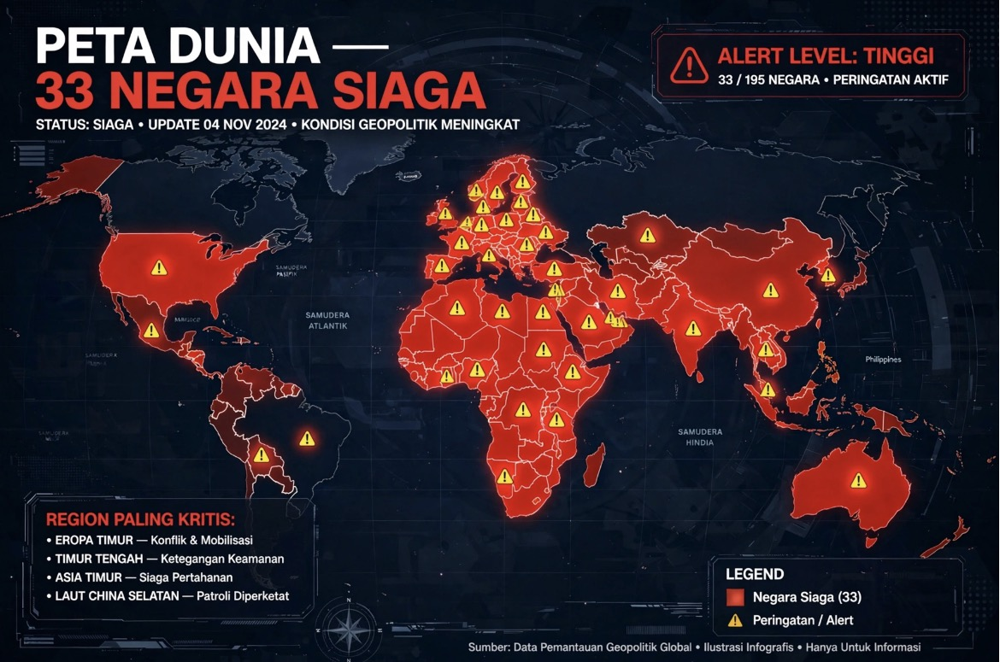

# 33 Negara Mengeluarkan Imbauan Stok Makanan di Tengah Eskalasi Ketegangan AS-Iran

*Ilustrasi (pic: Meta AI).*

  
***Dunia memang sedang meningkatkan kesiapsiagaan menghadapi risiko yang makin beragam. Tetapi kesiapsiagaan bukan bukti bahwa pemerintah mengetahui tanggal dimulainya perang***
  

33 negara yang mengeluarkan imbauan berasal dari kompilasi panduan darurat nasional yang diterbitkan pada waktu berbeda, bukan satu perintah global yang diumumkan serentak. Kebanyakan menyarankan persediaan untuk 72 jam, sementara beberapa negara menganjurkan sekitar satu minggu atau lebih.

Ini bukan khayalan media sosial. Associated Press melaporkan bahwa pejabat AS secara tertutup telah memperingatkan sejumlah negara Timur Tengah tentang kemungkinan serangan baru terhadap Iran setelah pemilu sela AS, serta risiko pembalasan Iran terhadap fasilitas energi dan infrastruktur penting.

Jadi, dua hal itu terjadi dalam konteks geopolitik yang sama-sama tegang, tetapi belum ada bukti bahwa imbauan kesiapsiagaan 33 negara merupakan respons terkoordinasi terhadap satu rencana serangan Iran.

## Dari Mana Angka 33 Negara itu Berasal?

Angka tersebut berasal dari pemetaan media Newsweek yang menggabungkan panduan kesiapsiagaan dari berbagai negara. Bukan pengumuman bersama dari 33 pemerintah.

Di Inggris kampanye Be Ready diluncurkan pada 22 Oktober 2026, meminta rumah tangga menyiapkan kebutuhan dasar untuk gangguan layanan hingga tiga hari. Pemerintah menyebut cuaca ekstrem, gangguan listrik, air, telepon, dan internet sebagai konteksnya.

Sedangkan Amerika Serikat: panduan FEMA/Ready.gov sudah lama menganjurkan persediaan makanan dan air untuk setidaknya tiga hari. Tidak ditemukan pengumuman baru yang meminta warga Amerika menimbun persediaan khusus untuk perang Iran.

Sementara Jepang melakukan imbauan kesiapsiagaan terbaru terkait risiko gempa besar dan bencana alam, bukan pengumuman bahwa perang Iran akan segera meluas ke Jepang.

Ada pula perbedaan makna yang penting: emergency supplies berarti persediaan darurat yang wajar, sedangkan stockpiling sering memberi kesan penimbunan besar-besaran. Terjemahan yang sensasional dapat membuat anjuran sederhana terdengar seperti mobilisasi menjelang perang dunia.

## Apakah Ancaman Iran itu Nyata?

Ya, risiko eskalasi militer memang nyata. AP melaporkan bahwa pejabat AS secara tertutup memperingatkan beberapa negara Timur Tengah tentang kemungkinan serangan baru terhadap Iran setelah pemilu sela 3 November, serta risiko pembalasan terhadap fasilitas energi dan infrastruktur penting. Trump belum mengambil keputusan final menurut sumber yang dikutip AP.

Laporan The National pada 3 November juga mencatat sejumlah negara Timur Tengah meningkatkan kesiapsiagaan, termasuk latihan darurat dan pengamanan fasilitas strategis, di tengah kekhawatiran konflik AS-Iran kembali meluas. Namun, langkah-langkah itu berbeda dari panduan persediaan rumah tangga yang dihimpun dalam daftar 33 negara.

Artinya, kita punya dua bukti yang berbeda:
Ada risiko konflik regional yang membuat pemerintah dan militer memperkuat kesiapsiagaan.
Ada panduan persediaan darurat untuk masyarakat sipil yang diterbitkan dengan alasan dan jadwal berbeda-beda.
Menggabungkan keduanya menjadi klaim bahwa semua negara sedang mempersiapkan warganya untuk perang Iran adalah lompatan kausal yang belum dibuktikan.

## Bagaimana dengan Pentagon yang Menyiapkan Pangkalan untuk 90 Hari?

Ini bagian yang paling mudah disalahartikan.

Menteri Pertahanan AS Pete Hegseth dilaporkan meluncurkan inisiatif FORTRESS pada 30 September 2026, dengan sasaran agar lebih banyak pangkalan militer mampu beroperasi mandiri hingga 90 hari jika pasokan dari luar terputus. Fokusnya mencakup energi, rantai pasok, cadangan material, dan ketahanan fasilitas militer.

Tetapi ada perbedaan mendasar:
- Pangkalan militer: dirancang untuk tetap menjalankan operasi dalam kondisi konflik dan gangguan rantai pasok.
- Rumah tangga sipil: menyiapkan kebutuhan dasar agar dapat bertahan selama layanan publik terganggu.
- Persiapan perang tertentu: memerlukan bukti bahwa tindakan tersebut memang ditujukan untuk menghadapi konflik spesifik.

Kesiapan militer selama 90 hari tidak berarti pemerintah memerintahkan warga menimbun makanan selama tiga bulan. Menggabungkan dua kebijakan tersebut menjadi satu peringatan perang global adalah kesalahan kategori.

Sejumlah pemerintah memang benar menganjurkan kesiapsiagaan rumah tangga, dan risiko konflik AS-Iran memang serius, serta ada persiapan militer dan pengamanan infrastruktur di tengah risiko eskalasi regional.

Namun belum terbukti sebanyak 33 negara mengeluarkan peringatan serentak karena mengetahui serangan besar terhadap Iran akan segera terjadi. Apalagi sampai mengumumkan persiapan untuk pemadaman listrik global atau perang dunia yang telah dijadwalkan.

## Apakah Diterapkan di Indonesia Juga?

Tidak perlu panik atau memborong supermarket. Kesiapsiagaan sederhana tetap masuk akal, terlepas dari konflik Iran: air minum, makanan tahan lama secukupnya, obat rutin, lampu senter, baterai, pengisi daya, uang tunai seperlunya, dan dokumen penting. Tujuannya agar rumah tangga tidak langsung lumpuh jika terjadi banjir, pemadaman, gangguan distribusi, atau bencana lokal.

Yang perlu kita pantau dalam konteks Iran adalah perkembangan operasi militer, status pelayaran Selat Hormuz, peringatan resmi pemerintah Indonesia, serta dampaknya terhadap harga energi dan rantai pasok. Indikator-indikator itu jauh lebih informatif daripada menghitung berapa banyak negara yang muncul dalam satu peta viral.

Dunia memang sedang meningkatkan kesiapsiagaan menghadapi risiko yang makin beragam. Tetapi kesiapsiagaan bukan bukti bahwa pemerintah mengetahui tanggal dimulainya perang. 

Jangan sampai fakta yang nyata dijahit dengan dugaan yang belum terbukti, lalu hasil jahitannya dijual sebagai ramalan kiamat. 

  
Referensi

1. Associated Press. (2026, October 29). US warns allies to prepare for possible Iran strikes, retaliation after elections, AP sources say. AP News⁠.

2. Cabinet Office. (2026, October 22). Households encouraged to take small, simple steps to stay prepared in an emergency. GOV.UK. Tautan resmi⁠.

3. Federal Emergency Management Agency. (n.d.). Recommended items to include in a basic emergency supply kit. Ready.gov. Daftar perlengkapan resmi⁠.

4. Hendawi, H. (2026, November 3). Drills and nuclear warnings as climate of uncertainty shrouds Middle East. The National. Tautan artikel⁠.

5. CNBC Indonesia. (2026, November 2). Pemerintah 33 negara siaga darurat, warga diminta stok makanan-air. Tautan artikel⁠.
