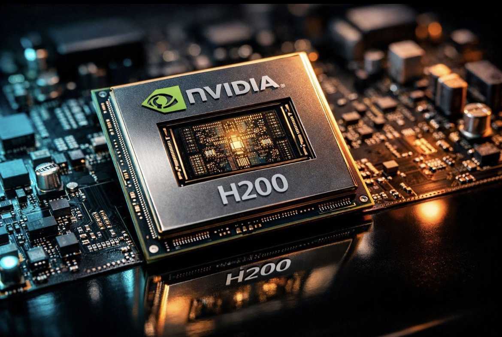

# 900 Ribu Chip AI untuk China: Washington Menjual Teknologi yang Sedang Berusaha Dibatasi?

*(pic: lanaturaleza.co.*

  
***Chip AI hari ini bukan lagi sekadar barang dagangan. Ia adalah kapasitas industri, kekuatan ekonomi, kemampuan intelijen, dan potensi kekuatan militer***
  

Angka 879.868 chip itu berasal dari dokumen resmi Komite Urusan Luar Negeri DPR Amerika Serikat yang dibuka kepada publik pada 19 November 2026.

Tetapi ada satu koreksi penting: angka tersebut adalah izin ekspor yang disetujui, bukan bukti bahwa seluruh 879.868 chip sudah dikirim dan diterima perusahaan China.

Dan yang lebih menarik, persetujuan itu bukan keputusan mendadak setelah skandal Jensen Huang, bukan pula keputusan baru setelah pertemuan APEC. Jejak kebijakannya sudah dimulai sejak Desember 2025. Skandal terbaru justru membuat keputusan lama itu kembali menjadi bom politik di Washington.

Mari kita bedah. Sebab ini bukan sekadar perdagangan semikonduktor. Ini menyangkut kontradiksi besar dalam strategi Amerika: membendung kebangkitan teknologi China sambil tetap membuka keran penjualan teknologi yang dibutuhkan China.

## Apa Sebenarnya yang Disetujui Amerika?

879.868 chip AI, melalui 21 permohonan lisensi yang disetujui. Dokumen Komite Urusan Luar Negeri DPR AS menyebut bahwa hingga 11 Mei 2026, Bureau of Industry and Security (BIS), lembaga di bawah Departemen Perdagangan AS, telah menyetujui ekspor, ekspor ulang, atau transfer domestik atas 879.868 chip ke perusahaan yang berkaitan dengan China.

Persetujuan bukan angka pengiriman aktual. Tidak seluruh permohonan yang disetujui otomatis berujung pada pengiriman.

Beberapa alokasi yang disebut dalam dokumen:

| Perusahaan China | Chip yang disetujui |
|:-----|:------:|
|Alibaba dan anak perusahaan|75.000|
|Tencent dan anak perusahaan|150.000|
|Baidu|43.000|
|BYD|4.000|

Keempat perusahaan tersebut masuk daftar perusahaan China yang diidentifikasi Departemen Pertahanan AS memiliki hubungan dengan militer China. 

Itu bukan berarti setiap chip yang dibeli otomatis digunakan untuk kepentingan militer, tetapi jelas meningkatkan pertanyaan mengenai risiko penggunaan ganda (dual-use).

## Chip Apa yang Dijual? Ini Bukan Semikonduktor Biasa

Nvidia H200, GPU akselerator AI kelas tinggi dari keluarga Hopper, Dan AMD Instinct MI325X yaitu Akselerator AI untuk pelatihan dan inferensi model skala besar.

Keduanya bukan chip konsumen untuk laptop atau ponsel. Mereka digunakan untuk komputasi intensif:
- Melatih model AI berskala besar.
- Menjalankan inferensi model AI.
- Memproses data dalam jumlah sangat besar.
- Mengembangkan sistem komputasi berperforma tinggi.
- Mendukung riset dan aplikasi teknologi yang juga dapat memiliki kegunaan militer.

H200 merupakan produk berperforma tinggi, tetapi bukan generasi paling mutakhir Nvidia. Di sinilah letak strategi ekspor AS: membolehkan China memperoleh produk yang cukup kuat untuk menjadi pelanggan, tetapi berusaha menjaga jarak antara kemampuan komputasi China dan teknologi paling maju yang tersedia bagi Amerika.

Dengan kata lain, Washington mencoba mengendalikan tingkat akses, bukan menghentikan seluruh perdagangan.

## Kronologi: Bukan Akibat APEC, Bukan Pula Reaksi Spontan terhadap Skandal

Perhatikan urutannya.
- 8 Desember 2025: Trump membuka pintu
Trump mengumumkan bahwa Nvidia boleh menjual H200 kepada pelanggan China yang disetujui, dengan syarat tertentu. Ini merupakan perubahan arah dari pembatasan era Biden.
- 13 Januari 2026: aturan teknis diterbitkan
Departemen Perdagangan AS mengubah kebijakan peninjauan lisensi dari praduga penolakan menjadi pemeriksaan kasus per kasus untuk H200, MI325X dan chip sejenis, jika syarat keamanan dipenuhi.
- Desember 2025 sampai Mei 2026: proses persetujuan
BIS memproses permohonan ekspor. Sampai 11 Mei, 879.868 chip telah memperoleh persetujuan.
- 19 November 2026: data dibuka ke publik
Ketua Komite Urusan Luar Negeri DPR, Brian Mast, menggunakan kewenangannya berdasarkan Export Control Reform Act untuk mengungkap informasi lisensi yang biasanya bersifat rahasia.
- 20 November 2026: kontroversi melebar
Menteri Keuangan Scott Bessent mengatakan tidak diperlukan pembatasan tambahan atas chip Nvidia yang lebih lama. Pernyataan ini muncul setelah pengungkapan data dan meningkatnya sorotan terhadap persoalan akses teknologi China.

Jadi, jawabannya:
- Bukan keputusan setelah APEC. Persetujuan yang diungkap mencakup periode Desember 2025 sampai Mei 2026.
- Bukan keputusan yang dibuat setelah skandal terbaru. Kebijakan dan proses lisensinya sudah berjalan sebelumnya.
- Skandal menjadi pemicu sorotan baru, karena publik dan Kongres mulai mempertanyakan siapa yang mengawasi aliran teknologi strategis ini.

Ada perbedaan antara waktu keputusan dibuat, waktu persetujuan diberikan, dan waktu informasi tersebut diumumkan. Tiga hal ini jangan dicampur.

## Ada Hubungan dengan Skandal Jensen Huang?

Pemberitaan Reuters dan AP pada 19–20 November mengaitkan kontroversi ekspor chip ini dengan skandal yang melibatkan Jensen Huang, mantan CEO Nvidia, dan seorang eksekutif perempuan yang dikaitkan dengan perusahaan Singapura bernama Megaspeed.

Perempuan tersebut dilaporkan diduga memiliki hubungan dengan intelijen China. Ada pula dugaan bahwa Megaspeed menjadi jalur yang memungkinkan perusahaan China mengakses komputasi dari chip Nvidia yang ditempatkan di luar China.

Namun, tuduhan spionase itu belum boleh diperlakukan sebagai fakta hukum yang sudah terbukti.

Ada dua isu yang berhubungan, tetapi tidak identik:
- Persetujuan ekspor resmi: Pemerintah AS memberikan lisensi kepada perusahaan untuk mengekspor chip kepada pelanggan tertentu.
- Dugaan pengalihan atau akses tidak langsung: Teknologi Nvidia diduga bisa dimanfaatkan perusahaan China melalui perusahaan perantara atau pusat data di luar China.

Isu kedua justru membuat persoalan semakin rumit. Melarang chip masuk langsung ke China tidak otomatis mencegah perusahaan China menggunakan chip yang berada di Singapura, Indonesia, Malaysia, atau negara lain melalui layanan komputasi jarak jauh.

AP melaporkan bahwa skandal Megaspeed dan dugaan akses jarak jauh tersebut memicu pemeriksaan lebih ketat terhadap celah kontrol ekspor.

## Mengapa Amerika Mengizinkan Penjualan kalau China Dianggap Ancaman Strategis?

Nah, ini inti kontradiksi geopolitiknya. Ada setidaknya empat kepentingan yang saling bertabrakan.

A. Kepentingan bisnis Nvidia dan AMD

China adalah pasar teknologi yang sangat besar. Jika Nvidia sepenuhnya kehilangan pasar China, perusahaan China punya insentif lebih kuat untuk mempercepat pengembangan alternatif domestik, terutama dari Huawei dan produsen chip lokal lainnya.

Dari perspektif perusahaan Amerika, penjualan chip yang masih diizinkan berarti:
- Pendapatan tetap masuk.
- Ekosistem perangkat lunak Nvidia tetap digunakan.
- Pelanggan China masih memiliki ketergantungan pada teknologi Amerika.
- Amerika mempertahankan pengaruh dalam rantai pasok AI global.

Ini bukan sekadar menjual barang. Ini juga mempertahankan posisi dominan dalam ekosistem teknologi.

B. Strategi controlled interdependence

Amerika tidak selalu ingin memutus hubungan ekonomi dengan China. Washington dapat memilih mempertahankan ketergantungan tertentu, tetapi mengontrol teknologi yang dianggap paling strategis.

Logikanya:
- Chip kelas tertentu boleh dijual.
- Chip paling mutakhir dibatasi.
- Pelanggan harus melalui pemeriksaan.
- Penggunaan dan kapasitas komputasi harus diawasi.
- Akses tidak langsung melalui pusat data luar negeri harus ditutup.

Masalahnya, strategi ini hanya efektif apabila pengawasan benar-benar mampu mengikuti perkembangan teknologi dan jaringan perusahaan internasional.

C. Pendapatan industri versus keamanan nasional

Di sinilah konflik kepentingan pemerintah dan industri terlihat. Departemen Perdagangan dapat memandang lisensi sebagai perdagangan yang masih dapat dikendalikan melalui persyaratan teknis.

Sementara sebagian anggota Kongres dan kalangan keamanan nasional melihat persetujuan tersebut sebagai risiko strategis.

Ketua Komite Urusan Luar Negeri DPR Brian Mast bahkan mempertanyakan mengapa persetujuan diberikan kepada perusahaan yang tercantum dalam daftar perusahaan militer China.

Mantan pejabat keamanan nasional AS Chris McGuire juga mempertanyakan apakah Departemen Perdagangan melakukan pemeriksaan keamanan nasional yang memadai.

D. China bisa mendapatkan teknologi tanpa harus menjadi sekutu Amerika

Ini bagian yang agak pahit bagi Washington.
China tidak perlu memiliki hubungan politik yang harmonis dengan Amerika untuk membeli teknologi Amerika. Selama lisensi diberikan, perusahaan China dapat memperoleh akses terhadap kemampuan komputasi yang sangat penting bagi pengembangan AI.

Dan kemampuan komputasi itu memiliki nilai strategis yang melampaui industri teknologi sipil.

Amerika ingin China tidak menjadi terlalu kuat, tetapi perusahaan Amerika juga tidak ingin China menjadi pasar yang sepenuhnya hilang.
Itulah konflik antara national security dan corporate interest.

## Apakah 900 ribu Chip ini Akan Memperkuat Militer China?

Jawabannya: berpotensi, tetapi jangan menyimpulkan bahwa seluruh chip tersebut akan masuk ke militer China.

Ada konsep penting dalam kajian keamanan teknologi, yaitu dual-use technology.

Teknologi yang sama dapat digunakan untuk:

| Penggunaan sipil | Potensi penggunaan militer |
|:-----|:------:|
|Pelatihan model AI|Analisis intelijen|
|Pengenalan gambar|Pengawasan dan identifikasi target|
|Simulasi komputasi|Simulasi sistem persenjataan|
|Analisis data besar|Analisis medan operasi|
|Optimasi logistik|Perencanaan logistik militer|
|Robotika|Sistem otonom militer|

Namun, kemampuan chip bukan satu-satunya faktor penentu. Hasil akhirnya juga bergantung pada model AI, perangkat lunak, data, infrastruktur, organisasi, dan cara teknologi itu digunakan.

Daftar perusahaan militer China yang disebut Pentagon merupakan indikator risiko, bukan bukti bahwa seluruh pembelian mereka ditujukan untuk kepentingan militer.

## Kontradiksi Paling Besar: Amerika Sedang Membendung China atau Sedang Membiayai Kompetitornya?

Kebijakan ini memperlihatkan tiga lapisan strategi yang tidak selalu konsisten:

Lapisan pertama: pemerintah ingin mempertahankan keunggulan teknologi. Amerika tidak ingin China memperoleh akses tanpa batas ke komputasi AI paling canggih.

Lapisan kedua: industri ingin mempertahankan pasar.
Nvidia dan AMD memiliki kepentingan komersial yang sangat besar dalam mempertahankan pelanggan global, termasuk China.

Lapisan ketiga: pemerintah membutuhkan kendali atas rantai pasok.
Amerika tidak hanya mengendalikan ekspor chip, tetapi juga berusaha mengendalikan desain, perangkat lunak, manufaktur, peralatan produksi, dan akses komputasi.

Masalahnya, semakin kompleks rantai pasok global, semakin sulit pula memastikan bahwa sebuah chip hanya digunakan oleh pihak yang tercantum dalam lisensi.

Ada pelajaran penting dari kasus Megaspeed: pengawasan ekspor tidak cukup hanya memeriksa siapa pembeli pertama. Pemerintah juga harus memahami siapa pengguna akhir, siapa yang mengendalikan pusat data, siapa yang memperoleh akses jarak jauh, dan siapa yang akhirnya menikmati kemampuan komputasinya.

Bukan Skandal Angka Semata, Melainkan Masalah Konsistensi Kebijakan

Saya melihat tiga persoalan besar:
- Inkonsistensi strategi: Amerika menyebut China sebagai pesaing strategis, tetapi tetap mengizinkan ekspor chip AI berkemampuan tinggi kepada sejumlah perusahaan yang memiliki risiko hubungan dengan sektor militer.
- Kelemahan pengawasan: persetujuan ekspor belum menjamin kontrol terhadap penggunaan akhir, terutama jika akses komputasi dapat dilakukan dari luar negeri.
- Konflik kepentingan ekonomi dan keamanan: keuntungan industri teknologi Amerika dapat berhadapan langsung dengan tujuan keamanan nasional pemerintahnya sendiri.

Tetapi kita juga harus adil terhadap data: 879.868 adalah jumlah yang memperoleh persetujuan lisensi, bukan jumlah yang terbukti sudah dikirim. 

Nvidia menyatakan pengiriman H200 ke China telah dihentikan meskipun beberapa lisensi sebelumnya telah diberikan. AMD menyatakan mematuhi peraturan ekspor AS.

Amerika sedang mencoba mengatur seberapa cepat China boleh maju dalam AI, tetapi mekanisme pengaturannya sendiri terbelah antara kepentingan industri, kepentingan politik, dan kepentingan keamanan nasional.

Trump menghendaki perdagangan yang menguntungkan Amerika. Pentagon ingin mencegah teknologi strategis memperkuat pesaing. Nvidia ingin mempertahankan pasar. Kongres ingin memastikan pemerintah tidak memberikan terlalu banyak akses.
Keempat kepentingan itu tidak selalu berjalan searah.

Dan satu hal yang menarik: skandal personal seorang eksekutif dapat membuka persoalan yang jauh lebih besar daripada kehidupan pribadinya, yaitu apakah negara mampu mengawasi perusahaan teknologi yang produknya telah menjadi infrastruktur kekuatan geopolitik.

Chip AI hari ini bukan lagi sekadar barang dagangan. Ia adalah kapasitas industri, kekuatan ekonomi, kemampuan intelijen, dan potensi kekuatan militer.

  
**Referensi**

Reuters. (2026, November 19). US signed off on sales of nearly 900,000 AI chips to China in six months, House committee says. Reuters⁠.

U.S. House Committee on Foreign Affairs. (2026, November 19). House Foreign Affairs Committee ECRA Disclosure. Dokumen resmi⁠.

U.S. Department of Commerce, Bureau of Industry and Security. (2026, January 13). Department of Commerce revises license review policy for semiconductors exported to China. BIS⁠.

Associated Press. (2026, November 20). Treasury secretary says no further restrictions are needed for Nvidia chip exports to China. AP⁠.

Al Jazeera. (2026, November 19). US signed off on sales of nearly 900,000 AI chips to China in six months. Al Jazeera⁠.
