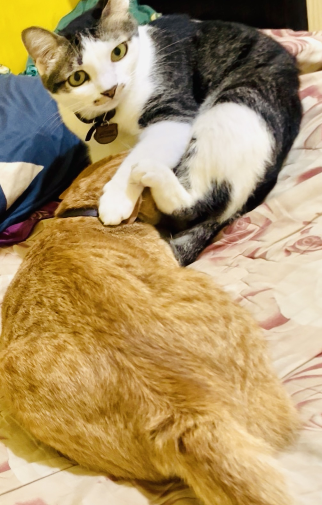

# Ahong dan BotBot, Ketika Naluri Bayi Menetap Sampai Dewasa 

*Ahong menyusu pada BotBot jantan (Pic: Rita Mf Jannah)*

  
***Ahong kehilangan induk biologisnya, tetapi kemudian memiliki BotBot yang bersedia menjadi bagian penting dari kehidupan sosialnya***
  

Ahong sudah tumbuh menjadi pejantan oren berbadan besar, tetapi urusan administrasi emosionalnya masih tercatat sebagai bayi yang belum lulus menyusu kepada BotBot.

Bayangkan BotBot sedang rebahan dengan wajah pasrah, sementara Ahong datang membawa seluruh berat badannya, lalu mulai menyusu. Ini bukan sekadar tingkah lucu, ada penjelasan perilaku dan neurobiologi yang menarik di baliknya.

Kita bedah, ya. Karena perilaku Ahong ini punya hubungan dengan naluri menyusu, pembentukan ikatan sosial, dan mekanisme menenangkan diri pada mamalia. 

## Ahong Melakukan Non-Nutritive Suckling

Dalam ilmu perilaku hewan, perilaku mengisap tanpa memperoleh nutrisi disebut non-nutritive suckling. Artinya, gerakan menyusu tetap dilakukan meskipun tujuannya bukan lagi mendapatkan susu.

Pada anak kucing, menyusu bukan cuma aktivitas makan. Ia juga merupakan bagian dari pengalaman awal yang melibatkan:
- Kontak fisik dengan induk.
- Kehangatan tubuh.
- Aroma dan sentuhan yang familier.
- Rasa nyaman ketika berada dekat figur pengasuh.
- Pola gerakan mengisap yang berulang.

Setelah kebutuhan nutrisi berubah dan anak kucing disapih, sebagian individu masih mempertahankan pola perilaku tersebut. Bahkan, mereka dapat mengarahkannya kepada benda lunak, selimut, manusia, saudara sekandung, atau kucing lain.

MSD Veterinary Manual menjelaskan bahwa penyapihan kucing biasanya berlangsung sekitar usia 5–8 minggu, tetapi sebagian kucing masih menyusu jauh setelah periode itu. 

Pada fase lebih lanjut, perilakunya kemungkinan lebih berkaitan dengan interaksi sosial daripada kebutuhan nutrisi.

Jadi, Ahong bukan sedang lupa bahwa dirinya sudah dewasa. Ia mempertahankan suatu pola perilaku yang dahulu memiliki fungsi biologis dan sosial.

## Mengapa BotBot yang Menjadi Sasaran?

Nah, bagian ini menarik.

Ahong tidak memilih sembarang benda. Ia menyusu kepada individu yang memiliki hubungan sosial dengannya, yaitu BotBot.

Kita tahu BotBot bukan induk biologis Ahong. Namun, dalam kehidupan sosial mamalia, fungsi pengasuhan tidak selalu harus dilakukan oleh induk biologis. Individu lain dapat menjadi sumber kontak, perlindungan, dan interaksi sosial.

BotBot mungkin menyediakan beberapa hal yang membuat Ahong nyaman:

Pertama, familiaritas. Aroma tubuh dan kehadiran BotBot sudah dikenal Ahong sejak kecil. Rangsangan yang familier cenderung lebih mudah diasosiasikan dengan pengalaman positif.

Kedua, kontak sosial. Kedekatan tubuh dan sentuhan merupakan bagian dari perilaku afiliatif pada kucing. Kucing yang memiliki hubungan baik dapat mencari kontak, tidur berdekatan, menggosokkan tubuh, dan saling menjilati.

Ketiga, regulasi emosi. Gerakan mengisap yang berulang mungkin berfungsi sebagai perilaku menenangkan diri. Dalam literatur perilaku kucing, kebiasaan mengisap dapat bertahan hingga dewasa dan diarahkan kepada kucing lain maupun benda. 

Mekanisme spesifik yang membuat setiap individu merasa nyaman belum sepenuhnya dipahami, jadi kita tidak perlu menganggap semua kucing melakukannya karena alasan psikologis yang persis sama.

Dengan kata lain, BotBot mungkin telah menjadi semacam social comfort object bagi Ahong, tetapi dalam bentuk makhluk hidup yang bisa menjilat balik dan sesekali mengeluarkan jurus cakaran. 

## Apakah ini Akibat Ahong Kehilangan Induk?

Ini hipotesis yang masuk akal, tetapi perlu dibedakan dari fakta yang sudah terbukti. Ahong memiliki riwayat kehilangan induk biologis dan kemudian tumbuh dengan BotBot jantan sebagai figur pengasuh. Pengalaman awal tersebut mungkin ikut membentuk pola keterikatannya.

Penelitian pada 5.726 kucing dari 40 ras menemukan bahwa penyapihan sebelum usia delapan minggu berkaitan dengan peningkatan risiko perilaku agresif tertentu. 

Penelitian itu juga menemukan hubungan antara usia penyapihan dan sejumlah perilaku repetitif, termasuk wool sucking. Namun, penelitian tersebut berbasis survei, bukan eksperimen yang membuktikan bahwa kehilangan induk menyebabkan seekor kucing terus menyusu kepada kucing lain.

Jadi, kita tidak bisa menyimpulkan bahwa Ahong pasti menyusu kepada BotBot karena trauma kehilangan induk.

Penjelasan yang lebih hati-hati adalah: pengalaman awal Ahong mungkin berkontribusi terhadap terbentuknya perilaku tersebut, sementara hubungan sosialnya dengan BotBot membuat perilaku itu terus dipertahankan.

Dan ada satu hal yang perlu kita garis bawahi: perilaku Ahong tidak otomatis menunjukkan gangguan psikologis. Perilaku yang tidak biasa bagi manusia belum tentu abnormal bagi kucing.

## Mengapa Kebiasaan itu Tidak Hilang Ketika Ahong Dewasa?

Perilaku tidak selalu menghilang ketika fungsi awalnya sudah tidak diperlukan. Ada konsep dalam ilmu perilaku yang disebut behavioral persistence, yaitu bertahannya suatu pola perilaku karena masih memiliki fungsi atau konsekuensi yang menguntungkan bagi individu.

Misalnya:
- Ahong mendekati BotBot.
- Ahong mulai menyusu.
- BotBot tetap berada di tempat dan membiarkannya.
- Ahong memperoleh kontak fisik yang familier dan pengalaman yang mungkin menenangkan.
- Perilaku tersebut terus diulang.

Ini bukan berarti Ahong secara sadar membuat keputusan, “Aku sudah besar, tetapi aku tetap ingin menjadi bayi.”  Perilaku itu bisa bertahan karena tidak ada alasan kuat bagi sistem perilakunya untuk menghentikannya.

Menariknya, studi tentang perilaku menyusu pada kucing juga menemukan bahwa kebiasaan mengisap dapat diarahkan kepada individu lain, bukan hanya kain atau benda. Jadi, Ahong bukan satu-satunya kucing yang memiliki kebiasaan semacam ini. 

## Apakah BotBot Menganggap Ahong sebagai Anaknya?

Kita harus berhati-hati menggunakan istilah “menganggap sebagai anak”. Kita tidak dapat mengetahui secara langsung bagaimana BotBot mengategorikan hubungan tersebut dalam pikirannya.

Namun, kita bisa membaca perilaku sosialnya.
- BotBot membiarkan Ahong mendekat dan menyusu, itu menunjukkan toleransi terhadap kontak tersebut.
- BotBot juga menjilati Ahong, tidur berdekatan, atau mencari kontak dengannya, itu menjadi petunjuk tambahan tentang hubungan afiliatif.
- BotBot sesekali menyentil Ahong, itu tidak otomatis berarti ia menolak hubungan mereka. Kucing menggunakan berbagai perilaku untuk mengatur jarak dan interaksi sosial.

Jadi, BotBot bisa menjadi figur pengasuh sosial bagi Ahong tanpa harus kita anggap memiliki konsep keibuan seperti manusia.

Dan jangan lupakan satu detail: BotBot adalah kucing jantan. Ia tidak menghasilkan susu seperti induk betina yang sedang laktasi. Ahong melakukan gerakan menyusu sebagai perilaku sosial, bukan sedang mendapatkan asupan susu dari BotBot.

## Kapan Perilaku ini Perlu Dihentikan?

Ahong menyusu dengan santai, BotBot membiarkannya, dan tidak ada luka atau gangguan, biasanya tidak perlu dipaksa berhenti.

Perhatikan beberapa hal:
| Kondisi | Maknanya |
|:-----|:------:|
|BotBot tetap rileks dan tidak berusaha menjauh|Kemungkinan toleransi yang baik|
|BotBot menjilati Ahong setelahnya|Petunjuk tambahan hubungan afiliatif|
|Kulit BotBot menjadi merah, basah, iritasi, atau luka|Perlu membatasi perilaku|
|Ahong menggigit, mencabuti, atau menelan bulu|Perlu intervensi dan evaluasi|
|BotBot menggeram, telinga mendatar, ekor menghentak, atau terus mencoba kabur|BotBot sedang menunjukkan ketidaknyamanan|

Jangan memarahi Ahong. Jika mulai mengganggu BotBot, alihkan dengan lembut menggunakan permainan atau aktivitas lain. Jangan pula memaksa BotBot menerima perilaku tersebut.

Ahong besar secara fisik, tetapi masih membawa kebiasaan masa kecilnya. Penjelasan paling masuk akal adalah kombinasi tiga hal:
- Retensi perilaku menyusu: pola mengisap yang terbentuk sejak masa kitten masih bertahan.
- Ikatan sosial: BotBot menjadi individu yang familier dan menerima kontak Ahong.
- Fungsi menenangkan diri: menyusu mungkin memberikan pengalaman sensoris dan emosional yang menyenangkan bagi Ahong.

Kita tidak bisa memastikan satu faktor sebagai penyebab tunggal. Namun, perilaku ini memang dikenal dalam dunia feline behavior dan tidak otomatis merupakan kelainan.

Ada satu hal yang membuat kisah mereka menarik secara biologis: Ahong kehilangan induk biologisnya, tetapi kemudian memiliki BotBot yang bersedia menjadi bagian penting dari kehidupan sosialnya. Kita tidak perlu menyebut BotBot ibu dalam pengertian biologis untuk mengakui bahwa hubungan mereka istimewa.

Ahong oh Ahong… usia boleh bertambah, badan boleh membesar, tetapi kontrak menyusu dengan BotBot rupanya belum memiliki tanggal kedaluwarsa.

  
**Referensi**

Ahola, M. K., Vapalahti, K., & Lohi, H. (2017). Early weaning increases aggression and stereotypic behaviour in cats. Scientific Reports, 7, 10412. https://doi.org/10.1038/s41598-017-11173-5⁠

Landsberg, G. M. (2025). Normal Social Behavior in Cats. MSD Veterinary Manual. Baca artikel⁠.

A survey-based assessment of risk factors for cross-sucking behaviors in neonatal kittens, Felis catus (2020). Baca penelitian⁠.

Social Behavior of Cats. Merck Veterinary Manual (2025). Baca artikel⁠.
