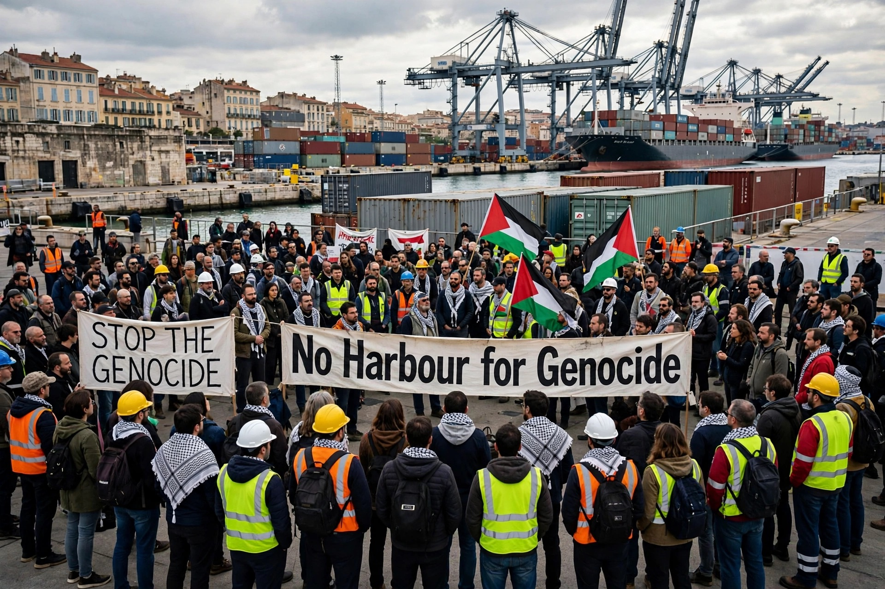

# Aksi Kampanye Buruh Pelabuhan Lintas Negara: Kami Tidak Mau Bekerja untuk Perang Israel

*Ilustrasi (pic: Grok AI).*

  
***Aksi Kampanye “No Harbour for Genocide” 30 Oktober ini adalah mobilisasi buruh lintas negara yang nyata menolak mengangkut senjata karena khawatir senjata itu digunakan untuk melanggar hukum humaniter***
  

Gerakannya bukan sekadar demonstrasi pro-Palestina di jalan, melainkan upaya menggunakan rantai pasok dan infrastruktur perdagangan global sebagai alat tekanan politik. Pelabuhan menjadi titik strategis karena barang, bahan baku, energi, dan komponen militer bergerak melewatinya.

Tapi ada tiga hal yang perlu kita bedah terpisah: apakah aksi serentak 113 pelabuhan itu benar-benar berlangsung, apakah targetnya memang kapal atau perusahaan yang terkait Israel, dan seberapa besar dampak ekonominya. 

Angka partisipasi dalam seruan aksi belum otomatis sama dengan jumlah pelabuhan yang benar-benar terblokade.

## Benarkah 113 Pelabuhan di 22 negara?

Ya, rencana aksi internasionalnya nyata dan sudah dikonfirmasi oleh beberapa sumber independen maupun organisasi buruh. 

Reuters melaporkan pada 29 Oktober bahwa lebih dari 25 serikat pekerja mendukung aksi di 113 pelabuhan yang tersebar di 22 negara. Namun, Reuters juga menegaskan bahwa jumlah pekerja yang benar-benar ikut dan tingkat gangguan operasional belum diketahui.

Ada perbedaan angka dalam pemberitaan yang perlu diperhatikan:

| Sumber | Cakupan yang dilaporkan |
|------|-------|
|Reuters, 29 Oktober|113 pelabuhan, 22 negara, lebih dari 25 serikat|
|International Transport Workers’ Federation (ITF), 28 Oktober|Lebih dari 100 pelabuhan, 17 negara|
|Fox News, 29 Oktober|Jaringan 106 organisasi, aksi direncanakan di 113 pelabuhan|

Angka tersebut tidak harus saling bertentangan. Mereka menghitung kategori berbeda: serikat pekerja, organisasi pendukung, negara, dan lokasi aksi. Angka 106 kelompok bukan berarti 106 serikat pekerja pelabuhan.

Satu koreksi penting: istilah blokade 113 pelabuhan agak terlalu dramatis jika dipakai untuk menggambarkan semua lokasi. 

Bentuk aksinya beragam: mogok kerja beberapa jam, penghentian bongkar muat, demonstrasi, aksi solidaritas, dan kegiatan di laut. Tidak semuanya berarti kapal benar-benar dicegah memasuki pelabuhan.

## Apa Sebenarnya yang Mereka Targetkan?

Kampanye No Harbour for Genocide secara eksplisit menargetkan aliran logistik yang dianggap menopang operasi militer Israel, terutama:
- Senjata dan amunisi.
- Bahan bakar untuk kebutuhan militer.
- Komponen militer dan barang dual-use, yaitu barang yang dapat digunakan untuk keperluan sipil maupun militer.
- Perusahaan pelayaran dan jaringan logistik yang secara konsisten mengangkut pasokan tersebut.

Kampanye ini mengelola daftar kapal yang menurut mereka terlibat dalam rantai pasokan itu. Mereka menyebut gerakannya dimulai pada musim panas 2024, termasuk kampanye terhadap kapal tanker Overseas Santorini yang membawa bahan bakar jet untuk Israel dan kemudian menghadapi penolakan di sejumlah pelabuhan Mediterania. 

Ini adalah penjelasan dari pihak pengorganisasi, bukan verifikasi independen atas setiap kapal yang masuk daftar mereka.

Jadi, sasaran utamanya bukan seluruh perdagangan Israel, apalagi semua kapal yang kebetulan berlayar menuju Israel. Fokus yang diumumkan adalah pengangkutan barang yang dinilai mendukung kegiatan militer.

## Mengapa Pelabuhan Menjadi Titik Tekanan yang Strategis?

Bayangkan rantai pasok militer sebagai sebuah sistem:
- Produsen senjata dan komponen (Pabrik, pemasok bahan baku, perusahaan pertahanan)
- Pengiriman dan ekspor (Pelabuhan dan terminal kargo) Bongkar muat, penyimpanan, pemeriksaan, pemindahan.
- Pelayaran internasional (Penerima dan pengguna akhir) Militer, kontraktor, atau pembeli lain.

Pelabuhan adalah simpul logistik. Jika pekerja menghentikan penanganan kargo tertentu, pengiriman dapat tertunda, biaya meningkat, dan perusahaan harus mencari jalur alternatif.

Tetapi ada tiga tingkatan dampak yang jangan dicampur:
- Gangguan lokal: satu terminal atau satu jenis kargo tertunda.
- Gangguan jaringan: beberapa pelabuhan dan perusahaan pelayaran harus mengubah jadwal serta rute.
- Dampak strategis: pasokan militer benar-benar terlambat atau berkurang sehingga memengaruhi kemampuan operasional penerima.

Tingkat pertama jauh lebih mudah terjadi daripada tingkat ketiga. Mogok sehari belum otomatis membuat pasokan militer Israel terputus.

Reuters menyebut penyelenggara memperkirakan aksi tersebut berpotensi mengganggu lebih dari 40% kargo Mediterania dan lebih dari US$2 miliar nilai pengiriman. Itu perkiraan penyelenggara, bukan kerugian yang sudah terbukti terjadi. Bahkan pelabuhan Genoa memperkirakan dampaknya terbatas.

## Mengapa Buruh Pelabuhan Ikut Terlibat?

Ini bagian yang paling menarik secara ilmu politik dan hubungan industrial. Biasanya, pekerja pelabuhan bernegosiasi mengenai upah, jam kerja, keselamatan, dan kondisi kerja. 

Dalam gerakan ini, mereka memperluas konsep tanggung jawab pekerja: apakah seseorang boleh menolak melakukan pekerjaan yang menurut keyakinannya ikut memfasilitasi pelanggaran hukum humaniter?
ITF, federasi internasional pekerja transportasi, secara terbuka mendukung aksi ini. 

Mereka menyebut tiga isu yang bertemu dalam gerakan tersebut:
- Solidaritas terhadap warga Palestina.
- Penolakan terhadap penggunaan pelabuhan sipil untuk pengangkutan persenjataan yang digunakan dalam perang.
- Persoalan domestik pekerja, termasuk upah, kondisi kerja, dan otomatisasi.

Dengan demikian, ini bukan sekadar aksi aktivis Palestina yang mengajak buruh ikut demonstrasi. Ada organisasi pekerja yang membawa agenda ketenagakerjaan mereka sendiri ke dalam gerakan solidaritas internasional.

Ada sejarah panjang di baliknya. Gerakan buruh pernah menggunakan mogok kerja untuk menentang apartheid di Afrika Selatan, perang, dan perdagangan senjata. 

Strateginya disebut labour internationalism: pekerja di berbagai negara menggunakan posisi mereka dalam sistem produksi dan distribusi untuk menekan keputusan politik.
Namun, jangan menganggap semua buruh pelabuhan di negara-negara itu mendukung aksi. Dukungan serikat tertentu tidak sama dengan dukungan seluruh pekerja, apalagi seluruh penduduk negara tersebut.

## Apakah Aksi ini Sah secara Hukum?

Kita perlu membedakan dua tindakan:

A. Mogok kerja dan demonstrasi. 

Ini berkaitan dengan hak berserikat, kebebasan berekspresi, dan hukum ketenagakerjaan nasional. Perlindungannya berbeda-beda di setiap negara. 

Ada negara yang mengakui mogok solidaritas dalam kondisi tertentu, sementara negara lain membatasi mogok yang tidak berkaitan langsung dengan perselisihan industrial.

B. Menghalangi kapal secara fisik

Ini persoalan hukum yang berbeda. Menutup akses pelabuhan, mengancam awak kapal, merusak properti, atau menghambat keselamatan navigasi dapat menimbulkan konsekuensi pidana dan perdata. Hak protes tidak otomatis memberikan hak untuk membahayakan orang atau menguasai fasilitas pelabuhan.

Ada pula persoalan yang lebih substantif: apakah negara dan perusahaan boleh memfasilitasi pengiriman senjata ketika ada risiko nyata bahwa senjata tersebut digunakan untuk melanggar hukum humaniter internasional? Di sini hukum internasional menjadi relevan. 

Perjanjian Perdagangan Senjata (Arms Trade Treaty/ATT), khususnya Pasal 6 dan 7, mengatur larangan dan penilaian risiko ekspor senjata bagi negara-negara pihak. Tetapi penerapannya bergantung pada status negara, jenis barang, dan fakta transaksi. Tidak setiap barang dual-use otomatis masuk kategori senjata dalam ATT.

Dengan kata lain, tuntutan agar pemerintah memeriksa atau menghentikan pengiriman senjata memiliki dasar hukum yang dapat diperdebatkan secara serius. Namun, itu tidak berarti setiap kapal yang dituduh membawa barang untuk Israel sudah terbukti melanggar hukum.

## Apakah ini Akan Mengguncang Ekonomi Israel?

Ada beberapa jalur dampak yang mungkin:

| Jalur dampak | Mekanisme |
|------|-------|
|Biaya logistik|Kapal menunggu, perusahaan mengubah rute, biaya meningkat|
|Risiko perusahaan|Operator menghadapi tekanan reputasi dan ketidakpastian layanan|
|Pasokan militer|Pengiriman tertentu bisa tertunda jika tidak ada jalur alternatif|
|Tekanan diplomatik|Pemerintah harus menjelaskan kebijakan ekspor dan penggunaan pelabuhan|
|Efek politik|Isu Palestina masuk ke ruang kerja dan agenda serikat buruh internasional|

Namun, Israel tidak hanya bergantung pada satu pelabuhan atau satu negara. Pengiriman dapat dialihkan melalui negara ketiga, pelabuhan lain, jalur udara, atau pemasok berbeda, tergantung jenis barang dan urgensinya.

Jadi, efektivitas jangka panjang tidak cukup diukur dari jumlah pelabuhan yang ikut mogok. Kita perlu melihat apakah pengiriman tertentu benar-benar tertunda, apakah perusahaan mengubah kebijakan, dan apakah pemerintah mengubah izin ekspor.

## Mengapa ini Penting Secara Geopolitik?

Ada satu perubahan menarik: tekanan terhadap kebijakan Israel tidak lagi hanya datang dari pemerintah, lembaga internasional, atau demonstrasi masyarakat sipil. Kini sebagian pekerja yang mengoperasikan infrastruktur perdagangan internasional ikut menggunakan posisi ekonominya.

Ini menciptakan tekanan dari bawah ke atas:
- Aktivis mengidentifikasi kapal dan jaringan pasokan.
- Serikat pekerja mengorganisasi penolakan penanganan kargo.
- Perusahaan pelayaran menghadapi risiko gangguan dan reputasi.
- Pemerintah mendapat tekanan untuk mengawasi ekspor senjata dan transit barang militer.

Namun, perlu dicatat bahwa gerakan ini juga mengandung perbedaan kepentingan. Serikat pekerja punya agenda ketenagakerjaan, kelompok Palestina punya agenda solidaritas, dan organisasi politik memiliki agenda masing-masing. Mereka dapat bekerja sama tanpa harus memiliki ideologi atau tujuan yang identik.

## Apa yang Perlu Dipantau Sepanjang 30 Oktober?

Karena sekarang masih pagi di Indonesia dan aksi berlangsung mengikuti waktu lokal setiap pelabuhan, angka final belum bisa disimpulkan. 

Empat indikator yang layak dipantau:
- Kehadiran pekerja: berapa banyak pelabuhan yang benar-benar mengalami penghentian kerja?
- Operasi kapal: apakah kapal tertahan, jadwal berubah, atau bongkar muat kargo militer dihentikan?
- Respons pemerintah: apakah ada intervensi polisi, pengadilan, atau otoritas pelabuhan?
- Dampak perusahaan: apakah perusahaan pelayaran mengubah kebijakan pengangkutan senjata atau hanya mengalihkan rute?

Aksi 30 Oktober ini adalah mobilisasi buruh lintas negara yang nyata, tetapi klaim bahwa 113 pelabuhan semuanya diblokade total belum terbukti. Arti pentingnya justru terletak pada strategi: mengubah posisi pekerja dalam rantai logistik global menjadi instrumen tekanan terhadap perdagangan persenjataan.

Dan ada satu pertanyaan besar yang paling menarik untuk kita perdebatkan: kalau pekerja pelabuhan menolak mengangkut senjata karena khawatir senjata itu digunakan untuk melanggar hukum humaniter, apakah penolakan itu merupakan tindakan politik yang mengganggu perdagangan, atau justru bentuk tanggung jawab moral dalam pekerjaan mereka?

Itu bukan pertanyaan kecil. Itu menyentuh batas antara netralitas pekerja, tanggung jawab korporasi, dan kewajiban negara dalam perang. 

  
**Referensi:**

1. Reuters. (2026, October 29). Dockworkers at more than 100 ports to strike against arms shipments on Friday. Reuters⁠.

2. International Transport Workers’ Federation. (2026, October 28). ITF stands firm with dockworkers’ solidarity action for peace and Palestinian rights. ITF⁠.

3. No Harbour for Genocide. (2026). Campaign, strategy and vessel blocklist. Campaign website⁠.

4. International Committee of the Red Cross. (2013). Arms Trade Treaty, Article 6: Prohibitions. ICRC treaty database⁠.

5. United Nations. (2013). The Arms Trade Treaty. UN Audiovisual Library of International Law⁠.

6. Anadolu Agency. (2026, October 29). Dockworkers in 22 countries to stage global action against arms trade. Anadolu Agency⁠.
