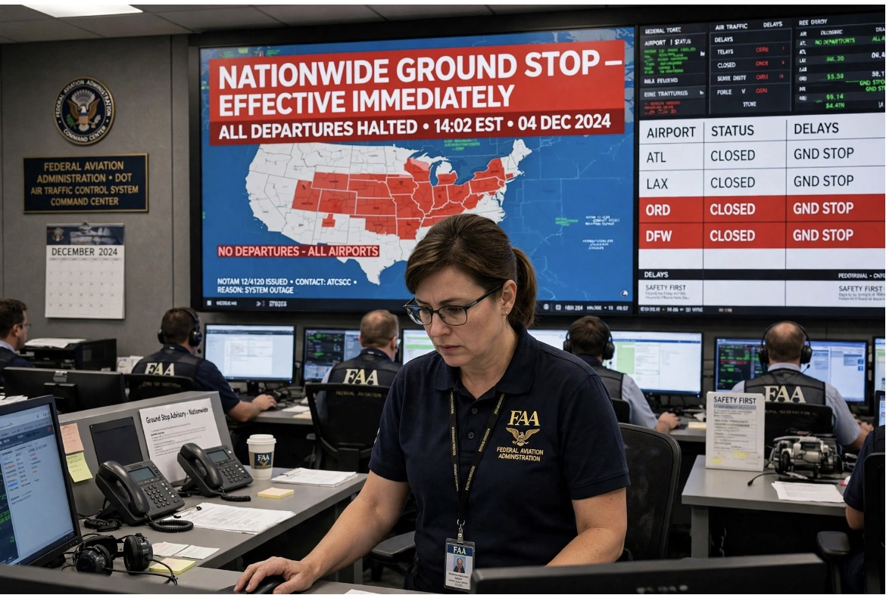

# Amerika Membumikan Pesawatnya Sendiri: Satu Router, Puluhan Ribu Penerbangan, dan Rapuhnya Infrastruktur Negara Adidaya

*Ilustrasi (pic: Grok AI).*

  
***Negara adidaya dapat memiliki kemampuan menghancurkan infrastruktur lawannya, tetapi tetap gagal menjaga infrastruktur kritisnya sendiri***
  

Kali ini Iran bahkan belum sempat dipanggil ke ruang interogasi, pesawat-pesawat Amerika sudah disuruh duduk manis di landasan.

Ketika infrastruktur strategis Amerika lumpuh, apakah refleks politiknya akan mencari musuh eksternal, atau berani memeriksa kegagalan teknologinya sendiri?

Peristiwa ini benar terjadi pada Jumat, 13 November 2026. FAA mengeluarkan nationwide ground stop setelah gangguan telekomunikasi memengaruhi komunikasi dan sebagian umpan radar di pusat pengendalian lalu lintas udara. Penghentian berlangsung lebih dari empat jam dan berdampak pada puluhan ribu penerbangan.

## Apa yang Sebenarnya Terjadi?

Kronologinya begini:
- 13 November, sekitar pukul 15.36 waktu Eastern: FAA mulai mendeteksi ketidakstabilan jaringan telekomunikasi.
- Gangguan memengaruhi komunikasi antara pengendali lalu lintas udara dan pesawat, serta sebagian data radar.
- FAA memberlakukan penghentian keberangkatan penerbangan secara nasional.
- Pesawat yang sudah berada di udara pada umumnya tetap diizinkan melanjutkan penerbangan dan mendarat dengan pengaturan keselamatan.
- Pukul 20.15 Eastern: pembatasan nasional dicabut setelah sistem dinyatakan cukup stabil untuk melanjutkan operasi.

Reuters melaporkan lebih dari 20.000 penerbangan terdampak gangguan sejak Jumat. Dampaknya berlanjut pada Sabtu karena pesawat, awak, dan jadwal penerbangan telah terlanjur berantakan.

Satu hal perlu diluruskan: bukan berarti seluruh pesawat yang sedang terbang dipaksa mendarat darurat. Ground stop terutama menghentikan keberangkatan dan mengendalikan arus penerbangan. Ini perbedaan teknis yang penting.

## Biang Keroknya: Sebuah Router yang Membuat Jaringan Tersedak

Ini bagian yang agak memalukan bagi negara dengan anggaran pertahanan dan teknologi raksasa.

Menurut Menteri Transportasi AS Sean Duffy, kontraktor pemerintah bernama L3Harris Technologies sedang melakukan pekerjaan pemutakhiran jaringan komunikasi FAA di lokasi terpencil.

Pekerjaannya tampak sederhana: mengganti jalur komunikasi lama berbasis kabel tembaga (copper) dengan serat optik (fiber). Tetapi dalam proses itu, sebuah router diduga menyebabkan banjir permintaan koneksi ke router-router lain.

Duffy menyebut angka yang mengerikan: lebih dari 1.000 upaya koneksi setiap empat sampai lima detik. Akibatnya, sistem komunikasi mengalami ketidakstabilan dan sebagian aliran data radar terganggu.

Mari kita sederhanakan mekanismenya:

- Rantai kegagalan teknis
Pemutakhiran jaringan
Kabel tembaga diganti fiber optik

- Router bermasalah
Permintaan koneksi membanjiri perangkat lain

- Gangguan komunikasi dan sebagian data radar
Pengendali kehilangan kestabilan informasi operasional

- FAA menerapkan nationwide ground stop
Keselamatan penerbangan diprioritaskan

Tetapi perhatikan kata yang digunakan pemerintah: diduga.

Pada konferensi pers 14 November, Duffy mengatakan penyelidikan belum menentukan apakah masalah berasal dari kesalahan pengguna, kesalahan instalasi kontraktor, atau perangkat router yang cacat.

Jadi, kita belum boleh mengunci kesimpulan bahwa satu router tertentu sudah terbukti menjadi penyebab final. Yang sudah diketahui adalah gangguan terjadi saat proses pemutakhiran dan router yang terlibat diduga membanjiri jaringan.

## Mengapa Kegagalan Satu Perangkat Bisa Melumpuhkan Penerbangan Nasional?

Sistem penerbangan modern bukan kumpulan pesawat yang bekerja sendiri-sendiri. Ia adalah jaringan infrastruktur yang saling bergantung:
- Radar dan sensor pengawasan.
- Sistem komunikasi pilot dan pengendali.
- Jaringan pertukaran data penerbangan.
- Pusat pengendalian lalu lintas udara.
- Sistem navigasi dan koordinasi antarfasilitas.

Pesawat mungkin memiliki instrumen navigasi sendiri, tetapi penerbangan komersial dalam ruang udara padat membutuhkan koordinasi dengan pengendali lalu lintas udara.

Jika komunikasi dan data pengawasan menjadi tidak stabil, kapasitas sistem untuk memisahkan pesawat secara aman dapat berkurang.

Dalam manajemen keselamatan penerbangan, ini berkaitan dengan prinsip fail-safe: ketika informasi kritis tidak dapat dipercaya, operasi dibatasi daripada memaksakan layanan dalam kondisi yang tidak pasti.

Jadi, keputusan FAA menghentikan keberangkatan bukan bukti bahwa semua pesawat sudah kehilangan kendali. Itu adalah tindakan pengendalian risiko.

Dan justru di sini ada satu hal yang patut diapresiasi: sistem keselamatan bekerja dengan cara menghentikan operasi ketika tingkat kepercayaan terhadap informasi turun.

## Amerika Punya Teknologi Canggih, Tetapi Infrastruktur Dasarnya Menua

Ini bukan sekadar cerita tentang router rusak.
Reuters mengungkap bahwa sistem telekomunikasi FAA sudah lama menghadapi persoalan infrastruktur tua dan terfragmentasi.

Sebuah tinjauan Government Accountability Office (GAO) pada 2024 menemukan bahwa 105 dari 138 sistem FAA dinilai tidak berkelanjutan atau berpotensi tidak berkelanjutan (unsustainable or potentially unsustainable).

Apa artinya? Amerika memiliki perusahaan teknologi kelas dunia, industri semikonduktor, pusat data, kecerdasan buatan, dan kemampuan militer canggih. Namun infrastruktur operasional yang menopang keselamatan penerbangan masih bergantung pada sistem lama.

Ini merupakan masalah yang dalam kajian kebijakan publik disebut infrastructure debt.

Apa itu infrastructure debt?

Utang infrastruktur adalah akumulasi biaya dan risiko yang muncul ketika pemeliharaan, pembaruan, dan penggantian sistem penting ditunda terlalu lama.

Efeknya berlapis:
- Perangkat lama semakin sulit memperoleh suku cadang.
- Teknologi baru harus dipasang berdampingan dengan teknologi lama.
- Integrasi sistem menjadi rumit.
- Gangguan kecil dapat menjalar ke sistem lain.
- Biaya pemulihan semakin besar karena ketergantungan sudah terlanjur meluas.

Dengan kata lain, negara dapat memiliki teknologi paling mutakhir di satu sektor, tetapi tetap rentan akibat infrastruktur dasar yang tidak diperbarui. Sebab kecanggihan teknologi tidak otomatis berarti ketahanan sistem.

## Apakah ini Serangan Siber?

Pada awal kejadian, gangguan nasional itu memang memunculkan spekulasi serangan siber. Namun, pejabat keamanan dalam negeri AS menyatakan tidak ada indikasi bahwa gangguan komunikasi FAA tersebut berkaitan dengan serangan siber. 

Penjelasan pemerintah kemudian berpusat pada kegagalan selama pemutakhiran jaringan. Al Jazeera melaporkan pejabat telah mengesampingkan dugaan serangan siber dalam penjelasan yang disampaikan setelah kejadian.

Mari kita bedakan empat kemungkinan:

| Hipotesis | Bukti publik saat ini |
|------|-------|
|Kesalahan instalasi atau konfigurasi|Didukung penyelidikan awal|
|Kerusakan perangkat router|Sedang diperiksa|
|Serangan siber eksternal|Tidak ada indikasi yang diumumkan|
|Operasi Iran atau Israel|Tidak ada bukti publik|

Kita boleh bercanda tentang siapa yang biasanya menjadi tersangka pertama dalam narasi geopolitik. Tetapi atribusi serangan siber tidak bisa berdasarkan siapa yang diuntungkan, siapa yang punya kemampuan, atau siapa yang sedang bermusuhan dengan Amerika.

Dalam forensik siber, penyidik membutuhkan bukti seperti:
- Malware atau kode berbahaya yang ditemukan.
- Log akses dan aktivitas jaringan.
- Pola intrusi yang dapat direkonstruksi.
- Infrastruktur komando dan kendali (command and control).
- Digital signatures atau pola operasi yang bisa dibandingkan dengan aktor tertentu.
- Bukti hubungan operasional antara pelaku dan gangguan.

Bahkan jika ditemukan serangan siber, mengidentifikasi pelaku secara teknis belum otomatis membuktikan siapa yang memerintahkan operasi tersebut. Itulah perbedaan antara technical attribution dan political attribution.

Jadi, untuk sementara, Iran tidak terbukti, Israel juga tidak terbukti. Router dan proses pemutakhiran jaringan justru menjadi fokus penyelidikan. Jangan sampai router belum selesai diinterogasi, intelijen sudah menyiapkan tersangka internasional.

## L3Harris: Kontraktor Teknologi Pertahanan Ikut Nrada di Pusat Kontroversi

Ada ironi tambahan. L3Harris Technologies bukan perusahaan teknologi kecil yang baru belajar memasang router. Perusahaan ini merupakan kontraktor besar di sektor kedirgantaraan, pertahanan, dan komunikasi.

Pemerintah AS menyatakan perusahaan tersebut sedang mengerjakan pemutakhiran jaringan FAA. Menteri Transportasi mempertanyakan apakah masalah berasal dari kesalahan kontraktor atau perangkat yang dipasang. Namun, jangan langsung menyimpulkan bahwa perusahaan itu sengaja merusak sistem.

Ada perbedaan antara:
- Kesalahan teknis kontraktor.
- Kegagalan manajemen proyek.
- Kegagalan pengawasan pemerintah.
- Sabotase yang disengaja.

Keempatnya membutuhkan standar pembuktian berbeda.

Justru pertanyaan tata kelola yang lebih penting adalah: mengapa sistem kritis penerbangan nasional begitu rentan terhadap satu perubahan perangkat di lokasi terpencil?

Kontraktor bisa salah. Namun pemerintah tetap bertanggung jawab memastikan sistem yang diserahkan kepada publik memenuhi standar keselamatan dan ketahanan.

## Pelajaran Geopolitik: Negara Adidaya Tidak Hanya Diuji oleh Musuh, tetapi Oleh Infrastrukturnya Sendiri

Ada kecenderungan dalam analisis keamanan nasional untuk melihat ancaman sebagai sesuatu yang datang dari luar: rudal, drone, serangan siber, sabotase, atau operasi intelijen.

Padahal, dalam kajian critical infrastructure security, ancaman dapat muncul dari dalam sistem itu sendiri.

Bayangkan:
- Serangan militer membutuhkan senjata.
- Serangan siber membutuhkan akses dan eksploitasi sistem.
- Tetapi kegagalan operasional dapat muncul hanya karena konfigurasi jaringan yang salah.
Dampaknya bisa sangat luas, bahkan tanpa satu pun peluru ditembakkan.

Inilah yang disebut systemic vulnerability: kerentanan yang muncul bukan semata-mata karena satu komponen rusak, melainkan karena desain keseluruhan sistem memungkinkan gangguan lokal menyebar menjadi gangguan berskala nasional.

Kasus FAA ini juga menunjukkan bahwa modernisasi tidak boleh sekadar mengejar kecepatan pemasangan teknologi baru. 

Migrasi sistem kritis harus memiliki pengujian, redundansi, mekanisme pemulihan, dan prosedur rollback yang kuat. Kalau tidak, proyek modernisasi justru dapat menjadi sumber gangguan baru.

## Pesawatnya Berhenti, tetapi Persoalan Sebenarnya Baru Mulai Terbang

Ada tiga kesimpulan yang bisa kita tarik.
Pertama, ini merupakan kegagalan infrastruktur telekomunikasi yang berdampak pada keselamatan penerbangan. Bukan sekadar gangguan jadwal maskapai.

Kedua, penyelidikan awal mengarah pada persoalan teknis dalam proyek pemutakhiran jaringan. Kesalahan instalasi, konfigurasi, atau kerusakan perangkat masih harus ditentukan secara resmi.

Ketiga, belum ada bukti publik yang menghubungkan insiden ini dengan Iran, Israel, atau aktor negara asing lainnya. 

Tuduhan semacam itu membutuhkan bukti forensik, bukan sekadar kecocokan kepentingan geopolitik.

Negara adidaya dapat memiliki kemampuan menghancurkan infrastruktur lawannya, tetapi tetap gagal menjaga infrastruktur kritisnya sendiri.

Amerika tidak perlu diserang musuh asing untuk mengalami kelumpuhan operasional. Kadang-kadang, persoalannya ada di ruang server, proyek pengadaan, sistem yang terlalu tua, dan pengawasan yang tidak memadai. 

Router kecil, konsekuensi nasional. Ironi teknologi abad ke-21. 

  
**Referensi**

Reuters. (2026, November 14). US flight shutdown exposes deepening air traffic network crisis.

Reuters. (2026, November 14). US aviation shutdown blamed on L3Harris-installed router.

U.S. Department of Transportation. (2026, November 14). U.S. Transportation Secretary Sean P. Duffy provides update on restoration of airspace following nationwide ground stop.

Associated Press. (2026, November 13). FAA lifts nationwide ground stop after communications failure; officials see no indication of cyberattack.

Al Jazeera. (2026, November 15). What forced the US to ground all planes? A router switch, we now know.

U.S. Government Accountability Office. (2024). FAA’s air traffic control systems: Technology modernization and sustainability challenges.
