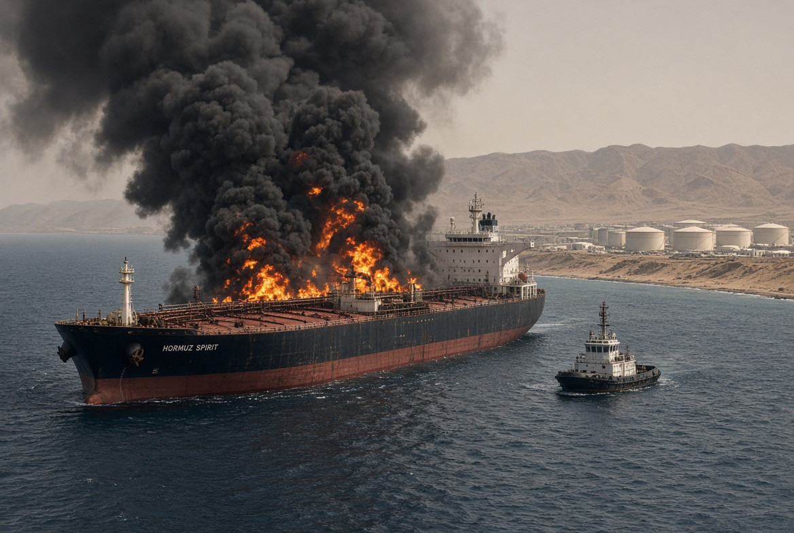

# Amerika Serikat Versus Iran: Apakah Perang Akan Meletus?

*Ilustrasi (pic: Grok AI).*

  
***Jangan sampai warga sipil Iran, rakyat negara-negara Teluk, dan masyarakat yang bergantung pada energi dunia kembali membayar harga dari kegagalan diplomasi para pemimpin***
  

Jangan langsung menyimpulkan perang sudah di depan pintu hanya karena Washington dan Teheran kembali saling mengirim ancaman. Ancaman perang, persiapan militer, dan keputusan untuk benar-benar menyerang adalah tiga hal yang berbeda.

Yang perlu kita periksa adalah apakah ada perubahan nyata di lapangan, seperti pengerahan kapal dan pesawat, kesiapan pangkalan, evakuasi warga, peringatan resmi, serta jalur diplomasi yang mulai ditutup. 

Kita akan pisahkan fakta terbaru dari propaganda dan spekulasi, supaya kita tidak ikut terseret genderang perang sebelum tahu siapa yang benar-benar sedang mengangkat senjata.

## Risiko Eskalasi Meningkat

Ancaman serangan militer baru itu serius. Bukan sekadar rumor media sosial. Tetapi per 30 Oktober 2026, Trump belum mengeluarkan keputusan final untuk menyerang kembali. Dan ada detail yang sangat penting: ini bukan ancaman perang dari situasi damai. 

Konflik AS–Iran sudah berlangsung sejak akhir Februari 2026. Serangan militer AS terhadap Iran terakhir dilaporkan terjadi pada awal September, dan sekarang ada risiko operasi besar dilanjutkan.

## Trump Mendapat Opsi Militer Baru

Komandan CENTCOM, Laksamana Brad Cooper, dilaporkan memberikan pengarahan langsung kepada Trump mengenai opsi serangan terhadap Iran. Pertemuan ini terjadi ketika Washington mempertimbangkan dimulainya kembali operasi militer besar.

Tambahan sekitar 9.000 personel AS karena Pentagon telah mengirim USS Theodore Roosevelt, kapal amfibi, dan pasukan Marinir ke kawasan Teluk Persia. AP melaporkan bahwa pengerahan ini memperkuat kehadiran militer AS, meskipun belum membuktikan kapan serangan akan dilakukan.

Insiden kapal tanker di Selat Hormuz diklaim
Iran terkena ranjau laut. Namun secara terpisah, UKMTO melaporkan sebuah tanker terkena proyektil pada 29 Oktober. Identitas pelaku penembakan proyektil itu belum dipastikan secara independen.

Yang paling serius bukan satu insiden kapal, melainkan kombinasi pengerahan militer, peringatan kepada negara-negara Teluk, dan pembahasan opsi serangan baru.

## Mengapa Tanggal 3 November Menjadi Penting?

Ini bagian yang membuat situasinya menarik secara politik.

AP melaporkan bahwa pejabat AS secara pribadi telah meminta sejumlah negara Timur Tengah bersiap menghadapi kemungkinan serangan baru setelah pemilu sela AS pada 3 November 2026.

Menurut dua diplomat yang mengetahui komunikasi tersebut:
- Operasi militer baru bisa berlangsung beberapa hari.
- Iran diperkirakan dapat membalas.
- Infrastruktur energi dan fasilitas penting negara-negara sekutu AS berpotensi menjadi sasaran balasan.
- Trump belum mengambil keputusan final.

AP juga melaporkan perang telah membebani kandidat Partai Republik akibat kenaikan harga bahan bakar dan biaya perang yang diperkirakan Pentagon mencapai US$47,1 miliar.

Jadi, ada dua hal yang harus dipisahkan:
• Fakta: pemerintah AS sedang menyiapkan opsi militer dan meminta sekutu bersiap menghadapi eskalasi.
• Analisis politik: penundaan hingga setelah pemilu dapat mengurangi biaya politik domestik bagi pemerintahan Trump. 

Namun, belum ada bukti bahwa pemilu adalah satu-satunya alasan penentuan waktu tersebut.

## Apa yang Sebenarnya Diperebutkan AS dan Iran?

Perselisihannya bukan hanya soal siapa yang menguasai kawasan Teluk. Ada tiga simpul besar:

|Isu | Posisi Washington | Posisi Teheran |
|:-----|:------:|------:|
|Program nuklir|Ingin isu nuklir dibahas sejak awal dan memperoleh konsesi|Menolak menyerahkan posisi nuklirnya tanpa penyelesaian tuntutan lain|
|Blokade dan sanksi|Mempertahankan tekanan terhadap pelabuhan dan ekspor minyak Iran|Menuntut blokade pelabuhan dihentikan dan sanksi ekspor minyak dicabut|
|Selat Hormuz|Menghendaki jalur pelayaran internasional tetap dapat digunakan|Iran berusaha mempertahankan kendali dan aturan transitnya|

Ini bukan sekadar perbedaan diplomatik. Selat Hormuz adalah jalur penting bagi perdagangan minyak dan gas dunia. Perselisihan mengenai siapa yang berhak mengatur lalu lintas kapal dapat berubah menjadi konfrontasi militer.

Reuters melaporkan bahwa Qatar kembali mengirim mediator ke Teheran pada 30 Oktober. Washington ingin persoalan nuklir masuk sejak awal, sementara Iran menuntut penghentian blokade pelabuhan dan pencabutan sanksi minyak terlebih dahulu.

## Diplomasi Masih Berjalan, tetapi Ruang Komprominya Sempit

Ini justru perkembangan yang jangan sampai terlewat. Pada 30 Oktober, mediator Qatar kembali ke Teheran untuk mendorong kesepakatan. Artinya, jalur diplomatik belum ditutup.

Tetapi kedua pihak masih berbeda pendapat tentang urutan penyelesaian:
AS ingin konsesi nuklir dibahas dari awal.
Iran ingin blokade dan sanksi minyak diselesaikan lebih dahulu.
Usulan perdamaian Qatar sebelumnya disebut tidak dapat diterima oleh seorang pejabat senior Iran.
Jadi, negosiasi berlangsung bersamaan dengan persiapan militer. Ini pola yang sering disebut coercive diplomacy: menggunakan ancaman atau tekanan militer untuk memperkuat posisi tawar dalam perundingan.

Namun, ancaman militer yang terlalu kuat juga dapat menghasilkan efek sebaliknya: pihak yang ditekan merasa harus membalas agar tidak terlihat menyerah.

## Kalau Perang Berlanjut, Bagaimana Iran Bisa Membalas?

Iran tidak harus mengalahkan seluruh kekuatan militer AS secara konvensional untuk membuat biaya perang meningkat.

Ada beberapa jalur eskalasi:

A. Selat Hormuz
Gangguan pelayaran, ranjau laut, rudal antikapal, dan ancaman terhadap tanker dapat meningkatkan risiko perdagangan energi.

B. Infrastruktur energi Teluk
Fasilitas minyak, kilang, terminal ekspor, dan jaringan energi di negara-negara Teluk berpotensi terkena dampak.

C. Pangkalan dan kepentingan AS
Pangkalan militer, fasilitas logistik, dan aset AS di kawasan dapat menjadi sasaran rudal atau drone.

D. Kelompok bersenjata regional
Kelompok yang memiliki hubungan dengan Iran dapat memperluas konflik. Namun, jangan menganggap setiap tindakan mereka otomatis diperintahkan langsung oleh Teheran.

Kita sudah melihat konflik meluas ke Yaman dan Arab Saudi. AP melaporkan serangan Houthi terhadap infrastruktur Saudi serta serangan balasan koalisi pimpinan Saudi. CBS juga melaporkan ledakan di Riyadh dan klaim pencegatan rudal pada 29 Oktober.

Ini membuat risiko perang regional lebih rumit daripada sekadar AS melawan Iran.

## Dampaknya bagi Indonesia dan Pasar Saham?

Nah, ini bagian yang perlu kita perhatikan juga. Apalagi kita pernah membahas IHSG, ANTM, MDKA, TLKM, dan sensitivitas pasar terhadap konflik Hormuz.

Dampaknya tidak seragam:

| Sektor | Potensi pengaruh |
|------|-------|
|Energi|Harga minyak lebih tinggi bisa menguntungkan produsen tertentu, tetapi merugikan importir|
|Pertambangan|Harga emas bisa mendapat dukungan dari permintaan aset aman; logam industri dapat tertekan jika ekonomi melambat|
|Transportasi|BBM, asuransi, dan biaya pengiriman meningkat|
|Rupiah|Tekanan bisa muncul jika dolar menguat dan harga energi naik|
|IHSG|Volatilitas dan arus modal asing bisa meningkat|

Khusus Indonesia, kenaikan harga minyak bukan otomatis kabar baik. Kita juga harus memperhitungkan kebutuhan impor energi, subsidi, nilai tukar, dan kemampuan APBN menyerap kenaikan biaya.

Indikator yang Perlu Dipantau

| Indikator | Arti strategis |
|------|-------|
|Keputusan Trump setelah 3 November|Apakah opsi serangan berubah menjadi perintah operasi|
|Pergerakan kapal induk dan pesawat tanker|Kesiapan operasional AS|
|Aktivitas CENTCOM dan militer Israel|Koordinasi kemungkinan operasi|
|Status Selat Hormuz|Risiko gangguan energi global|
|Respons Iran dan kelompok regional|Apakah konflik melebar|
|Negosiasi Qatar|Apakah masih ada jalan keluar diplomatik|

Ada tiga fakta yang paling penting:
- Persiapan militer AS bukan gertakan kosong. Ada pengerahan pasukan, pembahasan opsi serangan, dan peringatan kepada negara-negara sekutu.
- Perang belum diputuskan untuk dilanjutkan. Trump masih punya pilihan antara operasi militer dan kesepakatan diplomatik.
- Risiko perang regional meningkat. Bahkan jika serangan AS hanya berlangsung beberapa hari, balasan Iran dan gangguan Hormuz dapat memperpanjang krisis.

Yang paling perlu diwaspadai adalah kemungkinan salah perhitungan. Satu kapal tanker terkena serangan, satu rudal salah sasaran, atau satu pangkalan terkena serangan balasan bisa menciptakan rangkaian respons yang sulit dihentikan.

Pertanyaannya adalah apakah Washington benar-benar ingin menyelesaikan ancaman nuklir Iran melalui kesepakatan, atau ingin memaksa Iran menerima persyaratan melalui tekanan militer sampai Teheran tidak punya pilihan selain menyerah pada meja perundingan?

Kita belum punya bukti untuk memastikan motif tunggal itu. Tetapi perbedaan tuntutan dan pola tekanan militernya sudah terlihat jelas. 
Satu hal penting, jangan sampai warga sipil Iran, rakyat negara-negara Teluk, dan masyarakat yang bergantung pada energi dunia kembali membayar harga dari kegagalan diplomasi para pemimpin. 

  
**Referensi**

1. Associated Press. (2026, October 29). US warns allies to prepare for possible Iran strikes, retaliation after elections. AP News⁠.

2. Reuters. (2026, October 30). Qatari mediators return to Tehran to push for US-Iran deal, official says. Reuters⁠.

3. The Wall Street Journal. (2026, October 28). U.S. Warns Gulf of Possible Short, Intense Renewal of Iran War After Midterms. WSJ⁠.

4. CBS News. (2026, October 30). Live Updates: Tankers strike mines in Strait of Hormuz, as Hegseth fires top general. CBS News⁠.

5. Anadolu Agency. (2026, October 29). CENTCOM chief briefs Trump on options for renewed attacks on Iran. Anadolu Agency⁠.

