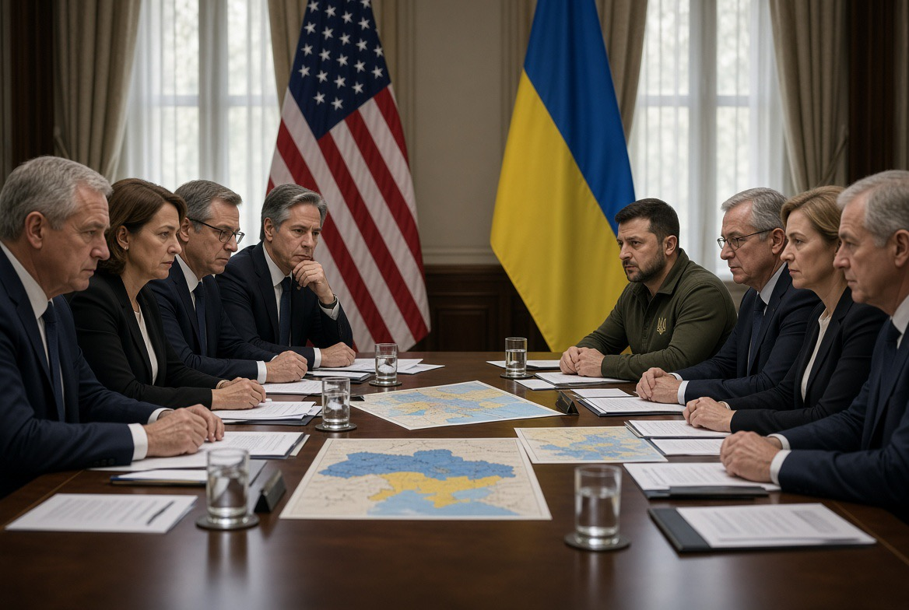

# Anak Tiri Geopolitik: Ukraina, Trump, Putin, Minyak, & Paradoks Perdamaian yang Timpang

*Ilustrasi (pic: Grok AI).*

  
Pertanyaan strategis yang paling penting bukan apakah Ukraina masih disayang AS, melainkan apakah dukungan yang tersedia cukup untuk menjaga kemampuan Ukraina mempertahankan diri
  

Pada 11 Oktober 2026 Trump mengumumkan gencatan senjata energi. Ia menyatakan Rusia dan Ukraina telah menyepakati penghentian serangan terhadap sasaran energi. Namun, laporan berikutnya menunjukkan tidak ada kesepakatan bilateral yang jelas dan diterima kedua pihak dalam bentuk yang sama. 

Kyiv sempat menahan serangan ke kilang Rusia, sedangkan serangan Rusia terhadap fasilitas energi Ukraina berlanjut.

Lalu 13–14 Oktober serangan Rusia berlanjut. Ukraina melaporkan serangan rudal balistik dan drone yang menyasar infrastruktur energi. 

Zelenskyy menilai Moskow tidak menghormati gencatan yang diumumkan Washington. Rusia juga melancarkan serangan ke berbagai wilayah Ukraina, menyebabkan pemadaman darurat dan kerusakan rumah.

Kemudian pada 15 Oktober Ukraina melanjutkan serangan ke kilang Rusia. Drone Ukraina menyerang kilang di wilayah Ryazan, tenggara Moskow, yang dimiliki perusahaan minyak negara Rosneft. 

Seorang pejabat Ukraina mengonfirmasi serangan tersebut kepada Reuters. Kyiv menyatakan pembatasan serangan ke kilang telah berakhir setelah Rusia terus menyerang infrastruktur energi Ukraina.

15–16 Oktober Trump menyerang keputusan Zelenskyy secara verbal. Dalam wawancara dengan Newsmax, Trump menyebut serangan Ukraina terhadap kilang minyak Rusia sebagai “a disgrace”. Ia berpendapat serangan tersebut menaikkan harga energi global dan mengatakan Zelenskyy lebih sulit diajak berunding dibandingkan Putin.

Kronologi ini menunjukkan bahwa pertengkaran bukan hanya soal kepribadian dua pemimpin. Sengketa utamanya adalah siapa yang harus menanggung biaya gencatan senjata, siapa yang menentukan kapan gencatan itu berakhir, dan apakah kepentingan ekonomi pihak ketiga boleh mengalahkan kebutuhan pertahanan negara yang diserang.

## Mengapa Minyak Mendadak Menjadi Tokoh Utama?

Kilang minyak bukan sekadar pabrik yang menghasilkan bahan bakar. Kilang adalah bagian dari rantai pendapatan negara, logistik militer, transportasi, dan perdagangan.

Bagi Rusia, kilang mengolah minyak mentah menjadi diesel, bensin, dan produk lain. Gangguan terhadap kilang dapat mengurangi pasokan bahan bakar, menghambat distribusi, menambah biaya, dan memaksa pemerintah mengalihkan sumber daya untuk memperbaiki kerusakan. Reuters melaporkan serangan Ukraina telah menimbulkan gangguan dan kekurangan bahan bakar di Rusia.

Sementara bagi Trump, diesel adalah komoditas ekonomi yang penting. Trump menyatakan serangan terhadap kilang Rusia dapat meningkatkan harga energi global.  Namun, hubungan sebab-akibatnya tidak sesederhana itu: harga bahan bakar juga dipengaruhi perang yang lebih luas, sanksi, kapasitas produksi, biaya transportasi, dan permintaan global.

Sedangkan bagi Ukraina, infrastruktur energi bukan hanya aset ekonomi. Listrik diperlukan untuk rumah sakit, pemanas, air bersih, komunikasi, dan industri. Ketika Rusia menyerang jaringan energi Ukraina, dampaknya langsung terasa pada kehidupan warga dan kemampuan negara mempertahankan operasinya. 

AP melaporkan serangan Rusia pada 16 Oktober menyebabkan pemadaman darurat yang memengaruhi ratusan ribu rumah tangga.

## Apakah Trump Hanya Membela Kepentingan Minyak?

Itu terlalu sederhana jika dinyatakan sebagai fakta yang sudah terbukti. Ada tiga lapisan yang harus kita pisahkan:
- Pernyataan resmi yang terverifikasi: Trump secara terbuka mengaitkan serangan Ukraina terhadap kilang Rusia dengan kenaikan harga minyak dan diesel.
- Kepentingan ekonomi yang masuk akal: pemerintah AS memiliki alasan untuk memperhatikan harga bahan bakar, terutama ketika inflasi energi menjadi isu politik domestik.
- Motif pribadi atau motif tersembunyi: klaim bahwa Trump semata-mata bertindak demi kepentingan minyak atau demi Putin memerlukan bukti tambahan. Kita tidak bisa membaca motif hanya dari satu pernyataan.

Ada konteks tambahan yang penting. Reuters melaporkan bahwa ketegangan meningkat setelah Trump melonggarkan sanksi terhadap diesel Rusia dalam sebuah kesepakatan yang bertujuan menambah pasokan ke pasar dunia dan menekan harga bahan bakar. 

Kyiv menilai langkah itu dapat memberikan ruang ekonomi bagi Moskow untuk melanjutkan perang.

Di sinilah konflik kepentingannya muncul: Trump mengutamakan penghentian serangan terhadap energi dan stabilisasi pasokan, sementara Ukraina menilai pembatasan tersebut tidak adil jika Rusia tetap menyerang jaringan listriknya.

Satu kebijakan bisa tampak masuk akal dari perspektif pasar energi, tetapi terasa sangat berbeda dari perspektif negara yang setiap malam menghadapi rudal.

## Mengapa Analogi “Ayah, Anak Tiri, dan Ibu Tiri Rusia” Terasa Cocok?

Analogi menangkap sesuatu yang nyata dalam politik aliansi: negara kecil atau negara yang sedang berperang dapat merasa bahwa dukungan sekutunya bersyarat.

Tetapi mari kita pertajam metaforanya:

Ukraina sebagai anak yang bergantung pada ayah sangat membutuhkan bantuan militer, intelijen, pertahanan udara, komunikasi, dan dukungan diplomatik dari negara-negara Barat. Ketergantungan ini memberikan pengaruh besar kepada pihak yang menyediakan bantuan.

AS sebagai ayah yang juga memiliki kepentingannya sendiri. Pemerintah AS tidak hanya mempertimbangkan keselamatan Ukraina. Washington juga menghitung biaya perang, hubungan dengan Rusia, harga energi, prioritas militer, serta konsekuensi domestik dari dukungan jangka panjang.

Rusia sebagai lawan yang tetap menjadi mitra negosiasi meskipun pernah melancarkan invasi skala penuh ke Ukraina pada 2022. Namun, bagi pemerintah AS, Rusia juga merupakan pihak yang harus diajak berunding jika tujuan kebijakannya adalah mengakhiri perang. 

Mengadakan negosiasi tidak otomatis berarti menyetujui invasi, tetapi cara negosiasi dilakukan dapat mengubah keseimbangan tekanan terhadap kedua pihak.

Dalam teori hubungan internasional, situasi ini berkaitan dengan asimetri aliansi. Negara yang lebih kecil memperoleh kemampuan bertahan dari dukungan negara yang lebih kuat, tetapi dukungan tersebut juga dapat memberikan negara patron pengaruh atas pilihan strategis mitranya.

Masalahnya, kepentingan kedua pihak tidak selalu identik:
- AS dapat menganggap penghentian serangan terhadap kilang sebagai langkah untuk menjaga pasokan energi dan membuka jalur diplomasi.
- Ukraina dapat menganggap penghentian sepihak sebagai pembatasan terhadap kemampuan membalas serangan Rusia.
- Rusia dapat memperoleh manfaat jika tekanan terhadap infrastruktur energinya berkurang sementara serangannya terhadap Ukraina terus menghasilkan dampak.

Poin terakhir merupakan analisis mengenai konsekuensi strategis, bukan bukti bahwa seluruh kebijakan AS dirancang khusus untuk menguntungkan Rusia.

Apakah Ukraina benar-benar “ditendang”?

Belum tepat jika kita menyimpulkan bahwa AS telah sepenuhnya meninggalkan Ukraina. AP melaporkan ketegangan meningkat, termasuk persoalan pembatasan penggunaan sistem komunikasi satelit Starshield dan kekhawatiran tentang dukungan intelijen. 

Pada saat yang sama, negara-negara Uni Eropa kembali menyatakan dukungan bagi Ukraina dan mendorong AS tetap terlibat dalam upaya menghadapi agresi Rusia.

Yang dapat dikatakan dengan lebih akurat adalah bahwa hubungan Kyiv–Washington sedang mengalami tekanan serius, dan Ukraina menghadapi ketidakpastian tentang syarat serta kesinambungan dukungan AS.

## Apakah Ukraina Salah karena Menyerang Kilang Rusia?

Pertanyaan ini perlu dibedakan menjadi dua: apakah serangan itu masuk akal secara militer, dan apakah serangan itu sah menurut hukum perang.

Dari perspektif strategi militer

Kilang dapat menjadi sasaran yang bernilai karena bahan bakar mendukung kegiatan ekonomi dan logistik militer. 

Menyerangnya dapat menambah biaya perang Rusia dan memaksa Moskow mengalokasikan sumber daya untuk pertahanan serta perbaikan.

Namun, strategi tersebut juga memiliki risiko:
- Rusia dapat membalas dengan meningkatkan serangan terhadap infrastruktur Ukraina.
- Serangan terhadap fasilitas energi dapat memengaruhi warga sipil dan pasokan bahan bakar.
- Ketegangan dengan Washington dapat mengurangi dukungan yang sangat dibutuhkan Ukraina.
- Keberhasilan merusak fasilitas tidak otomatis menghasilkan keuntungan politik yang sebanding.

Dengan kata lain, suatu serangan dapat memberi keuntungan taktis tetapi sekaligus menimbulkan kerugian strategis.

Dari perspektif hukum humaniter internasional

Hukum perang tidak menganggap semua fasilitas energi otomatis sebagai sasaran militer yang sah. Status suatu kilang harus dinilai berdasarkan penggunaan dan fungsi konkretnya, kontribusinya terhadap aksi militer, serta keuntungan militer yang diharapkan dari serangan tersebut.

Bahkan ketika sebuah fasilitas memenuhi kriteria sasaran militer, pihak penyerang tetap wajib mematuhi prinsip proporsionalitas dan mengambil tindakan pencegahan yang layak untuk mengurangi kerugian sipil.

Jadi, kita tidak bisa menyimpulkan bahwa serangan Ukraina pasti sah hanya karena Rusia lebih dahulu menyerang jaringan listrik Ukraina. Begitu pula, serangan Rusia terhadap infrastruktur energi tidak otomatis sah hanya karena Moskow menyatakan memiliki tujuan militer.

Hak untuk membela diri tidak menghapus kewajiban mematuhi hukum humaniter internasional. Prinsip ini berlaku bagi Rusia maupun Ukraina.

## Kalau AS Berubah Arah, Bisakah Eropa Mengambil Alih Peran Ayah? 

Eropa dapat mengurangi ketergantungan Ukraina pada AS, tetapi menggantikan seluruh kemampuan Amerika dalam waktu singkat merupakan persoalan yang jauh lebih rumit.

Pada 16 Oktober, para pemimpin Uni Eropa kembali menyatakan dukungan terhadap Ukraina dan menyerukan agar Washington tetap terlibat. Zelenskyy menghadiri pertemuan para pemimpin Eropa di Brussel ketika ketegangan dengan Trump meningkat.

Mengapa Eropa belum tentu dapat menggantikan AS secara penuh?
- Pertahanan udara: Ukraina membutuhkan sistem pencegat dan persenjataan untuk menghadapi rudal balistik serta serangan drone.
- Intelijen: informasi mengenai pergerakan pasukan dan ancaman udara sangat penting untuk pertahanan.
- Komunikasi militer: pembatasan kemampuan sistem satelit dapat memengaruhi koordinasi operasi dan penggunaan drone.
- Kapasitas industri: peningkatan produksi amunisi, rudal, dan sistem pertahanan memerlukan waktu, modal, dan rantai pasokan yang stabil.

AP melaporkan bahwa Ukraina menghadapi kekhawatiran mengenai keterbatasan rudal Patriot dan penggunaan sistem Starshield di tengah meningkatnya serangan Rusia terhadap infrastruktur energi. 

Pada saat bersamaan, para pemimpin Eropa menyatakan akan mempertahankan dukungan terhadap Kyiv.

Artinya, dukungan Eropa dapat menjadi penyangga penting, tetapi keberhasilannya bergantung pada kemampuan mengubah pernyataan politik menjadi pengiriman senjata, pembiayaan, produksi, dan koordinasi militer.

Kemandirian strategis bukan slogan “kami tidak membutuhkan siapa pun”. Kemandirian berarti memiliki cukup banyak pilihan sehingga tidak ada satu sekutu yang dapat menentukan seluruh ruang gerak.

## Apakah Perdamaian Trump Benar-benar Perdamaian?

Kita harus berhati-hati dengan istilah perdamaian. Ada perbedaan antara menghentikan serangan untuk sementara, mencapai gencatan senjata yang dapat diverifikasi, dan menyelesaikan konflik secara politik.

Gencatan senjata energi yang diumumkan Trump dimaksudkan untuk menghentikan serangan terhadap infrastruktur energi. Namun, Ukraina menyatakan bahwa Rusia tetap melancarkan serangan, sehingga Kyiv akhirnya melanjutkan serangan terhadap kilang Rusia.

Dari perspektif negosiasi, gencatan senjata akan lebih kuat jika memiliki ketentuan tertulis yang diterima kedua pihak; mekanisme pemantauan dan verifikasi; prosedur untuk menangani dugaan pelanggaran; konsekuensi yang jelas jika satu pihak melanggar; dan jaminan bahwa penghentian serangan tidak hanya menguntungkan satu pihak.

Jika satu pihak menghentikan serangan sedangkan pihak lain tetap menyerang, gencatan senjata dapat berubah menjadi pembatasan sepihak yang justru memperburuk posisi pihak yang mematuhinya.

Namun, kita juga perlu membedakan laporan tentang pelanggaran dengan penetapan hukum final. Setiap insiden perlu diverifikasi berdasarkan waktu, lokasi, sasaran, dan bukti yang tersedia.

## Paradoks Perdamaian

Dalam diplomasi, pihak yang lebih kuat secara militer atau ekonomi sering memiliki kemampuan lebih besar untuk menentukan syarat. 

Jika tekanan diberikan secara tidak seimbang, pihak yang lebih lemah dapat menghadapi pilihan sulit: menerima kesepakatan yang tidak memenuhi kebutuhan keamanannya, atau menolak dan berisiko kehilangan dukungan.

Karena itu, keberhasilan diplomasi tidak cukup diukur dari seberapa cepat para pemimpin mengumumkan kesepakatan. Kita juga perlu menilai apakah kesepakatan tersebut dapat dilaksanakan, mengurangi ancaman, dan diterima oleh pihak-pihak yang harus mematuhinya.

## Apakah Ukraina Benar-benar Menjadi Anak Tiri?

Kita menangkap perasaan yang dapat muncul ketika negara yang bergantung pada bantuan sekutu mendapati bahwa sekutunya memiliki prioritas yang berbeda. Tetapi secara analitis, kita perlu menyimpulkan berdasarkan tindakan yang terverifikasi, bukan semata-mata berdasarkan gambaran hubungan pribadi antara pemimpin.

Ada tiga temuan utama dari eskalasi terbaru ini:

Pertama, kepentingan energi dan keamanan Ukraina tidak selalu sejalan. Trump secara terbuka mengkritik serangan Ukraina terhadap kilang Rusia karena dampaknya terhadap harga minyak dan diesel. 

Kyiv memandang pembatasan serangan itu secara berbeda, terutama ketika serangan Rusia terhadap infrastruktur energi Ukraina terus berlangsung.

Kedua, ketergantungan militer menciptakan kerentanan politik. Ukraina memerlukan bantuan dari sekutu, tetapi bantuan itu dapat menjadi sumber tekanan ketika kebijakan sekutu berubah. 

Ketidakpastian mengenai dukungan AS membuat diversifikasi bantuan dan penguatan kemampuan domestik semakin penting.

Ketiga, kemandirian tidak berarti harus berjuang sendirian. Pelajaran yang dapat diambil dari konflik berkepanjangan adalah pentingnya membangun kapasitas domestik, memperluas jaringan mitra, dan mempertahankan ruang diplomasi. Itu berbeda dari meniru strategi kelompok bersenjata yang beroperasi dalam konteks hukum dan politik yang berbeda.

Ukraina bukan anak yang tidak memiliki pilihan sama sekali. Ia masih memiliki kemampuan militer, dukungan masyarakat, dan mitra internasional. Tetapi ketergantungan pada bantuan eksternal membuat perubahan kebijakan Washington memiliki konsekuensi nyata bagi keamanan Kyiv.

Dan Rusia bukan sekadar ibu tiri yang berhasil merebut perhatian ayah. Rusia adalah negara yang melancarkan invasi skala penuh ke Ukraina pada 2022, sementara AS sedang mencoba menegosiasikan penghentian perang dengan mempertimbangkan kepentingannya sendiri.

Pertanyaan strategis yang paling penting bukan apakah Ukraina masih disayang AS, melainkan apakah dukungan yang tersedia cukup untuk menjaga kemampuan Ukraina mempertahankan diri dan apakah setiap kesepakatan gencatan senjata dapat diterapkan secara timbal balik.

  
**Referensi**

1. Reuters. (2026, October 16). Ukraine’s resumption of strikes on Russian refineries is “disgrace”, Trump says. Reuters.

2. Associated Press. (2026, October 16). Russia strikes 9 Ukrainian regions as strain grows between Zelenskyy and Trump. AP News.

3. Reuters. (2026, October 15). Ukraine hits Russian refinery as Zelenskiy says “we’re done” with Trump’s energy truce. Reuters.

4. The Guardian. (2026, October 16). Trump calls Ukraine’s resumption of strikes on Russian oil refineries a “disgrace”. The Guardian.

5. Associated Press. (2026, October 15). Ukraine resumes attacks on Russian oil refineries, officials say, after brief truce. AP News.

6. The Guardian. (2026, October 16). “Your €90 billion will soon run out”: Brussels discusses the new cost of supporting Ukraine. The Guardian.
