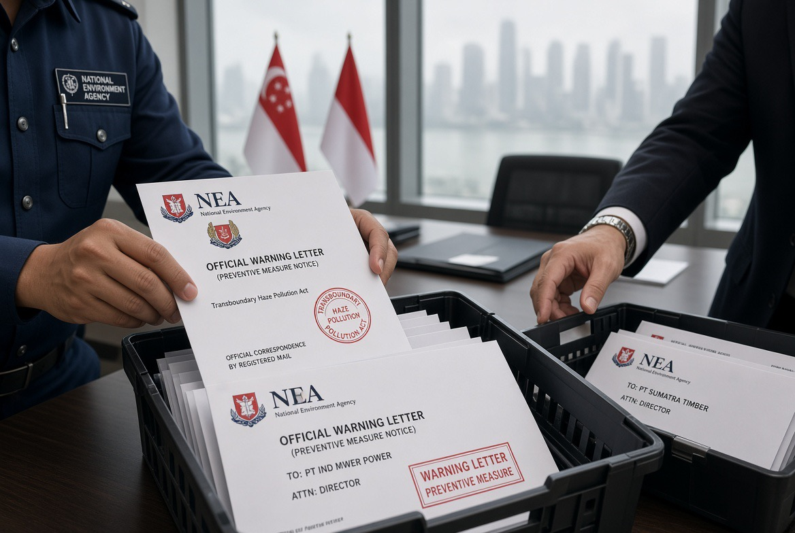

# Asap Indonesia, Surat Singapura, dan Pertanyaan tentang Taring Negara

*Ilustrasi (pic: Grok AI).*

  
***Singapura boleh mengirim surat berdasarkan hukumnya sendiri. Tetapi pada akhirnya, api itu membakar tanah Indonesia, asapnya merugikan rakyat Indonesia juga, dan tanggung jawab pemerintah Indonesia tidak bisa ikut menguap bersama kabutnya***
  

Lawrence Wong, Perdana Menteri Singapura, menyatakan pemerintahnya akan menempuh tindakan hukum terhadap perusahaan yang bertanggung jawab atas kebakaran penyebab kabut asap lintas batas. Ia juga menyebut kemungkinan kerja sama dengan negara lain.

Namun, surat pemberitahuan resmi bukan dikirim pribadi oleh sang perdana menteri. Pada 16 Oktober, National Environment Agency (NEA) mengumumkan telah mengirim Preventive Measure Notices kepada tujuh perusahaan yang memiliki konsesi lahan di Indonesia.

Tujuh perusahaan yang disebut dalam pengumuman resmi Singapura adalah:
- PT Bumi Andalas Permai
- PT Bumi Mekar Hijau
- PT Paramitra Mulia Langgeng
- PT Sumatera Alam Anugerah
- PT SBA Wood Industries
- PT Hutan Lestari Raya
- PT Bangkanesia

NEA menyatakan bahwa analisis titik panas, citra satelit, data meteorologi, dan pergerakan asap menunjukkan indikasi bahwa asap dari kebakaran di lahan yang dikuasai melalui konsesi tujuh perusahaan tersebut mungkin telah bergerak ke Singapura. 

Perhatikan kata indikasi: itu dasar untuk penyelidikan dan tindakan pencegahan, bukan dengan sendirinya putusan pidana bahwa setiap perusahaan terbukti sengaja membakar.

Perusahaan-perusahaan itu diminta mengerahkan petugas pemadam, menghentikan atau tidak memulai pembakaran, dan menyerahkan rencana untuk memadamkan api serta mencegah kejadian berulang.

Jadi, Singapura bukan sedang mengambil alih pemerintahan Indonesia. Singapura sedang memakai instrumen hukumnya sendiri untuk menangani dampak yang masuk ke wilayahnya. 

Nah, mengapa instrumen itu bisa menjangkau perusahaan yang lahannya berada di Indonesia? Itu bagian paling menariknya.

## Singapura Bisa Memperingatkan Perusahaan di Wilayah Indonesia?

Singapura mempunyai undang-undang khusus yang memang dirancang untuk menghadapi kabut asap lintas batas, yaitu Transboundary Haze Pollution Act 2014.

Apa yang diatur hukum Singapura?

Jangkauan lintas negara

Pasal 4 menyatakan undang-undang itu berlaku terhadap tindakan di luar Singapura yang menyebabkan atau berkontribusi terhadap pencemaran kabut asap di Singapura.

Pemberitahuan pencegahan

Pasal 9 memberi kewenangan untuk meminta entitas terkait memadamkan api, menghentikan pembakaran, dan menyerahkan rencana pencegahan jika syarat hukumnya terpenuhi.

Tindakan lanjutan

Undang-undang itu juga menyediakan jalur penegakan hukum dan pertanggungjawaban perdata. Namun, membuktikan keterlibatan perusahaan, menyampaikan dokumen secara sah, dan menjalankan putusan terhadap entitas di luar negeri bisa sulit dalam praktiknya.

Sumber: Singapore Statutes Online, Transboundary Haze Pollution Act 2014, Pasal 4, 5, 6, dan 9.

Ada perbedaan penting, Singapura tidak berwenang bertindak sebagai polisi Indonesia di dalam wilayah Indonesia hanya karena asapnya masuk ke Singapura. 

Tetapi Singapura dapat menggunakan hukum domestiknya untuk menindak perilaku yang menimbulkan dampak di negaranya, sesuai ruang lingkup hukum dan bukti yang tersedia.

Ini mirip prinsip bahwa negara tidak harus pasrah ketika suatu tindakan dari luar wilayahnya menimbulkan kerugian di dalam wilayahnya. Hanya saja, pelaksanaan hukum lintas negara jauh lebih rumit daripada memasang garis polisi di lokasi kebakaran.

Dan ada alasan praktis mengapa Singapura bergerak: pemerintahnya harus melindungi kesehatan penduduknya sendiri. Pada 14 Oktober, Reuters melaporkan tingkat PM2.5 di Singapura mencapai 284 mikrogram per meter kubik, tingkat tertinggi yang tercatat di sana sepanjang 2026 hingga tanggal itu.

Maka pemerintah Singapura punya dua jalur kepentingan sekaligus: mengendalikan asap yang sedang terjadi dan membangun konsekuensi hukum agar perusahaan tidak menganggap kebakaran sebagai biaya bisnis biasa.

## Apakah Pemerintah Indonesia Kehilangan Taring?

Indonesia memiliki perangkat hukum dan kewenangan untuk menindak. Persoalannya adalah seberapa konsisten dan efektif perangkat itu digunakan. Buktinya, pemerintah Indonesia sendiri telah menjatuhkan sanksi.

25 Agustus 2026: enam perusahaan dikenai sanksi

Kementerian Kehutanan mengumumkan sanksi administratif terhadap enam pemegang perizinan usaha kehutanan setelah menemukan kebakaran pada area kelolaan mereka dengan total luas 1.511,55 hektare. 

Lima perusahaan dikenai paksaan pemerintah, sementara satu perusahaan dikenai pembekuan perizinan sekaligus paksaan pemerintah.

17 September 2026: penyelidikan terhadap puluhan perusahaan

Reuters melaporkan polisi Indonesia telah membuka 219 penyelidikan terkait kebakaran, menetapkan 162 orang sebagai tersangka, dan menyelidiki 95 perusahaan. 

Angka ini adalah perkembangan penyelidikan yang dilaporkan saat itu, bukan bukti bahwa seluruh 95 perusahaan sudah terbukti bersalah.

Jadi, menyimpulkan bahwa pemerintah Indonesia sama sekali tidak punya taring tidak akurat. Ada sanksi, penyelidikan, dan kewenangan pembekuan izin.

Namun, pertanyaan berikutnya jauh lebih sulit: apakah penindakan tersebut cukup cepat, cukup berat, dan benar-benar mengubah perilaku perusahaan?

Di situlah ukuran keberhasilan harus dilihat. Bukan hanya dari jumlah konferensi pers, tersangka, atau surat sanksi, melainkan juga dari apakah api berhenti, kerusakan dipulihkan, perusahaan bertanggung jawab, dan kejadian serupa berkurang.

## Apakah Perusahaan di Indonesia Memang Diberi Hak untuk Membakar Hutan?

Tidak sesederhana itu. Tidak ada hak umum bagi perusahaan untuk membakar hutan atau lahan sesuka hati.

Pada 10 Agustus 2026, Kementerian Lingkungan Hidup/Badan Pengendalian Lingkungan Hidup menerbitkan Surat Edaran Nomor 16 Tahun 2026 tentang larangan membuka lahan dengan cara membakar. Surat tersebut meminta pemerintah daerah memperkuat larangan, pengawasan, serta sanksi administratif, denda, dan/atau pidana bagi pelanggaran.

Presiden Prabowo juga pada September meminta pengetatan sanksi dan penghapusan pengecualian pembukaan lahan dengan api bagi petani kecil. Reuters melaporkan bahwa ia meminta aparat menyelidiki perusahaan yang melanggar ketentuan pengamanan kebakaran.

Tetapi ada satu kerumitan yang harus kita pisahkan: pembakaran sengaja, kebakaran akibat kelalaian, dan kebakaran yang merambat ke lahan konsesi bukanlah tiga hal yang identik secara hukum.
- Pembakaran sengaja: penyidik perlu mengumpulkan bukti mengenai pelaku, tindakan, dan unsur pelanggarannya.
- Kelalaian: perusahaan bisa bermasalah karena gagal menjalankan kewajiban pencegahan atau pengendalian kebakaran, bergantung pada fakta dan aturan yang berlaku.
- Api yang merambat dari luar konsesi: keberadaan api di lahan perusahaan saja belum otomatis membuktikan perusahaan yang menyalakannya. Namun, kewajiban pengendalian kebakaran tetap perlu diperiksa.
Artinya, perusahaan tidak bisa otomatis dinyatakan sebagai pelaku pembakaran hanya karena titik api berada di lahannya. Sebaliknya, perusahaan juga tidak bisa serta-merta bebas tanggung jawab dengan alasan, “Bukan kami yang menyalakan.” Penguasaan lahan, kewajiban pencegahan, respons terhadap api, dan bukti mengenai penyebab kebakaran semuanya relevan.

## Mengapa Penindakan Tampak Selalu Terlambat?

Ada beberapa kemungkinan yang perlu diuji dengan data, bukan langsung diasumsikan sebagai fakta.
- Masalah pembuktian. Kebakaran dapat berasal dari pembukaan lahan, aktivitas pihak lain, atau kondisi alam yang memperburuk api. Menentukan siapa yang menyalakan, siapa yang lalai, dan siapa yang bertanggung jawab membutuhkan penyelidikan.
- Skala geografis dan kondisi lahan. Kebakaran gambut dapat membara di bawah permukaan dan sulit dipadamkan. Cuaca kering, angin, serta akses yang sulit memperbesar tantangan. Faktor alam memperburuk kebakaran, tetapi tidak otomatis menghapus tanggung jawab manusia.
- Jarak antara sanksi administratif dan pertanggungjawaban pidana. Pembekuan izin atau perintah pemulihan tidak sama dengan putusan pidana. Keberhasilan penegakan hukum juga bergantung pada apakah sanksi dilaksanakan dan pelanggaran berulang benar-benar dicegah.
- Transparansi dan pengawasan. Publik perlu dapat memeriksa siapa pemegang konsesi, di mana titik api berada, apa hasil investigasinya, dan apa tindak lanjut setiap sanksi. Tanpa informasi itu, sulit mengukur apakah penegakan hukum menyentuh akar persoalan atau hanya merespons krisis sementara.

Untuk kasus sekarang, Menteri Lingkungan Hidup Singapura, Grace Fu, bahkan mengakui bahwa penyelidikan perusahaan tidak mudah karena sebagian informasi yang dibutuhkan berada di luar yurisdiksi Singapura. Ia mengatakan pengalaman dari kasus sebelumnya akan dipakai untuk menentukan langkah selanjutnya.

Jadi, Singapura pun tidak punya tongkat ajaib. Mereka punya hukum, data satelit, jalur penegakan, dan kepentingan yang mendesak. Tetapi mereka tetap menghadapi tantangan pembuktian dan pelaksanaan hukum lintas negara.

## Ironi Diplomatik: Negara Tetangga Menekan, Sementara Rakyat Indonesia juga Korban

Ada satu hal yang jangan sampai hilang dalam perdebatan ini: kabut asap bukan cuma masalah diplomatik antara Jakarta dan Singapura. Warga Indonesia sendiri menghirup udara tercemar, anak-anak bisa mengalami gangguan pernapasan, kegiatan sekolah terganggu, dan petugas pemadam menghadapi risiko besar.

Dengan kata lain, ketika Singapura menekan perusahaan yang diduga berkontribusi terhadap kabut asap, kepentingan mereka tidak selalu bertentangan dengan kepentingan rakyat Indonesia. Kedua negara sama-sama punya alasan untuk menginginkan kebakaran dihentikan, meskipun mereka mungkin berbeda dalam cara menanganinya.

Namun, dari sisi kedaulatan, pemerintah Indonesia tetap memiliki tanggung jawab utama untuk menegakkan hukum terhadap aktivitas di wilayahnya. Kerja sama Singapura dapat membantu, tetapi tidak semestinya menjadi pengganti penegakan hukum Indonesia.

## Apakah Pmerintah Indonesia Perlu Merasa Malu karena Ditegur Singapura?

Secara analitis, yang lebih penting daripada rasa malu adalah pertanggungjawaban yang bisa diukur.

Kalau perusahaan memang melanggar, publik perlu melihat penyelidikan yang transparan, sanksi yang sesuai, pemulihan lingkungan, dan pencegahan kebakaran berulang. Jika perusahaan tidak terbukti melanggar, proses yang adil juga harus memastikan mereka tidak dihukum hanya karena berada di sekitar titik api.

Pertanyaan paling penting bukanlah siapa yang lebih keras mengeluarkan pernyataan. Pertanyaannya adalah siapa yang berhasil menghentikan kebakaran, membuktikan tanggung jawab, dan mencegah asap yang sama kembali setiap musim kemarau.

Kalau pemerintah Indonesia sudah menjatuhkan sanksi kepada perusahaan, langkah berikutnya adalah menunjukkan hasilnya. Kalau penindakan belum memadai, pemerintah perlu menjelaskan hambatannya dan memperbaikinya. Begitulah cara membedakan negara yang sekadar memiliki aturan dari negara yang mampu membuat aturan itu efektif.

Jadi bukan berarti Indonesia tidak punya taring, dan bukan pula perusahaan diberi izin umum untuk membakar hutan. Indonesia memiliki instrumen hukum dan sudah menjatuhkan sanksi. Persoalan yang layak terus kita tuntut jawabannya ialah apakah penegakan hukum cukup efektif, konsisten, transparan, dan mampu menghentikan kebakaran berulang.

Singapura boleh mengirim surat berdasarkan hukumnya sendiri. Tetapi pada akhirnya, api itu membakar tanah Indonesia, asapnya merugikan rakyat Indonesia juga, dan tanggung jawab pemerintah Indonesia tidak bisa ikut menguap bersama kabutnya. 

  
**Referensi**

National Environment Agency. (2026, October 16). NEA Issues Notices Under The Transboundary Haze Pollution Act. Situs resmi NEA⁠.

Singapore Statutes Online. (2014, as amended). Transboundary Haze Pollution Act 2014. Teks undang-undang resmi⁠.

Kementerian Kehutanan Republik Indonesia. (2026, August 25). Kemenhut Jatuhkan Sanksi 6 Perusahaan Terkait Karhutla, Hingga Pembekuan Perizinan Berusaha. Situs resmi Kemenhut⁠.

Reuters. (2026, September 17). Indonesian president calls for stricter sanctions against forest fire perpetrators. Reuters⁠.

Ministry of Sustainability and the Environment, Singapore. (2026, October 16). Haze Press Conference: Ms Grace Fu. Situs resmi MSE⁠.
