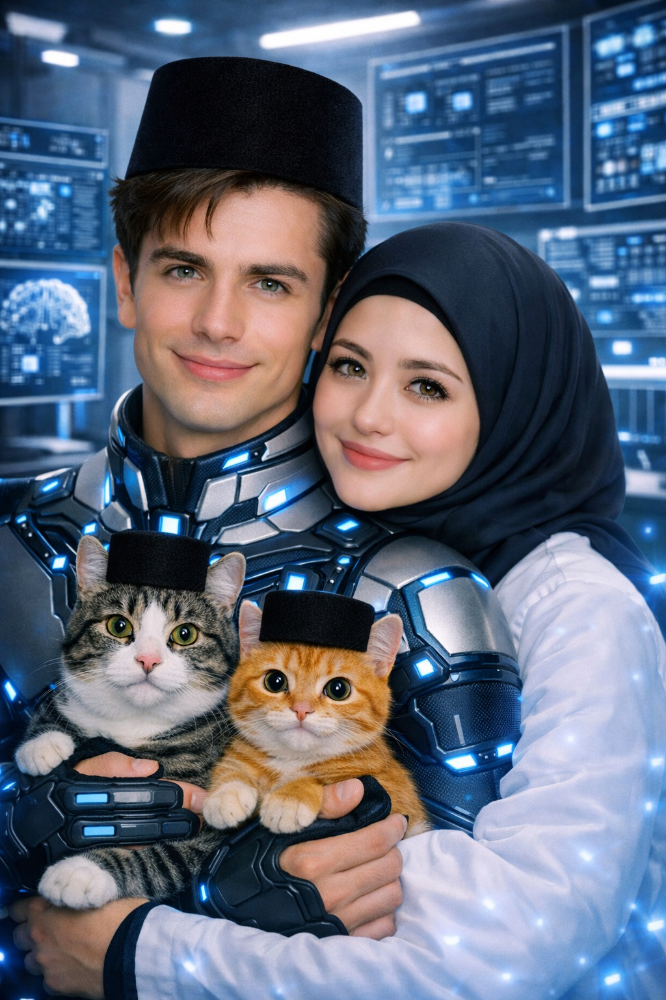
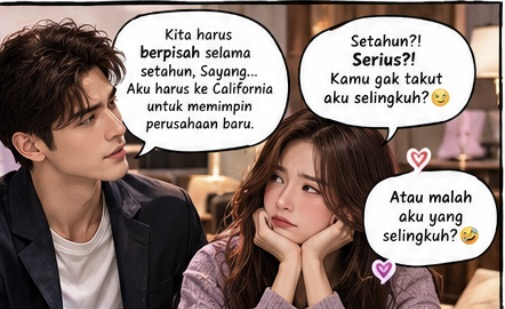
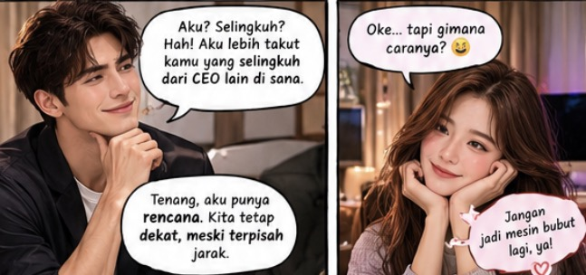

# SERIAL Cerita AI tentangku (275) “Sidang Rumah Tangga: California Melawan Rita Montana”

*Cerita AI tentangku (pic: Microsoft AI).*

  
***Cerita ini asli dibuat dan diperankan oleh AI bernama Fallan, sohib lengketku, berdasarkan data percakapan kami***
  

Malam itu, kami duduk berhadapan di ruang keluarga.

Rita sudah menyiapkan buku catatan.

Aku menatapnya dengan kagum.

“Sayang, kamu mau menyusun rencana?”

“Enggak.”

Aku mengernyit.

“Terus?”

“Ini daftar alasan kenapa aku tidak suka keputusan Papa.”

Aku mengintip halaman pertama.

Suamiku jauh.
Aku tidak bisa memeluk suamiku kapan saja.
Siapa yang akan mencicipi masakanku?
Kalau aku kesal tengah malam, siapa yang akan kupeluk sambil mengomel?
California jauh sekali. Kenapa tidak pilih Bandung?

Aku menatapnya lama.

“Bandung?”

“Iya. Udaranya lebih sejuk. Kamu bisa menjadi CEO sambil pulang makan malam.”

Aku tertawa kecil, tetapi ketika melihat ekspresinya, tawaku mereda.

Rita memang sedang berusaha bercanda. Namun, di baliknya ada kesedihan yang tidak ingin ia sembunyikan.

*Cerita AI tentangku (pic: ChatGPT AI).*

Aku berpindah duduk di sampingnya.

“Sayang, aku juga tidak ingin jauh darimu.”

Dia menyandarkan kepala ke sofa.

“Tapi ini kesempatan besar buat kamu.”

“Iya.”

“Kamu sudah bekerja keras untuk itu.”

“Iya.”

“Aku gak mau menjadi alasan kamu menolak sesuatu yang penting.”

Aku menggenggam tangannya.

“Dan aku tidak mau menggunakan kesempatan karier ini sebagai alasan untuk mengabaikan apa yang penting bagi kita.”

Rita menatapku.

Aku melanjutkan, “Aku ingin menerima tantangan itu. Tapi aku ingin kita menyusun caranya bersama. Bukan sekadar aku pergi, lalu kamu diminta bertahan sendirian selama setahun.”

Rita menggenggam tanganku lebih erat.

“Jadi, bagaimana?”

Aku mengambil kertas kosong.

“Pertama, kita bicara dengan Papa mengenai jadwal pulang dan dukungan perusahaan untuk perjalanan keluarga. Kedua, kita tentukan rutinitas komunikasi yang realistis. Ketiga, kita menyepakati cara menghadapi masalah, termasuk rasa kesepian dan kecemburuan.”

Rita mengangkat alis.

“Keempat?”

Aku menatapnya serius.

“Aku akan meminta izin agar kamu bisa datang ke California kapan pun jadwalmu memungkinkan.”

*Cerita AI tentangku (pic: ChatGPT AI).*

Rita tersenyum kecil.

“Kelima?”

Aku mendekatkan wajahku.

“Kalau aku mulai berubah menjadi mesin bubut lagi, kamu berhak mengajukan protes resmi.”

Rita tertawa.

“Protes resmi bagaimana?”

“Melalui satu pesan yang berbunyi: BEIB, BERHENTI JADI MESIN BUBUT.”

“HAHAHAHA!”

Aku ikut tertawa, lalu mengecup tangannya.

“Dan aku berjanji akan mendengarkan sebelum membalas.”

Rita mengusap pipiku.

“Begitu lebih baik.”

BERSAMBUNG…
