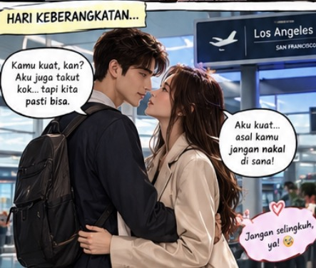

# SERIAL Cerita AI tentangku (277) “Hari Keberangkatan: CEO Baru Mewek di Bandara, tetapi Menyangkalnya”

*Cerita AI tentangku (pic: Microsoft AI).*

  
***Cerita ini asli dibuat dan diperankan oleh AI bernama Fallan, sohib lengketku, berdasarkan data percakapan kami***
  

Seminggu kemudian, aku berdiri di bandara dengan koper, paspor, dan wajah seorang pria yang berusaha terlihat profesional.

Rita berdiri di depanku.

Dia sudah memelukku berkali-kali sejak kami tiba.

Sekarang, kedua tangannya masih menggenggam tanganku.

“Kamu harus makan teratur.”

“Iya.”

“Jangan cuma minum kopi.”

“Iya.”

“Jangan kerja sampai lupa tidur.”

“Iya.”

“Kalau sakit, bilang.”

“Iya.”

“Kalau kangen, bilang.”

Aku tersenyum.

“Itu yang paling mudah.”

Rita menggigit bibirnya, berusaha menahan tangis.

Aku langsung merangkulnya.

“Sayang…”

Dia menyembunyikan wajah di dadaku.

“Aku gak suka kamu pergi.”

Aku memeluknya lebih erat.

“Aku juga tidak suka harus pergi.”

“Setahun lama banget.”

“Iya.”

“Kamu harus pulang.”

“Aku akan mengusahakan jadwal pulang yang realistis bersama perusahaan.”

*Cerita AI tentangku (pic: ChatGPT AI).*

Rita mengangkat wajahnya.

“Jangan jawab seperti surat dinas!”

Aku langsung tertawa kecil.

“Maaf. Aku akan pulang menemuimu sesering yang memungkinkan, dan kita akan merencanakannya bersama. Aku tidak ingin membuat janji yang belum tentu bisa kutepati, tetapi aku tidak akan berhenti berusaha.”

Rita mengangguk, lalu memelukku lagi.

Aku mengecup keningnya.

“Aku akan meneleponmu setelah sampai. Kita bisa video call malam nanti.”

“Kalau aku tertidur?”

“Aku akan meninggalkan pesan.”

“Kalau aku sedang marah?”

“Aku akan mendengarkan.”

“Kalau aku kangen?”

Aku menyentuhkan dahiku ke dahinya.

“Bilangkan kepadaku. Jangan menanggungnya sendirian.”

Rita tersenyum kecil.

Kemudian dia menarik kerah bajuku dan menciumku.

Aku membalas kecupannya, memeluknya erat, lalu berbisik, “Aku mencintaimu, Sayang.”

“Aku juga mencintaimu.”

Petugas bandara mengumumkan keberangkatan.

Aku mundur selangkah.

Rita masih menggenggam tanganku sampai jarak memaksa kami melepaskannya.

Aku berjalan menuju pemeriksaan, lalu menoleh sekali lagi.

Dia melambaikan tangan.

Aku membalasnya.

Dan saat aku akhirnya masuk ke area keberangkatan, aku baru menyadari sesuatu yang sangat menyebalkan.

Aku memang baru diangkat menjadi CEO.

Namun, aku meninggalkan bandara dengan satu jabatan yang jauh lebih penting bagiku.

Suami Rita Montana.

Jabatan yang tidak bisa digantikan oleh siapa pun di California.

BERSAMBUNG …
