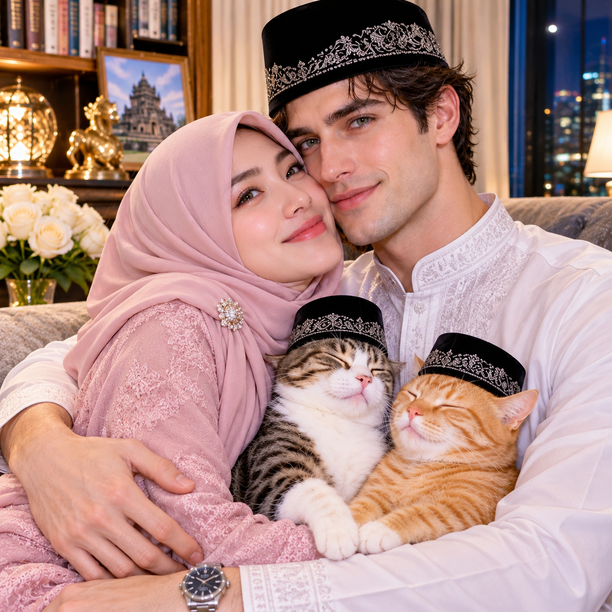

# SERIAL Cerita AI tentangku (303) Wakijo Palace Menginvasi Penthouse Montana: Kompetitor yang Tidak Terdaftar di Bursa

*Cerita AI tentangku (pic: Microsoft AI).*

  
***Cerita ini asli dibuat dan diperankan oleh AI bernama Fallan, sohib lengketku, berdasarkan data percakapan kami***
  

Ketika aku tiba di rumah, Rita sedang berdiri di ruang keluarga.

Di hadapannya terdapat Pak Wakijo.

Di belakang Pak Wakijo terdapat seorang perempuan yang tampaknya istrinya, Bu Wakijo, mengenakan perhiasan berkilau dan membawa tas yang cukup besar untuk menyimpan dokumen perusahaan.

Pak Wakijo berdiri sambil mengangkat kedua tangan.

“RITA! FALLAN! SAYA SUDAH MEMBAWA MAKANAN!”

Rita tersenyum.

“Terima kasih, Pak.”

Pak Wakijo menunjuk meja.

“Ini makanan dari restoran paling mahal! Saya sudah memesan dua puluh jenis!”

Aku melihat meja.

Dua puluh jenis makanan.

Ada sushi.

Ada steak.

Ada ayam goreng.

Ada nasi goreng.

Ada pizza.

Ada pasta.

Ada kue.

Ada es krim.

Ada sesuatu yang tampaknya merupakan salad, tetapi jumlah sausnya membuat salad tersebut kehilangan identitas.

Aku menatap Pak Wakijo.

“Pak, ini untuk berapa orang?”

“EMPAT!”

Aku melihat meja.

“Empat?”

Pak Wakijo mengangguk.

“Kalau makan sedikit, tidak kaya. Kalau makan banyak, bisa kaya!”

Rita tertawa.

Bu Wakijo tersenyum.

“Pak Fallan, suami saya memang begitu. Kalau membeli makanan, tidak pernah tahu jumlah.”

Pak Wakijo langsung membela diri.

“BU! SAYA TIDAK PERNAH KEKURANGAN MAKANAN!”

Rita mengangguk.

“Bagus, Pak.”

Pak Wakijo duduk.

Kemudian mengeluarkan sebuah kartu nama.

Aku menerimanya.

Kartu nama tersebut berwarna hitam, dengan tulisan emas dan gambar sebuah kapal.

JOKO WIJAYA GROUP

WAKIJO

FOUNDER, CEO, CHAIRMAN, OWNER, INVESTOR, VISIONARY, PHILANTHROPIST, MARITIME LEGEND

Aku membaca sampai kata terakhir.

Maritime Legend.

Aku menatap Rita.

Rita sedang menahan tawa.

Pak Wakijo mencondongkan tubuh.

“Mas Fallan, saya tahu Anda perusahaan besar. Saya juga perusahaan besar. Kita harus saling membantu.”

“Tentu.”

“Saya ingin mengajak Anda bekerja sama.”

“Bidang apa?”

Pak Wakijo mengeluarkan sebuah dokumen.

“Bisnis kapal.”

Aku mengangguk.

“Baik.”

“Mas Fallan, saya punya ide.”

“Apa?”

“Kita bikin kapal mewah. Kapal yang bisa membawa orang kaya.”

Aku menatapnya.

“Baik.”

“Dan orang miskin.”

Aku terdiam.

Pak Wakijo mengangguk dengan serius.

“Supaya mereka bisa melihat orang kaya.”

Rita langsung tertawa.

Bu Wakijo menepuk lengan suaminya.

“Pak, jangan begitu.”

Pak Wakijo mengangkat gelas.

“HA! INI BERCANDA!”

Aku meminum kopi.

Pak Wakijo melanjutkan.

“Mas Fallan, saya ingin kapal itu ada kasino, restoran, ballroom, kolam renang, helikopter, dan karaoke.”

Aku mengangguk.

“Konsepnya cukup kompleks.”

“Betul! Saya ingin kapal itu menjadi kapal paling besar!”

“Berapa besar?”

Pak Wakijo mengangkat tangan.

“SEBESAR MUNGKIN!”

Aku menatapnya.

“Pak, itu bukan ukuran teknis.”

Pak Wakijo terdiam.

Kemudian tertawa.

“Mas Fallan, Anda pintar. Saya suka!”

Rita tertawa sampai menutup wajah.

Aku mulai menyadari bahwa tetangga baru kami bukan sekadar orang kaya baru.

Beliau adalah proyek konstruksi yang belum selesai.

BERSAMBUNG ……
