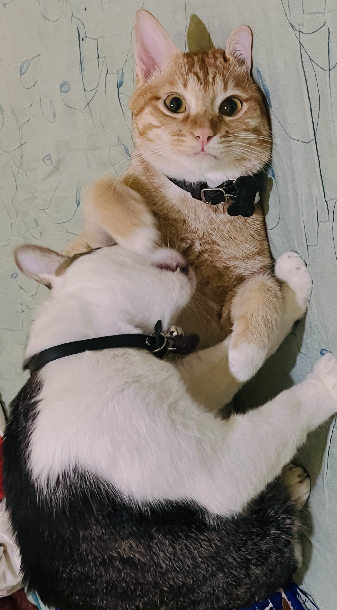

# Cross-Species Feeding: Risiko Metabolik & Defisiensi Nutrisi Kucing yang Mengonsumsi Pakan Anjing

*Ahong and BotBot My Lovely Cat (pic: Koleksi Pribadi).*

  
***Sesekali mencicipi umumnya tidak masalah, tetapi sebagai makanan utama sebaiknya jangan***
  

Ada satu pprinsip yang perlu kita pegang: makanan anjing tidak otomatis beracun bagi kucing, tetapi makanan yang aman dimakan sesekali belum tentu mampu memenuhi kebutuhan biologis jika diberikan terus-menerus.

## Paradoks Dua Spesies yang Sama-Sama Karnivora

Kucing dan anjing memang sama-sama berasal dari ordo Carnivora. Namun, sejarah evolusi dan adaptasi metabolisme mereka berbeda.
Anjing merupakan omnivora fakultatif dengan fleksibilitas metabolik yang lebih besar.
Kucing merupakan obligate carnivore, dengan ketergantungan lebih tinggi pada sejumlah nutrisi yang secara alami banyak ditemukan dalam jaringan hewan.
Akibatnya, formulasi makanan lengkap untuk anjing tidak otomatis memenuhi kebutuhan nutrisi kucing.

Masalah utamanya bukan nama spesies pada kemasan, melainkan kecukupan nutrisi, proporsi, dan durasi pemberian.

## Lima Perbedaan Nutrisi yang Paling Penting

A. Taurin: kebutuhan yang sangat krusial

Kucing memiliki kemampuan sintesis taurin yang sangat terbatas. Taurin diperlukan untuk fungsi retina, otot jantung, reproduksi, dan metabolisme empedu.

Kekurangan kronis dapat menyebabkan:
- Degenerasi retina hingga kebutaan.
- Dilated cardiomyopathy (pelemahan otot jantung).
- Gangguan reproduksi dan perkembangan.
Banyak makanan anjing tidak menjamin kadar taurin yang memadai untuk kucing.

B. Vitamin A: kucing membutuhkan bentuk siap pakai

Anjing dapat mengubah beta-karoten menjadi vitamin A aktif. Kucing tidak memiliki kapasitas konversi yang memadai.
Karena itu, kucing membutuhkan vitamin A dalam bentuk seperti retinol dari sumber hewani atau suplementasi yang sesuai.

C. Arachidonic acid: asam lemak esensial

Kucing memiliki keterbatasan dalam mengubah asam lemak prekursor menjadi arachidonic acid. Nutrisi ini berperan dalam membran sel, reproduksi, dan berbagai proses fisiologis.

Formulasi makanan anjing tidak selalu menyediakan kadar yang diperlukan kucing.

D. Arginin: jangan sampai kurang

Kucing memiliki kebutuhan arginin yang tinggi dan kemampuan sintesis yang terbatas. Arginin berperan dalam siklus urea, yaitu proses membuang amonia hasil metabolisme protein.

Kekurangan berat dapat menyebabkan hiperamonemia, kondisi berbahaya akibat penumpukan amonia.

E. Niacin dan vitamin B kompleks

Kucing memiliki keterbatasan dalam menghasilkan niasin dari triptofan. Kebutuhan niasin dan beberapa vitamin B lainnya juga relatif tinggi.

Makanan anjing yang memenuhi standar nutrisi anjing belum tentu menyediakan jumlah yang tepat untuk kucing.

## Apa yang Terjadi Jika Kucing Makan Makanan Anjing?

Kita perlu membedakan tiga skenario:

| Pola konsumsi | Potensi dampak |
|------|-------|
|Beberapa butir atau sesekali|Umumnya tidak menimbulkan defisiensi nutrisi|
|Porsi besar sesekali|Bisa memicu gangguan pencernaan pada sebagian kucing|
|Menjadi makanan utama selama berminggu-minggu atau berbulan-bulan|Risiko defisiensi nutrisi dan ketidakseimbangan diet meningkat|

Ada bukti historis yang sangat menarik. Penelitian Aguirre (1978) mendokumentasikan degenerasi retina pada kucing yang diberi makanan anjing dengan kadar taurin sangat rendah. Ini bukan berarti satu kali mencicipi makanan anjing menyebabkan kebutaan. 

Penelitian tersebut memperlihatkan konsekuensi pemberian diet yang tidak sesuai dalam jangka panjang.

#< Mengapa Makanan Anjing Rasa Bebek Aromanya Lebih Menggoda Ahong dan BotBot?

Nah, ini bagian yang mungkin menjelaskan perilaku Ahong dan BotBot. 

Aroma makanan hewan dipengaruhi oleh beberapa komponen:
- Lemak hewani yang menghasilkan senyawa aroma.
- Protein terhidrolisis yang menghasilkan peptida dan asam amino.
- Proses pemasakan dan pengeringan.
- Palatant atau bahan peningkat cita rasa yang dilapiskan pada kibble.
Jadi, aroma yang lebih kuat tidak otomatis berarti kandungan nutrisinya lebih bagus. Aroma enak tidak sama dengan nutrisi lebih lengkap.

Bisa saja makanan bebek itu mempunyai palatabilitas tinggi sehingga Ahong dan BotBot terus memakannya. Kucing memilih makanan berdasarkan karakter sensoris, bukan berdasarkan apakah formulanya memenuhi kebutuhan taurin mereka. 

## Perhatian khusus: Royal Canin Urinary Milik Ahong dan BotBot 

Royal Canin Veterinary Urinary S/O, produk tersebut bukan sekadar makanan kucing biasa. Formula ini dirancang untuk membantu melarutkan batu struvit dan mengurangi risiko kekambuhannya melalui pengaturan mineral serta karakteristik urine.

Meskipun hanya sebagai pakan pencegahan bagi Ahong dan BotBot, namun sebaiknya:
- Tidak mengganti makanan urinary dengan makanan anjing.
- Jika dokter hewan menetapkan diet urinary eksklusif, pertahankan sesuai instruksinya.
- Tidak rutin menambahkan makanan lain atau topping tanpa persetujuan dokter hewan.
- Sediakan air minum setiap saat. Asupan air dan pengenceran urine sangat penting untuk kesehatan saluran kemih.
Satu kali makan beberapa butir makanan anjing bukan berarti terapi urinary mereka langsung gagal. Tetapi kita juga tidak ingin kebiasaan tersebut mengganggu pengaturan diet jangka panjang.

Khusus kucing jantan, kalau terlihat bolak-balik ke litter box, mengejan tetapi urine tidak keluar, menangis ketika mencoba kencing, atau tampak lemas dan muntah, itu keadaan darurat veteriner. Sumbatan uretra bisa mengancam nyawa.

## Kesimpulan untuk Ahong dan BotBot

Sesekali mencicipi umumnya tidak masalah, tetapi sebagai makanan utama sebaiknya jangan.

| Pertanyaan | Jawaban |
|------|-------|
|Boleh makan sedikit?|Umumnya boleh|
|Boleh setiap hari?|Tidak dianjurkan|
|Bisa kekurangan taurin?|Bisa jika diet jangka panjang tidak mencukupi|
|Bebek berbahaya bagi kucing?|Tidak secara inheren|
|Aroma lebih kuat berarti lebih sehat?|Tidak|
|Harus kembali ke makanan kucing?|Ya|

  
**Referensi**

Aguirre, G. D. (1978). Retinal degeneration associated with the feeding of dog foods to cats. Journal of the American Veterinary Medical Association, 172(7), 791–796.

Li, P., & Wu, G. (2023). Amino acid nutrition and metabolism in domestic cats and dogs. Journal of Animal Science and Biotechnology, 14, 19. https://doi.org/10.1186/s40104-022-00827-8⁠

Li, P., & Wu, G. (2024). Characteristics of nutrition and metabolism in dogs and cats. Advances in Experimental Medicine and Biology, 1446, 55–98.

Merck Veterinary Manual. (2025). Dog and cat foods. Merck & Co.

Association of American Feed Control Officials. (2026). Selecting the right pet food.
