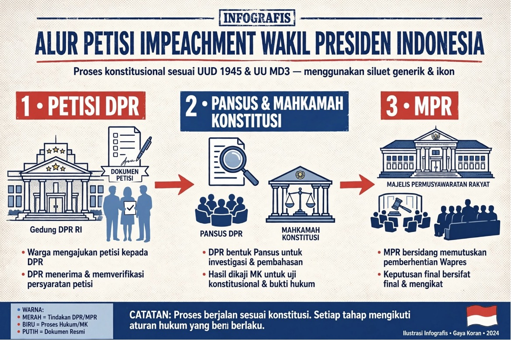

# Dari Istana ke Meja Pemakzulan: Pengunduran Diri Menyelesaikan Persoalan atau Sekadar Mengakhiri Krisis Jabatan?

*Ilustrasi (pic: Meta AI).*

  
***Standar hukum yang berlaku terhadap pejabat negara juga berlaku ketika pejabat tersebut sudah telanjur berkuasa. Sebaliknya, proses pemberhentian pun harus tunduk pada standar pembuktian dan prosedur yang sama ketatnya***
  

Petisi 120 anggota DPR dari delapan fraksi. DPR mengonfirmasi penerimaan usulan Hak Menyatakan Pendapat pada 11 November 2026, dan menjadwalkan pengumumannya dalam rapat paripurna 12 November. Jadi ini bukan petisi anonim yang beredar di media sosial.

Dan ada perkembangan yang lebih besar: Gibran memang menyatakan niat mundur dalam pertemuan dengan Prabowo pada 10 November. Namun laporan berikutnya berbeda tingkat kepastiannya. 

AP melaporkan ia menawarkan pengunduran diri dan belum jelas apakah diterima. Reuters kemudian mengutip ajudan Budi Arie Setiadi yang menyatakan Gibran sudah mengundurkan diri dan akan mengirim surat formal ke MPR. 

Artinya, kita harus membedakan niat/penawaran mundur, klaim bahwa pengunduran diri telah disampaikan, dan status konstitusional jabatan yang secara formal masih perlu ditentukan melalui prosedur negara.

## Pangkal Persoalan: Bukan Sekadar “Ijazah Palsu”

Ada nuansa hukum yang sangat penting di sini.

6 Oktober 2026, Mahkamah Konstitusi (MK): MK menyatakan tidak menemukan bukti meyakinkan bahwa Gibran memiliki ijazah, sertifikat, atau diploma luar negeri yang menjadi dasar penyetaraan dengan pendidikan setingkat SMA. 

Dokumen yang terungkap antara lain certificate of attendance, academic records, dan explanation of grades. Tetapi MK tidak mendiskualifikasi atau memberhentikan Gibran dalam perkara tersebut. Permohonan juga tidak diterima karena pemohon tidak memiliki kedudukan hukum.

30 Oktober 2026, Mahkamah Agung (MA): dalam perkara TUN, MA mengabulkan kasasi dan membatalkan surat keterangan penyetaraan pendidikan Gibran. 

Pertimbangannya, dokumen yang menjadi dasar surat itu tidak membuktikan kelulusan jenjang pendidikan tertentu. Ini membuat dasar administratif yang dipakai untuk memenuhi persyaratan pencalonan menjadi persoalan hukum serius.

Jadi, jangan menyederhanakan putusan MK sebagai “MK memutus Gibran tidak lulus SMA”. MK menyatakan bukti kelulusan yang diperlukan tidak ditemukan dalam perkara itu. 

MA kemudian membatalkan surat penyetaraan administratifnya. Dua putusan tersebut punya objek dan konsekuensi hukum berbeda.

## Mengapa 120 Anggota DPR Bisa Mengajukan Pemakzulan?

Dasar yang dipakai pengusul adalah Hak Menyatakan Pendapat (HMP), khususnya Pasal 79 ayat (4) huruf c UU MD3: DPR dapat menyatakan pendapat bahwa Presiden atau Wakil Presiden diduga tidak lagi memenuhi persyaratan jabatan.

Rinciannya menurut DPR:

| Fraksi | Penandatangan |
|------|-------|
|PDIP|14|
|Golkar|11|
|Gerindra|11|
|NasDem|19|
|PKB|18|
|PKS|28|
|PAN|1|
|Demokrat|18|
|Total|120|

Angka ini penting secara politik karena dukungannya melintasi delapan fraksi. Namun, jangan keliru membaca angka 120 sebagai suara yang sudah menyetujui pemakzulan. Itu adalah jumlah anggota yang mengusulkan penggunaan hak DPR, bukan hasil pemungutan suara akhir.

## Apakah Gibran Otomatis Dimakzulkan?

Ini bagian yang sering dipelintir oleh judul berita.

Pasal 7A dan 7B UUD 1945 menetapkan jalur pemberhentian Presiden/Wakil Presiden:
- DPR membangun pendapat konstitusional.
Usulan HMP harus diproses melalui mekanisme DPR. Pengajuan ke MK memerlukan dukungan sekurang-kurangnya dua pertiga anggota DPR yang hadir, dalam sidang yang dihadiri minimal dua pertiga seluruh anggota.
- MK memeriksa dan memutus.
MK wajib memutus paling lama 90 hari setelah permintaan DPR diterima. Di sinilah persoalan hukum mengenai kelayakan jabatan harus diuji dalam mekanisme pemakzulan.
- MPR mengambil keputusan akhir.
Jika MK membenarkan pendapat DPR, DPR meneruskan usulan pemberhentian kepada MPR. MPR harus bersidang paling lambat 30 hari setelah menerima usulan. Keputusan membutuhkan kuorum dan persetujuan khusus sebagaimana Pasal 7B ayat (7).

Dengan demikian, petisi 120 anggota adalah pintu masuk proses politik-konstitusional, bukan surat pemberhentian.

## Lalu, Apakah Tawaran Mundur Gibran itu Sungguhan?

Dari laporan yang tersedia, iya. Kronologinya:
- 10 November: Menteri Sekretaris Negara Prasetyo Hadi mengonfirmasi bahwa Gibran menyampaikan niat mundur dalam pertemuan sekitar 2,5 jam dengan Prabowo.
- 11 November: Budi Arie Setiadi mengonfirmasi bahwa surat pengunduran diri telah disampaikan kepada Prabowo. Reuters juga melaporkan pernyataan Budi Arie tersebut.
- 12 November: status formal pengunduran diri dan penyelesaian kekosongan jabatan masih harus ditunggu melalui pengumuman resmi lembaga negara.

Ada satu hal yang menarik: Gibran dilaporkan menyatakan niat mundur, tetapi pada saat yang sama ia juga ingin memperjuangkan persoalan dokumen pendidikannya melalui jalur hukum. 

Prabowo, menurut keterangan yang diberitakan, memberikan masukan kepadanya. Jadi kita belum punya dasar untuk menyimpulkan bahwa Prabowo menolak atau menerima pengunduran diri tersebut.

Jika kekosongan jabatan Wapres resmi terjadi, Pasal 8 ayat (2) UUD 1945 mengatur bahwa MPR memilih pengganti dari dua calon yang diusulkan Presiden, paling lambat 60 hari. Bukan otomatis digantikan oleh orang yang ditunjuk Presiden.

## Apa Sebenarnya yang Sedang Dipertaruhkan?

Ada empat lapisan persoalan yang perlu dipisahkan

A. Persoalan administratif berubah menjadi persoalan legitimasi konstitusional

Persyaratan pendidikan dalam pencalonan bukan dekorasi administratif. Ia merupakan salah satu syarat hukum untuk memasuki jabatan publik tertentu.

Jika surat penyetaraan pendidikan yang menjadi dasar pemenuhan persyaratan itu dibatalkan MA, konsekuensinya tidak berhenti pada dokumen tersebut. Muncul pertanyaan lanjutan: bagaimana status pencalonan yang sebelumnya menggunakan dokumen itu?

Tetapi ada jurang hukum antara dua pernyataan berikut:
- Dokumen administratif yang digunakan untuk memenuhi persyaratan pencalonan dinyatakan tidak sah.
- Wakil Presiden yang telah dilantik otomatis kehilangan jabatan.
Pernyataan pertama memiliki dasar putusan MA. Pernyataan kedua membutuhkan mekanisme konstitusional tersendiri. Itulah mengapa Pasal 7A dan 7B menjadi pusat perdebatan sekarang.

B. Masalah ex post facto legitimacy

Ini menarik dari perspektif teori hukum tata negara.

Gibran telah dilantik pada 20 Oktober 2024. Dua tahun kemudian, pengadilan menghasilkan putusan yang mempersoalkan dasar administratif persyaratan pendidikannya.

Pertanyaannya: bagaimana sistem hukum memperlakukan jabatan yang telah terbentuk ketika salah satu dasar persyaratan pencalonannya kemudian dinyatakan bermasalah?

Ada dua prinsip yang berhadapan:
- Legalitas persyaratan jabatan: seseorang harus memenuhi syarat yang ditetapkan hukum ketika mencalonkan diri.
- Kepastian hukum jabatan publik: hasil pemilu dan pelantikan tidak boleh dibatalkan begitu saja tanpa prosedur konstitusional yang jelas.
Konstitusi harus menyelesaikan ketegangan itu. Bukan tekanan massa, bukan pula kehendak elite politik yang dapat menggantikan putusan melalui prosedur yang sah.

C. Petisi lintas fraksi: apakah ini murni soal hukum atau juga konfigurasi kekuasaan?

Perhatikan komposisi 120 anggota tersebut. Mereka berasal dari delapan fraksi, termasuk partai-partai yang berada dalam koalisi pemerintahan.

Secara politik, ini memperlihatkan bahwa persoalan Gibran tidak lagi dapat dibaca hanya sebagai pertentangan antara oposisi dan pemerintah.

Namun, ada dua hal yang jangan dicampuradukkan:
- Kesamaan sikap terhadap isu hukum: anggota DPR dapat mendukung pemeriksaan karena menilai ada persoalan persyaratan jabatan.
- Kesamaan kepentingan politik: para penandatangan belum tentu memiliki motif, agenda, atau tujuan akhir yang sama.
Kita juga tidak boleh langsung menyimpulkan bahwa Prabowo sedang menyingkirkan Gibran atau bahwa semua penandatangan sedang menjalankan satu skenario politik. Itu hipotesis yang membutuhkan bukti tambahan.

D. Paradoks pengunduran diri: menyelesaikan jabatan atau menghindari preseden pemakzulan?

Ini justru bagian yang paling menarik.
Pengunduran diri dan pemakzulan adalah dua jalur yang berbeda:

| Pengunduran diri | Pemakzulan |
|------|-------|
|Berangkat dari keputusan pejabat yang bersangkutan|Berangkat dari proses konstitusional DPR|
|Memerlukan penyelesaian status kekosongan jabatan|Memerlukan pemeriksaan MK dan keputusan MPR|
|Tidak otomatis menghasilkan putusan tentang pelanggaran konstitusi|Dapat menghasilkan putusan mengenai dasar pemberhentian|
|Fokus pada berakhirnya jabatan|Fokus pada pertanggungjawaban konstitusional|

Jika Gibran mengundurkan diri dan pengunduran dirinya diproses secara sah, persoalan kekosongan jabatan dapat bergerak melalui Pasal 8 ayat (2). Tetapi itu tidak otomatis menjawab seluruh persoalan hukum yang melatarbelakanginya. 

Pengunduran diri tidak sama dengan pengakuan bersalah, dan juga tidak menghapus pertanyaan mengenai bagaimana persyaratan pencalonan sebelumnya dipenuhi.

Inilah perbedaan antara penyelesaian jabatan dan penyelesaian pertanggungjawaban konstitusional.

## Apa yang Perlu Kita Awasi Mulai Hari ini?

12 NOVEMBER 2026
- Rapat paripurna DPR: apakah usulan HMP benar-benar diteruskan dan bagaimana sikap anggota DPR dalam proses selanjutnya?
- Status surat pengunduran diri: apakah ada konfirmasi resmi dari Presiden, Wapres, MPR, atau lembaga negara terkait?
- Tindak lanjut putusan MA: bagaimana pemerintah melaksanakan kewajiban mencabut surat keterangan penyetaraan yang dibatalkan?
- Proses konstitusional: apakah jalur HMP tetap diteruskan meskipun pengunduran diri telah diajukan?
- Pengisian jabatan: jika kekosongan Wapres resmi terjadi, siapa dua nama yang akan diusulkan Presiden kepada MPR?
- Satu catatan: rapat paripurna yang dijadwalkan hari ini merupakan agenda penting, tetapi belum boleh kita sebut sebagai sidang pemakzulan yang sudah menghasilkan keputusan pemberhentian.

Ini bukan sekadar kabar tentang seorang Wapres yang dipersoalkan ijazahnya. Kita sedang menyaksikan pertemuan tiga mekanisme kekuasaan: pengujian legalitas administratif oleh pengadilan, pengawasan politik oleh DPR, dan mekanisme pergantian jabatan menurut konstitusi.

Hal yang paling penting bukan buru-buru menebak siapa yang akan menang dalam pertarungan elite, melainkan memastikan bahwa standar hukum yang berlaku terhadap pejabat negara juga berlaku ketika pejabat tersebut sudah telanjur berkuasa. Sebaliknya, proses pemberhentian pun harus tunduk pada standar pembuktian dan prosedur yang sama ketatnya.

Negara hukum diuji bukan ketika orang biasa berhadapan dengan hukum, melainkan ketika hukum harus memeriksa orang yang sedang duduk di puncak kekuasaan. 

  
**Referensi**

Associated Press. (2026, November 11). Indonesia’s vice president offers resignation as questions mount over his eligibility.

Dewan Perwakilan Rakyat Republik Indonesia. (2026, November 11). 120 anggota DPR usulkan Hak Menyatakan Pendapat, polemik ijazah Wapres masuk agenda paripurna.

Mahkamah Konstitusi Republik Indonesia. (2026, October 6). MK tidak menemukan bukti Gibran memiliki ijazah SLTA atau sederajat.

Mahkamah Agung Republik Indonesia. (2026, October 30). Putusan Nomor 742 K/TUN/2026.

Reuters. (2026, November 11). Over 100 Indonesian lawmakers sign petition that could lead to vice president’s impeachment.

Sekretariat Jenderal DPR RI. (n.d.). Undang-Undang Dasar Negara Republik Indonesia Tahun 1945, Pasal 7A, 7B, dan 8.
