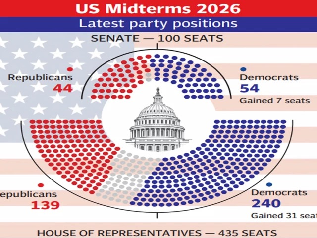

# Demokrat Kuasai Penuh Kongres AS: Rebuke Besar Trump karena Perang Iran?

*Ilustrasi (pic: Grok AI).*

  
***Hasil pemilu ini mengubah keseimbangan kekuasaan di Washington, tetapi belum menentukan akhir perang Iran***
  

Ada dua hal yang jangan sampai tercampur: Demokrat benar-benar merebut kendali kedua kamar Kongres, dan kemenangan itu merupakan penolakan pemilih terhadap perang Iran. 

Yang pertama adalah fakta elektoral yang bisa diperiksa. Yang kedua adalah interpretasi politik yang perlu diuji, bukan otomatis mengikuti hasil pemilu.

Ada satu detail konstitusional penting: Kongres AS terdiri dari House of Representatives dan Senate. Menguasai keduanya berarti partai tersebut punya kendali atas agenda legislasi dan sejumlah fungsi pengawasan, tetapi bukan berarti bisa begitu saja membatalkan keputusan perang presiden.

## Demokrat Menguasai Kedua Kamar Kongres

Menurut laporan NPR yang mengacu pada penghitungan hasil pemilu Associated Press, Demokrat berhasil merebut Senat dan House dalam pemilu sela 3 November 2026. 

Ini mengakhiri kendali penuh Partai Republik atas Kongres dan mengembalikan Demokrat ke posisi menguasai kedua kamar untuk pertama kalinya sejak 2023.

Reuters melaporkan Demokrat merebut sejumlah kursi Senat di negara bagian yang sebelumnya kuat mendukung Trump, termasuk Texas, Kansas, South Carolina, Iowa, North Carolina, Ohio, dan Maine. 

Di Texas, Demokrat memenangkan kursi Senat federal untuk pertama kalinya sejak 1988. Mereka juga meraih sedikitnya 30 tambahan kursi di House.

Ini bukan sekadar perubahan beberapa kursi. Peta politik yang sebelumnya memberi Trump kendali terpadu atas Gedung Putih dan Kongres berubah menjadi divided government: presiden dari Republik, dua kamar legislatif dikuasai Demokrat.

Namun, hasil akhir penghitungan sejumlah distrik masih dapat diperbarui. Jadi angka kursi final jangan dibekukan terlalu cepat.

## Apakah ini Referendum terhadap Perang Iran?

Ada bukti kuat bahwa perang Iran ikut menjadi faktor elektoral, tetapi bukan satu-satunya faktor.

Reuters melaporkan tiga isu besar yang membentuk kemarahan pemilih:
- Perang Iran dan biaya hidup. Perang yang berlangsung sejak Februari 2026 ikut mendorong kenaikan harga energi dan tekanan ekonomi rumah tangga.
- Inflasi dan keterjangkauan hidup. Pemilih menghadapi biaya kebutuhan sehari-hari yang tinggi.
- Korupsi dan tata kelola pemerintahan. Kampanye Demokrat mengangkat isu konflik kepentingan serta keuntungan bisnis keluarga Trump.
Yang menarik, Trump sendiri mengakui perang Iran berkontribusi terhadap kekalahan Partai Republik. Wakil Presiden JD Vance bahkan menyalahkan perang tersebut secara lebih langsung dalam komentarnya setelah pemilu.

Jadi, menyebut hasil ini sebagai rebuke terhadap Trump punya dasar politik. Tetapi menyebutnya sebagai penolakan pemilih yang semata-mata disebabkan perang Iran akan terlalu menyederhanakan perilaku pemilih Amerika.

## Apakah Demokrat Sekarang Bisa Menghentikan Perang Iran?

Nah, di sinilah drama konstitusionalnya. Menguasai Kongres tidak sama dengan memegang tombol kendali militer.

Presiden AS adalah Commander-in-Chief. Kongres memiliki kewenangan konstitusional untuk menyatakan perang, mengatur pendanaan militer, dan mengawasi pemerintah. Kedua kekuasaan itu saling membatasi, tetapi batas operasionalnya telah lama menjadi arena sengketa.

Ada empat instrumen yang kini bisa digunakan Demokrat:

| Instrumen | Dampak yang mungkin |
|------|-------|
|Investigasi dan subpoena|Memanggil pejabat, meminta dokumen, menguji dasar keputusan perang|
|Pengawasan anggaran|Menekan pendanaan operasi militer melalui proses anggaran|
|War Powers Resolution|Mendorong pembatasan atau penghentian penggunaan pasukan|
|Konfirmasi pejabat|Senat dapat menghambat atau menolak calon pejabat pemerintahan Trump|

Tetapi ada penghalang besar: veto presiden. Jika Trump memveto undang-undang yang membatasi perang, Kongres memerlukan dua pertiga suara di masing-masing kamar untuk mengesampingkan veto itu. Demokrat tidak memiliki mayoritas sebesar itu. 

Carnegie Endowment juga menekankan bahwa mayoritas sederhana Demokrat belum cukup untuk memaksakan pembatasan hukum terhadap presiden tanpa dukungan sebagian Republik.

Artinya, Demokrat dapat membuat perang semakin mahal secara politik, mempersempit ruang anggaran, mengungkap informasi, dan menghambat agenda pemerintahan. Namun, mereka belum otomatis dapat memerintahkan militer menghentikan operasi besok pagi.

## Mengapa Perang Iran Menjadi Bumerang Domestik?

Ini bagian yang menarik secara ilmu politik. Perang luar negeri sering menghasilkan efek rally around the flag: masyarakat berkumpul di belakang pemimpin ketika negara menghadapi ancaman eksternal. 

Tetapi efek ini tidak permanen. Jika perang berlangsung lama, biaya ekonomi meningkat, dan tujuan strategisnya tidak jelas, dukungan publik bisa terkikis.

Ada tiga mekanisme yang relevan:

A. Economic voting

Pemilih tidak selalu menilai perang dari peta geopolitik. Mereka juga menilai harga bensin, biaya transportasi, bahan pangan, dan daya beli. Ketika biaya perang masuk ke kehidupan rumah tangga, kebijakan luar negeri berubah menjadi persoalan domestik.

B. Accountability voting

Pemilih menggunakan pemilu sela untuk memberi sinyal kepada pemerintahan yang sedang berkuasa. Mereka tidak harus sepakat dengan seluruh program oposisi. Cukup dengan merasa bahwa pemerintah perlu dikoreksi.

C. War fatigue

Perang yang berkepanjangan dapat menimbulkan kejenuhan, terutama ketika pemerintah belum mampu menjelaskan secara meyakinkan apa definisi kemenangan, berapa lama operasi akan berlangsung, dan bagaimana perang akan berakhir.

Reuters mengidentifikasi kombinasi perang Iran, tekanan biaya hidup, dan kemarahan terhadap tata kelola Trump sebagai faktor penting dalam perubahan suara pemilih.

## Konsekuensi Geopolitik: Apa Artinya bagi Iran, Israel, dan Negara Teluk?

Ada beberapa implikasi yang layak dipantau:

1. Iran memperoleh ruang diplomatik, tetapi bukan jaminan kemenangan strategis. Perubahan keseimbangan politik di Washington dapat memperbesar tekanan terhadap kebijakan perang Trump. Namun, Iran tetap menghadapi tekanan militer dan ekonomi.

2. Israel harus memperhitungkan perubahan dinamika politik Washington. Dukungan AS terhadap keamanan Israel tidak otomatis hilang, tetapi perdebatan mengenai biaya perang, penjualan senjata, dan strategi terhadap Iran dapat menjadi lebih terbuka.

3. Negara-negara Teluk menghadapi ketidakpastian. Mereka berkepentingan menjaga keamanan jalur energi, tetapi juga harus memperhitungkan risiko serangan balasan dan eskalasi regional.

4. Selat Hormuz tetap menjadi titik strategis. Ketegangan militer di kawasan ini dapat memengaruhi biaya energi, asuransi pelayaran, dan perdagangan internasional. 

Reuters mencatat bahwa gangguan perang telah membuat harga minyak tetap tinggi dibandingkan tingkat sebelum konflik.

Jangan buru-buru menyimpulkan bahwa kemenangan Demokrat berarti AS akan langsung menarik diri dari konflik. Kebijakan luar negeri Amerika tidak berubah hanya karena pergantian mayoritas legislatif.

## Satu Ironi Politik yang Menarik

Pada Juni 2026, ketika Partai Republik masih menguasai Kongres, House dan Senate sudah pernah menunjukkan perlawanan terhadap perang Iran melalui resolusi war powers. Bahkan sejumlah anggota Republik ikut mendukung pembatasan tindakan militer Trump.

Jadi, ketidakpuasan terhadap perang bukan fenomena yang baru muncul setelah Demokrat menang. Retakan dukungan sudah terlihat di dalam Partai Republik sendiri.
Pemilu November memperbesar retakan tersebut menjadi perubahan kendali institusional.

Ini penting: oposisi terhadap perang tidak identik dengan dukungan terhadap Iran. Seorang anggota Kongres dapat menentang perang karena alasan konstitusional, biaya fiskal, risiko keamanan nasional, atau ketidakjelasan tujuan militer, tanpa mendukung rezim Teheran.

## Kemenangan Demokrat dapat dibaca sebagai koreksi elektoral terhadap pemerintahan Trump, dengan perang Iran sebagai salah satu faktor penting bersama ekonomi dan isu tata kelola.

Namun, tiga lapisan harus dibedakan:
- Lapisan elektoral: Demokrat merebut kedua kamar Kongres.
- Lapisan politik: Trump kehilangan dukungan legislatif dan menghadapi tekanan pengawasan yang lebih besar.
- Lapisan militer-konstitusional: Trump masih memiliki kewenangan sebagai presiden, sedangkan Demokrat harus menggunakan instrumen Kongres untuk membatasi kebijakan perang.
Dengan kata lain, hasil pemilu ini mengubah keseimbangan kekuasaan di Washington, tetapi belum menentukan akhir perang Iran.

Kalau Demokrat berhasil menguasai Kongres tetapi Trump tetap mempertahankan perang Iran, apakah Amerika sedang menuju krisis konstitusional baru tentang siapa yang sebenarnya berhak menentukan perang dan damai? 

Itu bukan lagi sekadar persaingan dua partai. Itu pertarungan tentang distribusi kekuasaan dalam negara presidensial. 

  
**Referensi**

1. Associated Press. (2026, November 5). Democratic sweep of Congress ushers in a new era as Trump acknowledges impact of the Iran war. AP News. https://apnews.com/article/9c5c4c5283f58b1ae0786e2f410c21a0⁠

2. Hendrixson White, J. (2026, November 4). Three ways the new Democratic Congress could constrain Trump on foreign policy. Carnegie Endowment for International Peace. https://lync.ceip.org/emissary/2026/11/democratic-congress-midterms-foreign-policy-trump⁠

3. McDaniel, E., & Grisales, C. (2026, November 4). Democrats win full control of Congress, ushering in a new era of divided government. NPR. https://www.opb.org/article/2026/11/04/2026-midterms-democrats-win-the-senate/⁠

4. Reuters. (2026, November 5). Democrats vow to rein in Trump as he shows off White House ballroom. https://www.investing.com/news/politics-news/democrats-vow-to-rein-in-trump-as-he-shows-off-white-house-ballroom-5002462⁠

5. Congressional Research Service. (2025, June 24). War Powers Resolution: Expedited procedures in the House and Senate (R47603). https://www.everycrsreport.com/reports/R47603.html⁠

6. Zengerle, P. (2026, June 23). US Senate joins House in voting to halt Iran war, rebuking Trump. Reuters. https://www.fidelity.com/news/article/default/202606231834RTRSNEWSCOMBINED_KBN3SP2RD-OUSTP_1⁠

