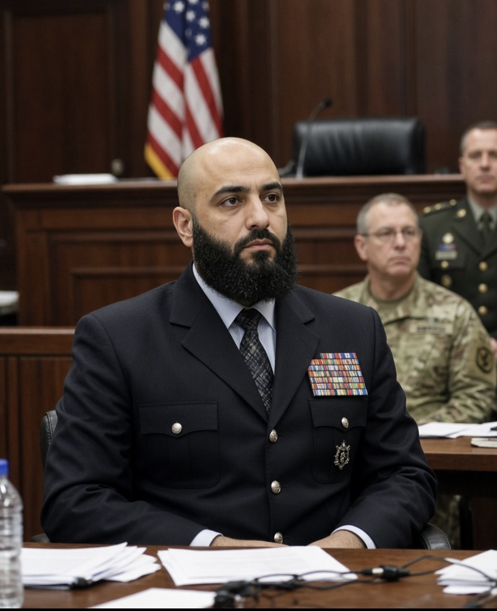

# Eksekusi Nidal Malik Hasan: Keadilan, Identitas, dan Politik Pertunjukan Kekuasaan

*Ilustrasi (pic: Grok AI).*

  
***Pengadilan memutuskan tanggung jawab pidananya berdasarkan tindakan dan bukti perkara, bukan berdasarkan dugaan bahwa ia merupakan korban diskriminasi***
  

Ada empat persoalan berbeda dalam kasus ini, yaitu hukuman mati, siaran langsung eksekusi, perlakuan terhadap minoritas di lingkungan militer, dan kemungkinan pemanfaatan identitas seseorang sebagai simbol politik. 

Kalau semuanya dicampur, kita berisiko melewatkan persoalan yang justru paling serius.

## Siapa Nidal Malik Hasan?

Nidal Malik Hasan adalah mantan mayor Angkatan Darat AS dan psikiater militer.

Pada 5 November 2009, Hasan menembaki personel di Fort Hood, Texas. Sebanyak 13 orang tewas dan 32 lainnya terluka. Pada 2013, pengadilan militer menyatakannya bersalah atas pembunuhan berencana dan percobaan pembunuhan, lalu menjatuhkan hukuman mati. (Angkatan Darat AS⁠)

Pada 2 Oktober 2026, Donald Trump menyetujui pelaksanaan hukuman mati. Angkatan Darat kemudian menetapkan 3 Desember 2026 sebagai tanggal eksekusi dengan regu tembak di Fort Hood. 

Pada 8 Oktober, Menteri Pertahanan Pete Hegseth mengumumkan rencana menyiarkan eksekusi tersebut secara langsung. (Reuters⁠, Angkatan Darat AS⁠)

Tetapi, eksekusi dan siaran langsungnya adalah dua keputusan yang berbeda. Trump mendukung pelaksanaan hukuman mati, sedangkan pada 9 dan 10 Oktober ia masih menyatakan bahwa keputusan mengenai siaran langsung sedang dipertimbangkan. Jadi, rencana siaran tersebut belum bisa disebut pasti terlaksana. (Reuters⁠, The Washington Post⁠)

## Apakah ini Penegakan Hukum atau Pertunjukan Kekuasaan?

Inilah inti kontroversinya. Hegseth menjelaskan rencana tersebut dengan gagasan bahwa masyarakat harus melihat konsekuensi dari tindakan semacam itu. 

Logikanya adalah membuat hukuman menjadi pesan publik, bukan sekadar proses yang berlangsung di balik tembok penjara. Namun, belum ada bukti bahwa menyiarkan eksekusi secara langsung akan memberikan efek pencegahan yang lebih besar daripada pelaksanaan hukuman tanpa siaran.

Kita perlu membedakan tiga tujuan yang sering dicampur dalam perdebatan hukuman mati:

| Tujuan | Pertanyaan ilmiah |
|------|-------|
|Retribusi|Apakah hukuman dianggap sebanding dengan beratnya kejahatan?|
|Pencegahan|Apakah ancaman hukuman mengurangi kemungkinan kejahatan di masa mendatang?|
|Pertunjukan publik|Apakah menampilkan hukuman kepada khalayak memberi manfaat yang tidak bisa diperoleh melalui proses hukum biasa?|

Dua tujuan pertama merupakan bagian dari perdebatan lama tentang teori pemidanaan. Yang ketiga menimbulkan masalah tambahan: apakah penderitaan seseorang perlu dijadikan tontonan agar negara terlihat tegas?

Hukuman mati sendiri masih sah dalam sistem hukum federal tertentu dan sistem peradilan militer AS, meskipun ditolak atau dibatasi di banyak negara. Namun, legalitas hukuman mati tidak otomatis menjawab pertanyaan tentang etika siaran langsungnya.

Pada 9 Oktober, Perserikatan Bangsa-Bangsa mengkritik rencana tersebut dengan sangat keras. Juru bicara PBB menyebut gagasan itu “abhorrent” dan menyatakan bahwa penyiaran eksekusi dapat menimbulkan persoalan terkait larangan penyiksaan serta perlakuan yang kejam, tidak manusiawi, atau merendahkan martabat. (Reuters⁠)

Hukuman dapat dijalankan berdasarkan putusan pengadilan, tetapi menjadikan pelaksanaannya sebagai tontonan adalah pilihan kebijakan tambahan. Pilihan kedua inilah yang memerlukan pembenaran tersendiri.

## Siaran Langsung Menjadi Persoalan HAM yang Lebih Serius

Bayangkan perbedaan antara dua situasi:
Dalam situasi pertama, negara melaksanakan hukuman berdasarkan prosedur hukum, dengan pengawasan dan pembatasan akses yang ditentukan aturan.
Dalam situasi kedua, negara sengaja memperluas penonton melalui siaran langsung sehingga kematian terpidana menjadi peristiwa publik yang dapat direkam, dibagikan, dan dikonsumsi berulang kali.
Perbedaan itu bukan hanya soal kamera. Ia menyangkut tujuan, martabat manusia, dampak terhadap keluarga, risiko bagi penonton, dan cara negara menampilkan kekuasaannya.

Reuters melaporkan bahwa siaran tersebut akan menjadi langkah yang sangat tidak lazim dalam sejarah modern AS. Eksekusi militer biasanya berlangsung secara tertutup, dan belum ada preseden modern yang diketahui untuk siaran langsung eksekusi legal kepada khalayak luas. (Reuters⁠)

Ada pula risiko yang berlawanan dengan tujuan pemerintah sendiri, rekaman dapat dipakai sebagai propaganda oleh kelompok ekstremis, disebarkan di luar konteks hukum, atau menjadi materi yang mengundang glorifikasi kekerasan. 

Sejumlah anggota Kongres AS memperingatkan bahwa siaran tersebut bisa menjadi alat perekrutan bagi kelompok teroris. (Al Jazeera⁠)

Maka pertanyaan ilmiahnya bukan hanya, “Apakah Hasan pantas dihukum?” Pengadilan telah menjawab pertanyaan pidananya melalui proses hukum. 

Pertanyaan tambahannya adalah: Apa manfaat publik yang dapat dibuktikan dari menyiarkan kematian seseorang, dan apakah manfaat itu sebanding dengan risiko menjadikan kekerasan negara sebagai hiburan atau propaganda?

Sampai sekarang, belum ada bukti yang meyakinkan bahwa siaran langsung akan memberikan manfaat pencegahan yang khusus dan sebanding dengan risiko tersebut.

## Hasan Keturunan Palestina dan Muslim: Apakah Diskriminasi Menjadi Faktor?

Hasan adalah seorang Muslim Amerika yang keluarganya memiliki latar belakang Palestina. Kasusnya berlangsung dalam konteks setelah serangan 11 September 2001, ketika identitas Muslim dan Arab-Amerika menjadi objek kecurigaan serta diskriminasi di sejumlah lingkungan sosial dan institusional.

Laporan mengenai Hasan juga mencatat bahwa ia pernah menghadapi kekhawatiran tentang identitas Muslimnya dan perannya sebagai dokter militer ketika AS berperang di negara-negara mayoritas Muslim. Namun, latar belakang tersebut tidak membuktikan bahwa bullying merupakan penyebab tunggal penembakan Fort Hood. 

Pengadilan memutuskan tanggung jawab pidananya berdasarkan tindakan dan bukti perkara, bukan berdasarkan dugaan bahwa ia merupakan korban diskriminasi. (Reuters⁠)

Ada tiga pernyataan yang harus dipisahkan:

Hasan mungkin mengalami tekanan atau diskriminasi dalam kehidupan profesionalnya.

Tekanan tersebut dapat menjadi salah satu unsur yang diteliti untuk memahami latar belakang seseorang.

Tekanan tersebut tidak membenarkan pembunuhan terhadap orang lain dan tidak otomatis menjelaskan seluruh motifnya.

Bahkan jika seseorang benar-benar mengalami perundungan, korban tidak menjadi sasaran yang sah untuk membalas dendam kepada orang-orang yang tidak terlibat. Sebaliknya, jika diskriminasi memang terjadi, institusi tetap berkewajiban menyelidiki dan mengatasinya.

Keadilan bagi korban penembakan dan keadilan terhadap kemungkinan diskriminasi bukan dua tujuan yang saling meniadakan. Keduanya dapat dituntut sekaligus.

## Apakah Trump Menggunakan Eksekusi ini untuk Membalas Kekesalan terhadap Iran dan Palestina?

Ini hipotesis geopolitik yang menarik, tetapi bukti yang tersedia belum cukup untuk menetapkannya sebagai motif Trump.

Hasan pernah menyatakan keberatan ideologis terhadap perang AS di negara-negara Muslim. Reuters menggambarkan serangan Fort Hood sebagai tindakan yang dikaitkan dengan penolakannya terhadap perang-perang tersebut. Namun, itu menjelaskan sebagian konteks tindakan Hasan, bukan motif pemerintahan Trump dalam memutuskan pelaksanaan hukumannya pada 2026. (Reuters⁠)

Kita harus membedakan:

Motif Hasan pada 2009: berkaitan dengan penembakan dan konteks ideologis yang diteliti dalam kasus pidananya.

Motif pemerintah AS pada 2026: belum dapat disimpulkan sebagai pembalasan terhadap Palestina atau Iran hanya berdasarkan identitas Hasan.

Dampak politik siaran: dapat memperkuat citra pemerintahan yang menekankan hukuman keras, tetapi dampak itu tidak membuktikan bahwa balas dendam geopolitik merupakan tujuan utamanya.

Ada satu hal yang tetap layak dikritisi, jika negara menampilkan eksekusi seorang Muslim keturunan Palestina sebagai demonstrasi kekuasaan, publik dapat menafsirkan tindakan tersebut melalui sejarah konflik dan diskriminasi yang lebih luas. 

Persepsi itu dapat timbul bahkan tanpa bukti bahwa pemerintah secara sengaja merancangnya sebagai pembalasan etnis atau geopolitik.

Dengan kata lain, efek simbolis suatu kebijakan tidak selalu sama dengan motif pembuat kebijakan. Analisis yang kuat harus memeriksa keduanya, bukan menyamakan keduanya.

## Paradoks Amerika sebagai Pengusung HAM

AS memiliki sejarah panjang dalam mempromosikan hak asasi manusia melalui diplomasi, hukum, dan kebijakan luar negeri. Pada saat yang sama, AS mempertahankan hukuman mati dalam sistem hukum tertentu dan mengalami perdebatan domestik yang tajam tentang batas penggunaannya.

Itu bukan kontradiksi yang dapat diselesaikan hanya dengan mengatakan bahwa AS munafik. Kita perlu melihat standar apa yang diklaim, kebijakan apa yang diterapkan, dan apakah keduanya konsisten.

Ada perbedaan antara menjatuhkan hukuman setelah proses pengadilan, menetapkan metode eksekusi yang dianggap sah menurut hukum domestik, serta menyiarkan eksekusi secara langsung kepada masyarakat.

Negara bisa menyatakan bahwa proses hukumnya sah, tetapi tetap menghadapi kritik HAM atas metode atau cara hukuman itu ditampilkan. Legalitas domestik tidak otomatis menyelesaikan seluruh pertanyaan etika dan kewajiban internasional.

Paus Leo XIV pada 10 Oktober kembali menyatakan penolakannya terhadap hukuman mati dengan alasan martabat manusia. Kritik terhadap siaran eksekusi juga datang dari tokoh agama, anggota Kongres, serta organisasi HAM, termasuk dari dalam AS sendiri. (Reuters⁠, Al Jazeera⁠)

Karena itu, kita tidak tepat mengatakan bahwa seluruh masyarakat AS mendukung rencana tersebut. Kritik yang muncul justru memperlihatkan adanya pertentangan internal mengenai bagaimana negara seharusnya menjalankan hukuman dan memperlakukan terpidana.

## Siaran Langsung akan Membuat AS Terlihat Lebih Kuat?

Dalam teori komunikasi politik, demonstrasi kekuasaan dapat menghasilkan dua jenis dampak yang berlawanan:

Efek deterrence: pihak lain menjadi lebih takut melanggar aturan karena melihat konsekuensinya.

Efek delegitimasi: masyarakat menilai penggunaan kekuasaan itu berlebihan, merendahkan martabat, atau tidak sesuai dengan nilai yang diklaim negara.

Siaran langsung mungkin dimaksudkan untuk menegaskan konsekuensi dari kejahatan berat. Namun, jika publik menafsirkannya sebagai tontonan penderitaan, pesan yang diterima bisa berbeda dari pesan yang ingin dikirim pemerintah.

Ada juga risiko bahwa rekaman tersebut akan dipakai oleh kelompok ekstremis untuk membangun narasi permusuhan. Dengan demikian, siaran yang dimaksudkan sebagai simbol ketegasan bisa menghasilkan materi propaganda yang memperpanjang konflik.

Itu bukan kepastian bahwa kebijakan tersebut akan gagal. Namun, risiko itu membuat klaim bahwa siaran langsung otomatis meningkatkan keamanan atau mencegah terorisme tidak dapat diterima tanpa bukti empiris.

Kritik yang paling kuat bukanlah bahwa Hasan tidak bertanggung jawab atas tindakannya, atau bahwa latar belakangnya membatalkan putusan pengadilan. Ia telah divonis atas pembunuhan berencana dan percobaan pembunuhan yang menimbulkan korban nyata.

Inti persoalannya adalah bahwa pelaksanaan hukuman mati dan keputusan untuk menyiarkannya merupakan dua tindakan berbeda yang harus dinilai secara terpisah.

Negara dapat mengklaim bahwa hukuman tersebut sah menurut hukum domestik, tetapi tetap harus menjawab pertanyaan mengenai martabat manusia, tujuan siaran, risiko propaganda, dan konsistensi nilai HAM yang dikemukakannya.

Demikian pula, kita dapat mengkritik diskriminasi terhadap Muslim atau warga keturunan Palestina tanpa menjadikan identitas Hasan sebagai bukti bahwa pemerintah sedang membalas dendam kepada Palestina atau Iran. 

Untuk tuduhan sebesar itu, kita memerlukan bukti langsung mengenai motif kebijakan, bukan sekadar kesamaan identitas dan konteks geopolitik.

Sebuah negara tidak membuktikan keunggulan moralnya hanya dengan menunjukkan bahwa ia mampu menghukum seseorang. Ukuran yang lebih sulit adalah apakah ia dapat menjalankan hukum tanpa mengubah penderitaan manusia menjadi pertunjukan kekuasaan, dan apakah ia menerapkan prinsip martabat manusia secara konsisten bahkan ketika berhadapan dengan orang yang dibencinya.

Itulah pertanyaan yang layak terus diajukan, bukan untuk menghapus kejahatan Hasan, melainkan untuk memastikan bahwa keadilan tidak berubah menjadi panggung tempat negara mempertontonkan kemampuannya mencabut nyawa. 

  
**Referensi**

Reuters. (2026, October 6). Trump orders firing squad for gunman who killed 13 people at Fort Hood, Texas. (Reuters⁠)

U.S. Army Public Affairs. (2026, October 7). Army sets execution date for convicted murderer Nidal Hasan. (U.S. Army⁠)

Reuters. (2026, October 8). US to livestream Army firing squad execution of Fort Hood shooter, Pentagon says. (Reuters⁠)

Reuters. (2026, October 9). UN calls US plans to livestream execution “abhorrent”. (Reuters⁠)

Reuters. (2026, October 10). Pope Leo condemns death penalty as Trump mulls livestreamed execution. (Reuters⁠)
