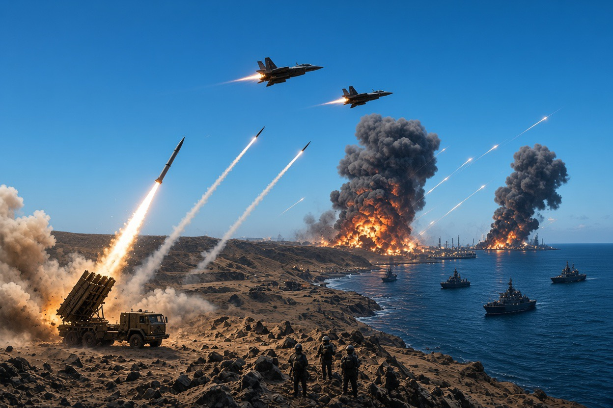

# Eskalasi Konflik Saudi–Houthi di Yaman: Analisis Geopolitik, Strategi Militer, Hukum Humaniter Internasional, & Risiko Regional

*Trump dan Ilham Omar (pic: itv.com)

  
***Apakah tekanan militer akan menghasilkan penyelesaian politik atau justru memperluas perang yang sudah terlalu lama menghancurkan kehidupan warga Yaman?***
  

Tanggal 2 Oktober 2026 merupakan tanda-tanda ofensif Saudi. Reuters melaporkan bahwa Arab Saudi sedang menyiapkan pilihan operasi untuk menekan Houthi, termasuk kemungkinan ofensif di pesisir Laut Merah dan operasi di beberapa front. 

Pasukan Yaman yang didukung Riyadh diperkirakan menjadi unsur darat utama, dengan dukungan serangan udara Saudi.

8–10 Oktober serangan Houthi terhadap bandara internasional King Khalid di Riyadh menewaskan warga sipil dan menyebabkan banyak korban luka. 

AP melaporkan sedikitnya 13 orang tewas dan lebih dari 300 terluka dalam serangan yang sedang diselidiki otoritas Saudi. Angka korban dan kronologi serangan lanjutan perlu dibedakan karena laporan-laporan berikutnya membahas insiden berbeda.

Kemudian 13 Oktober Saudi melancarkan serangan udara terhadap fasilitas penyimpanan minyak di wilayah yang dikuasai Houthi, termasuk fasilitas di sekitar Sanaa. 

Houthi menyatakan serangan Saudi sebagai alasan untuk membalas. Sasaran energi kini menjadi bagian nyata dari eskalasi, bukan sekadar ancaman retoris.

Sampai 14 Oktober Aramco masuk ke dalam lingkaran sasaran. Reuters dan AP melaporkan serangan rudal terhadap kantor pusat Saudi Aramco di Dhahran. 

Houthi mengancam akan meneruskan serangan terhadap infrastruktur minyak dan bandara Saudi. Koalisi pimpinan Saudi juga melaporkan pencegatan rudal lain yang menuju Riyadh.

Pfensif yang direncanakan Saudi, serangan Houthi ke wilayah Saudi, lalu serangan balasan terhadap sasaran di Yaman membentuk lingkaran eskalasi. 

Akan tetapi, kronologi saja belum membuktikan bahwa setiap serangan merupakan respons langsung terhadap serangan tepat sebelumnya. Kita perlu membedakan urutan waktu dari bukti hubungan sebab-akibat.

## Mengapa Perang ini Meledak Kembali?

Untuk memahami eskalasi, kita perlu memisahkan tiga lapisan konflik yang sekarang saling memperkuat:

Lapisan I: perang internal Yaman

Yaman bukan sekadar arena tempat Saudi melawan Houthi. Negara ini terpecah antara otoritas yang diakui secara internasional, pemerintahan de facto Houthi yang berpusat di Sanaa, dan kelompok-kelompok bersenjata lain, termasuk faksi separatis di selatan. 

Perpecahan di antara kelompok anti-Houthi sendiri menyulitkan pembentukan front yang terpadu.

Lapisan II: persaingan Saudi–Iran

Saudi mendukung pemerintah Yaman yang diakui secara internasional, sementara Houthi memiliki hubungan dan menerima dukungan dari Iran. 

Dukungan Iran meningkatkan kemampuan militer Houthi, tetapi tidak otomatis membuktikan bahwa setiap keputusan operasional mereka diperintahkan langsung oleh Teheran. Houthi juga memiliki kepentingan domestik, organisasi, dan kalkulasi strategis sendiri.

Lapisan III: perang regional yang lebih luas

Utusan PBB menyatakan bahwa ketidakstabilan di Timur Tengah memengaruhi dinamika perang Yaman, sedangkan perkembangan di Yaman kembali berdampak pada kawasan. Reuters dan AP mengaitkan eskalasi terbaru dengan konflik Amerika Serikat–Iran yang lebih luas. 

Dengan demikian, medan perang Yaman tidak lagi dapat dianalisis secara terpisah dari konfrontasi regional.

Inilah yang dalam studi konflik disebut conflict entanglement: beberapa konflik yang awalnya berbeda saling terhubung sehingga tindakan di satu medan mengubah perhitungan pihak-pihak di medan lainnya.

Risikonya, suatu serangan yang dirancang untuk mencapai tujuan terbatas di Yaman dapat memicu respons yang jauh lebih luas, karena pihak lawan menghubungkannya dengan ancaman terhadap keamanan nasional, reputasi, atau kepentingan regionalnya.

## Mengapa Houthi Menargetkan Bandara dan Infrastruktur Minyak Saudi?

Jawabannya tidak cukup dengan mengatakan bahwa Houthi memiliki rudal. Kita harus melihat fungsi strategis dari sasaran tersebut.

A. Menekan keamanan wilayah Saudi

Serangan yang mencapai Riyadh menunjukkan bahwa jarak geografis dan keunggulan persenjataan Saudi tidak menjamin perlindungan sempurna. 

AP melaporkan bahwa penyelidikan Saudi berfokus pada kegagalan pertahanan udara menghadang rangkaian drone dan rudal. Para pejabat yang dikutip AP menyebut drone mungkin digunakan untuk mendahului serangan rudal jelajah dan balistik. 

Rincian teknis ini masih merupakan keterangan awal, bukan hasil penyelidikan final yang dipublikasikan.

B. Menciptakan biaya ekonomi dan psikologis

Bandara merupakan infrastruktur transportasi, sementara perusahaan energi merupakan bagian penting dari ekonomi Saudi. 

Ancaman terhadap keduanya berpotensi mengganggu penerbangan, meningkatkan biaya keamanan, memengaruhi kepercayaan investor, dan membuat perusahaan harus menyiapkan rencana darurat.

Reuters melaporkan bahwa serangan terhadap bandara dan ancaman terhadap infrastruktur minyak telah mengganggu kegiatan penerbangan serta meningkatkan risiko terhadap fasilitas strategis Saudi.

C. Membangun daya tawar untuk negosiasi

Serangan lintas batas dapat digunakan untuk memberi tekanan agar lawan mengubah operasi militernya atau menerima syarat negosiasi tertentu. 

Namun, kita tidak boleh langsung menyimpulkan bahwa setiap serangan Houthi semata-mata bertujuan memaksa Saudi berunding. Untuk menguji hipotesis itu, diperlukan bukti mengenai tuntutan politik Houthi, pola pemilihan sasaran, dan kesediaan mereka menghentikan serangan jika tuntutan tertentu dipenuhi.

Ada paradoks strategi di sini: tekanan militer dapat meningkatkan daya tawar, tetapi serangan yang menewaskan warga sipil juga dapat mempersempit ruang diplomasi, memperkuat dukungan bagi tindakan balasan, dan membuat kompromi politik lebih sulit diterima.

## Mengapa Persenjataan Saudi Belum Menjamin Perlindungan Penuh?

Saudi memiliki anggaran pertahanan besar dan membeli sistem persenjataan modern, tetapi pertahanan udara bukan perisai ajaib yang dapat menutup seluruh wilayah secara sempurna.

Ada beberapa persoalan strategis:
- Luas wilayah. Infrastruktur penting tersebar di banyak lokasi. Melindungi semua bandara, pusat kota, fasilitas energi, pelabuhan, dan instalasi militer membutuhkan cakupan radar serta sistem pencegat yang luas.
- Serangan campuran. Drone, rudal jelajah, dan rudal balistik memiliki karakteristik penerbangan berbeda. Sistem pertahanan perlu mendeteksi, mengidentifikasi, dan menentukan respons dalam waktu terbatas.
- Ketimpangan biaya. Penyerang dapat mencoba memaksa pihak bertahan menggunakan pencegat mahal untuk menghadapi senjata yang lebih murah. Namun, rasio biaya aktual bergantung pada jenis senjata, jarak, dan tingkat keberhasilan setiap serangan.
- Keterbatasan persediaan dan waktu reaksi. Jumlah pencegat, kualitas peringatan dini, serta koordinasi antarsistem dapat menentukan hasil. AP melaporkan Saudi sedang menyelidiki bagaimana serangan terhadap Riyadh berhasil menembus pertahanan udaranya.

Artinya, keberhasilan menembus pertahanan udara tidak otomatis membuktikan bahwa sistem pertahanan Saudi secara keseluruhan tidak berguna. Sebaliknya, keberhasilan mencegat sejumlah rudal juga tidak membuktikan bahwa wilayahnya telah terlindungi sepenuhnya.

Secara militer, pertanyaan yang lebih tepat bukan “Siapa memiliki senjata lebih canggih?”, melainkan “Siapa yang mampu mempertahankan kemampuan operasionalnya, mengurangi kerugian, dan mencapai tujuan politik dengan biaya yang dapat ditanggung?”

## Laut Merah dan Bab el-Mandeb: Mengapa Dunia Ikut Berkepentingan?

Salah satu dimensi terpenting konflik ini adalah geografi maritim. Yaman berada di dekat Bab el-Mandeb, jalur sempit yang menghubungkan Laut Merah dengan Teluk Aden dan Samudra Hindia.

Jalur ini penting bagi perdagangan internasional karena menghubungkan lalu lintas laut dari Asia dan Samudra Hindia menuju Laut Merah, Terusan Suez, serta kawasan Mediterania. 

Gangguan keamanan di sana dapat memaksa kapal mengubah rute, memperpanjang waktu perjalanan, menaikkan biaya asuransi, dan meningkatkan ongkos logistik.

Dalam pengarahan kepada Dewan Keamanan pada 9 Oktober, utusan PBB memperingatkan bahwa ancaman Houthi terhadap kapal komersial yang terkait dengan Saudi di Laut Merah dapat mengancam kebebasan navigasi. 

Dewan Keamanan sebelumnya juga mengecam serangan Houthi terhadap Saudi dan ancaman terhadap pelayaran komersial di Laut Merah serta Bab el-Mandeb.

Mengapa ini mengubah kalkulasi Saudi? Karena bagi Riyadh, ancaman terhadap Houthi bukan hanya persoalan wilayah perbatasan. Jika kelompok tersebut mampu mengganggu jalur maritim dan fasilitas energi, masalah keamanan berubah menjadi persoalan ekonomi dan konektivitas regional.

Namun, ada jebakan strategis: operasi militer yang bertujuan mengamankan jalur laut dapat justru meningkatkan ancaman terhadap pelayaran apabila serangan balasan meluas. 

Keamanan maritim tidak hanya ditentukan oleh kemampuan menguasai pesisir, tetapi juga oleh stabilitas politik dan insentif semua pihak untuk tidak menyerang kapal sipil.

## Siapa yang Mendapat Keuntungan Strategis?

Pertanyaan ini perlu dijawab dengan membedakan keuntungan taktis, keuntungan strategis, dan keuntungan politik.

| Dimensi | Indikator yang perlu dinilai | Batas kesimpulan saat ini |
|--------|--------|--------|
|Militer|Kemampuan menyerang, bertahan, menguasai wilayah, dan mempertahankan pasokan|Houthi telah menunjukkan kemampuan menyerang sasaran di Saudi, tetapi dampak jangka panjang terhadap keseimbangan kekuatan masih berkembang.|
|Politik|Kemampuan memengaruhi keputusan lawan dan posisi dalam negosiasi|Tekanan militer dapat menambah daya tawar, tetapi juga dapat memicu koalisi yang lebih luas melawan pihak penyerang.|
|Ekonomi|Kerusakan fasilitas, gangguan penerbangan, perdagangan, dan biaya keamanan|Serangan terhadap bandara dan fasilitas energi telah menimbulkan gangguan; besarnya kerugian jangka panjang belum dapat dipastikan.|
|Diplomasi|Dukungan negara lain, kecaman internasional, dan peluang mediasi|Serangan terhadap warga sipil mengundang kecaman, sementara kebutuhan menghentikan perang tetap menciptakan ruang bagi diplomasi.|

Sumber terbaru menunjukkan Houthi mampu menimbulkan biaya keamanan yang nyata bagi Saudi. Pada saat yang sama, Saudi memiliki kapasitas militer dan jaringan dukungan internasional yang lebih luas. Kedua hal itu tidak dengan sendirinya menentukan hasil akhir perang.

Karena itu, kita perlu berhati-hati terhadap narasi bahwa satu pihak “sudah menang” hanya karena berhasil menyerang sasaran bernilai tinggi. 

Dalam konflik berkepanjangan, kemampuan bertahan, menjaga dukungan politik, dan mengubah tekanan militer menjadi kesepakatan sering kali sama pentingnya dengan keberhasilan serangan.

## Hukum Humaniter Internasional: Apakah Bandara dan Depot Minyak Boleh Diserang?

Ini salah satu bagian paling penting, karena hukum perang tidak mengizinkan pihak bertikai menganggap semua infrastruktur lawan sebagai sasaran yang sah.

Menurut prinsip hukum humaniter internasional, pihak yang bertikai wajib membedakan antara warga sipil dan kombatan, serta antara objek sipil dan sasaran militer. 

Mereka juga wajib menghindari serangan yang diperkirakan menimbulkan kerugian sipil berlebihan dibandingkan keuntungan militer konkret dan langsung yang diharapkan, serta mengambil langkah pencegahan yang layak. 

Utusan PBB untuk Yaman secara eksplisit mengingatkan semua pihak tentang kewajiban-kewajiban tersebut pada 9 Oktober.

**Bandara**

Bandara sipil tidak otomatis menjadi sasaran militer hanya karena berada di wilayah musuh. Jika bagian atau fasilitas tertentu digunakan secara efektif untuk operasi militer dan penghancuran atau penetralannya memberikan keuntungan militer yang jelas, status objek tersebut perlu dinilai berdasarkan fakta yang spesifik.

Bahkan ketika sebuah sasaran memenuhi definisi sasaran militer, prinsip proporsionalitas dan kewajiban mengambil tindakan pencegahan tetap berlaku.

**Depot minyak dan fasilitas energi**

Fasilitas minyak dapat memiliki fungsi ekonomi sipil sekaligus kemungkinan fungsi militer. Penilaian hukumnya bergantung pada penggunaan konkret fasilitas tersebut, keuntungan militer yang diharapkan, risiko terhadap warga sipil, serta dampak yang dapat diperkirakan.

Karena itu, kita tidak bisa menyatakan setiap serangan terhadap depot minyak pasti ilegal, ataupun menyimpulkan bahwa semua serangan sah hanya karena dilakukan terhadap infrastruktur strategis. Informasi mengenai sasaran spesifik dan keadaan serangan sangat menentukan.

**Serangan yang menimbulkan korban sipil**

PBB telah mengecam serangan Houthi terhadap bandara Riyadh dan menegaskan bahwa serangan terhadap warga sipil serta infrastruktur sipil melanggar hukum internasional. 

Laporan AP juga mencatat korban sipil dari serangan udara Saudi di Yaman, meskipun rincian dan atribusi tiap insiden harus diverifikasi secara terpisah.

Prinsipnya berlaku untuk semua pihak. Identitas pelaku, tujuan politik, atau klaim pembalasan tidak menghapus kewajiban melindungi warga sipil.

## Dampak Kemanusiaan: Warga Yaman Kembali Menanggung Harga Perang

Eskalasi ini berlangsung di negara yang telah mengalami bertahun-tahun konflik, perpecahan politik, dan krisis ekonomi. Ketika serangan udara dan pertempuran darat meningkat, kerusakan tidak berhenti pada jumlah korban langsung.

Dampak lanjutan mencakup:
layanan kesehatan yang kesulitan menangani korban;
gangguan distribusi bahan bakar dan kebutuhan pokok;
terhambatnya bantuan kemanusiaan;
perpindahan penduduk dari wilayah pertempuran;
risiko terhadap fasilitas kesehatan, pasokan air, dan infrastruktur sipil.
Utusan PBB pada 9 Oktober menyebut situasi kemanusiaan di Taiz memburuk dengan cepat, sementara pertempuran meningkat di sekitar Taiz, Lahj, Marib, al-Jawf, dan Hajjah. PBB juga menekankan bahwa perempuan dan anak-anak kembali menanggung beban besar eskalasi tersebut. Penting untuk tidak membiarkan angka serangan dan senjata menutupi dimensi ini. 

Dalam analisis konflik, kerugian manusia bukan catatan kaki dari strategi militer. Itu bagian utama dari konsekuensi perang, dan perlindungan warga sipil merupakan kewajiban hukum, bukan hadiah yang baru diberikan setelah gencatan senjata.

## Apa yang Perlu Diamati Setelah 14 Oktober?

Daripada membuat ramalan pasti, kita bisa memantau beberapa indikator yang akan membantu menilai apakah konflik bergerak menuju eskalasi lebih jauh atau kembali ke jalur diplomasi.

**Indikator militer**

Apakah serangan terhadap bandara dan fasilitas energi berlanjut? Apakah Saudi memperluas operasi udara atau mendukung ofensif darat yang lebih besar? Apakah Houthi terus meningkatkan jangkauan dan jenis sasaran serangannya?

**Indikator maritim**

Apakah ancaman terhadap kapal komersial di Laut Merah dan Bab el-Mandeb meningkat, dan apakah perusahaan pelayaran mulai mengubah rute secara lebih luas?

**Indikator regional**

Apakah negara-negara Teluk, Amerika Serikat, Iran, dan mitra internasional meningkatkan keterlibatan militer, atau justru mendukung upaya mediasi? Pernyataan diplomatik perlu dibandingkan dengan tindakan nyata.

Indikator diplomasi dan kemanusiaan

Apakah ada penghentian serangan yang dapat diverifikasi, akses bantuan yang membaik, atau pembicaraan yang menghasilkan komitmen konkret? PBB menyatakan bahwa tekanan militer dan diplomasi tidak harus saling meniadakan.

## Eskalasi Saudi–Houthi pada Oktober 2026 memperlihatkan bagaimana perang internal dapat berkembang menjadi konflik regional dengan sasaran yang semakin luas. 

Houthi menunjukkan kemampuan menyerang wilayah dan infrastruktur penting Saudi, sementara Saudi merespons dengan operasi udara terhadap wilayah yang dikuasai Houthi. 

Konflik ini juga terhubung dengan ketegangan Amerika Serikat–Iran dan risiko terhadap pelayaran di Laut Merah.

Tiga kesimpulan utama:
- Keunggulan persenjataan tidak identik dengan keamanan mutlak. Pertahanan wilayah yang luas menghadapi tantangan dari serangan drone dan rudal yang beragam.
- Keberhasilan taktis tidak otomatis menjadi kemenangan strategis. Serangan yang menimbulkan biaya besar bagi lawan dapat sekaligus memicu respons lebih luas dan mempersempit peluang negosiasi.
- Perlindungan warga sipil dan jalur perdagangan merupakan kepentingan internasional. Hukum humaniter tetap berlaku bagi semua pihak, apa pun alasan politik yang mereka gunakan untuk membenarkan tindakan militer.

Pertanyaan terpenting bukan hanya siapa yang mampu melancarkan serangan berikutnya, melainkan apakah tekanan militer akan menghasilkan penyelesaian politik atau justru memperluas perang yang sudah terlalu lama menghancurkan kehidupan warga Yaman.

<be> 
**Referensi**

United Nations Office of the Special Envoy for Yemen. (2026, October 9). Briefing by the UN Special Envoy for Yemen, Hans Grundberg, to the Security Council.

Associated Press. (2026, October 12). Saudis probe how defense systems failed to stop deadly Houthi attack on Riyadh.

Reuters. (2026, October 14). Yemen’s Houthis vow more attacks on Saudi airports, oil facilities after Aramco HQ hit.

Associated Press. (2026, October 14). Iran-backed Houthis struck Saudi oil giant Aramco’s executive offices, officials say.

Reuters. (2026, October 7). The war’s explosive new front.

United Nations Office of the Special Envoy for Yemen. (2026, September 18). UNSC Press Statement on escalation in Yemen and attacks against the Kingdom of Saudi Arabia.
