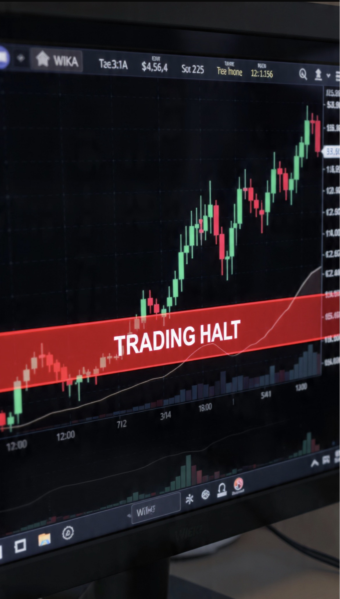

# Evaluasi Kebijakan Pasar Modal Indonesia: Presiden Boleh Tidak Takut MSCI, tetapi Apakah MSCI Percaya?

*Ilustrasi (pic: Meta AI).*

  
***Jika Indonesia sudah mengumumkan begitu banyak reformasi, mengapa penyedia indeks global masih menahan perubahan indeks dan meminta bukti perbaikan lebih lanjut?***
  

Meskipun Presiden Prabowo sudah mengirim pesan bahwa Indonesia tidak takut MSCI tetapi pasar modal itu bukan lawan debat yang bisa dikalahkan dengan suara keras. Ia punya cara menjawab yang agak kejam: arus modal masuk atau keluar, biaya pendanaan naik atau turun, dan investor percaya atau tidak.

Perkembangan sampai 19 November 2026, ada kabar yang cukup penting: pemerintah dan regulator ternyata sudah mengambil sejumlah tindakan konkret. Namun, ada jurang antara mengumumkan reformasi, melaksanakan reformasi, dan membuktikan kepada investor global bahwa reformasi itu berhasil.

Dan justru jurang ketiga itulah yang masih menjadi persoalan.

## Posisi Indonesia Sekarang

Kita luruskan dulu: MSCI belum resmi menurunkan Indonesia menjadi standalone market. 

Status Indonesia masih emerging market, tetapi MSCI telah membuka konsultasi untuk reklasifikasi dan mempertahankan pembekuan sejumlah perubahan indeks saham Indonesia sampai ada pemberitahuan lebih lanjut. Keputusan final dijadwalkan paling lambat 30 Juni 2027.

Yang sudah terjadi:
- Pembekuan perubahan tertentu pada indeks MSCI Indonesia.
- Konsultasi reklasifikasi menuju standalone.
- Tuntutan bukti reformasi yang material dan berkelanjutan.
  Sumber: MSCI, 15 Oktober 2026.

Ada perkembangan lain yang tidak boleh diabaikan: pada 14 November, FTSE Russell juga mengumumkan pembekuan penambahan saham Indonesia ke indeksnya sampai 2027, sambil menunggu reformasi bursa. Jadi persoalannya bukan hanya satu penyedia indeks global.

Ketika dua penyedia indeks besar sama-sama menahan perubahan terkait saham Indonesia, persoalannya sudah menyangkut reputasi dan aksesibilitas pasar secara lebih luas.

## Apa yang Sudah Dilakukan Pemerintah? 

Berikut tindakan yang bisa ditelusuri dari pengumuman regulator dan pemberitaan yang tersedia:

A. OJK memperketat pengawasan dan memperpanjang buyback

Pada 26 Oktober 2026, OJK mengumumkan tiga langkah strategis:
- Memperpanjang fasilitas buyback saham tanpa persetujuan RUPS sampai Juni 2027.
- Menyempurnakan mekanisme High Shareholding Concentration (HSC), termasuk melibatkan pihak independen di luar organisasi regulator bursa.
- Memperkuat pengawasan untuk mendeteksi transaksi tidak wajar dan perdagangan terkoordinasi. OJK

Apa artinya?
- Buyback memberi emiten ruang membeli kembali sahamnya ketika harga tertekan, sepanjang memenuhi persyaratan dan kemampuan keuangan.
- HSC membantu mengidentifikasi saham dengan kepemilikan sangat terkonsentrasi.
- Pengawasan transaksi diarahkan agar regulator tidak hanya bereaksi setelah harga bergerak ekstrem, tetapi mampu mendeteksi pola yang mencurigakan lebih dini.

Tetapi ada catatan penting: buyback bukan obat penyakit tata kelola. Ia dapat membantu permintaan saham dalam jangka pendek, tetapi tidak otomatis memperbaiki transparansi, kualitas perusahaan, atau kepercayaan investor asing.

B. Pemerintah menetapkan agenda free float minimum 15%

Pada 27 Oktober, Kementerian Koordinator Bidang Perekonomian menegaskan percepatan reformasi melalui:
- Free float minimum 15%.
- Keterbukaan pemilik manfaat (beneficial ownership).
- Pelaporan kepemilikan saham di atas 1%.
- Penguatan pengawasan HSC.
- Pembentukan Joint Task Force untuk penegakan hukum terhadap manipulasi harga dan perdagangan terkoordinasi.

Ini penting sekali. Free float adalah saham yang benar-benar tersedia untuk diperdagangkan publik, bukan saham yang terkunci pada pemegang kendali atau pihak tertentu.

Misalnya sebuah perusahaan memiliki 100 juta saham. Kalau hanya 5 juta saham yang sungguh-sungguh tersedia bagi publik, maka free float-nya 5%.

Mengapa investor global peduli? Karena kapitalisasi pasar yang besar tidak selalu berarti sahamnya likuid dan mudah dibeli atau dijual. Kalau sebagian besar saham dikuasai kelompok kecil, harga dapat lebih mudah bergerak ekstrem dan indeks menjadi kurang representatif.

Namun, jangan salah memahami target 15% ini: menaikkan free float secara administratif saja belum cukup. Yang harus dibuktikan adalah ketersediaan saham publik yang nyata dan informasi kepemilikannya dapat diverifikasi.

C. BEI mulai memperjelas siapa pemilik saham

Ada tindakan teknis yang cukup signifikan. Pada 2 November 2026, BEI menerbitkan Keputusan Direksi Nomor Kep-00160/BEI/11-2026 mengenai perubahan ketentuan laporan bulanan registrasi kepemilikan saham.

Ketentuan ini memperkuat pelaporan pemegang saham di atas 1%, termasuk identifikasi apakah pemegang saham tersebut merupakan pengendali atau afiliasi pengendali. Informasi tersebut disampaikan melalui KSEI sebagai dasar publikasi kepemilikan.

Ini bukan perkara remeh. Dalam pasar yang kepemilikannya terkonsentrasi, mengetahui nama pemegang saham saja belum tentu cukup. Kita perlu mengetahui siapa pengendalinya, siapa afiliasinya, dan apakah beberapa kepemilikan yang tampak terpisah sebenarnya terhubung.

Di sinilah konsep beneficial ownership menjadi penting. Investor ingin mengetahui siapa yang sesungguhnya mengendalikan aset, bukan hanya nama yang tercetak di daftar pemegang saham.

D. Penegakan hukum mulai menunjukkan angka

Dalam siaran pers 26 Oktober, OJK menyampaikan bahwa sepanjang 2026 telah menjatuhkan:

| Tindakan | Jumlah |
|------|-------|
|Denda hasil pemeriksaan kasus|Rp2,23 triliun|
|Pihak yang dikenai denda tersebut|166|
|Peringatan tertulis|28|
|Pembekuan|8|
|Pencabutan izin|6|
|Larangan|13|
|Perintah tertulis|6|
|Perkara yang mencapai proses pengadilan|6|

OJK juga mencatat denda keterlambatan sebesar Rp293,78 miliar kepada 805 pihak. OJK Ini adalah angka yang dilaporkan regulator, bukan berarti semua perkara tersebut berkaitan langsung dengan manipulasi saham atau MSCI.

Tetapi angka penegakan hukum itu menunjukkan bahwa regulator memang sedang melakukan tindakan administratif dan hukum.

Pertanyaan berikutnya justru lebih penting: berapa banyak pelanggaran besar yang berhasil dibongkar, siapa pelakunya, bagaimana hasil proses hukumnya, dan apakah praktiknya berhenti?

Denda besar tidak otomatis membuktikan pasar sudah bersih.

## Masalah Besar: Reformasi Belum Sama dengan Pemulihan

Mari kita lihat apa yang terjadi setelah rangkaian pengumuman tersebut.

Indikator tekanan pasar yang dilaporkan pada November, IHSG sejak awal tahun −38%. Rupiah, 17 November Rp18.285.

Angka berasal dari laporan BigGo Finance yang merangkum kondisi pasar 17 November 2026. Ini bukan kutipan data penutupan resmi BEI atau kurs referensi BI.

Angka tersebut mengindikasikan bahwa tekanan pasar masih serius. Namun, perlu diingat bahwa IHSG dan rupiah juga dipengaruhi kondisi global, suku bunga, arus modal, dan risiko politik domestik. Kita tidak boleh mengatribusikan seluruh penurunannya kepada MSCI.

Ada tiga persoalan yang perlu dibedah.

Persoalan pertama: pasar memerlukan bukti, bukan janji

MSCI sudah menjelaskan persoalannya sejak Juni 2026. Indonesia kemudian mengumumkan sejumlah reformasi. Namun, pada 15 Oktober MSCI tetap meluncurkan konsultasi reklasifikasi karena menilai belum ada bukti perbaikan material yang konsisten. Artinya, masalahnya bukan lagi kekurangan pengumuman kebijakan.

Masalahnya adalah apakah kebijakan tersebut menghasilkan perubahan yang bisa dilihat oleh investor independen.

Bayangkan pemerintah mengatakan: Kami akan memberantas perdagangan terkoordinasi. Investor akan bertanya:
Berapa kasus yang berhasil diidentifikasi?
Berapa yang benar-benar dibuktikan?
Apakah rekening terkait dibekukan?
Apakah pelakunya dikenai sanksi?
Apakah ada putusan hukum?
Apakah pola perdagangan serupa masih ditemukan?
Kalau jawabannya hanya berupa konferensi pers, investor belum memperoleh alasan untuk mengubah penilaiannya.

Persoalan kedua: FTSE ikut menahan perubahan indeks

Pada 14 November, FTSE Russell mengumumkan pembekuan penambahan saham Indonesia ke indeksnya sampai 2027 sambil menunggu reformasi pasar.

Ini menarik karena MSCI dan FTSE Russell adalah dua penyedia indeks yang berbeda. Keduanya memiliki metodologi dan proses penilaian masing-masing. Jadi, jangan menyimpulkan bahwa keputusan FTSE otomatis mengikuti MSCI.

Tetapi ketika keduanya sama-sama menyoroti kebutuhan reformasi, Indonesia menghadapi persoalan kredibilitas yang lebih luas.

Ini juga berarti pemerintah tidak cukup melakukan diplomasi dengan satu lembaga. Pemerintah harus memperbaiki kualitas pasar yang menjadi dasar penilaian berbagai lembaga tersebut.

Persoalan ketiga: intervensi untuk menopang harga tidak sama dengan memperbaiki pasar

Pemerintah memiliki beberapa instrumen untuk membantu stabilitas pasar, termasuk fasilitas buyback, koordinasi dengan investor institusional domestik, dan pengawasan perdagangan.

Tetapi ada bahaya jika stabilisasi harga menjadi tujuan utama. Misalnya, saham turun karena investor menemukan bahwa laporan keuangan perusahaan buruk. Apakah negara harus memaksa harga sahamnya naik? Tidak.

Harga saham harus tetap dapat mencerminkan kondisi perusahaan. Negara bertugas menjaga agar proses pembentukan harga berlangsung adil, bukan menjamin semua investor mendapatkan keuntungan.

Pasar yang sehat bukan pasar yang selalu hijau. Pasar yang sehat adalah pasar yang tidak dimanipulasi.

## Prabowo dan MSCI: Apakah Pendekatan Konfrontatif Membantu?

Pada 21 Oktober, Prabowo menyampaikan bahwa Indonesia tidak takut dan tidak akan diintimidasi oleh MSCI. Ia juga menuding MSCI berusaha menakut-nakuti Indonesia. Pernyataan itu disampaikan dalam rapat kabinet.

Secara politik, pernyataan tersebut merupakan pesan kedaulatan dan ketegasan.
Tetapi secara ekonomi, ada perbedaan mendasar antara dua hal:
- Menolak tekanan pihak luar yang tidak adil.
- Menolak evaluasi yang menunjukkan kelemahan institusi domestik.

MSCI bukan pemerintah asing yang mempunyai kewenangan menentukan kebijakan fiskal Indonesia. MSCI adalah penyedia indeks komersial yang membuat klasifikasi berdasarkan metodologinya dan kebutuhan pengguna indeks.

Indonesia tidak wajib menerima semua pandangan MSCI tanpa kritik. Indonesia juga berhak menyampaikan data, metodologi tandingan, dan keberatan.

Namun, apabila persoalan yang dikemukakan MSCI memang berkaitan dengan transparansi kepemilikan dan integritas perdagangan, jawaban yang paling efektif adalah memperbaiki dua hal tersebut.

Kedaulatan ekonomi tidak berarti menolak evaluasi. Kedaulatan ekonomi berarti memiliki institusi yang cukup kuat untuk menghadapi evaluasi tanpa harus bergantung pada belas kasihan investor.

Dan kalau pemerintah ingin menunjukkan bahwa Indonesia tidak dapat diintimidasi, justru transparansi dan penegakan hukum yang konsisten merupakan demonstrasi kekuatan institusional.

Apa yang Masih Harus Dikerjakan Indonesia?

Ini daftar pekerjaan yang perlu menjadi agenda utama pemerintah, OJK, BEI, dan KSEI:

| Bidang | Tindakan yang perlu dibuktikan |
|------|-------|
|Kepemilikan saham|Pengungkapan beneficial owner hingga pengendali akhir|
|Free float|Memastikan saham publik benar-benar tersedia dan likuid|
|Manipulasi|Penindakan perdagangan terkoordinasi berdasarkan bukti transaksi|
|Pengawasan|Sistem deteksi dini yang transparan dan dapat diaudit|
|Penegakan hukum|Publikasi perkara, sanksi, dan perkembangan pengadilan|
|Investor asing|Kepastian penyelesaian transaksi dan akses informasi|
|Emiten BUMN|Keterbukaan keuangan, kualitas proyek, dan disiplin modal|
|Akuntabilitas|Laporan kemajuan reformasi dengan tenggat yang jelas|

Ada satu pekerjaan yang sering luput: reformasi perusahaan BUMN. Kita tidak bisa terus berharap BUMN menjadi mesin pertumbuhan ekonomi, tetapi mengabaikan kualitas tata kelola, pemilihan proyek, beban utang, dan pengembalian investasi.

Contoh WIKA relevan sebagai persoalan korporasi. Investor membutuhkan jawaban mengenai kemampuan menghasilkan arus kas, restrukturisasi utang, kualitas proyek, dan disiplin penggunaan modal. Bukan sekadar pernyataan bahwa pemerintah mendukung perusahaan strategis.

Danantara juga harus memperhatikan hal ini. Jika lembaga pengelola investasi negara mengelola aset strategis, tata kelolanya perlu dapat diuji publik. Pengelolaan aset negara tidak boleh menjadi wilayah yang kebal dari pengawasan.

## Bagaimana Kita Tahu Reformasi Berhasil Sebelum Juni 2027?

Saya ingin mengusulkan sebuah scorecard yang dapat dipakai publik untuk memantau pemerintah. Ini bukan penilaian politik, melainkan indikator kebijakan yang dapat diperiksa.

Dashboard reformasi pasar modal Indonesia. Indikator pemantauan yang disarankan, bukan hasil pengukuran resmi:

1. Transparansi beneficial ownership

Apakah pengendali akhir saham dapat diidentifikasi?

2. Free float riil

Apakah saham benar-benar tersedia bagi investor publik?

3. Penindakan manipulasi

Apakah kasus besar diselesaikan sampai tuntas?

4. Kualitas pengawasan

Apakah pola perdagangan terkoordinasi terdeteksi lebih dini?

5. Kepercayaan penyedia indeks

Apakah MSCI dan FTSE melihat bukti perbaikan?

6. Arus modal asing

Apakah aliran modal kembali stabil dan berkelanjutan?

Yang terakhir harus dibaca hati-hati. Arus modal asing bukan ukuran tunggal keberhasilan reformasi. Investor dapat masuk karena kondisi global sedang mendukung, bukan karena tata kelola Indonesia sudah membaik.

Sebaliknya, investor dapat menjual saham karena faktor global meskipun reformasi domestik berjalan.

Karena itu, kita perlu memeriksa seluruh indikator secara bersamaan.

Indonesia Sudah Bergerak tetapi Belum Membuktikan Bahwa Masalahnya Selesai

Empat kesimpulan:
- Pemerintah tidak diam. Ada reformasi free float, transparansi kepemilikan di atas 1%, penguatan HSC, perpanjangan buyback, pengawasan transaksi, dan penegakan hukum.
- Ancaman MSCI belum selesai. Konsultasi reklasifikasi masih berlangsung dan keputusan final baru dijadwalkan paling lambat Juni 2027.
- FTSE Russell juga menahan penambahan saham Indonesia ke indeksnya. Ini memperluas persoalan dari sekadar hubungan Indonesia dengan MSCI.
- Tantangan terbesar sekarang adalah implementasi dan pembuktian. Bukan lagi sekadar membuat regulasi baru.

Jangan menganggap semua saham Indonesia akan bergerak sama. Dalam kondisi pasar seperti ini, saham dengan fundamental kuat, arus kas sehat, utang terkendali, likuiditas baik, dan keterbukaan informasi memadai tetap harus dibedakan dari saham yang bergantung pada spekulasi atau konsentrasi kepemilikan.

Jangan pula menjadikan setiap penurunan harga sebagai kesempatan membeli. Harga murah belum tentu berarti valuasinya murah.

Jika Indonesia sudah mengumumkan begitu banyak reformasi, mengapa penyedia indeks global masih menahan perubahan indeks dan meminta bukti perbaikan lebih lanjut? Itulah pertanyaan yang harus dijawab dengan data, bukan dengan kemarahan.

Apakah keterbukaan kepemilikan saham di atas 1% benar-benar menghasilkan peta pengendalian perusahaan yang lebih jelas, dan apakah penindakan terhadap perdagangan terkoordinasi menghasilkan putusan yang dapat diperiksa publik.

Sebab kalau dua hal itu benar-benar berjalan, kita sedang membangun fondasi pasar modal. Kalau hanya ramai di pengumuman, kita cuma sedang mengecat ulang gedung yang fondasinya retak. 

  
**Referensi**

1. MSCI. (2026, October 15). MSCI Launches a Consultation on a Proposal to Reclassify Indonesia from Emerging Market to Standalone Market Status. Sumber resmi MSCI⁠.

2. Otoritas Jasa Keuangan. (2026, October 26). OJK Perkuat Stabilitas dan Integritas Pasar Modal Melalui Tiga Langkah Kebijakan Strategis. Siaran pers OJK⁠.

3. Kementerian Koordinator Bidang Perekonomian RI. (2026, October 27). Reformasi Tata Kelola Pasar Modal, Berikan Manfaat Nyata bagi Masyarakat. Sumber resmi pemerintah⁠.

4. Reuters. (2026, October 26). Indonesia strengthens measures against stock manipulation after market rout triggered by MSCI. Baca laporan⁠.

5. The Edge Malaysia. (2026, November 12). Prabowo’s brother sounds alarm over Indonesian stock market. Baca laporan⁠.

6. IDNFinancials. (2026, November 14). FTSE freezes Indonesian stock inclusions until 2027 pending reforms. Baca laporan⁠.

7. Veritask. (2026, November 4). Kep-00160/BEI/11-2026 Updates the Requirements for Monthly Share Ownership Reports. Baca analisis regulasi⁠.
