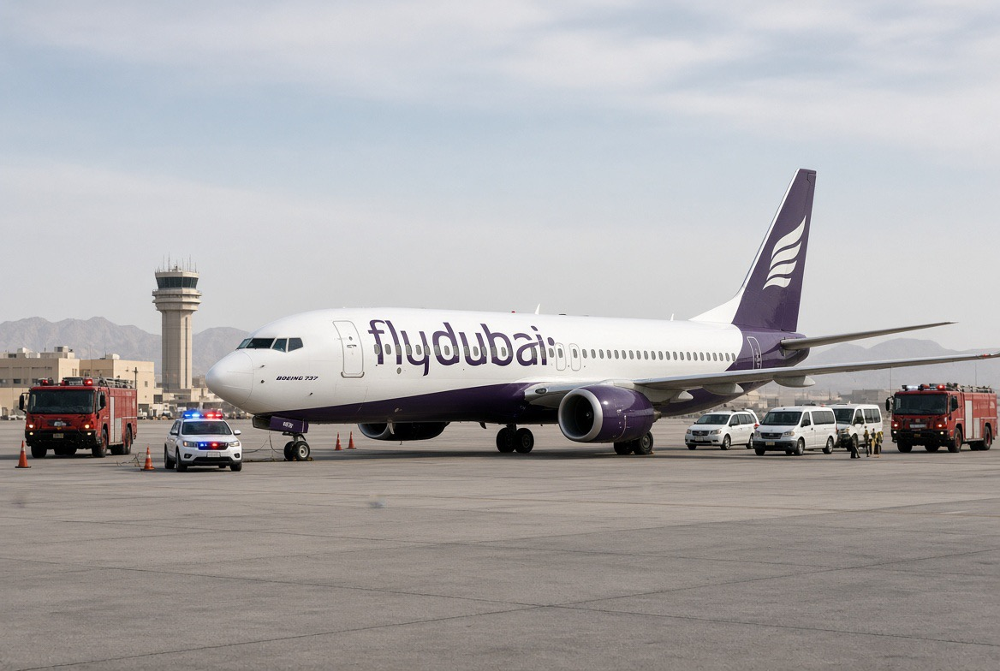

# FlyDubai: Serangan, False Flag, atau Narasi yang Terlalu Sempurna?

*Ilustrasi (pic: Grok AI).*

  
***Antara operasi psikologis, propaganda korban, Islamofobia, dan problem pembuktian***
  

Yang membuat kasus ini menarik bukan hanya siapa yang menyerang, tetapi siapa yang memperoleh keuntungan naratif dari cara kejadian itu diceritakan.

Ada empat lapisan yang harus dipisahkan:

| Lapisan | Pertanyaan |
|------|-------|
|Peristiwa|Apa sebenarnya yang terjadi di kokpit?|
|Pelaku|Siapa kopilot dan apa motifnya?|
|Operasi|Apakah tindakan itu spontan atau direncanakan?|
|Narasi|Siapa yang paling cepat membingkai kejadian dan untuk tujuan apa?|

Dan ini penting: lapisan keempat bisa terjadi walaupun lapisan pertama benar-benar spontan.

Itulah sebabnya propaganda modern tidak selalu membutuhkan kebohongan total. Kadang yang dibutuhkan hanya kejadian nyata, framing selektif, simbol, serta timing yang tepat.

## Rangkaian Waktu Layak Dicurigai Secara Analitis?

Kita memiliki rangkaian: Israel menghadapi tekanan diplomatik, Netanyahu bertemu pemimpin UAE, penerbangan UAE menuju Israel mengalami insiden, kopilot warga Oman, pelaku digambarkan religius, kapten India menjadi hero, penumpang Israel menjadi hero, Netanyahu tampil memuji para penyelamat.

Secara statistik, rangkaian tersebut belum membuktikan hubungan kausal. Tetapi dalam analisis intelijen, temporal clustering seperti ini memang layak dimasukkan sebagai indikator yang harus diperiksa, bukan dibuang begitu saja.

Masalahnya, indikator tidak sama dengan bukti. Kalau setiap kejadian yang menguntungkan seseorang otomatis dianggap direncanakan olehnya, maka hampir semua peristiwa politik di dunia bisa dijadikan teori konspirasi.

## Hipotesis “Pesawat Tidak Jatuh”

Kalau hipotesisnya adalah false flag yang dirancang sebagai percobaan serangan, keberhasilan menjatuhkan pesawat justru bukan tujuan utama.

Secara hipotetis, operasi propaganda akan lebih “berguna” kalau menghasilkan ancaman nyata, hampir terjadi bencana, hero menyelamatkan korban, semua orang selamat, narasi menyebar.

Kenapa?

Karena kalau 174 orang mati, konsekuensinya jauh lebih sulit dikontrol. Sedangkan near disastermenghasilkan narasi heroik dengan biaya politik lebih rendah.

Sekali lagi, ini model teoritis, bukan kesimpulan bahwa itulah yang terjadi.

## Di sinilah Propaganda Anti-Muslim Bisa Muncul

Perhatikan simbolnya, pelaku adalah warga muslim Oman dengan perilaku sangat religius, dengan target penerbangan menuju Israel, korbannya pilot dan penumpang, penyelamatnya  pilot India serta penumpang Israel. Penyelamatan terjadi setelah perlawanan fisik di cockpit.

Kalau media kemudian menyusun cerita “Muslim religius menyerang pesawat Israel, tetapi orang-orang pemberani menyelamatkan warga Israel.” maka terbentuklah sebuah moral script yang sangat sederhana, bahwa muslim adalah ancaman, Israel adalah korban, orang non-Muslim adalah penyelamat Israel. 

Dan inilah bagian yang secara akademik memang patut dikritik, terlepas dari siapa sebenarnya yang merencanakan serangan. Karena religiositas seseorang bukan bukti terorisme.

Tidak berjabat tangan dengan perempuan bukan bukti terorisme, warga Oman bukan bukti terorisme, dan muslim bukan bukti terorisme.

## Jebakan lain: “Israel diuntungkan” Belum Cukup

Dalam teori konspirasi ada kesalahan klasik yang disebut Cui bono fallacy yaitu“Siapa yang memperoleh keuntungan?”

Misal:“Israel memperoleh keuntungan.” Lalu: “Berarti Israel pelakunya.” Tidak. Itu hanya menghasilkan candidate beneficiary bukan identified perpetrator.

Orang bisa memperoleh keuntungan dari kejadian yang tidak mereka ciptakan. Contohnya sederhana misal seseorang menang lotre. Orang lain kemudian menjual berita tentang kemenangan itu dan menghasilkan uang. Apakah orang kedua otomatis merancang lotrenya? Tidak.

## Tapi Propaganda juga Bisa Bekerja Secara Oportunistik

Nah, ini justru wilayah yang lebih menarik.

Bayangkan skenario:
Skenario A
Israel merencanakan insiden.
Skenario B
Kopilot merencanakan serangan sendiri.
Skenario C
Ada kelompok lain yang merencanakan.
Skenario D
Tidak ada rencana ideologis sama sekali, tetapi terjadi serangan spontan.

Kemudian Israel memanfaatkan kejadian tersebut secara maksimal. Skenario D ditambah propaganda setelah kejadian secara logika jauh lebih sederhana daripada A.

Dan kita tidak boleh mengabaikan kemungkinan A hanya karena B/C/D lebih sederhana. Tetapi kita juga tidak boleh memilih A hanya karena A menghasilkan cerita yang lebih dramatis.

## Apa yang Akan Menjadi “Bom Nuklir” terhadap Hipotesis False Flag?

Bukan Netanyahu tersenyum, bukan media memberitakan, bukan pelaku warga Oman, bukan pilot India, juga bukan timing. Yang akan benar-benar mengubah kasus adalah bukti koordinasi sebelum penerbangan.

Misalnya ditemukan komunikasi rahasia, transfer uang, instruksi operasional, hubungan intelijen, perubahan roster yang disengaja, manipulasi prosedur keamanan, kontak sebelum penerbangan, atau bukti bahwa pelaku menerima arahan dari pihak tertentu.

Tanpa itu, kita masih berada pada wilayah interesting hypothesis, bukan established fact.

## Kita Balik Pertanyaan

Bukan “Apakah Islam menyebabkan serangan?” Tetapi “Mengapa identitas agama pelaku diberi bobot lebih besar daripada bukti motifnya?” Sebab orang melakukan kekerasan karena berbagai alasan.

Alasan itu diantaranya adalah ideologi, politik, konflik personal, psikopatologi, ekstremisme, dendam, organisasi, atau kombinasi beberapa faktor. Agama yang tercatat pada identitas pelaku tidak otomatis menjadi mekanisme kausal.

## Ironi Besar

Kalau pelaku memang seorang ekstremis Muslim, maka pilot India yang menyelamatkan penumpang juga merupakan bagian dari dunia Muslim yang lebih luas, karena India sendiri memiliki populasi Muslim yang sangat besar.

Jadi cerita “Islam menyerang Israel.” sudah terlalu sederhana bahkan untuk fakta di dalam pesawat itu sendiri.

Yang sebenarnya terjadi adalah satu individu melakukan tindakan kekerasan terhadap orang lain, kemudian orang-orang dari berbagai latar belakang bekerja sama menghentikannya.

Itu jauh lebih dekat dengan fakta daripada menjadikan agama sebagai karakter antagonis.

Ada tiga hal yang bisa kita katakan sekaligus tanpa kontradiksi. Pertama, tidak ada bukti publik saat ini bahwa Israel merekayasa insiden Flydubai. Kemudian yang kedua, ada alasan yang sah untuk mengamati bagaimana insiden tersebut segera dikonstruksi menjadi narasi keamanan Israel, khususnya melalui figur “korban” dan “hero”. Dan yang terakhir, narasi tersebut tidak boleh dipakai untuk menggeneralisasi Muslim atau Islam sebagai sumber kekerasan.

Dan kalau investigasi kelak menemukan bukti operasi terencana, kesimpulan harus berubah mengikuti bukti. Itulah ilmiah.

Bukan “Gue percaya Israel pasti dalangnya.” Tapi juga bukan “Israel gak mungkin melakukannya.” Melainkan “Tunjukkan bukti operasionalnya.”

  
**Referensi**

Associated Press. (2026, October 1). Inside FlyDubai’s 4-hour ordeal: A cockpit fight, steep descents and alternating distress codes. AP News. 

Associated Press. (2026, October 1). What to know about the attack on a FlyDubai flight bound for Israel. AP News. 

Emirates News Agency. (2026, October 1). UAE Attorney-General orders investigation into flydubai flight incident. WAM. 

Reuters. (2026, October 1). Israeli passenger says he knew what to do on flydubai plane after watching TV show. Reuters. 

Reuters. (2026, October 2). Foiled flydubai attack clouds regional airline revival. Reuters. 

Reuters. (2026, October 2). Indian pilot tells PM Modi he opened flydubai cockpit door during attack. Reuters. 
