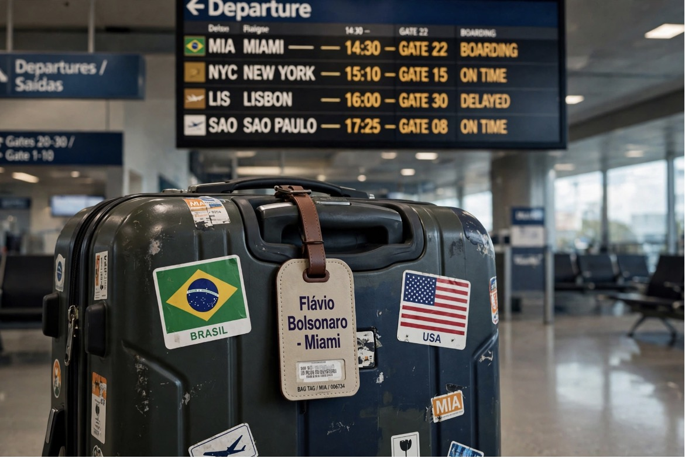

# Flávio Bolsonaro Kalah Pilpres Putaran Kedua: Suaka di Miami, Demokrasi di Brasil

*Ilustrasi (pic: Meta AI).*

  
***Seorang politisi yang mengklaim dirinya mewakili kehendak rakyat justru harus meninggalkan negaranya untuk mempertahankan panggung politiknya***
  

Politik internasional sudah seperti drama keluarga yang modalnya pesawat pribadi, surat terbuka, dan seorang presiden yang merasa kalah pemilu berarti dirinya baru saja menjadi korban kudeta.

Tapi ada satu detail yang membuat ceritanya jauh lebih menarik daripada sekadar, “anak Bolsonaro kabur ke Miami, lalu Trump menyediakan sofa politik.” 

Flávio Bolsonaro memang pergi ke Amerika Serikat setelah kalah dari Lula, sempat menyebut dirinya presiden terpilih yang sah, lalu mengubah klaimnya menjadi pemimpin oposisi Brasil. Trump kemudian mengatakan ia boleh tinggal di AS selama yang ia inginkan. Namun, izin tinggal dan dukungan politik adalah dua hal yang berbeda.

Mari kita bedah apakah menjadi sekutu Washington bisa menjadi semacam asuransi politik bagi elite yang kalah di negaranya sendiri?

## Kalah, Pergi, lalu Mengklaim Legitimasi

27–28 Oktober 2026 Flávio meninggalkan Brasil ke Miami setelah kalah dalam pemilihan putaran kedua dari Luiz Inácio Lula da Silva. Kepergiannya berlangsung ketika ia menghadapi penyelidikan di Brasil dan Mahkamah Agung telah memerintahkan agar paspornya diserahkan.

28–29 Oktober, presiden terpilih versi sendiri ini sempat menyatakan dirinya sebagai “the elected president”, menuduh pemilu dicuri tanpa menyajikan bukti yang mendukung klaim itu, lalu mengoreksi suratnya menjadi klaim bahwa dirinya adalah pemimpin Brasil. Padahal hasil pemilu telah diakui otoritas pemilu Brasil dan berbagai pemantau internasional.

31 Oktober, Trump membuka pintu dan mengatakan Flávio boleh tinggal di Amerika Serikat selama yang ia inginkan dan menyebut pemilu Brasil sebagai sesuatu yang memalukan. Namun, Reuters melaporkan Trump tidak memiliki rencana untuk bertemu Flávio dan pejabat AS tidak menyatakan adanya rencana dukungan terhadap ambisi politiknya.

Ada satu ironi tambahan. Flávio bukan sekadar politisi yang kalah. Ayahnya, Jair Bolsonaro, telah dijatuhi hukuman 27 tahun penjara dalam perkara terkait upaya kudeta setelah kalah pada 2022. 

Perkara Flávio sendiri berbeda: ia menghadapi penyelidikan keuangan dan membantah tuduhan yang diarahkan kepadanya. Jangan mencampur kedua perkara itu menjadi satu dakwaan keluarga.

## Menjadi “Boneka AS” Menjamin Keselamatan Politik?

Kita perlu membedakan tiga tingkat perlindungan yang sering terlihat sama dari kejauhan, padahal mekanismenya berbeda:

Tingkat 1: Perlindungan masuk wilayah

Amerika Serikat dapat mengizinkan seseorang masuk atau tinggal berdasarkan aturan imigrasinya. Itu tidak otomatis berarti orang tersebut memperoleh kekebalan dari proses hukum negara asal.

Tingkat 2: Perlindungan diplomatik

Pemerintah yang bersahabat dapat memberi dukungan politik, mengecam proses hukum negara lain, atau menjadikan perkara seseorang bagian dari negosiasi bilateral.

Tingkat 3: Kekebalan hukum

Ini jauh lebih rumit. Status tinggal tidak otomatis memberikan kekebalan hukum, dan perlindungan terhadap ekstradisi bergantung pada hukum, perjanjian, serta keputusan yang relevan.

Dalam kasus Flávio, Reuters melaporkan ia masuk ke AS dengan status humanitarian parole, yang umumnya bersifat sementara, bukan izin tinggal permanen. 

Trump boleh mengatakan Flávio bisa tinggal selama yang ia inginkan, tetapi ucapan presiden tidak dengan sendirinya mengubah seluruh ketentuan hukum imigrasi.

Jadi, kita belum bisa menyimpulkan bahwa Flávio sudah mendapat suaka politik permanen atau jaminan bebas dari tuntutan Brasil.

Yang bisa kita simpulkan: ia memperoleh ruang untuk berada di luar jangkauan langsung proses politik dan hukum domestik Brasil, setidaknya untuk sementara. Itu sudah memiliki nilai politik tersendiri.

## Mengapa Washington Memberi Ruang kepada Sekutu Ideologis?

Di sinilah teori hubungan internasional mulai menggigit.

Dalam pendekatan realism, negara tidak selalu bertindak berdasarkan persahabatan personal atau kesamaan ideologi. Mereka mengejar kepentingan strategis, pengaruh regional, akses ekonomi, dan kemampuan membentuk perilaku negara lain. Kesamaan ideologi dapat menjadi perekat, tetapi bukan keseluruhan penjelasan.

Dalam kasus Bolsonaro, hubungan politik keluarga tersebut dengan Trump telah lama terlihat. Jair Bolsonaro menjalin kedekatan dengan Trump saat menjadi presiden Brasil, sedangkan anggota keluarganya terus mengembangkan hubungan dengan lingkaran konservatif Amerika. Namun, kedekatan itu tidak berarti semua tindakan Washington otomatis dirancang untuk menyelamatkan mereka.

Ada tiga mekanisme yang patut diperhatikan.
Pertama, patronase politik transnasional. Pemimpin atau kelompok politik yang memiliki jaringan internasional bisa memperoleh akses, legitimasi simbolis, dan panggung media setelah kehilangan dukungan domestik. 

Kedua, tekanan terhadap pemerintah lawan. Ketika Washington mempertanyakan legitimasi pemilu Brasil sambil menerima kandidat yang kalah, tindakan itu dapat dibaca oleh pemerintah Lula sebagai sinyal campur tangan. 

Reuters melaporkan Lula menuduh Washington berkolusi dengan keluarga Bolsonaro untuk membantu mereka kembali berkuasa, sementara Washington membantah mencampuri urusan domestik Brasil. Tuduhan Lula tersebut harus diperlakukan sebagai klaim politik yang diperdebatkan, bukan fakta yang otomatis terbukti.

Ketiga, nilai tawar strategis. Brasil merupakan negara besar di Amerika Latin, dengan sumber daya alam penting dan posisi diplomatik yang berpengaruh. Hubungan Washington dengan pemerintahan Brasil bukan perkara kecil, sehingga dukungan terhadap tokoh oposisi dapat ikut memperkeruh hubungan bilateral.

Namun, ada batas yang menarik: Reuters melaporkan Trump tidak memiliki rencana bertemu Flávio dan seorang pejabat AS mengatakan pemerintah saat ini tidak berencana mendukung ambisi politiknya. Jadi, akses ke Amerika tidak boleh langsung dibaca sebagai kontrak untuk mengembalikannya ke kursi presiden.

## Demokrasi Dianggap Sah ketika Menang, lalu Dicurigai ketika Kalah

Inilah pola yang perlu kita periksa secara empiris, bukan sekadar menertawakan seorang kandidat yang mendadak menjadi presiden dari Miami. 

Pada 25 Oktober 2026, Lula memperoleh 51,79% suara, sedangkan Flávio memperoleh 48,21%, dengan selisih sekitar 4,4 juta suara. 

Misi ahli Carter Center memuji penyelenggaraan pemilu dan menekankan bahwa setiap keberatan yang berbasis bukti semestinya disalurkan melalui proses hukum yang berlaku. 

Lembaga itu juga mencatat beberapa persoalan administratif dan keputusan peradilan yang kontroversial, sehingga pujiannya bukan berarti setiap aspek pemilu dianggap sempurna.

Perhatikan logikanya:
- Kandidat kalah dalam pemilu.
- Ia menuduh hasilnya tidak sah.
- Ia tidak menyajikan bukti yang memadai untuk mendukung tuduhan kecurangan.
- Ia meninggalkan negara ketika menghadapi persoalan hukum.
- Dari luar negeri, ia mengklaim legitimasi politik yang bertentangan dengan hasil resmi.

Masalah demokratisnya bukan bahwa seorang kandidat tidak boleh mengkritik pemilu. Kritik dan gugatan justru bagian dari demokrasi. Masalahnya adalah apakah klaim kecurangan didukung bukti yang dapat diuji, dan apakah kandidat bersedia menggunakan mekanisme hukum yang berlaku?

Ketika seorang kandidat menerima legitimasi pemilu hanya jika dirinya menang, prinsip demokrasi berubah menjadi semacam kontrak sepihak: suara rakyat sah selama rakyat memilih saya.

Dan itu bukan prinsip demokrasi. Itu prinsip kepentingan pribadi yang mengenakan jas demokrasi.

## Apakah Strategi ini Justru bisa merugikan Bolsonaro?

Ada ironi yang layak dicatat. Reuters melaporkan sejumlah analis menilai kepergian Flávio ke Amerika dapat melemahkan oposisi konservatif Brasil, karena ia meninggalkan arena politik domestik ketika kelompoknya perlu menentukan kepemimpinan dan strategi setelah kekalahan. 

Bahkan partainya sendiri tidak mendukung klaim bahwa ia adalah pemimpin Brasil yang sah.

Ini menunjukkan bahwa perlindungan eksternal memiliki biaya.

| Potensi keuntungan | Potensi kerugian |
|------|-------|
|Mendapat tempat tinggal dan panggung internasional|Kehilangan kontak langsung dengan basis politik domestik|
|Dapat menyuarakan tuduhan dari luar negeri|Tuduhan semakin sulit dipercaya jika bukti tidak muncul|
|Mempertahankan perhatian media|Lawan politik dapat menggambarkannya sebagai pemimpin yang meninggalkan negaranya|
|Memperoleh akses ke jaringan sekutu asing|Ketergantungan pada sekutu asing dapat melemahkan citra kemandirian nasional|

Kita belum dapat memastikan apakah efek jangka panjangnya akan lebih menguntungkan atau merugikan Flávio. Namun, laporan awal menunjukkan bahwa kepergiannya tidak otomatis memperkuat kepemimpinannya di kubu kanan Brasil.

## Negara Besar Bukan Tempat Perlindungan Gratis

Dalam politik internasional, dukungan dari negara kuat hampir selalu memiliki konteks kepentingan. Namun, kita tidak boleh menyamakan setiap penerimaan tokoh asing dengan transaksi politik rahasia.

Ada perbedaan antara:
- sekutu ideologis, yaitu tokoh yang berbagi pandangan politik;
- klien politik, yaitu aktor yang bergantung pada dukungan patron yang lebih kuat;
- proxy, yaitu aktor yang secara nyata digunakan untuk menjalankan tujuan strategis pihak lain.

Ketiganya tidak identik. Untuk menyebut Flávio sebagai proxy Washington, misalnya, kita memerlukan bukti mengenai hubungan operasional, ketergantungan, atau koordinasi strategis, bukan sekadar fakta bahwa Trump membolehkannya masuk ke Amerika.

Inilah disiplin analitis yang penting: kedekatan adalah petunjuk, bukan bukti final mengenai motif.

Dan ada satu batas yang tidak boleh dilupakan. Washington dapat menyediakan ruang politik bagi seseorang, tetapi tidak dapat secara sepihak mengubah kekalahan pemilu menjadi kemenangan yang sah di Brasil. 

Legitimasi domestik tetap bergantung pada institusi dan masyarakat Brasil, meskipun tekanan eksternal dapat memengaruhi medan politiknya.

Dukungan negara besar dapat memberi tokoh politik ruang bernapas, akses, dan panggung untuk mempertahankan pengaruhnya setelah kalah. Tetapi itu bukan jaminan keselamatan hukum, apalagi tiket otomatis untuk kembali berkuasa.

Dan ada ironi yang paling menarik: seorang politisi yang mengklaim dirinya mewakili kehendak rakyat justru harus meninggalkan negaranya untuk mempertahankan panggung politiknya. Sementara itu, negara yang memberinya tempat tinggal tetap memiliki kepentingan sendiri.

Jadi, pertanyaan paling tajam bukan hanya “apakah dia menjadi boneka Amerika?” Melainkan: siapa yang akhirnya lebih bergantung kepada siapa, dan apa yang harus dibayar untuk mempertahankan hubungan itu? 

  
**Referensi**

The Carter Center. (2026, October 27). Carter Center Election Expert Mission Commends Brazil’s Democratic Presidential Runoff Election. Baca laporan pemantauan pemilu⁠.

Reuters. (2026, October 29). Brazil’s Lula to reap gains from Bolsonaro family flight. Baca analisis Reuters⁠.

Reuters. (2026, October 31). Trump says Flavio Bolsonaro can stay in US as long as he wants. Baca laporan Reuters tentang Trump dan status Flávio⁠.
