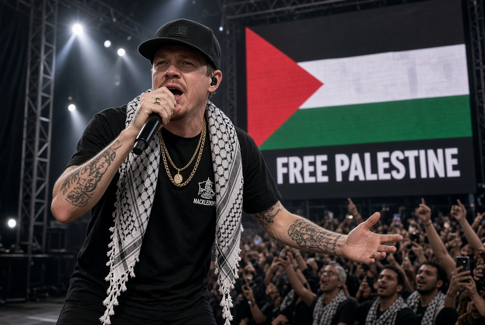

# Free Palestine Tour: Aktivisme atau Personal Branding?

*Ilustrasi (pic: Grok AI).*

  
***Macklemore, biaya politik sebuah suara selebritas, dan ketika solidaritas Palestina berubah menjadi panggung global***
  

Macklemore mengumumkan tur tersebut pada 24 September 2026, beberapa hari setelah ia dikeluarkan dari tur stadion Ed Sheeran. Tanggal Eropa yang diumumkan adalah Dublin, 26 Oktober, Paris, 29 Oktober, serta London, 30 Oktober.

Dan yang paling penting, Macklemore menyatakan seluruh hasil pertunjukan akan diberikan kepada organisasi yang mendukung rakyat Palestina. 

Daftarnya mencakup Anera, Gaza Soup Kitchen, Taawon, HEAL Palestine, Medical Aid for Palestinians, Palestine Children’s Relief Fund, UNRWA USA, Jewish Voice for Peace, dan beberapa organisasi lainnya. 

Jadi secara desain, ini bukan tur komersial biasa yang kebetulan memakai nama Palestina. Ia memang dikonstruksi sebagai konser, penggalangan dana, dan advokasi politik.

## Mengapa Tiba-tiba Bikin Tur Sendiri?

Sebelum tur ini diumumkan, Macklemore dikeluarkan dari tur Ed Sheeran saat konser di MetLife Stadium, New Jersey, 5 September 2026, karena ia menyampaikan dukungan terbuka terhadap Palestina dan memperkenalkan “Hind’s Hall”, lagu pro-Palestina yang sudah dia bawakan sejak 2024.

Setelah itu, sejumlah venue AS menyatakan mereka tidak akan mengizinkan Macklemore tampil sebagai bagian dari tur tersebut. Promotor kemudian mengeluarkannya dari lineup. 

Jadi urutannya: pro-Palestina di panggung, venue menolak, dikeluarkan dari tur, membuat tur sendiri, menamai tur “Free Palestine”, seluruh proceeds dialihkan ke organisasi terkait Palestina.

Secara politik, itu jauh lebih menarik daripada sekadar Macklemore bikin konser Palestina karena lagi viral.

## Macklemore Sudah Melakukan Sejak 2024

Pada 2024, Macklemore merilis “Hind’s Hall”, lagu yang mendukung demonstrasi mahasiswa pro-Palestina di kampus-kampus AS. 

Streaming proceeds lagu itu diarahkan untuk bantuan Palestina melalui UNRWA. Dia juga tampil dalam aksi pro-Palestina di Washington pada 2023.

Kemudian pada 2025 ia menjadi executive producer dokumenter The Encampments, yang membahas gerakan demonstrasi mahasiswa pro-Palestina. 

Dalam wawancara, ia menjelaskan bahwa keterlibatannya berhubungan dengan perkembangan aktivismenya sejak membuat Hind’s Hall. 

Jadi timeline-nya:

2023 → aksi publik

2024 → Hind’s Hall

2025 → The Encampments

2026 → terus bicara di panggung

2026 → kehilangan slot tur Ed Sheeran

2026 → membuat Free Palestine Tour

Jadi tudingan bahwa ia baru mendukung Palestina setelah melihat ada pasar untuk itu menjadi kurang cocok dengan kronologi.

## Apakah Berarti Dia Suci dari Motif Popularitas?

Ini bagian yang harus kita bedakan sebab motivasi manusia jarang cuma satu.

Dalam psikologi sosial, seseorang dapat melakukan tindakan karena kombinasi nilai moral, identitas, solidaritas, empati, reputasi, audience, keuntungan finansial, serta sense of purpose. Dan semuanya bisa terjadi bersamaan.

Jadi mungkin saja Macklemore benar-benar peduli Palestina, dan sekaligus sadar bahwa posisi tersebut memperkuat identitas publiknya sebagai artis yang vokal secara politik. Kedua hal itu tidak saling membatalkan.

## Expressive Activism

Selebritas tidak punya instrumen kebijakan luar negeri. Mereka tidak bisa mengirim bantuan pemerintah; menjatuhkan sanksi; membuat resolusi PBB; atau membuka koridor kemanusiaan. Tetapi mereka punya sesuatu yang sangat besar, yaitu ATTENTION.

Seorang rapper terkenal bisa mengubah isu yang hanya dibaca aktivis menjadi isu yang dibicarakan jutaan penggemar. Itulah celebrity activism, 

Dan ini punya dua sisi. Potensinya memperluas perhatian, mengumpulkan dana, membuat orang mencari informasi, serta memperbesar jaringan solidaritas. Sedangkan risikonya: masalah kompleks berubah menjadi slogan, isu kemanusiaan berubah menjadi personal brand, publik mengingat selebritasnya lebih daripada korban, dan posisi politik menjadi bagian dari marketing persona.

Macklemore sendiri secara eksplisit mengatakan ia ingin menggunakan panggung sebagai sesuatu yang lebih dari hiburan. 

## Bukti Sulit Dijelaskan Kalau Cuma Mengejar Popularitas

Dia kehilangan uang dan exposure, ini penting. Kalau tujuan utamanya sekadar “gue mau viral.” maka posisi politik yang paling aman adalah cukup memberi sinyal samar, jangan terlalu keras karena dia sedang berada dalam tur stadion salah satu artis terbesar dunia. 

Sebaliknya dia justru melakukan “Free Palestine.” di panggung besar Amerika, dan akhirnya kehilangan slot tur tersebut.

AP melaporkan bahwa sejumlah venue memberi tahu promotor mereka tidak akan mengizinkan Macklemore tampil, sehingga promotor mengeluarkannya dari tur. Itu menciptakan real professional cost.

Jadi secara revealed preference sederhana, dia tampaknya bersedia menanggung biaya profesional untuk posisi tersebut.

Itu bukan bukti bahwa dia tidak mencari popularitas. Tetapi jelas membuat teori “semuanya cuma oportunisme karena Palestina sedang viral” menjadi terlalu sederhana.

## Bagian Paling Menarik: $1 juta 

Pada September 2026, Macklemore juga berkomitmen memberikan sekitar US$1 juta kepada organisasi bantuan Palestina.

AP melaporkan bahwa setelah dikeluarkan dari tur Sheeran, ia berjanji menyumbangkan pendapatan bersihnya dari tur tersebut kepada enam organisasi, termasuk Medical Aid for Palestinians, Palestine Children’s Relief Fund, dan UNRWA USA. Ini bukan lagi posting Instagram. Ada resource transfer.

Dalam penelitian aktivisme, itu penting. Karena kita bisa membedakan antara symbolic activism yaitu “Gue dukung Palestina.” dengan material activism yaitu “Gue mengalihkan uang, waktu, panggung, dan kesempatan profesional untuk tujuan tersebut.”

Macklemore saat ini menunjukkan keduanya.

## Ada Kritik yang Tetap Valid

Misalnya seseorang berkata: “Dia terlalu menyederhanakan konflik.” Itu bisa diperdebatkan secara substansi. Atau: “Bahasa Macklemore kadang terlalu absolut.” Itu juga bisa dianalisis. Atau: “Celebrity activism dapat mengubah konflik kompleks menjadi moral binary.” Itu kritik akademis yang sah.

Dan ada pula kritik dari sebagian kelompok Yahudi dan organisasi yang menilai beberapa retorika Macklemore sebagai antisemitik atau mengabaikan pengalaman korban Israel. AP mencatat kritik tersebut, sementara Macklemore sendiri mengatakan kritik terhadap pemerintah Israel dan dukungan terhadap Palestina tidak dimaksudkan sebagai kritik terhadap orang Yahudi. 

Jadi, pro-Palestina bukan berarti otomatis benar dalam setiap pernyataan. Begitu juga dikritik oleh kelompok pro-Israel tidak otomatis seluruh aktivismenya tidak valid. Setiap klaim tetap harus diperiksa satu per satu.

## Ada Sesuatu yang Lebih Besar Sedang Terjadi

Perhatikan perubahan Macklemore, 2024 dia membuat lagu, 2025 masuk produksi film, 2026 kehilangan slot tur. Setelah itu dia membangun platform pertunjukan sendiri.

Ini menarik secara teori gerakan sosial. Ketika sebuah institusi membatasi ekspresi seseorang, orang tersebut kadang menciptakan institusi alternatif.

Jadi Macklemore tidak lagi bergantung pada tour promoter, venue, mainstream entertainment ecosystem. Dia mencoba membangun artist, audience, charity, dan movement. Itu jauh lebih mirip movement entrepreneurship daripada sekadar celebrity endorsement.

## “Free Palestine” Tour Ternyata Bukan Hanya Macklemore

Daftar organisasi penerima dan konsep tur menunjukkan bahwa dia ingin membawa jaringan aktivisme ke dalam konser. Ada organisasi kemanusiaan, advokasi, media, dan kelompok politik/komunitas di dalam ekosistem penerima manfaat. 

Artinya, konsernya berfungsi sebagai node dalam jaringan gerakan, bukan hanya panggung musik.

## Apakah Dia “Memihak Palestina Saja?

Secara politik, iya, posisi publiknya memang sangat jelas pro-Palestina. Dia menggunakan istilah “Free Palestine”, mendukung Palestinian liberation, mengkritik kebijakan Israel, dan mengarahkan dana kepada organisasi Palestina.  Namun itu tidak berarti Macklemore membenci orang Israel atau Yahudi. Itu klaim berbeda.

Bahkan dalam penampilannya di New Jersey, dia secara eksplisit mengatakan kritik terhadap Israel dan dukungan terhadap Palestina tidak ditujukan kepada orang Yahudi. 

Kita boleh menilai apakah seseorang berhasil menjaga garis tersebut dalam setiap pernyataannya, tetapi jangan menghapus perbedaan konseptualnya.

## Popularitas atau Ketulusan?

| Indikator | Yang kita lihat |
|------|-------|
|Konsistensi waktu|Ada sejak 2023/2024|
|Risiko profesional|Ada|
|Pengorbanan finansial|Ada|
|Penggalangan dana|Ada|
|Aktivitas di luar musik|Ada|
|Personal branding|Juga ada|
|Bukti motif batin 100% altruistik|Tidak bisa dibuktikan|

Dan ini penting, tidak ada alat ilmiah yang bisa membuka isi hati Macklemore. Kita tidak bisa mengatakan “Dia tulus 87%.” Yang bisa kita lakukan adalah melihat perilaku yang dapat diamati.

Dan perilaku yang dapat diamati menunjukkan komitmen pro-Palestina yang sudah berlangsung beberapa tahun dan kini disertai biaya profesional serta kontribusi finansial. Itu lebih kuat daripada sekadar virtue signaling.

Pertanyaan yang lebih ilmiah bukan “Macklemore tulus atau cari popularitas?” Karena itu memaksa kita memilih dua motif seolah manusia hanya punya satu.

Pertanyaan yang lebih tajam adalah “Apakah tindakan Macklemore menghasilkan biaya dan manfaat material bagi perjuangan Palestina yang cukup besar sehingga aktivismenya tidak dapat direduksi menjadi personal branding?”

Untuk saat ini, jawabannya berdasarkan bukti publik, sulit mereduksinya menjadi sekadar cari popularitas. Karena dia sudah melakukan advokasi sebelum Free Palestine Tour, kehilangan kesempatan profesional setelah berbicara, mengalokasikan dana besar, membuat karya seni tentang isu tersebut, dan sekarang mengubah konsernya menjadi mekanisme penggalangan dana. 

Tapi itu juga tidak membuktikan bahwa seluruh motivasinya murni altruistik. Dan justru di situlah fenomena celebrity activism menjadi menarik, seorang artis bisa sekaligus peduli, berpolitik, membangun identitas, mencari audiens, dan menghasilkan uang. Motif-motif itu bisa hidup dalam satu tubuh manusia tanpa saling membunuh. 

Jadi untuk kasus Macklemore, kita bisa melihatnya sebagaii aktivisme yang menggunakan mesin popularitas, bukan popularitas yang  kebetulan memakai Palestina. Perbedaannya kecil di kalimat, tapi besar secara sosiologis. 

  
**Referensi**

Reuters, 24 Sep 2026: pengumuman Free Palestine Tour dan penggalangan dana. 

AP, 14 Sep 2026: Macklemore dikeluarkan dari tur Ed Sheeran setelah pernyataan pro-Palestina. 

AP, Sep 2026: komitmen sekitar US$1 juta untuk organisasi bantuan Palestina. 

Pitchfork, 2024: Hind’s Hall dan dukungan terhadap demonstrasi kampus. 

Democracy Now!, 28 Mar 2025: wawancara mengenai akar aktivisme Macklemore dan keterlibatannya dalam The Encampments. 
