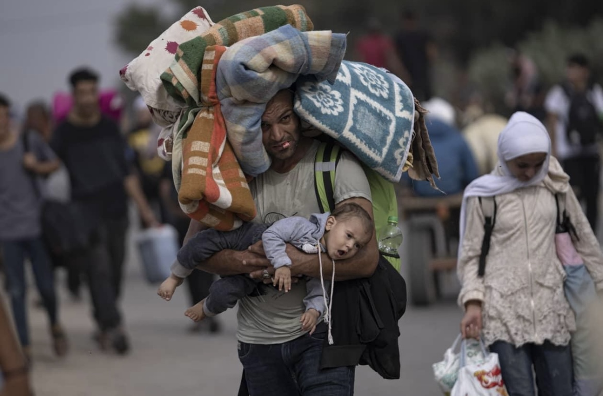

# Gaza: Pengusiran yang Tak Pernah Selesai, dan Politik Menciptakan Alasan

*(pic: marketwatch.com).*

  
***Bukan sekadar masalah keamanan. Itu adalah krisis hak untuk hidup, hak untuk tinggal, hak untuk kembali, dan hak untuk tidak dijadikan objek rekayasa geografis oleh kekuatan militer***
  

Apakah Israel menggunakan situasi keamanan, konflik, dan perintah evakuasi untuk terus mendorong warga Palestina keluar dari wilayah tempat mereka tinggal? Apakah setiap peristiwa, termasuk 7 Oktober, sengaja direkayasa oleh Israel sebagai dalih?

Pertanyaan pertama memiliki bukti kebijakan, tindakan militer, pola pemindahan penduduk, dan bahkan pernyataan politik sejumlah pejabat Israel yang bisa dianalisis secara serius. 

Pertanyaan kedua memerlukan bukti spesifik mengenai perencanaan dan rekayasa suatu peristiwa. Kita tidak perlu menganggap pertanyaan kedua terbukti untuk membuat pertanyaan pertama menjadi sangat mengerikan.

Dan yang membuat persoalan ini semakin serius: ada pejabat Israel yang secara terbuka berbicara tentang pengurangan atau pemindahan populasi Gaza.

## Apa yang Terjadi Sekarang? Warga Kembali Dipaksa Meninggalkan Tempat Tinggal

Operasi militer IDF terbaru menyebabkan warga Palestina kembali mengungsi.

Menurut laporan Reuters pada 18 November 2026 dan laporan The Guardian pada 18 November:
- Pasukan Israel menyeberangi Yellow Line di Gaza bagian tengah, dalam operasi darat yang diklaim bertujuan menghancurkan terowongan Hamas.
- Operasi melibatkan tank, tembakan artileri dan serangan udara di sekitar Al-Bureij dan Nuseirat.
- Otoritas militer Israel memerintahkan penduduk di beberapa blok wilayah tersebut untuk meninggalkan lokasi.
- Puluhan warga kembali melarikan diri.
- Operasi diumumkan selesai pada Kamis, dan warga di kawasan terdampak diberi kesempatan kembali, meskipun situasi keamanan tetap tidak stabil.
- Hamas menyebut operasi tersebut sebagai pelanggaran gencatan senjata.

Ini bukan berarti seluruh penduduk Gaza sedang diusir dalam satu operasi besar yang sama. Operasi terbaru ini merupakan pemindahan warga dalam wilayah tertentu, tetapi terjadi di tengah pola displacement yang jauh lebih panjang dan luas.

Yang membuat situasi ini tidak bisa dianggap sebagai operasi terisolasi adalah konteksnya. Warga Gaza sudah berkali-kali berpindah tempat, dan mereka tidak memiliki jaminan bahwa lokasi yang dituju akan menjadi tempat aman secara permanen.

## Yellow Line: Garis yang Secara Praktis Mengubah Peta Kehidupan Sipil

Yellow Line bukan sekadar garis militer di peta. Dalam praktiknya, garis ini berhubungan dengan wilayah penempatan pasukan Israel, akses penduduk terhadap rumah, tanah, fasilitas, dan kemungkinan kembali.
 
Pada 30 Oktober 2026, Kantor HAM PBB di wilayah pendudukan Palestina (OHCHR) mengeluarkan pernyataan yang sangat serius. 

Mereka melaporkan bahwa:
- Israel terus mendorong penduduk Palestina ke ruang geografis yang semakin sempit.
- Perluasan area penempatan militer di sekitar Yellow Line menyebabkan perpindahan baru.
- OHCHR menyebut Israel telah menyatakan tujuan memperluas area penempatan militernya hingga 70% wilayah Gaza.
- OHCHR menyoroti penghancuran infrastruktur sipil dan serangan terhadap lokasi pengungsian.
- OHCHR memperingatkan bahwa pemindahan paksa penduduk di dalam Gaza dapat merupakan kejahatan perang dan berpotensi pula menjadi kejahatan terhadap kemanusiaan.

Ketika sebuah populasi terus didorong ke wilayah yang semakin kecil, pertanyaan yang muncul bukan lagi sekadar siapa menguasai garis militer, tetapi apakah kondisi yang diciptakan membuat kehidupan permanen penduduk di wilayah itu menjadi mustahil.

## Bagian yang Tidak Bisa Begitu Saja Disapu dengan Label “Teori Konspirasi”

Pada 2 September 2026, Menteri Pertahanan Israel Israel Katz membuat pernyataan yang, secara politik, sangat signifikan.

Ia menyatakan bahwa Gaza tidak memiliki solusi nyata tanpa apa yang disebutnya sebagai migration, yakni pemindahan penduduk Palestina keluar dari Gaza. Katz juga mengatakan bahwa gagasan tersebut belum dibatalkan oleh Trump, melainkan dibekukan, dan bahwa gagasan itu terus dibicarakan.

Ini bukan interpretasi aktivis terhadap pidato yang ambigu. Ini adalah pernyataan yang dilaporkan sebagai ucapan pejabat pertahanan Israel sendiri.

Mari kita bedah konsekuensi politik dari pernyataan itu.

A. Bahasa administratif dapat menyamarkan paksaan

Dalam politik internasional, pengusiran tidak selalu diumumkan dengan kalimat: “Kami akan mengusir seluruh penduduk.” Ia bisa dibungkus dengan istilah:
- Migration.
- Voluntary relocation.
- Evacuation.
- Humanitarian zones.
- Temporary displacement.
- Security buffer.

Semua istilah tersebut tidak otomatis ilegal. Evakuasi sementara demi keselamatan warga, misalnya, dapat dibenarkan dalam kondisi tertentu menurut hukum humaniter.

Masalahnya adalah ketika kondisi yang membuat warga pergi terus diciptakan, diperpanjang, dan tidak disertai kemungkinan nyata untuk kembali.

Secara hukum, label voluntary tidak menentukan apakah perpindahan itu benar-benar sukarela. Misalnya, seseorang memiliki rumah. Rumahnya dihancurkan, lingkungan sekitarnya dibombardir, akses pangan dan air terganggu, wilayah tempat tinggalnya masuk zona militer, dan ia diperintahkan pergi. Ia akhirnya pergi.

Apakah perpindahan tersebut otomatis merupakan keputusan bebas? Tidak. Penilaian mengenai kesukarelaan harus memperhatikan kondisi nyata, tingkat paksaan, ancaman, serta pilihan yang tersedia. Bukan sekadar formulir, perintah, atau istilah administratif yang digunakan.

B. Pengusiran tidak harus berupa satu operasi besar

Ini salah satu aspek paling penting dalam menganalisis kemungkinan pemindahan paksa secara sistematis.

Bayangkan suatu wilayah mengalami rangkaian tindakan:
- Serangan dan penghancuran rumah.
- Perintah evakuasi berulang.
- Penetapan zona militer.
- Pembatasan akses ke wilayah tertentu.
- Penghancuran fasilitas air, sanitasi, kesehatan atau infrastruktur.
- Hambatan terhadap pembangunan kembali.
- Perluasan area yang berada di bawah kontrol militer.
- Kondisi yang membuat penduduk tidak mampu kembali ke tempat asal.

Masing-masing tindakan harus dianalisis berdasarkan bukti, tujuan, konteks, dan legalitasnya. Tidak semuanya otomatis merupakan tindakan kriminal.

Namun, apabila rangkaian tersebut terhubung dalam pola yang mendorong suatu populasi keluar dan menghalangi mereka untuk kembali, analisis hukum dan politiknya berubah secara drastis.

Kita tidak lagi hanya menganalisis satu serangan, melainkan efek kumulatif dari suatu kebijakan terhadap keberadaan populasi sipil di wilayah tertentu.

Dan inilah mengapa laporan OHCHR tentang Gaza yang semakin menyempit, perpindahan berulang, serta perluasan area penempatan militer sangat penting.

## Apakah 7 Oktober Dijadikan Alasan untuk Melakukan Sesuatu yang Jauh Lebih Besar?

Menurut analisis politik, sangat masuk akal untuk mengkritik penggunaan 7 Oktober sebagai legitimasi bagi kebijakan militer yang jauh melampaui tujuan membebaskan sandera atau menghentikan ancaman Hamas.

Tetapi kita harus memisahkan tiga proposisi:

| Proposisi | Status analisis |
|------|-------|
|Serangan Hamas pada 7 Oktober 2023 benar-benar terjadi|Fakta terdokumentasi|
|Pemerintah Israel menggunakan 7 Oktober sebagai legitimasi utama perang dan operasi militernya|Terdokumentasi secara politik|
|Israel sengaja merekayasa 7 Oktober agar dapat menginvasi Gaza|Belum terbukti|

Yang kedua dan ketiga bukan hal yang sama. Negara bisa memanfaatkan suatu peristiwa nyata untuk memperluas tujuan politik, militer, teritorial atau ideologisnya, tanpa menjadi pihak yang menciptakan peristiwa tersebut.

Dalam ilmu politik, kita dapat mengkaji fenomena ini melalui beberapa kerangka:

1. Rally around the flag dan legitimasi perang

Serangan besar menciptakan trauma nasional, rasa ancaman, dan tekanan politik terhadap pemerintah.

Dalam kondisi tersebut, pemerintah dapat memperoleh:
- Peningkatan dukungan terhadap tindakan militer.
- Penurunan ruang politik untuk kritik terhadap operasi perang.
- Perluasan kewenangan keamanan.
- Legitimasi untuk mobilisasi militer.
- Dukungan internasional awal.
- Perubahan agenda politik dari masalah domestik menuju keamanan nasional.

Namun, rally around the flag tidak berarti pemerintah otomatis menciptakan serangan.

2. Political opportunity dan penggunaan krisis

Krisis dapat menciptakan kesempatan politik bagi agenda yang sebelumnya sulit diwujudkan.

Jika sebagian elite politik sebelumnya telah memiliki agenda mengenai penguasaan wilayah, pemukiman, perubahan demografi, atau pemindahan penduduk, sebuah krisis dapat mengubah kondisi politik sehingga agenda tersebut lebih mudah dipromosikan.

Pertanyaan investigatifnya bukan sekadar siapa yang diuntungkan, melainkan apakah terdapat bukti hubungan antara agenda yang sudah ada, keputusan setelah peristiwa, mekanisme pelaksanaannya, dan tujuan yang hendak dicapai.

Keuntungan politik atau strategis yang diperoleh suatu pihak setelah kejadian bukan bukti bahwa pihak tersebut merekayasa kejadian. Tetapi keuntungan itu, jika disertai bukti lain, dapat menjadi bagian dari penyelidikan terhadap motif dan kebijakan.

Jadi, saya tidak akan mengatakan bahwa 7 Oktober direkayasa Israel tanpa bukti yang membuktikan keterlibatan dalam perencanaan atau pelaksanaannya. Itu akan melompat dari analisis motif menuju tuduhan faktual.

Tetapi saya juga tidak akan menerima bahwa semua kebijakan setelah 7 Oktober otomatis dibenarkan hanya karena serangan tersebut benar-benar terjadi.

7 Oktober tidak memberikan cek kosong bagi pemerintah Israel untuk memindahkan populasi, menghancurkan infrastruktur sipil, menghalangi kepulangan penduduk, atau mengubah status wilayah Gaza.

## Yellow Line dan Risiko Normalisasi Perubahan Teritorial

Ini bagian yang paling penting secara geopolitik. Gencatan senjata tidak selalu menghasilkan pemulihan kondisi sebelum perang. Dalam beberapa konflik, gencatan senjata justru membekukan hasil teritorial dan militer yang telah dicapai selama perang.

Jika garis penempatan militer:
dipertahankan,
diperluas,
dijadikan dasar pembatasan akses,
dan diikuti oleh penghancuran atau tidak pulihnya kawasan sipil,
maka terdapat risiko bahwa situasi yang awalnya diklaim sementara menjadi kondisi faktual yang berkepanjangan.

Bahaya terbesar bukan hanya perpindahan hari ini, tetapi ketika perpindahan hari ini menjadi geografi permanen besok.

OHCHR pada 30 Oktober 2026 memperingatkan tentang penyempitan ruang bagi penduduk Palestina, perpindahan berulang, dan perluasan area penempatan militer. 

Reuters pada 18 November juga melaporkan bahwa pasukan Israel telah menguasai lebih dari separuh Gaza sejak gencatan senjata, dengan area kontrol yang menurut laporan telah berkembang menjadi sekitar dua pertiga. 

Angka dan kondisi teritorial ini perlu dipahami sebagai gambaran yang dilaporkan pada periode tersebut, bukan sebagai batas permanen yang telah ditetapkan secara hukum.

Mengapa ini berbahaya?

Karena ada perbedaan antara:
- Kontrol militer sementara: berdasarkan kebutuhan keamanan yang dapat dipertanggungjawabkan dan dibatasi.
- Kontrol yang berubah menjadi penguasaan faktual berkepanjangan: berpotensi menciptakan perubahan permanen dalam akses, kepemilikan, struktur penduduk dan kondisi kehidupan.
- Pemindahan paksa: tindakan memindahkan penduduk tanpa dasar hukum yang dibenarkan.
- Pembersihan etnis: istilah deskriptif-politik yang merujuk pada upaya menghilangkan suatu kelompok dari wilayah melalui pemindahan paksa atau cara-cara lainnya. Istilah ini bukan kategori kejahatan mandiri yang memiliki definisi universal dalam hukum pidana internasional, meskipun tindakan yang membentuknya dapat menjadi kejahatan perang, kejahatan terhadap kemanusiaan, atau kejahatan lain.

Kita harus hati-hati dalam menggunakan terminologi hukum. Tetapi berhati-hati tidak sama dengan menutup mata terhadap pola.

## Pemindahan Paksa atau Kjahatan terhadap Kemanusiaan?

Dalam hukum humaniter internasional, jawabannya bergantung pada fakta dan konteks, tetapi kerangka hukumnya jelas.

Pasal 49 Konvensi Jenewa IV melarang pemindahan paksa dan deportasi penduduk sipil dari wilayah pendudukan, kecuali dalam kondisi tertentu yang sangat terbatas, seperti kebutuhan keselamatan penduduk atau alasan militer imperatif. Evakuasi tersebut harus bersifat sementara, disertai perlindungan yang memadai, dan penduduk harus dapat kembali ketika kondisi memungkinkan.

Statuta Roma, Pasal 7, pemindahan paksa dapat merupakan kejahatan terhadap kemanusiaan apabila memenuhi unsur-unsur yang ditetapkan dalam Pasal 7, termasuk konteks serangan yang meluas atau sistematis terhadap populasi sipil dan persyaratan terkait lainnya.

Statuta Roma, Pasal 8, pemindahan atau deportasi ilegal dalam konteks tertentu dapat merupakan kejahatan perang, dengan unsur-unsur yang harus dibuktikan sesuai ketentuan hukum yang berlaku.

Kuncinya bukan hanya apakah seseorang disuruh pergi. Kuncinya adalah legalitas pemindahan, alasan, kondisi, perlindungan, kemungkinan kembali, serta konteks keseluruhan tindakan.

Kecurigaan mengenai kemungkinan adanya strategi pemindahan penduduk Palestina bukan sesuatu yang dapat begitu saja diberi label teori konspirasi.

Ada dasar empiris yang serius untuk menyelidiki apakah kebijakan, operasi militer, pembatasan, dan penghancuran infrastruktur di Gaza secara kumulatif berkontribusi terhadap pemindahan paksa penduduk, bahkan apakah pemindahan tersebut merupakan bagian dari tujuan politik yang lebih luas.

Dasar analisisnya bukan semata-mata kecurigaan terhadap Israel, melainkan kombinasi dari:
- Pernyataan pejabat: Israel Katz secara terbuka menyatakan bahwa pemindahan penduduk Gaza masih dipandang sebagai solusi oleh pemerintahnya.
- Pola pemindahan berulang: warga Palestina terus menghadapi perpindahan akibat operasi militer, penghancuran, dan perintah evakuasi.
- Perubahan ruang teritorial: laporan OHCHR menunjukkan penyempitan wilayah yang dapat diakses penduduk dan perluasan area penempatan militer.
- Hambatan pemulihan: pembatasan dan kerusakan infrastruktur membuat kehidupan normal serta kepulangan semakin sulit.
- Konsistensi agenda politik: pernyataan mengenai pemindahan penduduk telah muncul dalam wacana politik sejumlah pejabat Israel, sehingga perlu dianalisis bersama tindakan konkret pemerintah.

Kelima hal tersebut bukan dengan sendirinya bukti bahwa setiap serangan direkayasa atau bahwa seluruh kebijakan memiliki satu rencana rahasia yang terkoordinasi. Tetapi semuanya merupakan alasan yang sah dan kuat untuk menyelidiki kemungkinan adanya kebijakan yang mendorong pemindahan penduduk secara sistematis.

Dan 7 Oktober tidak menghapus kewajiban hukum Israel terhadap warga sipil Palestina. Serangan Hamas tidak mengubah warga Gaza menjadi sasaran kolektif, tidak menghapus hak mereka untuk tetap tinggal, dan tidak membenarkan pemindahan paksa.

Yang paling menyedihkan dari situasi ini adalah warga sipil seolah-olah hidup dalam siklus tanpa pintu keluar: rumah dihancurkan, mereka pindah, tempat berlindung dihancurkan atau terancam, mereka pindah lagi, kemudian garis militer berubah, dan mereka kembali kehilangan ruang hidup.

Itu bukan sekadar masalah keamanan. Itu adalah krisis hak untuk hidup, hak untuk tinggal, hak untuk kembali, dan hak untuk tidak dijadikan objek rekayasa geografis oleh kekuatan militer.

Dan, kritik paling kuat terhadap kebijakan Israel justru tidak membutuhkan teori bahwa 7 Oktober direkayasa. Kita dapat mengkritik, menginvestigasi, dan menuntut pertanggungjawaban atas tindakan yang terdokumentasi, tanpa harus membuktikan teori yang belum terverifikasi. Fakta yang ada saja sudah cukup serius untuk menuntut penyelidikan independen.

  
**Referensi**

Reuters. (2026, November 18). Israel launches ground operation in central Gaza, dozens flee. Reuters⁠.

Office of the United Nations High Commissioner for Human Rights. (2026, October 30). Displacement deepens as Israeli forces push Palestinians into shrinking space. United Nations⁠.

Al Jazeera. (2026, September 2). Israel still wants to remove Palestinians from Gaza, defence minister says. Al Jazeera⁠.

United Nations Office for the Coordination of Humanitarian Affairs. (2026, November 13). Humanitarian situation report. OCHA⁠.

International Committee of the Red Cross. Convention (IV) relative to the protection of civilian persons in time of war, Article 49. ICRC⁠.

International Criminal Court. Rome Statute of the International Criminal Court, Articles 7 and 8. ICC⁠.
