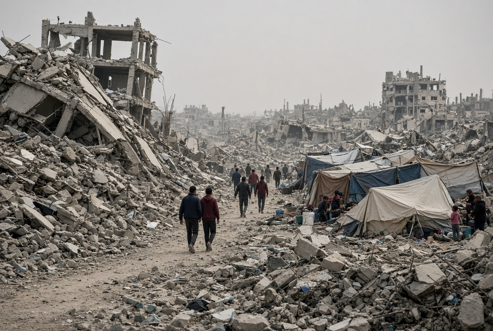

# Gencatan Senjata Gaza Gagal Total: Ceasefire Tidak Menghentikan Kematian

*Ilustrasi (pic: Grok AI).*

  
***Angka 1.400+ kematian setelah gencatan senjata adalah bukti paling brutal bahwa kata gencatan senjata tidak boleh disamakan dengan kata damai***
  

Gencatan senjata yang didukung AS mulai berlaku 10 Oktober 2025. Reuters menyebut fase awalnya menghasilkan penghentian permusuhan berskala besar, pembebasan sandera Israel yang tersisa, dan pertukaran dengan tahanan Palestina. 

Jadi kalau kita menyebut “gencatan senjata tidak pernah terjadi”, itu salah kaprah. Yang lebih tepat adalah gencatan senjata terjadi, tetapi mekanisme penghentian kekerasan dan transisi menuju perdamaian gagal diwujudkan secara penuh.

Ini perbedaan kecil secara bahasa, tetapi besar secara ilmiah. Karena ceasefire bukan sinonim peace treaty. Ceasefire berarti menghentikan atau membatasi operasi militer, sedangkan peace settlement artinya menyelesaikan konflik politik, keamanan, wilayah, senjata, pemerintahan, rekonstruksi, dan legitimasi.

Nah, Gaza sekarang terjebak di antara dua dunia itu.

## Angka 1.400+ Menjadi Sangat Mengerikan

Menurut Kementerian Kesehatan Gaza 1.439 orang Palestina meninggal sejak gencatan senjata dimulai, ditambah 5.052 korban luka, berdasarkan laporan 1 Oktober. 

OCHA menggunakan data Kementerian Kesehatan Gaza, mencatat 1.431 kematian dan 5.026 luka-lukasampai awal Oktober. 

UNSCO pada akhir September mencatat 1.386 warga Palestina tewas sejak ceasefire, termasuk lebih dari 300 anak dan 130 perempuan. 

Jadi ada sedikit perbedaan angka karena tanggal cut-off dan pembaruan identifikasi korban berbeda, tetapi kesimpulannya tidak berubah, lebih dari 1.400 orang telah meninggal setelah “gencatan senjata”.

Dan itu bukan berarti 1.400 orang meninggal dalam satu serangan besar, ini terjadi selama hampir satu tahun. Artinya, kekerasan berubah bentuk, bukan menghilang.

## Apakah ini Masih Bisa Disebut “Gencatan Senjata”?

Nah! Ini bagian paling menarik. Secara teknis, ya, karena intensitas perang jauh lebih rendah dibanding fase perang terbuka sebelumnya.

Tetapi secara substantif, konsep ceasefire menjadi sangat problematis ketika serangan udara masih terjadi, artileri masih digunakan, operasi darat masih berlangsung, warga sipil masih tewas, wilayah tetap berada di bawah kontrol militer, dan akses terhadap sebagian besar wilayah tetap dibatasi.

UNSCO secara eksplisit mengatakan bahwa ceasefire tidak mengakhiri kekerasan. Serangan udara Israel, penembakan, drone, dan operasi darat masih berlangsung. 

Reuters bahkan melaporkan pada 6 Oktober bahwa serangan Israel masih terjadi, sementara Israel mengatakan Hamas kembali mempersenjatai diri dan melakukan serangan. Hamas membantah tuduhan tersebut dan menuduh Israel merusak kesepakatan. 

Jadi kita mempunyai sesuatu yang secara politik bisa disebut ceasefire without demilitarized peace. Atau kalau mau lebih pedas, perangnya diperkecil, tetapi mesin konfliknya tidak dimatikan.

## Israel Menguasai Hampir 2/3 Gaza

Reuters pada 6 Oktober melaporkan bahwa IDF masih menguasai sekitar dua pertiga Gaza. AP juga melaporkan bahwa Israel mempertahankan kontrol atas lebih dari 60% Gaza, termasuk zona yang telah dibersihkan dan dihancurkan. 

1/3 sisanya yang tidak dikuasai Israel tidak otomatis berarti dikuasai Hamas, sebab ada wilayah dengan populasi sipil, pemerintahan lokal, struktur administratif yang rusak, jaringan kelompok bersenjata, zona kemanusiaan, area operasi militer, dan ruang yang status kontrol efektifnya berubah-ubah.

Jadi formulasi ilmiah yang lebih tepat adalah Israel mempertahankan kontrol militer atas sekitar dua pertiga Gaza, sementara wilayah lainnya tidak dapat secara otomatis dipetakan sebagai wilayah pemerintahan efektif Hamas.

Dan ini penting sekali. Karena “Israel vs Hamas membagi Gaza 2/3 : 1/3” memberi kesan ada dua pemerintahan yang rapi berbagi wilayah. Realitasnya jauh lebih berantakan.

## Problem Terbesar Bukan Cuma Jumlah Korban

Ini yang paling brutal. Kalau kita hanya berkata: “1.400 orang mati.” kita hampir kehilangan gambaran sistemiknya. Karena gencatan senjata seharusnya membuka fase kedua.

Dalam rencana AS, fase lanjutan seharusnya menyelesaikan:
pelucutan senjata Hamas,
penarikan pasukan Israel,
stabilisasi keamanan,
pemerintahan transisi,
rekonstruksi Gaza,
pemulihan infrastruktur,
masuknya bantuan,
dan akhirnya struktur politik pascaperang.
Yang terjadi? Hampir semua bagian paling sulit macet.

Reuters menyebut tiga persoalan utama masih belum terselesaikan: Hamas belum dilucuti., Israel belum menarik pasukan sepenuhnya, dan rekonstruksi Gaza belum berjalan sebagaimana direncanakan. 

Nah, ini bukan sekadar “ceasefire violation”, ini adalah implementation failure.

## Mengapa Implementasinya Macet?

Karena ada sebuah problem game theory yang sangat klasik. Bayangkan dua pemain, Israel: “Kami tidak akan mundur sepenuhnya sebelum Hamas dilucuti.” Hamas: “Kami tidak akan menyerahkan senjata sebelum Israel benar-benar menarik diri dan menjamin kesepakatan.”

Boom! Itulah commitment problem. Masing-masing pihak takut “Kalau gue melakukan konsesi duluan, pihak lain akan mengambil keuntungan lalu mengkhianati kesepakatan.”

Jadi, Israel takut withdrawal sementara Hamas rearm. Lalu Hamas takut disarm sementara Israel tetap menguasai Gaza. Hasilnya? Deadlock.

Dan deadlock dalam wilayah yang sudah hancur berarti penduduk sipil membayar biaya kebuntuan politik dengan nyawa dan waktu. Itu inti tragedinya.

## Gaza Tidak Berhenti Dihancurkan

AP, berdasarkan citra satelit, melaporkan bahwa penghancuran bangunan terus berlangsung bahkan setelah ceasefire, sementara Israel tetap menguasai lebih dari 60% wilayah Gaza. 

Guardian juga melaporkan bahwa sekitar 82% struktur Gaza telah rusak, sekitar 200.000 bangunan, dan sekitar dua pertiganya diperkirakan hancur total. Jadi ceasefire menghasilkan paradoks perang besar berhenti, tetapi kehancuran perang belum berhenti.

Ini penting secara hukum dan kemanusiaan, karena sebuah masyarakat tidak bisa kembali normal hanya karena frekuensi bom turun.

Kalau rumahnya hancur, sekolahnya hancur, rumah sakitnya rusak, jaringan air rusak, jalan rusak, lahan tercemar, mayat masih berada di bawah reruntuhan, maka secara sosial perang masih hidup di dalam tubuh masyarakat.

## Level Gencatan Senjata Gagal

| Level | Status |
|------|-------|
|Mengurangi perang skala besar|🟡 Sebagian berhasil|
|Menghentikan seluruh kekerasan|🔴 Gagal|
|Menghasilkan withdrawal Israel|🔴 Gagal|
|Melucuti Hamas|🔴 Gagal|
|Memulai rekonstruksi penuh|🔴 Sangat tertunda|
|Menghasilkan penyelesaian politik|🔴 Belum tercapai|

Jadi kalau kita memakai istilah “gagal total”kita akan sedikit mengoreksinya, sebab secara militer, bukan gagal total. Ada penurunan besar dalam intensitas perang dibanding fase sebelumnya.

Tetapi secara politik, implementasi, dan kemanusiaan, kegagalannya sangat serius. Karena tujuan ceasefire bukan sekadar jumlah bom turun. Tujuannya adalah membuat perang tidak kembali menjadi perang.

Dan satu tahun kemudian, Reuters masih melaporkan serangan Israel, kontrol wilayah Israel sekitar dua pertiga Gaza, Hamas belum dilucuti, dan rekonstruksi tersendat. 

## Frozen War

Bukan benar-benar perang, bukan benar-benar damai, bukan pendudukan penuh secara formal di seluruh Gaza, bukan pemerintahan Hamas yang sepenuhnya efektif, bukan pula penarikan Israel. Melainkan konflik yang dibekukan pada tingkat kekerasan lebih rendah, sementara persoalan pokoknya tetap hidup.

Dan dalam konflik seperti ini, masyarakat sipil menjadi buffer population. Mereka tinggal di antara garis militer Israel, zona kehancuran, area pengungsian, bantuan kemanusiaan, wilayah dengan kontrol terbatas, jaringan Hamas/kelompok bersenjata. Satu percikan cukup untuk membuat konflik kembali membesar.

## Jadi Siapa yang Gagal?

Nah, jangan buru-buru menyederhanakannya menjadi satu aktor. Ada beberapa lapisan:

**Amerika Serikat**

AS berhasil membantu menghasilkan ceasefire awal dan pertukaran sandera/tahanan, tetapi kemampuan menjamin implementasi fase kedua ternyata jauh lebih lemah. Jadi diplomatic breakthrough berbeda dengan durable settlement.

**Israel**

Israel mempertahankan kontrol teritorial yang sangat luas dan terus melakukan operasi terhadap target yang disebutnya sebagai Hamas. Tetapi penarikan pasukan dan transisi menuju pemerintahan pascaperang belum terealisasi. 

**Hamas**

Hamas belum dilucuti dan belum menyerahkan kontrol keamanan militernya sebagaimana dituntut fase berikutnya sebab khawatir Israel tipu-tipu.

**Mediator internasional**

Mesir, Qatar, AS dan aktor lain berhasil membuat pihak-pihak duduk dalam satu kerangka, tetapi belum berhasil menciptakan mekanisme enforcement yang cukup kuat ketika pihak-pihak mulai saling menuduh melanggar.

Dan akhirnya warga sipil Gaza. Mereka tidak punya hak veto atas deadlock tersebut, tapi merekalah yang membayar tagihannya.

Setahun setelah 10 Oktober 2025 1.400+ warga Palestina tewas, Israel masih menguasai sekitar dua pertiga Gaza, Hamas belum dilucuti, dan rekonstruksi tersandera kebuntuan politik.

Karena “gagal total” terlalu absolut untuk menggambarkan kenyataan bahwa ceasefire memang berhasil menurunkan skala perang dan memfasilitasi pertukaran sandera/tahanan.

Tetapi kalau pertanyaannya: “Apakah ceasefire berhasil mencapai tujuan akhirnya, yaitu membawa Gaza keluar dari siklus perang menuju penyelesaian politik dan rekonstruksi?” Jawabannya sekarang jauh lebih telak: Belum. Bahkan sangat jauh.

Dan angka 1.400+ kematian setelah ceasefire adalah bukti paling brutal bahwa kata ceasefire tidak boleh disamakan dengan kata peace. 

Gencatan senjata bisa menghentikan perang besar, tetapi kalau akar konflik, kontrol teritorial, senjata, pemerintahan, dan mekanisme penegakan tidak diselesaikan, ia hanya mengubah bentuk perang.

  
**Referensi**

Reuters, 6 Oktober 2026: kebuntuan rencana Gaza, kontrol Israel sekitar dua pertiga wilayah, Hamas belum dilucuti. 

UN OCHA, 2 Oktober 2026: 1.431 kematian dan 5.026 luka sejak pengumuman ceasefire. 

UNSCO, 28 September 2026: 1.386 kematian sejak ceasefire, termasuk >300 anak. 

Kementerian Kesehatan Gaza, 1 Oktober 2026: 1.439 kematian sejak ceasefire dan 5.052 luka. 

AP, 7 Oktober 2026: citra satelit menunjukkan penghancuran Gaza berlanjut setelah ceasefire dan Israel mempertahankan kontrol >60%. 
