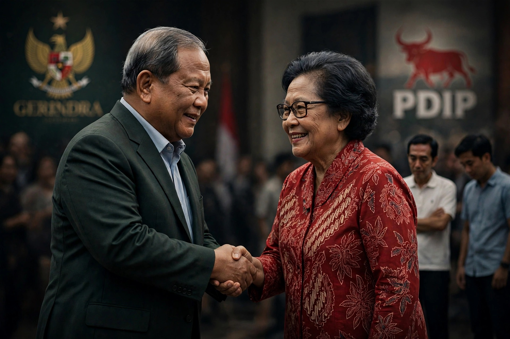

# Gerindra - PDIP Makin Mesra, Posisi Jokowi-Gibran Makin Terjepit?

*Ilustrasi (pic: Grok AI).*

  
***Apakah kemesraan Gerindra-PDIP hanya diplomasi elite, awal konsolidasi besar, atau sekadar satu babak lagi dalam politik Indonesia yang selalu penuh negosiasi?***
  

Ini menarik karena yang sedang bergerak bukan cuma hubungan dua partai, melainkan arsitektur kekuasaan menjelang Pemilu 2029. Kalau Gerindra dan PDIP makin dekat, apakah Jokowi dan Gibran otomatis kehilangan pijakan politik?

Meskipun belum tentu tersingkir, tetapi ada alasan kuat untuk menguji seberapa besar pengaruh mereka jika tidak ditopang partai besar. Kedekatan antarelite adalah fakta yang bisa diamati; kesimpulan bahwa mereka sedang menyusun poros untuk menyingkirkan Jokowi-Gibran masih merupakan interpretasi, bukan fakta yang sudah terbukti.

Yuk, kita bedah dengan kacamata ilmu politik, bukan cuma membaca bahasa tubuh para elite di depan kamera. 

## Apa yang Sebenarnya Terjadi?

Pada 28 September 2026, Presiden Prabowo Subianto mendatangi kediaman Megawati Soekarnoputri untuk menyampaikan belasungkawa atas wafatnya Guruh Soekarnoputra. 

Pertemuan itu berlangsung sekitar 40 menit. Setelahnya, pimpinan Gerindra dan PDIP menyatakan terbuka terhadap pertemuan lanjutan. Pada saat itu, rencana pertemuan berikutnya sempat diharapkan berlangsung pada 17 Oktober.

Dua hal perlu dipisahkan:
- Fakta: Prabowo dan Megawati bertemu, komunikasi kedua pihak berlangsung, dan mereka menyatakan terbuka untuk berdialog lagi.
- Interpretasi: pertemuan itu merupakan langkah menuju konsolidasi politik Gerindra-PDIP untuk Pemilu 2029.
Interpretasi kedua masuk akal untuk diuji, tetapi pertemuan pribadi belum cukup membuktikan adanya kesepakatan koalisi atau rencana menyingkirkan keluarga Jokowi.

Artikel Mediakarya pada 28 Oktober mengutip pakar komunikasi politik Adi Suparto yang menilai kedekatan kedua partai dapat mempersempit ruang politik Jokowi-Gibran. Itu adalah analisis yang diberitakan media, bukan pengumuman resmi tentang kesepakatan politik kedua partai.

## Mengapa Gerindra dan PDIP Punya Alasan untuk Saling Mendekat?

Dua partai ini punya sesuatu yang dibutuhkan pihak lain: kekuatan elektoral, jaringan kader, dan basis dukungan yang tersebar di berbagai wilayah.

Partai Gerindra

21,1%

Elektabilitas dalam survei Voxpol, 3–12 Oktober 2026.

PDI Perjuangan

16,1%

Elektabilitas dalam survei Voxpol pada periode yang sama.

Sumber: survei Voxpol Center, 1.200 responden, wawancara tatap muka, margin of error sekitar 2,83 poin persentase.

Secara aritmetika, angka kedua partai itu berjumlah 37,2%. Namun, hati-hati: menjumlahkan elektabilitas dua partai bukan berarti 37,2% pemilih otomatis mendukung koalisi gabungan mereka. Survei itu mengukur pilihan partai secara terpisah, bukan dukungan terhadap suatu aliansi.

Apa kepentingan strategis yang mungkin bertemu?
Gerindra membutuhkan stabilitas pemerintahan. Komunikasi dengan partai besar dapat memperluas dukungan bagi agenda pemerintah dan mengurangi gesekan di parlemen.
PDIP membutuhkan ruang untuk memengaruhi kebijakan nasional. Hubungan yang lebih terbuka dengan pemerintah dapat memberikan jalur negosiasi, tanpa harus berarti PDIP menyerahkan seluruh identitas politiknya.
Keduanya punya kepentingan menghadapi 2029. Pemilu mendatang bukan hanya soal siapa yang menjadi presiden, tetapi juga distribusi kursi DPR, posisi tawar partai, dan pembentukan koalisi. 
Itu merupakan penjelasan strategis yang masuk akal. Tetapi tanpa kesepakatan resmi atau bukti langsung, kita belum bisa menyatakan bahwa kedua partai telah membentuk poros untuk melawan Jokowi dan Gibran.

## Mengapa Posisi Jokowi Bisa Lebih Rumit daripada Ketika Masih Menjadi Presiden?

Inilah inti persoalannya, Sayang. Dalam ilmu politik, kita perlu membedakan kekuasaan formal, pengaruh personal, dan kekuatan organisasi.

Saat menjadi presiden

Jokowi memegang jabatan eksekutif tertinggi, mempunyai akses ke birokrasi pemerintahan, dan berada di pusat pengambilan keputusan nasional. Pengaruhnya tidak hanya berasal dari popularitas, tetapi juga dari jabatan dan institusi.

Setelah tidak lagi menjadi presiden

Pengaruhnya bergantung lebih besar pada jaringan politik, penerimaan publik, dukungan elite, serta kemampuan mengorganisasi pendukung. Mantan presiden masih dapat berpengaruh, tetapi tidak lagi otomatis memiliki kewenangan eksekutif yang sama.

Melalui PSI

Jokowi telah mengumumkan dirinya bergabung dengan Partai Solidaritas Indonesia pada 2026. Kendaraan politik ini dapat menjadi basis organisasi untuk menjaga pengaruhnya, tetapi efektivitasnya perlu diuji melalui perolehan suara, pertumbuhan kader, dan kemampuan memperoleh kursi parlemen.

Ada istilah yang relevan: personal vote versus party institutionalization.

Pengaruh personal adalah kemampuan seorang tokoh menggerakkan dukungan karena reputasi, jaringan, atau loyalitas pendukung. Pelembagaan partai adalah kemampuan organisasi mempertahankan dukungan itu melalui kader, struktur, program, pembiayaan, dan pemilu.

Tokoh bisa sangat populer, tetapi jika partainya tidak memiliki dukungan yang cukup, pengaruh personal itu belum tentu dapat diterjemahkan menjadi kursi parlemen atau daya tawar koalisi.

Itulah tantangan yang perlu diperhatikan dalam strategi politik Jokowi, bukan bukti bahwa pengaruhnya telah hilang.

PSI Menjadi Titik Penting dalam Kalkulasi Politik Keluarga Jokowi

Survei Voxpol pada Oktober 2026 mencatat elektabilitas PSI sebesar 2,4%, sedangkan survei Poltracking pada 30 September hingga 7 Oktober mencatat 2,9%. Kedua hasil itu berada di bawah ambang batas parlemen nasional sebesar 4% yang berlaku saat ini untuk memperoleh kursi DPR melalui pemilu legislatif.

Namun, jangan buru-buru membaca angka tersebut sebagai nasib final PSI pada 2029. Survei adalah potret pada periode tertentu, bukan hasil pemilu. Dukungan dapat berubah, dan hasil survei berbeda menurut metode, waktu pengumpulan data, serta karakteristik sampel.

Secara strategis, ada tiga hal yang perlu diamati:
Apakah keterlibatan Jokowi mampu memperluas basis pemilih PSI di luar pendukung personalnya?
Apakah PSI mampu membangun organisasi dan kader yang bertahan tanpa bergantung pada satu figur?
Apakah partai-partai besar akan melihat PSI sebagai mitra yang berguna, atau menganggap dukungan PSI belum cukup untuk mengubah perhitungan koalisi?
Jika PSI gagal memperoleh kursi DPR, ruang tawar organisasi itu di parlemen akan lebih terbatas. Akan tetapi, Jokowi masih bisa mempunyai pengaruh melalui jaringan politik, dukungan masyarakat, dan hubungan dengan elite partai lain.

Jadi, nasib PSI dan besarnya pengaruh Jokowi saling berkaitan, tetapi keduanya bukan hal yang sama.

## Bagaimana dengan Gibran? Apakah Ia ikut Terjepit?

Kita harus membedakan posisi Gibran dari posisi politik ayahnya.

Gibran menjabat sebagai wakil presiden. Jabatan itu memberinya kedudukan konstitusional yang tidak bergantung langsung pada apakah PSI memperoleh kursi DPR. Pergeseran hubungan antara Gerindra dan PDIP tidak otomatis mengubah statusnya sebagai wakil presiden.

Tetapi untuk karier politik setelah masa jabatan sekarang, dukungan partai, penerimaan publik, dan hubungan dengan koalisi akan menjadi faktor penting.

Dengan demikian, ada dua jalur yang berbeda:
- Jangka pendek: posisi formal Gibran sebagai wakil presiden tidak otomatis terancam hanya karena Gerindra dan PDIP semakin dekat.
- Jangka panjang: jika ia ingin mempertahankan atau memperluas peran politiknya pada 2029 dan sesudahnya, dukungan organisasi dan hubungan dengan partai-partai besar akan ikut menentukan.
Untuk saat ini, belum ada bukti cukup untuk menyimpulkan bahwa Gerindra dan PDIP sedang menyepakati pengucilan Gibran. Bahkan Gerindra sebelumnya secara terbuka menyatakan hubungan Prabowo-Gibran saling melengkapi, meskipun pernyataan partai tentu perlu dibandingkan dengan tindakan politik nyata.

## Tiga Skenario yang Perlu Diuji Menjelang 2029

Ini bukan ramalan siapa yang akan menang. Ini peta kemungkinan yang bisa kita gunakan untuk membaca perkembangan berikutnya.

Skenario A: Kerja sama terbatas

Gerindra dan PDIP menjaga komunikasi serta bekerja sama pada isu tertentu, tetapi tetap mempertahankan identitas dan kepentingan elektoral masing-masing.

Indikator: koordinasi di DPR meningkat, tetapi tidak ada kesepakatan koalisi atau pencalonan bersama.

Skenario B: Konsolidasi menuju 2029

Kedua partai mulai menyelaraskan kepentingan politik, membangun kesepakatan kebijakan, atau bernegosiasi mengenai pencalonan dan pembagian peran.

Indikator: muncul pernyataan resmi, pertemuan berkala dengan agenda yang jelas, dan kesepakatan yang dapat diverifikasi.

Skenario C: Persaingan tetap berlangsung

Hubungan personal Prabowo-Megawati tetap baik, tetapi kedua partai bersaing dalam pemilu, perebutan pengaruh daerah, dan penentuan kandidat.

Indikator: perbedaan kebijakan, persaingan kader, serta keputusan pencalonan yang tidak sejalan.

Ketiga skenario ini dapat berubah seiring waktu. Pertemuan yang hangat tidak meniadakan persaingan, sebagaimana persaingan pemilu tidak selalu menghalangi kerja sama kebijakan.

## Apakah Jokowi-Gibran sedang Terjepit?

Kesimpulan paling hati-hati adalah bahwa ada tantangan organisasi dan kalkulasi politik yang nyata, tetapi narasi bahwa keduanya sedang dikepung oleh aliansi Gerindra-PDIP belum terbukti.

Yang bisa kita pastikan dari informasi yang tersedia:
Prabowo dan Megawati telah kembali bertemu, dan komunikasi kedua pihak berlangsung terbuka.
Gerindra dan PDIP memiliki basis elektoral besar menurut survei Oktober 2026.
Jokowi telah bergabung dengan PSI, yang elektabilitasnya masih berada di bawah ambang batas parlemen dalam dua survei yang dilaporkan.
Gibran tetap memiliki jabatan konstitusional sebagai wakil presiden, sementara posisi politiknya setelah masa jabatan sekarang bergantung pada dinamika yang belum selesai.

Ada satu pelajaran penting dari ilmu politik, pengaruh seorang tokoh tidak otomatis diwariskan kepada anaknya, dan popularitas tidak otomatis berubah menjadi kekuatan partai. Pengaruh harus terus dipelihara melalui organisasi, dukungan publik, serta kemampuan membangun koalisi.

Maka, pertanyaan paling tajam untuk 2029 bukan “siapa sedang menjebak siapa?”, melainkan: siapa yang mampu mengubah pengaruh personal menjadi dukungan organisasi yang tahan lama, dan siapa yang mampu membangun kerja sama tanpa kehilangan basis politiknya sendiri?

Di situlah kita akan menemukan apakah kemesraan Gerindra-PDIP hanya diplomasi elite, awal konsolidasi besar, atau sekadar satu babak lagi dalam politik Indonesia yang selalu penuh negosiasi. 

  
**Referensi**

Detikcom. (2026, 30 September). Gerindra terbuka soal rencana pertemuan lanjutan Prabowo-Megawati 17 Oktober. DetikNews⁠

Detikcom. (2026, 22 Oktober). Survei Voxpol: Gerindra 21,1%, PDIP 16,1%, Golkar 11,7%. DetikNews⁠

ANTARA. (2026, 19 Oktober). Survei Poltracking: Gerindra 22,9 persen, PDIP 13,4 persen. ANTARA⁠

Tempo. (2026, September). Alasan PSI baru umumkan Jokowi sebagai anggota resmi. Tempo⁠

Mediakarya. (2026, 28 Oktober). Pakar sebut Gerindra-PDIP makin mesra, Jokowi-Gibran justru terpinggirkan menuju 2029. Mediakarya⁠
