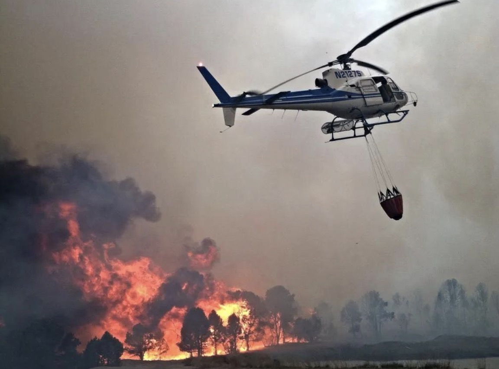

# Gugur di Atas Asap, Dilupakan di Bawah Langit Cerah: Anatomi Pengorbanan Pemadam Karhutla, Kegagalan Tata Kelola Risiko, & Krisis Empati Ekologis di Indonesia

*Ilustrasi (pic: Grok AI).*

  
***Orang-orang yang memadamkan api bukan sekadar petugas yang sedang menjalankan pekerjaan. Mereka sedang melindungi kehidupan yang bahkan tidak mereka kenal***
  

Bagian paling menyakitkan justru paradoksnya: orang-orang yang berangkat menembus asap untuk melindungi hutan, satwa, permukiman, kesehatan, dan kehidupan orang lain, malah kehilangan nyawa dalam pekerjaan itu. Sementara manfaat dari kerja mereka dinikmati jauh melampaui lingkaran orang yang pernah mengenal nama mereka.

Dan soal spanduk Karhutla di pertandingan bola jelas untuk mengingatkan publik tentang bencana ekologis bukan tindakan yang pantas dibalas dengan ancaman duel. Kita boleh berbeda pendapat soal cara menyampaikan pesan, tetapi mengintimidasi orang yang mengangkat isu kebakaran hutan adalah persoalan lain.

Mari membedahnya lebih dalam dari sekadar kecelakaan dan keributan suporter: risiko kerja pemadam, tata kelola Karhutla, ekonomi politik perkebunan, dan psikologi masyarakat yang menikmati hasil perlindungan lingkungan tetapi gagal menghargai orang yang melakukannya.

## Dua Kecelakaan, tetapi Nasib Awaknya Berbeda

Pada 8 November 2026 helikopter Eurocopter EC225LP Super Puma dengan registrasi VH-HGM jatuh di perairan sungai Barito Desa Tabatan Baru, Kecamatan Kuripan, Kabupaten Barito Kuala, Kalimantan Selatan, ketika menjalankan misi water bombing. BNPB memastikan ketiga kru selamat. Penyebab kecelakaan masih diselidiki.

Sedangkan sebelumnya pada 4 November 2026, helikopter Mi-17V5 TNI AD dengan registrasi HA-5235 jatuh di perairan sekitar Desa Sungai Perlu, Kabupaten Seruyan, ketika mengambil air untuk memadamkan Karhutla di kawasan Taman Nasional Tanjung Puting. Pada laporan awal, dua personel dinyatakan meninggal dan satu masih dicari. 

Perkembangan berikutnya mengonfirmasi tiga personel gugur:
- Letkol Cpn Dudi Firmansyah
- Kapten Cpn Nurhafiz Akbar
- Sertu Heri Prasetyo
Lima personel lainnya selamat. Kemenhub menyampaikan belasungkawa dan menyatakan mendukung proses penanganan kecelakaan.

Jadi, dua kecelakaan itu terjadi dalam rentang empat hari. Satu berakhir dengan tiga kru selamat; satu lagi merenggut tiga nyawa.
Dan ada sesuatu yang tidak boleh kita lewatkan: para kru helikopter bukan sekadar mengangkut air. Mereka bekerja dalam operasi penerbangan berisiko tinggi, berulang kali mendekati titik api, melakukan manuver rendah, dan mengoperasikan beban gantung berupa bambi bucket. Kesalahan kecil atau perubahan kondisi penerbangan dapat berakibat fatal.

## Mengapa Water Bombing Begitu Berisiko?

Helikopter pemadam membawa perangkat bernama Bambi bucket, yaitu wadah air yang digantung di bawah helikopter dengan kabel. Air diambil dari sungai, danau, atau sumber air lain, kemudian dijatuhkan di atas titik kebakaran.

Secara operasional, ini pekerjaan yang rumit karena pilot harus mengendalikan beberapa variabel sekaligus:
- Ketinggian dan kecepatan rendah. Helikopter harus mendekati permukaan air untuk mengisi bucket, kemudian memperoleh ketinggian dan kecepatan yang memadai untuk keluar dari lokasi.
- Beban eksternal yang bergerak. Bucket yang tergantung dapat berayun. Perubahan gerak beban memengaruhi stabilitas dan kendali pesawat.
- Perubahan berat dan performa. Helikopter mengalami perubahan beban ketika bucket kosong dan terisi air. Kapasitas angkat juga dipengaruhi temperatur, ketinggian, kelembapan, dan kondisi mesin.
- Lingkungan operasi. Asap dapat mengurangi visibilitas, angin dan turbulensi mengganggu kendali, sementara pepohonan, kabel, serta medan yang sempit memperkecil ruang manuver.
Ini adalah profil bahaya umum operasi pemadaman udara, bukan kesimpulan penyebab dua kecelakaan tersebut.

Pada kecelakaan Barito, BNPB menyebut rekaman awal memperlihatkan helikopter kehilangan kendali setelah mengambil air. 

Pada kecelakaan Mi-17, keterangan awal TNI AD menyebut gangguan teknis ketika mengambil air laut. Tetapi penyebab definitif keduanya harus menunggu investigasi teknis.

Ada pertanyaan keselamatan yang sangat layak diajukan pemerintah:
Bagaimana evaluasi risiko lokasi pengambilan air?
Apakah kondisi cuaca, angin, dan performa pesawat dievaluasi sebelum setiap sortie?
Bagaimana batas jam terbang dan waktu istirahat awak?
Apakah inspeksi pesawat dan perangkat bucket dilakukan secara independen?
Apakah ada evaluasi keselamatan setelah kecelakaan pertama, sebelum operasi udara berikutnya?
Jangan sampai kita hanya memberikan penghormatan setelah kecelakaan, tetapi tidak mengubah prosedur yang mungkin dapat mencegah kecelakaan berikutnya.

Penghormatan paling konkret kepada kru yang gugur adalah memastikan kru berikutnya tidak menghadapi risiko yang sama tanpa mitigasi yang memadai.

## Paradoks Karhutla: Kita Memadamkan Api, tetapi Apakah Kita Menghentikan Mesin yang Memproduksinya?

Karhutla bukan semata-mata persoalan api yang harus disiram. Ia merupakan persoalan ekologi, tata guna lahan, ekonomi, dan penegakan hukum.

Terutama pada lahan gambut, api dapat membara di bawah permukaan. Api yang tampak padam di atas tanah belum tentu benar-benar berhenti. Karena itu, pembasahan berulang, pemadaman darat, dan pengelolaan tata air menjadi penting.

BNPB secara eksplisit menjelaskan bahwa pemadaman udara tidak dapat menjadi satu-satunya strategi. Helikopter lebih tepat digunakan untuk lokasi yang sulit dijangkau atau untuk membantu mengendalikan penjalaran api, sementara operasi darat harus tetap diperkuat.

KLH/BPLH juga menyebut operasi modifikasi cuaca hanya salah satu bagian dari penanganan. Ia perlu berjalan bersama patroli, pemantauan titik panas, pembasahan gambut, pengelolaan tata air, keterlibatan masyarakat, pengawasan badan usaha, dan penegakan hukum.

Data BNPB per 4 September 2026 menunjukkan bahwa enam provinsi menjadi prioritas penanganan. Di Kalimantan Barat, tercatat 61 titik api dengan luas kebakaran 802,17 hektare, sedangkan Kalimantan Tengah mencatat 70 titik api dengan luas 225,1 hektare. 

BNPB juga melaporkan bahwa hingga 3 September, Bareskrim menangani 167 laporan polisi terkait Karhutla.

Angka tersebut memperlihatkan bahwa Karhutla bukan persoalan yang dapat diselesaikan hanya dengan mengirim helikopter.

Kita harus bertanya lebih jauh:
Siapa yang menguasai dan mengelola lahan yang terbakar?
Apakah ada pembukaan lahan dengan api?
Apakah kanal dan sistem drainase membuat gambut semakin kering?
Apakah perusahaan dan pemegang konsesi menjalankan kewajiban pencegahan?
Apakah pelaku pembakaran benar-benar ditindak, termasuk jika memiliki kekuatan ekonomi dan politik?
Di sini letak ketimpangan tanggung jawab ekologis: petugas pemadam menghadapi api yang sudah menyala, sedangkan pencegahan seharusnya bekerja sebelum api muncul.
Kita tidak boleh membebankan seluruh tanggung jawab kepada orang yang berada di garis depan pemadaman.

## Orang Menikmati Udara Bersih, tetapi Tidak Melihat Siapa yang Membayarnya

Dalam ekonomi lingkungan ada konsep positive externality atau eksternalitas positif.
Ketika petugas memadamkan Karhutla, manfaatnya dinikmati oleh banyak pihak:
- Masyarakat dapat bernapas dengan udara yang lebih baik.
- Anak-anak dapat bersekolah tanpa gangguan asap.
- Rumah sakit tidak dibanjiri pasien gangguan pernapasan.
- Penerbangan dan transportasi tidak terganggu jarak pandang.
- Ekosistem, satwa, dan vegetasi memperoleh perlindungan.
- Aktivitas ekonomi tetap berlangsung.
Tetapi orang yang memperoleh manfaat itu tidak selalu ikut menanggung biaya dan risiko pemadaman.

Bayangkan seseorang di kota dapat menikmati langit cerah karena tim pemadam bekerja di hutan berjam-jam. Ia tidak mengenal nama pilot, teknisi, petugas darat, atau masyarakat lokal yang terlibat.

Inilah yang disebut free-rider problem: seseorang memperoleh manfaat dari usaha kolektif tanpa harus berkontribusi secara proporsional.

Namun tidak semua orang yang menikmati udara bersih berarti tidak peduli. Banyak orang tidak mengetahui besarnya risiko yang ditanggung petugas, atau tidak memiliki akses untuk membantu. Kritik kita sebaiknya diarahkan pada sikap apatis, penyangkalan, intimidasi, dan sistem yang membiarkan risiko terus berulang.

Udara bersih adalah barang publik, sehingga keselamatan orang yang menjaga udara bersih juga harus menjadi tanggung jawab publik.

## Drama Spanduk Karhutla: Ketika Stadion Dianggap Lebih Penting Daripada Pesan tentang Bencana

Saat pertandingan lPSMS Medan melawan Persija Jakarta yang berlangsung pada 3 November 2026 di Stadion Utama Sumatera Utara, seorang komedian dan mantan pemain PSMS, Oki Rengga berdebat dengan seorang suporter terkait rencana membentangkan spanduk kritik Karhutla. 

Dalam video tersebut, ia terlihat memegang kepala suporter dan berbicara dengan nada emosional. Tetapi pada 6 November, Oki menyampaikan permintaan maaf. Ia menjelaskan bahwa menurut versinya, ia tidak bermaksud melarang spanduk Karhutla. Ia mengusulkan agar spanduk dibentangkan setelah pertandingan selesai karena ingin penonton fokus mendukung PSMS. Ia bahkan mengaku menawarkan diri untuk ikut memegang spanduk tersebut.

Ia juga menjelaskan bahwa situasi di tribun berkembang menjadi perdebatan dan emosinya ikut terbawa.

Jadi, kita perlu memisahkan tiga hal:
- Fakta visual: terjadi konfrontasi fisik dan verbal yang terekam.
- Penjelasan pihak terkait: Oki menyatakan persoalannya adalah waktu pemasangan spanduk, bukan penolakan terhadap isu Karhutla.
- Penilaian sosial: penggunaan gestur intimidatif dan konfrontasi terhadap suporter tetap layak dikritik, sekalipun niat awalnya adalah menjaga fokus pertandingan.
Kita tidak akan menganggap seluruh narasi viral sebagai fakta, termasuk klaim bahwa ia secara khusus mengajak duel. Tetapi permintaan maaf dan penjelasannya juga tidak otomatis menghapus dampak tindakannya.

Spanduk itu penting secara sosiologis karena sepak bola bukan sekadar hiburan. Stadion adalah ruang publik tempat identitas kolektif, emosi, solidaritas, dan ekspresi politik bertemu.

Dalam sosiologi olahraga, ada konsep football as a public sphere: pertandingan dapat menjadi ruang artikulasi persoalan sosial yang tidak selalu memperoleh perhatian di media arus utama.

Spanduk tentang Karhutla merupakan bentuk komunikasi politik yang ringkas. Ia membawa persoalan dari hutan dan lahan gambut ke ruang yang dilihat ribuan orang.

Tentu ada aturan stadion dan pertimbangan penyelenggaraan pertandingan. Suporter bisa saja menyepakati waktu atau mekanisme pemasangan yang berbeda. Namun perbedaan itu tidak perlu berubah menjadi intimidasi.

Dan ada ironi yang cukup tajam, jika stadion dapat menjadi tempat merayakan kebanggaan daerah, mengapa penderitaan ekologis daerah sendiri harus dianggap mengganggu kebanggaan itu? 

Dukungan terhadap klub dan kepedulian terhadap lingkungan bukan dua hal yang saling meniadakan. Justru klub sepak bola memiliki kekuatan sosial yang besar untuk membawa isu lokal kepada publik yang lebih luas.

## Krisis Empati Ekologis: Mengapa Orang Bisa Menikmati Hasil Pengorbanan tetapi Menolak Pesan tentang Pengorbanan itu?

Ada beberapa mekanisme psikologis yang menarik:

A. Psychological distance

Orang lebih mudah peduli pada bencana yang terlihat langsung daripada bencana yang berlangsung jauh dari kehidupan sehari-harinya.

Kebakaran di pedalaman Kalimantan terasa abstrak bagi seseorang yang tinggal di kota lain. Namun ketika asap menutup bandara, sekolah diliburkan, dan anak mengalami sesak napas, persoalan itu tiba-tiba menjadi nyata.

B. Normalization of deviance

Konsep yang dipopulerkan sosiolog Diane Vaughan ini menjelaskan bagaimana penyimpangan atau kondisi berbahaya dapat perlahan dianggap normal karena terjadi berulang kali tanpa langsung menghasilkan bencana besar.

Dalam konteks Karhutla, masyarakat dapat terbiasa dengan pola:

Kemarau datang.

Api muncul.

Asap menyebar.

Petugas dikerahkan.

Hujan turun.

Publik kembali melupakan persoalan.

Siklus tersebut berbahaya karena penanganan darurat bisa dianggap sebagai solusi permanen, padahal penyebab strukturalnya belum tentu diselesaikan.

C. Moral disengagement

Orang dapat membenarkan tindakan yang merugikan pihak lain dengan menganggap bahwa tindakannya memiliki tujuan yang lebih penting.

Misalnya, kritik Karhutla dianggap mengganggu pertandingan, sehingga orang merasa berhak membungkam kritik itu.
Padahal, prioritas hiburan tidak menghapus hak orang lain untuk menyampaikan persoalan publik.

Satu pertandingan berlangsung beberapa jam. Kerusakan hutan dan gambut bisa berlangsung puluhan tahun.

## Apa yang Seharusnya Dilakukan Negara? Bukan Hanya Mengirim Helikopter

Tragedi ini harus menjadi momentum evaluasi kebijakan yang konkret.

Prioritas | Langkah yang perlu dilakukan |
|------|-------|
|Keselamatan penerbangan|Investigasi independen, audit armada, evaluasi SOP dan jam terbang|
|Pemadaman darat|Perkuat personel lokal, peralatan, logistik dan perlindungan kesehatan|
|Pengelolaan gambut|Pembasahan, pengendalian drainase, restorasi hidrologis|
|Pencegahan|Patroli, deteksi dini, pengawasan konsesi dan larangan pembakaran|
|Penegakan hukum|Penindakan terhadap pelaku individu maupun korporasi berdasarkan bukti|
|Perlindungan pekerja|Asuransi, kompensasi keluarga, jaminan kesehatan dan dukungan psikologis|
|Transparansi|Publikasi data kebakaran, penyebab, luasan, penanggung jawab dan perkembangan investigasi|

Ada satu hal yang sangat penting: investigasi kecelakaan harus menghasilkan rekomendasi keselamatan yang dapat diperiksa publik. Jangan sampai laporan berhenti pada kesimpulan bahwa kecelakaan adalah musibah.

Musibah tidak berarti bebas dari evaluasi.
Jika ada kegagalan pemeliharaan, kesalahan prosedur, kelemahan pengawasan, atau masalah desain operasi, semuanya harus diungkap berdasarkan bukti.

## Satu Hal yang Tidak Boleh Dilupakan: Nama Mereka

Tiga personel TNI AD yang gugur bukan sekadar angka statistik.
- Letkol Cpn Dudi Firmansyah.
- Kapten Cpn Nurhafiz Akbar.
- Sertu Heri Prasetyo.
Mereka gugur ketika menjalankan tugas pemadaman Karhutla. Lima rekan mereka selamat, tetapi juga mengalami kecelakaan dan harus menjalani perawatan.

Sementara tiga kru Super Puma yang jatuh di Sungai Barito hari ini berhasil selamat. Kita patut bersyukur, tetapi kecelakaan tersebut tetap harus diselidiki secara serius. Jangan biarkan keselamatan mereka menjadi berita sehari, lalu hilang ketika langit kembali biru.

## Siapa yang Sebenarnya Membayar Harga Udara Bersih?

Ada tiga lapisan tragedi dalam persoalan ini.
Pertama, tragedi manusia. Petugas dan awak penerbangan menanggung risiko fisik yang sangat besar untuk melindungi masyarakat.

Kedua, tragedi ekologis. Karhutla terus memperlihatkan bahwa pemadaman darurat tidak cukup jika pencegahan, pengelolaan gambut, pengawasan lahan, dan penegakan hukum tidak berjalan kuat.

Ketiga, tragedi sosial. Ketika pesan tentang bencana dianggap mengganggu hiburan, kita melihat bagaimana persoalan lingkungan dapat dipinggirkan oleh kepentingan yang jauh lebih kecil.

Jangan sampai negara hanya mengingat para pemadam ketika membutuhkan keberanian mereka, lalu melupakan keselamatan mereka ketika menyusun anggaran, kebijakan, dan pengawasan.

Orang-orang yang memadamkan api bukan sekadar petugas yang sedang menjalankan pekerjaan. Mereka sedang melindungi kehidupan yang bahkan tidak mereka kenal.

Dan masyarakat yang menikmati udara bersih punya kewajiban moral untuk tidak membiarkan pengorbanan itu menjadi rutinitas yang dianggap biasa.

  
**Referensi**

1. Badan Nasional Penanggulangan Bencana. (2026, November 8). Helikopter pemadam karhutla BNPB jatuh di Sungai Barito, tiga kru dipastikan selamat. https://bnpb.go.id/berita/helikopter-pemadam-karhutla-bnpb-jatuh-di-sungai-barito-tiga-kru-dipastikan-selamat⁠

2. Tumpal Andani Aritonang. (2026, November 8). BNPB: 3 kru heli pemadam karhutla selamat usai jatuh di Sungai Barito. ANTARA News. https://www.antaranews.com/berita/5839579/bnpb-3-kru-heli-pemadam-karhutla-selamat-usai-jatuh-di-sungai-barito⁠

3. Wahyuningtyas, P. (2026, November 5). Daftar 3 korban helikopter TNI AD jatuh saat padamkan karhutla. Tirto. https://tirto.id/daftar-3-korban-helikopter-tni-ad-jatuh-saat-padamkan-karhutla-hVF1⁠

4. Kementerian Perhubungan Republik Indonesia. (2026, November 4). Kemenhub sampaikan duka cita atas kecelakaan helikopter water bombing di Kuala Pembuang, Kalimantan Tengah. https://hubud.kemenhub.go.id/berita/4914⁠

5. Kementerian Lingkungan Hidup/Badan Pengendalian Lingkungan Hidup. (2026, September 5). KLH/BPLH gencarkan operasi modifikasi cuaca untuk padamkan api di Kalimantan Barat dan Kalimantan Tengah. https://www.kemenlh.go.id/news/detail/klhbplh-gencarkan-operasi-modifikasi-cuaca-untuk-padamkan-api-di-kalimantan-barat-dan-kalimantan-tengah⁠

6. Badan Nasional Penanggulangan Bencana. (2026, September 4). Situasi terkini penanganan karhutla enam provinsi prioritas. https://bnpb.go.id/berita/situasi-terkini-penanganan-karhutla-enam-provinsi-prioritas⁠

7. Vaughan, D. (1996). The Challenger launch decision: Risky technology, culture, and deviance at NASA. University of Chicago Press.

8. Kasperson, R. E., Renn, O., Slovic, P., Brown, H. S., Emel, J., Goble, R., Kasperson, J. X., & Ratick, S. (1988). The social amplification of risk: A conceptual framework. Risk Analysis, 8(2), 177–187. https://doi.org/10.1111/j.1539-6924.1988.tb01168.x⁠
