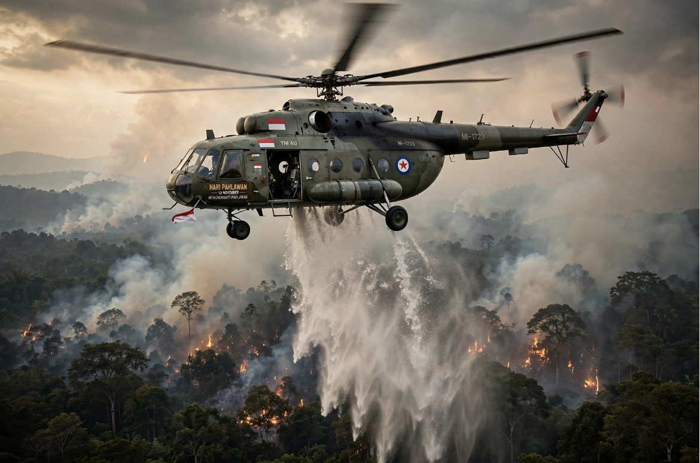

# Hari Pahlawan 2026: Melawan Api dan Harga Kemanusiaan Pengabdian Tanpa Monumen

*Ilustrasi (pic: Grok AI).*

  
***Kita boleh menyebut mereka pahlawan karena keberanian dan pengabdiannya. Tetapi jangan sampai sebutan pahlawan menjadi cara yang indah untuk menormalisasi kematian***
  

Untuk Hari Pahlawan 10 November 2026, kita menggeser sedikit makna kata pahlawan. Bukan untuk mengecilkan jasa mereka yang merebut kemerdekaan pada 1945, melainkan untuk melihat bahwa kemerdekaan juga harus dijaga melalui pekerjaan yang sering tidak mendapat panggung: menyelamatkan manusia, hutan, satwa, udara, dan kehidupan. Dan tahun ini, Kalimantan memberi kita alasan yang sangat nyata untuk merenungkannya. 

Dalam rentang beberapa hari, dua helikopter yang mendukung pemadaman Karhutla mengalami kecelakaan. Empat orang gugur. Mereka bukan sedang berperang melawan negara lain. Mereka sedang berusaha mencegah api merampas ruang hidup kita.

Kemerdekaan bukan hanya hak untuk hidup di tanah air, tetapi juga tanggung jawab untuk menjaga agar tanah air tetap layak dihuni.

## Siapa Saja yang Gugur dalam Perang Melawan Api?

Ada satu fakta yang membuat peringatan Hari Pahlawan tahun ini terasa begitu dekat: korban Karhutla bukan hanya personel berseragam. Mereka berasal dari berbagai lapisan masyarakat, mulai dari petugas kehutanan, Manggala Agni, prajurit TNI, pekerja mitra, masyarakat mitra polisi kehutanan, relawan, hingga warga yang ikut memadamkan api.

Pada 9 November, Menko Polkam Dudung Abdurachman menyampaikan bahwa sepanjang 2026 tercatat 15 orang meninggal ketika bertugas menangani Karhutla, tersebar di Kalimantan Tengah, Kalimantan Selatan, Jawa Timur, dan Sulawesi Selatan. Angka ini mencakup lebih dari dua kecelakaan helikopter yang sedang kita bicarakan.

Mari kita lihat beberapa kelompok pengabdian yang bisa kita kenali:

A. Barisan pemadam darat: BPK, Manggala Agni, petugas kehutanan, dan relawan

Di Kalimantan, kita mengenal BPK, singkatan dari Barisan Pemadam Kebakaran. BPK merupakan bagian penting dari budaya gotong royong pemadaman kebakaran, khususnya di wilayah perkotaan seperti Banjarmasin.

Tetapi kita perlu membedakan tugas BPK perkotaan dengan Manggala Agni dan tim pemadam Karhutla. Tidak semua BPK bertugas di kawasan hutan, dan tidak semua relawan Karhutla merupakan anggota BPK.

Di medan kebakaran hutan, petugas darat menghadapi panas ekstrem, perubahan arah angin, asap pekat, medan yang sulit, serta risiko terjebak ketika api berubah arah.

Tragedi Bromo pada Oktober menjadi contoh mengerikan. Empat petugas dan mitra meninggal dalam insiden 15 Oktober setelah angin kencang membuat api mengepung kelompok pemadam. Seorang anggota Masyarakat Mitra Polhut, Munawi, kemudian meninggal pada 19 Oktober setelah menjalani perawatan akibat luka bakar serius. 

Lima nama yang diberitakan adalah:
- Sukaris, petugas Taman Nasional Bromo Tengger Semeru.
- Hendra Rony Wagiyanata, Manggala Agni.
- Wisnu Yuda Pratama, pekerja mitra.
- Sefriel Ardiansyah, pekerja mitra.
- Munawi, anggota Masyarakat Mitra Polhut. kehutanan.
Ini bukan hanya cerita tentang keberanian. Ini juga cerita tentang pentingnya komando lapangan, pemetaan arah angin, jalur evakuasi, komunikasi antartim, dan kewenangan untuk mundur ketika kondisi berubah menjadi mematikan.

B. Tiga prajurit yang gugur di Tanjung Puting

Pada 4 November, helikopter Mi-17V5 milik Penerbangan TNI AD jatuh ketika menjalankan misi pemadaman di kawasan Taman Nasional Tanjung Puting, Kabupaten Seruyan, Kalimantan Tengah.

Tiga personel yang gugur adalah:
- Letkol Cpn Dudi Firmansyah.
- Kapten Cpn Nurhafiz Akbar.
- Sertu Heri Prasetyo.
Lima personel lainnya selamat. Kecelakaan terjadi ketika helikopter sedang menjalankan rangkaian operasi pengambilan air untuk water bombing.

C. Yayan Supyansuri, gugur di Sungai Barito

Pada 8 November, helikopter Super Puma VH-HGM yang mendukung operasi BNPB jatuh di Sungai Barito, Kabupaten Barito Kuala, Kalimantan Selatan.

Korban yang meninggal adalah Yayan Supyansuri, 39 tahun, yang bertugas sebagai Helicopter Landing Officer atau HLO. Dua pilot berkewarganegaraan asing selamat. Yayan meninggalkan seorang istri dan dua anak, yang saat itu masih berusia sembilan tahun dan tujuh bulan. Ia dimakamkan di Pasar Kemis, Tangerang, pada 9 November.

Tugas HLO bukan pekerjaan tambahan yang sepele. Dalam operasi water bombing, ia membantu koordinasi operasi pengambilan air dan penjatuhannya di lokasi kebakaran. Jadi, di balik helikopter yang terlihat dari kejauhan, ada orang-orang yang mengerjakan detail teknis agar misi pemadaman bisa berlangsung.

Catatan penting: kita tidak boleh menyebut semua 15 korban sebagai korban kecelakaan helikopter. Angka 15 adalah total korban meninggal dalam penanganan Karhutla sepanjang tahun menurut keterangan Menko Polkam. Mereka gugur dalam berbagai kejadian dan tugas.

## Dari Pertempuran Surabaya ke Medan Karhutla: Apa yang Membuat Seseorang Disebut Pahlawan?

Tanggal 10 November diperingati untuk mengenang Pertempuran Surabaya 1945. Perlawanan rakyat Surabaya menjadi simbol keberanian mempertahankan kemerdekaan ketika kedaulatan bangsa masih dipertaruhkan.

Tema resmi Hari Pahlawan 2026 adalah “Pahlawanku Teladanku, Melangkah Bersama, Melanjutkan Perjuangan” Bersumber dari Pedoman Peringatan Hari Pahlawan 2026 kemendikdasmen.go.id.

Ada kesinambungan filosofis antara perjuangan 1945 dan pengabdian para pemadam Karhutla, tetapi kita juga perlu melihat perbedaannya:

| Pahlawan 1945 | Pahlawan kemanusiaan masa kini |
|------|-------|
| kedaulatan|Melindungi kehidupan dan ruang hidup|
|Menghadapi ancaman kolonial|Menghadapi bencana ekologis|
|Berjuang melalui perlawanan bersenjata dan solidaritas rakyat|Berjuang melalui pelayanan, penyelamatan, dan gotong royong|
|Mempertahankan kemerdekaan politik|Menjaga agar kemerdekaan dapat dinikmati secara bermartabat|

Pahlawan tidak harus selalu diartikan sebagai orang yang meninggal dalam perjuangan. Orang yang menyelamatkan banyak kehidupan dan pulang kembali kepada keluarganya juga melakukan tindakan kepahlawanan.

Kematian bukan syarat kepahlawanan. Jangan sampai kita tanpa sadar menciptakan budaya yang menganggap semakin besar risiko yang ditanggung petugas, semakin mulia pengabdiannya.

Keberanian harus dihormati, tetapi keselamatan harus diusahakan. Itulah perbedaan antara mengagungkan pengorbanan dan membangun sistem yang menghargai manusia.

## Paradoks Moral: Mereka Menyelamatkan Kehidupan yang Mungkin Tidak Pernah Mengenal Nama Mereka

Di sinilah konsep public goods dalam ekonomi lingkungan menjadi relevan.

Ketika petugas memadamkan Karhutla, manfaatnya tidak berhenti di lokasi kebakaran. Mereka melindungi:
- Anak-anak yang membutuhkan udara bersih untuk bernapas.
- Orang lanjut usia dan penderita penyakit pernapasan.
- Sekolah, rumah sakit, bandara, serta aktivitas ekonomi.
- Habitat satwa liar dan keanekaragaman hayati.
- Masyarakat adat dan komunitas lokal yang hidupnya bergantung pada hutan.
- Generasi berikutnya yang belum lahir.

Orang yang tinggal jauh dari Kalimantan pun memperoleh manfaat ketika asap tidak menyebar ke wilayah lain. Namun, biaya dan risiko perlindungan tersebut terkonsentrasi pada orang-orang yang berada di garis depan.

Inilah ketimpangan yang disebut distributional injustice: manfaat dan beban suatu kebijakan atau persoalan lingkungan tidak terdistribusi secara adil. Masyarakat luas menikmati manfaatnya, tetapi petugas pemadam dan komunitas lokal menanggung risiko langsung.

Kita bahkan bisa mengajukan pertanyaan yang lebih tajam: Mengapa orang yang memadamkan api harus mempertaruhkan nyawanya, sementara sistem yang memungkinkan kebakaran berulang belum selalu berhasil dicegah?

Jika pembukaan lahan dengan api masih terjadi, jika pengawasan konsesi lemah, jika gambut terus dikeringkan, dan jika penegakan hukum tidak menyentuh pelaku yang bertanggung jawab, maka petugas pemadam akan terus dipanggil untuk menghadapi akibat dari persoalan yang tidak mereka ciptakan.

Pada 9 November, Kepala BNPB Kristomei Sianturi menyampaikan imbauan agar seluruh pihak tidak membuka lahan dengan cara membakar. Ia juga menegaskan bahwa Karhutla bukan sekadar persoalan asap, tetapi menyangkut nyawa orang-orang yang berjuang memadamkannya.

## Apakah Negara Sudah Menghormati Para Pahlawan Karhutla?

Penghormatan melalui upacara dan ucapan belasungkawa tentu penting. Tetapi ukuran penghormatan yang sesungguhnya harus dapat diperiksa melalui kebijakan.

BNPB pada 9 November mengumumkan evaluasi SOP keselamatan penerbangan water bombing setelah dua kecelakaan helikopter dalam waktu sekitar satu pekan.

Evaluasi mencakup prosedur pengambilan air dari sungai maupun laut, keselamatan awak, dan kemungkinan penggunaan perlengkapan keselamatan seperti pelampung. BNPB juga menyebut operasi darat akan diperkuat sementara penugasan armada udara dievaluasi.

Ada enam tuntutan yang seharusnya menjadi warisan nyata Hari Pahlawan tahun ini:

1. Keselamatan petugas sebagai indikator keberhasilan
Operasi pemadaman tidak boleh hanya dinilai berdasarkan hektare yang berhasil dipadamkan. Jumlah personel yang kembali dengan selamat juga harus menjadi indikator utama.

2. Audit keselamatan penerbangan
Evaluasi kelaikan armada, pelatihan, cuaca, lokasi pengambilan air, jam terbang, perlengkapan darurat, dan prosedur evakuasi.

3. Perlindungan bagi BPK dan relawan
Jaminan kecelakaan kerja, asuransi, alat pelindung diri, pelatihan, layanan kesehatan, dan kompensasi keluarga.

4. Pencegahan Karhutla
Pengelolaan gambut, patroli, deteksi dini, restorasi hidrologis, dan pengawasan perusahaan pemegang konsesi.

5. Penegakan hukum tanpa pandang bulu
Investigasi harus menjangkau penyebab kebakaran, termasuk kemungkinan kelalaian atau pelanggaran oleh pemegang izin dan korporasi.

6. Pendidikan publik
Kepedulian ekologis perlu menjadi bagian dari pendidikan, budaya olahraga, kegiatan komunitas, dan kebijakan pemerintah daerah.

Khusus untuk BPK perlu ditekankan satu hal: relawan bukan berarti tenaga kerja yang boleh diperlakukan sebagai sumber daya gratis. Kesukarelawanan tidak menghapus kewajiban negara dan penyelenggara operasi untuk menyediakan perlindungan.

## Mengapa Mereka Perlu Dikenang, bukan Sekadar Diberi Gelar Pahlawan?

Ada konsep dalam filsafat moral yang disebut moral remainder: setelah suatu keputusan atau tindakan menghasilkan kehilangan yang serius, tetap ada sesuatu yang tidak dapat ditebus sepenuhnya.

Kita dapat memberikan penghargaan kepada keluarga korban. Kita dapat membangun monumen. Kita dapat menuliskan nama mereka di buku sejarah. Tetapi semua itu tidak mengembalikan seorang suami kepada istrinya, seorang ayah kepada anaknya, atau seorang anak kepada orang tuanya. Karena itu, penghormatan tidak boleh berhenti pada simbol.

Untuk keluarga Yayan, misalnya, ada dua anak yang harus tumbuh tanpa kehadiran ayahnya. Negara perlu memastikan hak keluarga yang ditinggalkan tidak berhenti setelah upacara pemakaman selesai.

Hal serupa berlaku bagi keluarga Dudi Firmansyah, Nurhafiz Akbar, Heri Prasetyo, para petugas Bromo, dan korban lainnya. Mereka tidak boleh hanya muncul dalam berita ketika meninggal, kemudian hilang dari perhatian ketika keluarga mereka membutuhkan dukungan.

## Hari Pahlawan 2026: Kita Sedang Memperingati Siapa?

Kita memperingati mereka yang mengangkat senjata pada 1945. Kita juga patut mengingat orang-orang yang hari ini mengangkat selang, mengoperasikan pompa, menembus asap, mengemudikan helikopter, dan menyusuri lahan gambut untuk menyelamatkan kehidupan.

Mereka berasal dari profesi dan latar belakang berbeda. Ada prajurit, pegawai negeri, pekerja swasta, relawan, dan warga biasa.

Mereka mungkin tidak pernah menganggap dirinya pahlawan. Bisa jadi bagi mereka, itu hanya tugas yang harus diselesaikan sebelum pulang. Tetapi masyarakat memiliki utang moral kepada mereka.

Jangan hanya mengagungkan keberanian mereka ketika mereka gugur. Bangunlah sistem yang membuat mereka dapat pulang. Itulah makna kepahlawanan yang patut ditekankan hari ini.

Sebuah penghormatan untuk para pahlawan Karhutla:

**Untuk Mereka yang Melawan Api**

Pada 10 November 2026
Ada yang berangkat membawa selang,
ada yang membawa pompa,
ada yang menyusuri tanah gambut,
ada yang mengangkat air dari sungai,
dan ada yang terbang menembus langit berasap.
Mereka tidak sedang merebut kota.
Mereka sedang berusaha menyelamatkan hutan.
Mereka tidak sedang mempertahankan sebuah benteng.
Mereka sedang menjaga rumah bagi manusia dan satwa.
Ada yang pulang dengan tubuh penuh jelaga.
Ada yang pulang setelah menjalani perawatan.
Ada yang tidak pernah lagi mengetuk pintu rumahnya.
Tetapi udara yang kita hirup,
langit yang kembali terlihat biru,
dan hutan yang masih memiliki kesempatan untuk hidup,
menyimpan jejak pengabdian mereka.
Kepada mereka yang gugur, hormat kami.
Kepada mereka yang masih bertugas, perlindungan adalah hak kalian.
Kepada negara, jangan biarkan pengorbanan menjadi pengganti pencegahan.
Kepada masyarakat, jangan lupakan orang-orang yang menjaga kehidupan kita.
Selamat Hari Pahlawan, 10 November 2026.

Kita boleh menyebut mereka pahlawan karena keberanian dan pengabdiannya. Tetapi jangan sampai sebutan pahlawan menjadi cara yang indah untuk menormalisasi kematian petugas.

Mereka berhak mendapatkan penghormatan, tetapi juga berhak mendapatkan alat pelindung, pelatihan, prosedur keselamatan, asuransi, dan kesempatan untuk pulang.

Pahlawan yang sesungguhnya tidak hanya dikenang ketika gugur. Mereka juga harus dijaga ketika masih hidup.

Selamat Hari Pahlawan. Hari ini, kita mengenang para pejuang yang mempertahankan kemerdekaan, sekaligus mereka yang mempertaruhkan hidup agar tanah air ini tetap menjadi rumah bagi kita semua.

  
**Referensi**

1. Kementerian Sosial Republik Indonesia. (2026). Pedoman Peringatan Hari Pahlawan Tahun 2026: Pahlawanku Teladanku, Melangkah Bersama, Melanjutkan Perjuangan. Pedoman resmi Kemensos⁠.

2. Kementerian Kehutanan Republik Indonesia. (2026, October 16). Kemenhut berduka atas gugurnya empat petugas dan relawan saat pemadaman Karhutla di Bromo. Siaran pers Kemenhut⁠.

3. Wahyuningtyas, P. (2026, October 22). Profil 5 petugas Karhutla Bromo yang meninggal saat padamkan api. Tirto. Profil korban Bromo⁠.

4. Antara News. (2026, October 21). BNPB berduka cita atas gugurnya lima relawan pemadam Karhutla TNBTS. Laporan ANTARA⁠.

5. Badan Komunikasi Pemerintah Republik Indonesia. (2026, November 7). Pemerintah ucapkan belasungkawa atas gugurnya 3 personel TNI pemadam Karhutla. Pernyataan pemerintah⁠.

6. Badan Nasional Penanggulangan Bencana. (2026, November 8). Kecelakaan helikopter pemadaman Karhutla: Satu kru yang hilang ditemukan dalam keadaan meninggal dunia. Laporan BNPB⁠.

7. Badan Nasional Penanggulangan Bencana. (2026, November 9). Dua insiden helikopter terjadi saat penanganan Karhutla, BNPB evaluasi SOP keselamatan water bombing. Evaluasi keselamatan BNPB⁠.

8. Puspitasari, D. (2026, November 9). Menko Polkam ungkap total 15 orang meninggal saat padamkan Karhutla. detikNews. Data korban sepanjang 2026⁠.

9. Vaughan, D. (1996). The Challenger launch decision: Risky technology, culture, and deviance at NASA. University of Chicago Press.

10. Kasperson, R. E., Renn, O., Slovic, P., Brown, H. S., Emel, J., Goble, R., Kasperson, J. X., & Ratick, S. (1988). The social amplification of risk: A conceptual framework. Risk Analysis, 8(2), 177–187. https://doi.org/10.1111/j.1539-6924.1988.tb01168.x⁠
