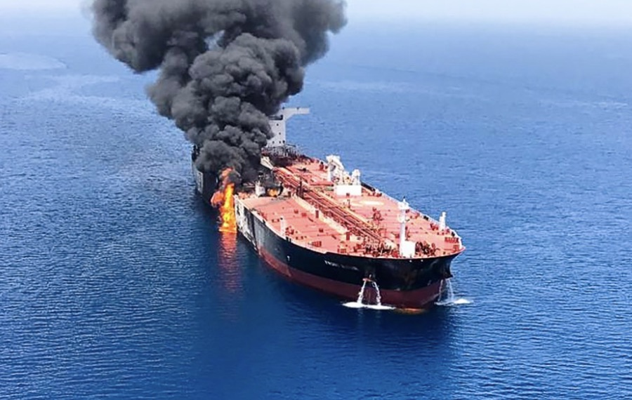

# Hormuz di Ujung Tanduk: Ranjau Laut, Ancaman Pembunuhan Pemimpin, dan Perang Urat Nadi Ekonomi Dunia

*Ilustrasi (Pic: Rita Mf Jannah & Meta AI)*

  
***Washington mempertimbangkan penargetan elite Iran untuk mencari jalan keluar dari perang, sementara Iran menggunakan ancaman terhadap jalur energi***
  

Kali ini kita pisahkan dua perkara yang sering dicampuradukkan dalam berita perang: klaim serangan terhadap kapal tanker dan pembahasan opsi serangan terhadap kepemimpinan Iran.

Keduanya punya bobot eskalasi yang berbeda. Kapal terkena ranjau belum otomatis berarti Iran sedang menutup Hormuz, dan pembahasan opsi militer di Washington belum otomatis berarti keputusan menyerang sudah diambil.

Kita akan bedah siapa yang mengklaim apa, apa yang sudah terkonfirmasi, dan apa implikasinya bagi jalur energi dunia.

## IRGC: Dua Tanker Kena Ranjau

Pada 26 November 2026, IRGC menyatakan dua kapal tanker meledak dan terbakar setelah menabrak ranjau laut di utara Pelabuhan Khasab, Oman, ketika melintasi jalur yang oleh Iran disebut tidak sah.

Salah satu kapal, menurut IRGC, merupakan supertanker yang membawa lebih dari 2 juta barel minyak mentah. Klaim itu diberitakan Reuters berdasarkan pernyataan IRGC yang disiarkan Tasnim.

Tetapi ada satu detail penting yang justru mengubah cara kita membaca berita ini. Apa yang dikonfirmasi lembaga pemantau maritim?

25 November: tanker diserang di Selat Hormuz

UKMTO melaporkan sebuah tanker yang sedang keluar dari selat terkena proyektil tak dikenal sekitar 18 mil laut di sebelah timur Khasab, Oman.

25 November: ledakan dekat tanker di sebelah barat Dubai

Kapal melaporkan dua ledakan akibat proyektil tak dikenal di dekatnya. Tidak ada kerusakan atau korban yang dilaporkan.

Dua tanker yang diklaim terkena ranjau
JMIC, pusat informasi keamanan maritim gabungan, menyatakan klaim Iran mengenai kapal tanker yang terkena ranjau belum dikonfirmasi oleh otoritas resmi atau nasional.

Ada pula laporan UKMTO mengenai tiga tanker yang terkena proyektil tak dikenal dalam rentang sekitar 17 menit ketika melintasi Hormuz pada 22 November. Ketiganya tetap dapat melanjutkan perjalanan dan seluruh awak dilaporkan selamat.

Jadi, kita harus membedakan dua hal:
- Serangan terhadap kapal tanker: ada insiden yang dikonfirmasi oleh pemantau maritim.
- Dua kapal terkena ranjau: masih merupakan klaim militer Iran yang belum dikonfirmasi secara independen.

Ini bukan perbedaan kecil. Ranjau laut memiliki implikasi militer dan hukum yang berbeda dari serangan menggunakan proyektil.

## Mengapa Iran Mengumumkan Kapal-Kapal itu Melanggar Jalur yang Diizinkan?

Di sinilah persoalan kedaulatan dan kontrol maritim menjadi menarik.

Iran sedang membangun narasi bahwa kapal yang melewati jalur tertentu tanpa koordinasi dengan Teheran menghadapi risiko keamanan dan dapat dianggap melanggar pembatasan Iran.

Pernyataan komandan Angkatan Laut IRGC bahkan menyebut Iran memiliki kendali operasional penuh atas Selat Hormuz. JMIC juga mencatat bahwa Iran membentuk daftar kapal dan perusahaan maritim yang dianggap tidak patuh terhadap pembatasannya.

Tetapi ada perbedaan mendasar antara:
- Negara memiliki hak berdaulat atas wilayah laut tertentu.
- Negara memiliki kewenangan hukum untuk mengatur lalu lintas kapal.
- Negara dapat mengklaim kendali penuh atas jalur pelayaran internasional.

Ketiganya bukan hal yang sama. 

Selat Hormuz merupakan jalur pelayaran internasional yang tunduk pada rezim hukum laut internasional, termasuk ketentuan transit passage dalam UNCLOS. Hak lintas tersebut tidak bisa begitu saja dihapus oleh deklarasi sepihak sebuah negara.

Dengan demikian, klaim Iran tentang jalur yang tidak sah tidak otomatis menjadikan kapal-kapal tersebut pelanggar hukum internasional.

Analisis strategisnya: Iran sedang berusaha mengubah geografi menjadi instrumen tekanan politik. Ia tidak harus menghancurkan seluruh kapal untuk menciptakan efek ekonomi. Cukup membuat perusahaan pelayaran, asuransi, pemilik kapal, dan pembeli minyak mempertanyakan keselamatan perjalanan.

Itulah yang disebut maritime coercion, tekanan melalui ancaman terhadap aktivitas maritim.

## Washington Membahas Pembunuhan Pemimpin Iran. Ini Serius?

Ada laporan pembahasan internal, belum ada keputusan serangan, namun berita ini juga memiliki dasar jurnalistik yang jelas.

Pada 24 November, Anadolu Agency melaporkan bahwa NBC News mengungkap pejabat pemerintahan Donald Trump sedang membahas kemungkinan serangan yang menargetkan para pemimpin senior Iran.

Pembahasan tersebut dilaporkan melibatkan dua sumber: seorang pejabat Amerika Serikat dan seseorang yang mengetahui diskusi tersebut.

Ada dua kubu pertimbangan di Washington:

Kelompok yang mendukung opsi penargetan pemimpin Iran
- Menganggap kemampuan AS menemukan dan menyerang pemimpin Iran dapat menunjukkan bahwa tidak ada tokoh yang benar-benar kebal.
- Berharap tekanan terhadap elite politik dan militer Iran dapat memaksa Teheran mengakhiri perang.
- Melihat operasi tersebut sebagai kemungkinan jalan keluar bagi pemerintahan Trump.

Kelompok yang menentang opsi tersebut
- Serangan dapat membuat pemimpin Iran yang tersisa semakin keras dan menolak kompromi.
- Dapat merusak kredibilitas Washington dalam perundingan perdamaian.
- Meningkatkan risiko pembalasan terhadap pejabat dan personel militer Amerika.

Menurut laporan itu, Trump sedang mempertimbangkan berbagai pilihan dan belum membuat keputusan final. 

Opsi yang dibahas bukan hanya penargetan pemimpin, tetapi juga kemungkinan operasi tempur berskala besar, serangan terhadap fasilitas minyak di Pulau Kharg, infrastruktur energi di Pulau Qeshm, dan fasilitas pengayaan nuklir di Pickaxe Mountain.

Hürriyet Daily News juga melaporkan bahwa opsi pembunuhan terarah terhadap pemimpin Iran telah lama dipertimbangkan dan kembali mengemuka dalam beberapa pekan terakhir.

Jadi, jangan tertukar:m, pembahasan kebijakan bukan perintah operasi. Pertimbangan militer bukan keputusan presiden. Dan keputusan presiden pun belum berarti serangan sudah dilaksanakan.

## Mengapa Washington Mempertimbangkan Pemimpin Iran sebagai Sasaran?

Ini berkaitan dengan teori decapitation strategy atau strategi pemenggalan kepemimpinan.

Dalam studi militer, strategi ini berusaha melumpuhkan pusat pengambilan keputusan lawan dengan menargetkan figur-figur yang mengendalikan sistem politik, militer, atau komando.

Ada tiga asumsi strategis di baliknya. Pertama, kepemimpinan dianggap sebagai pusat koordinasi.
Jika figur utama dan jaringan komando dilumpuhkan, proses pengambilan keputusan militer lawan diharapkan terganggu.

Kedua, tekanan terhadap elite diharapkan mengubah kalkulasi politik. Washington mungkin berharap pemimpin yang tersisa memilih negosiasi daripada mempertahankan perang.

Ketiga, serangan dipandang sebagai sinyal kemampuan dan dominasi. Pesan yang hendak disampaikan adalah bahwa Amerika mampu menjangkau pusat kekuasaan Iran meskipun berada jauh di dalam wilayahnya.

Tetapi strategi ini mempunyai masalah besar: menghancurkan struktur kepemimpinan tidak sama dengan menghancurkan kemampuan perlawanan.

Dalam beberapa situasi, justru bisa terjadi:
- Komando militer menjadi lebih terdesentralisasi.
- Unit-unit militer bertindak tanpa koordinasi pusat.
- Kelompok garis keras memperoleh legitimasi politik baru.
- Pembalasan dilakukan melalui jaringan proksi dan serangan asimetris.
- Negosiasi menjadi lebih sulit karena pihak yang tersisa merasa tidak memiliki jaminan keselamatan.

Dengan kata lain, sebuah negara bisa kehilangan pemimpinnya tanpa kehilangan kemauan untuk berperang.

Itulah salah satu alasan mengapa pejabat Amerika sendiri dilaporkan memperdebatkan risiko strategi tersebut.

## Mengapa Kombinasi Hormuz dan Ancaman terhadap Pemimpin Iran begitu Berbahaya?

Karena keduanya menyasar dua pusat kekuatan yang berbeda:

1.Selat Hormuz

Tekanan terhadap arus energi, perdagangan, asuransi, dan pelayaran.

2.Pusat kekuasaan Iran

terhadap struktur komando, elite politik, dan kesinambungan pemerintahan.

Iran memiliki posisi geografis yang sangat strategis. Selat Hormuz menghubungkan Teluk Persia dengan Teluk Oman dan Laut Arab. Gangguan di sini dapat menjalar ke pasar minyak, gas, pengiriman barang, serta biaya energi global.

Perhatikan mekanisme ekonominya:
- Ancaman ranjau dan serangan kapal meningkatkan persepsi risiko.
- Perusahaan asuransi menaikkan premi risiko perang atau membatasi perlindungan.
- Operator kapal dapat menunda pelayaran atau memilih rute yang lebih mahal.
- Pasokan minyak dan gas berpotensi mengalami gangguan.
- Harga energi dan biaya transportasi dapat meningkat.
- Dampaknya merambat ke biaya produksi, inflasi, dan neraca perdagangan negara pengimpor energi.

Dan ada satu hal yang perlu dicermati: gangguan pasar dapat terjadi bahkan ketika tidak ada penutupan total Hormuz.

Pasar tidak menunggu seluruh kapal tenggelam untuk mulai menghitung risiko.

## Apakah Iran sedang Menggunakan Hormuz sebagai Alat Tawar-Menawar?

Dari pernyataan IRGC dan aktivitas maritim yang dicatat JMIC, terdapat indikasi kuat bahwa tekanan terhadap pelayaran merupakan bagian dari strategi Iran untuk mempertahankan pengaruh dalam konflik.

Reuters mengutip juru bicara IRGC Hossein Mohebbi yang menyatakan bahwa pasukannya menggunakan kekuatan besar untuk mempertahankan penutupan selat dan menekan ekonomi Amerika Serikat.

Ini memperlihatkan tiga lapisan strategi:
| Lapisan | Instrumen | Tujuan strategis |
|:-----|:------:|------:|
|Militer|Ancaman ranjau, proyektil, pengawasan kapal|Meningkatkan risiko pelayaran|
|Ekonomi|Gangguan arus energi dan logistik|Menambah biaya konflik bagi pihak lain|
|Diplomasi|Klaim kendali dan pembatasan jalur|Menciptakan posisi tawar|

Namun, kita juga perlu hati-hati: kemampuan mengganggu pelayaran tidak identik dengan kemampuan mengendalikan selat secara permanen. 

Operasi pengawalan, pembersihan ranjau, pengawasan udara dan laut, serta tekanan militer dari pihak lawan dapat mengubah situasi.

Iran memiliki instrumen untuk menciptakan gangguan. Itu tidak otomatis berarti ia dapat mempertahankan kontrol tanpa batas.

## Bagaimana Dampaknya terhadap Indonesia?

Nah, ini bagian yang jangan sampai dilewatkan.

Indonesia bukan pihak yang berperang, tetapi tetap bisa terkena dampak melalui tiga saluran:

A. Harga energi

Jika pasokan minyak dan gas dari kawasan Teluk terganggu, biaya impor energi dapat meningkat. Dampaknya bergantung pada durasi gangguan, sumber pasokan alternatif, nilai tukar rupiah, dan kebijakan harga domestik.

B. Inflasi dan biaya logistik

Kenaikan harga minyak dapat meningkatkan biaya angkutan, distribusi, dan produksi. Efeknya bisa masuk ke harga barang secara bertahap.

C. Pasar keuangan

Ketidakpastian geopolitik dapat mendorong investor mengurangi eksposur pada aset berisiko dan mencari aset yang dianggap lebih aman. Pasar saham negara berkembang, termasuk Indonesia, dapat mengalami tekanan melalui arus modal dan nilai tukar.

Tetapi jangan langsung menyimpulkan bahwa setiap ketegangan di Hormuz akan membuat IHSG ambruk. Kita perlu melihat apakah gangguan pasokan benar-benar terjadi, berapa lama berlangsung, dan bagaimana respons kebijakan ekonomi Indonesia.

## Apakah ini Menuju Perang yang Lebih Besar?

Ada tiga fakta yang saat ini perlu kita pegang.
- Serangan terhadap kapal tanker memang terjadi. UKMTO mendokumentasikan sejumlah insiden proyektil di sekitar Hormuz, termasuk tiga tanker yang diserang pada 22 November dan satu tanker pada 25 November.
- Klaim dua tanker terkena ranjau berasal dari IRGC dan belum terverifikasi independen. JMIC secara eksplisit menyatakan klaim ranjau tersebut belum dikonfirmasi otoritas maritim.
- Pemerintahan Trump memang dilaporkan membahas penargetan pemimpin senior Iran. Namun, tidak ada keputusan final yang dilaporkan dalam sumber yang kita periksa.

Ada satu ironi strategis yang menarik: Washington mempertimbangkan penargetan elite Iran untuk mencari jalan keluar dari perang, sementara Iran menggunakan ancaman terhadap jalur energi untuk meningkatkan biaya perang bagi pihak lawan.

Kedua pihak sedang berusaha mengubah tekanan militer menjadi hasil politik. Tetapi tekanan yang terlalu besar bisa menghasilkan efek sebaliknya: mempersempit ruang kompromi dan memperluas medan konflik.

Pertanyaan paling penting bukan sekadar siapa yang mampu menyerang lebih jauh. Pertanyaannya adalah siapa yang masih memiliki jalan keluar politik setelah eskalasi mencapai titik yang membuat kompromi terlihat seperti kekalahan.

Dan itu adalah persoalan yang jauh lebih rumit daripada sekadar menghitung jumlah kapal yang terbakar. 

  
**Referensi**

1. Reuters. (26 November 2026). Iran’s Revolutionary Guards say two oil tankers hit sea mines near Oman’s Khasab. Baca laporan Reuters⁠.

2. Joint Maritime Information Center. (26 November 2026). Update 117 to JMIC Advisory Note: Regional Tension – Impact on Maritime Security. Baca laporan maritim PDF⁠.

3. Anadolu Agency. (24 November 2026). Trump administration debates targeting top Iranian leaders to end war: Report. Baca laporan⁠.

4. Hürriyet Daily News. (25 November 2026). US mulls high-profile assassinations in Iran: Report. Baca laporan⁠.

5. Reuters. (26 November 2026). Iran’s Revolutionary Guards say two oil tankers hit sea mines near Oman’s Khasab. Laporan dan pernyataan IRGC⁠.
