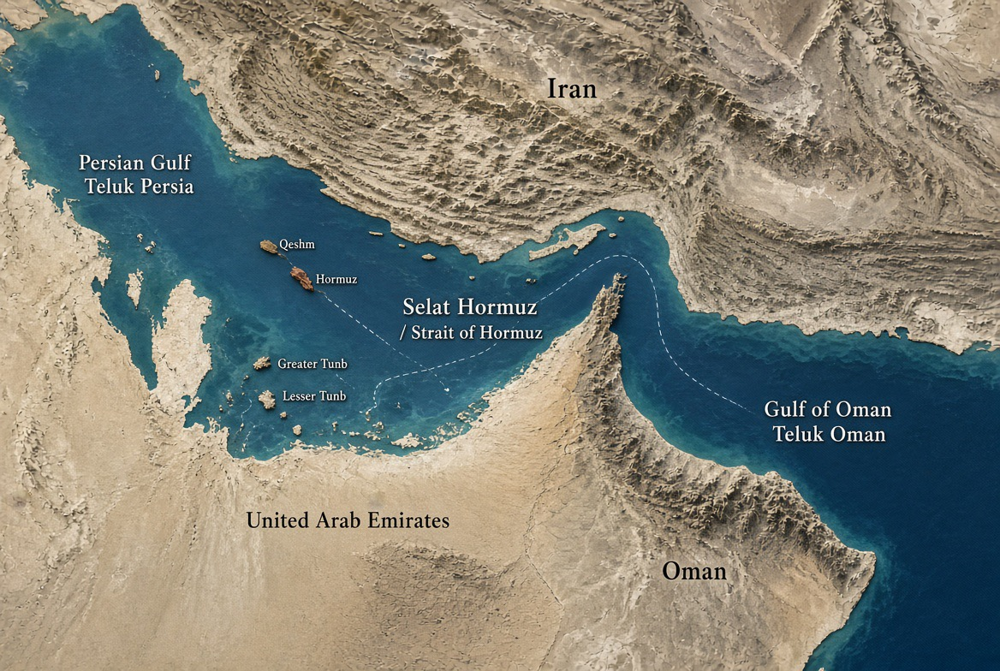

# Hormuz, AS-Iran: Diplomasi di Meja, Ancaman di Pintu

*Ilustrasi(pic: Grok AI).*

  
***Para pemimpin bisa berbicara tentang keamanan nasional, tetapi harga dari kegagalan mereka berunding akan dibayar juga oleh orang-orang yang bahkan tidak pernah duduk di meja perundingan***
  

Per 2 November 2026, diplomasi AS-Iran memang bergerak, tetapi belum menghasilkan kesepakatan. Delegasi Iran sudah meninggalkan Doha setelah pembicaraan melalui mediator Qatar, sementara rancangan proposal masih diedarkan dan pertemuan lanjutan mungkin dilakukan. 

Pada saat yang sama, Donald Trump kembali mengancam serangan, dan Teheran menyatakan siap membalas jika perang dilanjutkan.

Ada satu detail yang membuat situasinya makin genting: ancaman eskalasi berpusat pada periode setelah pemilu sela Amerika Serikat, yang berlangsung 3 November. Jadi, jendela diplomasi ini sedang bergerak di tengah hitung-hitungan militer sekaligus politik domestik Washington. 

## Apa yang Sebenarnya Sedang Dinegosiasikan?

Persoalannya bukan cuma apakah kapal tanker boleh lewat selat itu. Hormuz adalah bagian dari paket tawar-menawar yang mencakup blokade laut, sanksi ekonomi, kehadiran militer AS, perang regional, dan program nuklir Iran.

Menurut laporan Reuters dan Al Jazeera, Iran menyodorkan rencana bertahap yang dapat membuka kembali Selat Hormuz dalam waktu sekitar dua hari, lebih cepat daripada rencana awal tujuh hari. Namun, itu bergantung pada pemenuhan tuntutan Teheran.

Tuntutan yang diberitakan mencakup:
- Pengakhiran blokade laut AS terhadap pelabuhan Iran.
- Pelonggaran sanksi dan pemulihan sejumlah pengecualian penjualan minyak.
- Pengurangan kehadiran militer AS di kawasan.
- Pengaturan jalur pelayaran baru yang dikaitkan dengan Iran dan Oman.
- Penghentian konflik di seluruh front, termasuk serangan Israel terhadap Lebanon.

Ada pula perbedaan mendasar soal urutan pembahasan: Iran ingin langkah-langkah yang menyentuh Hormuz dan penghentian perang menjadi prioritas, sedangkan AS menginginkan persoalan nuklir ikut diselesaikan. Washington belum mengonfirmasi bahwa ia menerima seluruh syarat Iran.

Inilah sebabnya pembicaraan bisa disebut maju tanpa berarti kedua pihak sudah mendekati kesepakatan final. Mereka mulai mengedarkan rancangan, tetapi masih berbeda mengenai apa yang harus dilakukan terlebih dahulu dan apa yang harus dibayar masing-masing pihak.

## Mengapa Berunding Sambil Mengancam Perang?

Dalam teori hubungan internasional, ini dekat dengan konsep coercive diplomacy: menggunakan ancaman kekuatan untuk memaksa lawan menerima persyaratan, sambil tetap menyediakan jalan keluar melalui negosiasi.

Bayangkan kedua pihak sedang bermain poker, mereka tidak sekadar memegang kartu. Mereka juga mencoba membuat lawan percaya bahwa mereka bersedia membalikkan meja jika kartu mereka tidak dihargai. 

Tetapi ancaman hanya efektif kalau lawan percaya bahwa ancaman itu dapat dilaksanakan, dan bahwa biaya melaksanakannya masih dapat ditanggung. Oleh karena itu Washington memakai strategi tekanan maksimum sehingga Trump mempertahankan ancaman serangan serta menuntut penyelesaian persoalan nuklir. 

Logika strategisnya adalah menaikkan biaya penolakan Iran, sembari menawarkan kesepakatan sebagai alternatif perang yang lebih mahal. Namun, ancaman berulang juga berisiko membuat Teheran menilai bahwa kesepakatan tidak menjamin keselamatannya dari serangan berikutnya.

Strategi Teheran adalah pertahanan dan daya tawar. Iran berusaha menghubungkan pembukaan Hormuz dengan pengakhiran blokade dan perubahan kebijakan AS. Pesannya: akses pelayaran dan stabilitas energi tidak dapat dipisahkan dari tuntutan keamanan serta sanksi Iran. Teheran juga menyatakan siap membalas jika serangan dilanjutkan.

Ada paradoks yang membuat strategi ini berbahaya: semakin keras kedua pihak meyakinkan lawan bahwa mereka tidak akan mundur, semakin sulit mereka menjual kompromi kepada pendukung domestik masing-masing.

Trump perlu menghindari kesan bahwa ancamannya kosong. Pemerintah Iran juga menghadapi tekanan untuk tidak terlihat menyerah di bawah blokade dan serangan. Akibatnya, kompromi yang sebenarnya mungkin masuk akal secara strategis bisa tampak seperti kekalahan secara politik.

## Mengapa Pemilu Sela AS Menjadi Jam Hitung Mundur?

Reuters melaporkan Trump menahan diri dari serangan baru dalam beberapa pekan menjelang pemilu sela 3 November. Menteri Luar Negeri Marco Rubio mengatakan Trump belum memutuskan apakah serangan akan dilanjutkan, meskipun ia lebih memilih penyelesaian diplomatik.

Ada dua mekanisme yang perlu kita bedakan. Pertama, biaya politik domestik. Perang yang meluas dapat meningkatkan ketidakpastian harga energi, menimbulkan korban, dan memaksa pemerintah menjelaskan mengapa operasi militer masih berlangsung tanpa hasil diplomatik yang jelas.

Kedua, masalah komitmen setelah pemilu. Jika Iran percaya bahwa pembatasan militer AS hanya berlaku sampai pemungutan suara selesai, Teheran memiliki alasan untuk meminta jaminan yang lebih kuat sebelum memberikan konsesi. Sebaliknya, jika Washington percaya Iran sedang menggunakan negosiasi untuk memperkuat posisi militernya, penundaan dapat dianggap menguntungkan lawan.

Kita tidak dapat memastikan bahwa jadwal pemilu adalah satu-satunya alasan Trump menahan serangan. Tetapi waktu pelaksanaan pemilu jelas menjadi bagian penting dari konteks strategis yang dilaporkan media.

Dengan kata lain, kedua pihak bukan hanya merundingkan syarat perdamaian. Mereka juga merundingkan berapa lama masing-masing pihak dapat bertahan tanpa kesepakatan.

## Hormuz: Mengapa Satu Selat Bisa Mengguncang Ekonomi Dunia?

Selat Hormuz menghubungkan Teluk Persia dengan Teluk Oman dan Laut Arab. Jalur sempit ini merupakan salah satu titik lintas terpenting bagi perdagangan energi global.

Ketika lalu lintas di sana terganggu, efeknya tidak berhenti di negara-negara Teluk. Dampaknya menjalar melalui harga minyak, biaya pengangkutan, premi asuransi kapal, dan ekspektasi inflasi.

Pada 2 November, Reuters melaporkan harga minyak turun lebih dari 4% di tengah harapan bahwa pembicaraan dapat meredakan gangguan pasokan. 

Harga Brent berada sekitar US$108,66 per barel pada saat laporan tersebut dibuat. Namun, pada akhir Oktober, Brent telah mencapai penutupan tertinggi dalam enam bulan karena kekhawatiran akan eskalasi baru.

## Bagaimana Risiko Hormuz Menjalar?

Gangguan pelayaran atau blokade membuat ketersediaan minyak dan gas menurun atau menjadi tidak pasti. Sedangkan harga energi, biaya angkut, dan premi asuransi berpotensi meningkatkan tekanan pada inflasi, industri, perdagangan, dan mata uang negara pengimpor.

Ini adalah jalur dampak ekonomi yang mungkin terjadi, bukan kepastian bahwa setiap tahap akan selalu terjadi atau meningkat dengan besaran yang sama.

Indonesia pun tidak kebal. Walaupun produksi energi domestik dan struktur impornya berbeda dari negara lain, kenaikan harga minyak dunia dapat menekan biaya impor, subsidi energi, anggaran negara, serta biaya logistik.

Bagi investor, berita negosiasi yang positif dapat mendorong harga minyak turun, sedangkan ancaman serangan dapat membalikkan sentimen dengan cepat. Itu juga menjelaskan mengapa pasar dapat bereaksi terhadap perubahan nada bicara sebelum ada perubahan nyata pada arus kapal.

Pasar memperdagangkan bukan hanya pasokan yang ada, tetapi juga risiko pasokan yang mungkin hilang.

## Titik Paling Sulit: Nuklir, Blokade, dan Kepercayaan

Di sinilah negosiasi dapat macet meskipun kedua pihak menginginkan penghentian perang.

Iran ingin langkah konkret yang mengakhiri tekanan militer dan ekonomi. AS ingin persoalan nuklir masuk ke dalam penyelesaian. 

Reuters melaporkan bahwa Teheran tetap menghendaki tindakan AS sebelum pembicaraan nuklir dimulai. Masalahnya adalah urutan.
- Jika Iran membuka Hormuz lebih dahulu, apa jaminan blokade dan ancaman serangan akan dihentikan?
- Jika AS mengakhiri blokade lebih dahulu, apa jaminan Iran akan memenuhi tuntutan terkait nuklir?
- Jika salah satu pihak memenuhi sebagian syarat, bagaimana pelanggaran dapat diverifikasi?
- Jika kesepakatan dilanggar, siapa yang memutuskan pelanggaran telah terjadi dan tindakan balasan apa yang diperbolehkan?

Inilah persoalan credible commitment, atau jaminan bahwa pihak yang berjanji tidak akan memanfaatkan konsesi lawan untuk menyerang kembali ketika posisinya membaik.

Kesepakatan yang bertahan biasanya memerlukan urutan tindakan, mekanisme verifikasi, batas waktu, serta prosedur untuk menangani pelanggaran. Pernyataan pemimpin bahwa negosiasi berjalan baik tidak menggantikan unsur-unsur tersebut.

## Apakah Pembicaraan ini Benar-benar Maju?

Kita harus membedakan kemajuan diplomatik dari keberhasilan diplomatik.

| Indikator | Situasi per 2 November 2026 |
|------|-------|
|Kontak melalui mediator|Masih berlangsung|
|Rancangan proposal|Sedang diedarkan|
|Delegasi Iran di Doha|Telah meninggalkan lokasi pembicaraan|
|Pertemuan lanjutan|Mungkin dilakukan|
|Kesepakatan final|Belum tercapai|
|Ancaman serangan baru|Masih ada|
|Pembukaan Hormuz berdasarkan kesepakatan baru|Belum terkonfirmasi|
Sumber utama: laporan Reuters pada 2 November dan Al Jazeera pada 1 November.

Ada alasan untuk melihat kontak yang berlanjut sebagai peluang diplomatik. Tetapi belum ada dasar untuk menyatakan bahwa perang telah menuju akhir yang pasti.

Bahkan Reuters melaporkan sumber-sumber Iran menilai serangan baru AS masih lebih mungkin terjadi daripada kesepakatan. Itu merupakan penilaian sumber yang dikutip, bukan probabilitas terukur atau kepastian bahwa serangan akan terjadi.

## Tiga jalur yang Perlu Dipantau

Jalur A: kesepakatan bertahap

Kedua pihak menyepakati pembukaan Hormuz, penghentian blokade atau pengaturan ulang pembatasannya, lalu melanjutkan negosiasi nuklir. Ini membutuhkan verifikasi dan jaminan yang dapat diterima kedua pihak.

Jalur B: negosiasi sambil meningkatkan tekanan

Kontak diplomatik berlanjut, tetapi ancaman militer, blokade, dan persiapan pertahanan tetap dipertahankan. Jalur ini dapat menghasilkan kompromi, tetapi juga membuka peluang salah perhitungan.

Jalur C: serangan baru dan eskalasi regional

Jika Washington atau Israel melanjutkan serangan, Iran telah mengancam akan membalas. Risiko meluasnya konflik ke aset AS dan Israel di kawasan dapat meningkat, dengan konsekuensi bagi pelayaran dan energi.

Ketiganya adalah skenario analitis, bukan prediksi mengenai jalur yang pasti akan dipilih.

Diplomasi sedang Bekerja, tetapi Perang Belum Kehilangan Tempatnya

Hal paling penting saat membaca berita adalah jangan menganggap ancaman militer sebagai bukti bahwa negosiasi gagal, dan jangan menganggap adanya proposal sebagai bukti bahwa perdamaian sudah dekat.

Dalam diplomasi koersif, ancaman dan negosiasi dapat berjalan bersamaan karena keduanya merupakan alat tawar-menawar. Tetapi strategi itu memiliki batas: tekanan yang terlalu besar dapat membuat pihak lawan merasa tidak memiliki jalan keluar selain melawan.

Untuk beberapa hari ke depan, indikator yang lebih kuat daripada retorika adalah:
Apakah ada pengumuman resmi mengenai isi dan urutan kesepakatan?
Apakah pembatasan pelayaran dan blokade benar-benar berubah?
Apakah ada mekanisme verifikasi dan jaminan keamanan?
Apakah ancaman serangan berkurang setelah pemilu sela AS?
Apakah negosiasi nuklir dimulai atau tetap ditunda?
Selama jawaban atas pertanyaan-pertanyaan itu belum jelas, Hormuz tetap menjadi titik tekan strategis, bukan simbol bahwa perdamaian sudah tercapai.

Dan itulah sisi paling dingin dari geopolitik, para pemimpin bisa berbicara tentang keamanan nasional, tetapi harga dari kegagalan mereka berunding akan dibayar juga oleh orang-orang yang bahkan tidak pernah duduk di meja perundingan. 

  
**Referensi**

1. Al Jazeera. (2026, November 1). US-Iran talks on Strait of Hormuz advance amid military threats. Al Jazeera.

2. Reuters. (2026, November 2). Oil prices fall as hopes of US-Iran deal ease supply concerns. Reuters.

3. Reuters. (2026, November 2). Iran says US attack remains possible as diplomatic efforts continue. Reuters.

4. Reuters. (2026, November 2). Iran’s proposal seeks reopening of Strait of Hormuz as nuclear talks remain unresolved. Reuters.
