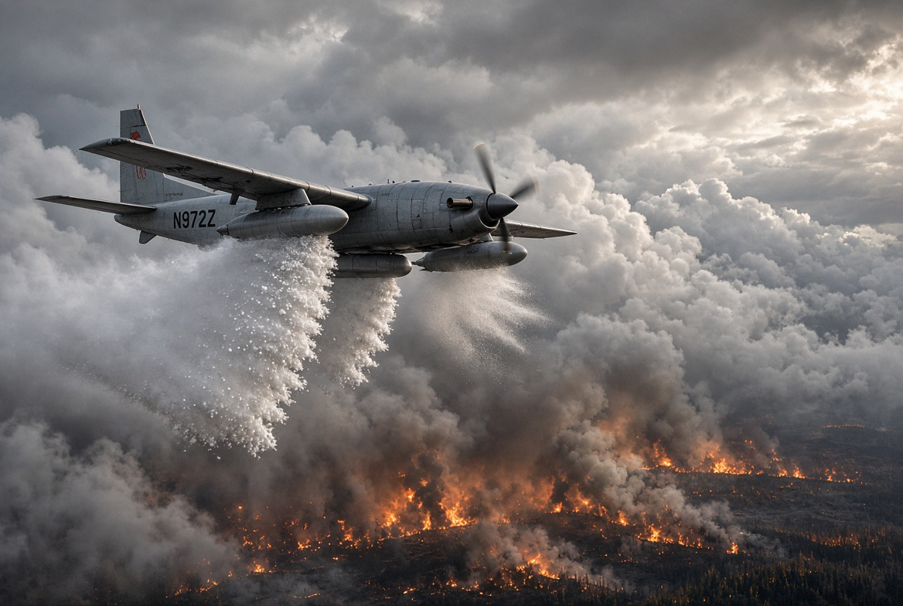

# Hujan Sumatera & Kalimantan: Dari Sumpah Pemuda ke Perjuangan Menyelamatkan Hutan Terbakar

*Ilustrasi (pic: Grok AI).*

  
***Sumpah Pemuda bukan cuma mengucapkan ikrarnya, melainkan menerjemahkan persatuan menjadi perlindungan nyata bagi manusia dan alam Indonesia***
  

Hari ini, 28 Oktober 2026, kita memperingati Hari Sumpah Pemuda ke-98. Para pemuda 1928 menyatukan Indonesia melalui ikrar, sedangkan para petugas modifikasi cuaca, pemadam karhutla, dan relawan hari ini berjuang menyatukan tenaga untuk melindungi tanah air yang sama.

Ada benang merah yang kuat di sini: nasionalisme bukan cuma kesediaan mengibarkan bendera, tetapi juga kesediaan menjaga tanah, udara, kehidupan, dan sesama warga yang berbagi negeri ini.

Tema resmi Sumpah Pemuda tahun ini adalah “Patriotik, Gigih, Berempati: Pemuda untuk Indonesia.” Tiga kata itu terasa sangat relevan dengan perjuangan menghadapi karhutla. 

## 1928 Pemuda Menyatukan Identitas, 2026 Persatuan Harus Menjadi Tindakan

Pada 27–28 Oktober 1928, pemuda dari berbagai organisasi dan latar belakang menyatakan satu tanah air, satu bangsa, dan satu bahasa persatuan. Mereka tidak menghapus keberagaman daerah, melainkan membangun identitas bersama di atas keberagaman tersebut.

Sekarang bayangkan medan karhutla di Kalimantan. Di sana ada petugas Manggala Agni, Masyarakat Peduli Api (MPA), relawan, masyarakat adat, BPBD, TNI, Polri, pemerintah daerah, dan tim ilmiah yang memantau cuaca. 

Mereka memiliki tugas, keahlian, dan asal institusi berbeda, tetapi menghadapi persoalan yang sama: api tidak mengenal batas administrasi, dan asap tidak berhenti di papan bertuliskan nama kabupaten.

Pada Agustus 2026, Kementerian Kehutanan melaporkan 12.880 personel gabungan terlibat dalam operasi pengendalian karhutla di Kalimantan. Angka itu mencakup berbagai unsur, termasuk petugas dan relawan, sehingga bukan berarti semuanya sukarelawan.

Itulah persatuan dalam bentuk operasional: bukan hanya merasa sebangsa, melainkan bekerja bersama menghadapi ancaman yang sama.

## Tiga ikrar, Tiga Pelajaran untuk Para Pejuang Karhutla “Bertumpah Darah yang Satu, Tanah Indonesia”

Nasionalisme Ekologis

Tanah air bukan sekadar garis batas pada peta. Ia mencakup hutan, gambut, sungai, udara, satwa liar, dan ruang hidup masyarakat. Melindungi Kalimantan berarti melindungi bagian dari sistem ekologis Indonesia yang menopang kehidupan manusia dan keanekaragaman hayati.

“Berbangsa yang Satu, Bangsa Indonesia” Solidaritas Lntas Daerah dan Profesi

Ketika Kalimantan menghadapi kebakaran, bantuan personel, peralatan, informasi cuaca, dan sumber daya dari wilayah lain menunjukkan bahwa bencana lokal dapat menjadi tanggung jawab nasional. Warga yang terdampak asap tidak seharusnya merasa sendirian hanya karena tinggal jauh dari pusat pemerintahan.

“Menjunjung Bahasa Persatuan, Bahasa Indonesia” Persatuan melalui Ilmu Pengetahuan

Bahasa persatuan membuat kita dapat berbagi pengetahuan lintas daerah. Hari ini, ilmu meteorologi, data satelit, laporan titik panas, pemetaan gambut, dan koordinasi lapangan menjadi bahasa kerja bersama untuk mengurangi risiko kebakaran.

Tentu, teknologi modern bukan bagian dari perjuangan tahun 1928. Hubungannya adalah pada nilai yang diwariskan: kemampuan melihat kepentingan bersama melampaui kepentingan kelompok sendiri.

Dan di sini ada satu catatan penting, nasionalisme ekologis juga menuntut kita berani mengoreksi kesalahan. Kalau tata kelola lahan buruk, pencegahan gagal, atau keselamatan petugas diabaikan, cinta tanah air justru harus mendorong evaluasi, bukan sekadar tepuk tangan.

## Pesawat Pembawa Bahan Semai: Sains yang Bekerja untuk Kepentingan Bersama

Dalam penanganan karhutla, operasi modifikasi cuaca atau OMC merupakan salah satu bentuk penggunaan ilmu atmosfer untuk mendukung penanganan bencana. 

Namun, kita perlu membedakan dua tujuan yang kadang dilakukan dalam rangkaian operasi yang sama:
Penyemaian NaCl: partikel natrium klorida digunakan pada awan yang sesuai untuk membantu pertumbuhan tetesan air dan meningkatkan peluang presipitasi.
Penggunaan dry ice: pada operasi yang sedang dijelaskan BMKG, es kering digunakan untuk mencoba mengganggu lapisan inversi atmosfer yang memerangkap asap dekat permukaan. Ini bukan mekanisme yang identik dengan penyemaian garam untuk hujan.

BMKG secara khusus menjelaskan penggunaan dry ice untuk membantu mengurai kabut asap di Sumatra dan Kalimantan pada 20 Oktober 2026. BNPB juga menegaskan bahwa tujuan dry ice berbeda dari penyemaian awan menggunakan NaCl.

Ada satu koreksi angka yang penting. Dalam laporan BNPB tertanggal 22 Oktober 2026, operasi OMC di Kalimantan Tengah dilaporkan menggunakan 5.000 kilogram dry ice dan 1.000 kilogram NaCl dalam tujuh sorti penerbangan. Itu berarti masing-masing sekitar 5 ton dan 1 ton, bukan ratusan ton dalam operasi yang dilaporkan tersebut. Angka ini spesifik untuk operasi itu, bukan total semua bahan yang digunakan sepanjang musim karhutla.

Mengapa kita harus teliti soal angka? Karena nasionalisme ilmiah bukan membesarkan angka supaya operasi terlihat hebat. Justru kepercayaan publik tumbuh ketika data disampaikan secara tepat, keberhasilan diukur, dan keterbatasan diakui.

Dan tentu, hujan yang turun setelah penyemaian belum otomatis membuktikan bahwa seluruh hujan disebabkan OMC. Kita perlu menilai kondisi awan, data radar, curah hujan, dan pembanding meteorologis untuk memperkirakan kontribusi operasi.

## Di Bawah Pesawat, ada Manusia yang Menghadapi Api secara Langsung

Pesawat OMC bisa menarik perhatian karena membawa teknologi canggih. Tetapi jangan sampai orang-orang yang bekerja di tanah justru terlupakan.

Laporan pemerintah pada Oktober 2026 menggambarkan petugas yang menghadapi asap pekat, panas, medan sulit, keterbatasan air, dan kelelahan. Pada gambut, api bahkan bisa tetap menyala di bawah permukaan ketika api di atas tampak sudah padam. Itulah mengapa pemadaman perlu dilanjutkan dengan pembasahan, pendinginan, dan pemeriksaan bara.

Di sini kita melihat tiga bentuk perjuangan yang saling melengkapi:

- Dari udara
Ahli meteorologi dan awak penerbangan memantau kondisi atmosfer serta menjalankan OMC jika syaratnya terpenuhi.

- Di darat
Manggala Agni, petugas pemadam, dan relawan memadamkan api, membasahi lahan, serta mencari bara yang berpotensi menyala kembali.

- Di tengah masyarakat
Warga membantu mendeteksi titik api, menyampaikan laporan dini, menjaga kesehatan keluarga, dan mencegah pembakaran lahan.

Tak satu pun dari ketiganya cukup sendirian. OMC tidak memadamkan semua sumber api secara langsung. Pemadaman darat pun bisa kesulitan ketika sumber air terbatas atau asap menghambat penerbangan. Sementara itu, pencegahan masyarakat sangat penting untuk mengurangi kebakaran baru.

Itulah gotong royong yang bukan sekadar slogan, melainkan pembagian kerja berdasarkan kemampuan dan kebutuhan.

## Apakah Cinta Tanah Air Cukup jika Kita Hanya Memadamkan Api?

Kita bisa mengerahkan ribuan personel, helikopter water bombing, pesawat OMC, dan relawan. Semua itu penting untuk menangani keadaan darurat. Namun, jika sumber risiko tidak dikurangi, masyarakat dan petugas bisa terus kembali ke medan yang sama setiap musim kemarau.

Strategi karhutla yang kuat perlu bekerja pada tiga tahap:
| Tahap | Prioritas |
|------|-------|
|Sebelum kebakaran|Mengelola muka air gambut, menjaga kawasan rawan, mendeteksi titik panas, dan menegakkan aturan terhadap pembakaran ilegal|
|Ketika kebakaran terjadi|Memadukan pemadaman darat, dukungan udara, OMC jika kondisi memungkinkan, dan perlindungan kesehatan masyarakat|
|Setelah api terkendali|Memastikan tidak ada bara tersisa, memulihkan lahan, mengevaluasi penyebab kebakaran, serta memperbaiki tata kelola|

Penelitian tentang kebakaran gambut secara luas menunjukkan bahwa kekeringan, pengeringan gambut, dan sumber penyalaan manusia dapat saling memperkuat risiko kebakaran. Karena itu, hujan dan pemadaman harus disertai pengelolaan lanskap serta pencegahan jangka panjang. OMC adalah salah satu alat, bukan pengganti semua kebijakan tersebut.

Ada pula dimensi keadilan. Warga yang menghirup asap, anak-anak yang terganggu sekolahnya, petani yang kehilangan penghasilan, masyarakat adat yang ruang hidupnya terdampak, serta relawan yang mempertaruhkan keselamatan tidak seharusnya menanggung seluruh beban akibat tata kelola yang buruk.

Patriotisme berarti menjaga negeri, tetapi juga memastikan orang-orang yang menjaga negeri tidak ditinggalkan sendirian.

## Makna Sumpah Pemuda bagi Generasi yang Berjuang Melawan Karhutla

Tema resmi tahun ini, “Patriotik, Gigih, Berempati: Pemuda untuk Indonesia,” dapat dibaca sebagai tiga kewajiban yang saling melengkapi:
- Patriotik: mencintai Indonesia dengan merawat hutan, gambut, udara, dan masyarakatnya.
- Gigih: terus bekerja berdasarkan ilmu, data, koordinasi, dan evaluasi, meskipun medan sulit dan hasilnya tidak selalu langsung terlihat.
- Berempati: memahami bahwa di balik angka hektare terbakar dan konsentrasi polutan terdapat manusia, satwa, serta ekosistem yang kehidupannya terganggu.

Kita tidak perlu menganggap setiap petugas sebagai pahlawan tanpa cela untuk menghargai pekerjaannya. Justru penghargaan yang sungguh-sungguh mencakup peralatan memadai, pelatihan, perlindungan keselamatan, waktu istirahat, dukungan kesehatan, dan evaluasi operasi secara transparan.

Begitu juga terhadap relawan. Kerelaan membantu tidak berarti mereka harus menanggung risiko tanpa perlindungan.

Kalau para pemuda 1928 membayangkan Indonesia sebagai tanah air bersama, maka generasi sekarang menghadapi tugas untuk memastikan tanah air itu tetap layak dihuni.
Ada orang yang berjuang dengan ilmu meteorologi dari pesawat. Ada yang membawa selang dan peralatan ke tengah asap. Ada yang memetakan titik panas, menjaga gambut tetap basah, melaporkan kebakaran, atau membantu tetangganya menghadapi dampak asap.

Pekerjaan mereka berbeda, tetapi tujuan kemanusiaannya bertemu: melindungi kehidupan.

Satu tanah air berarti kita tidak boleh membiarkan satu wilayah berjuang sendirian. Satu bangsa berarti keselamatan warga di Sumatera dan Kalimantan sama berharganya dengan keselamatan warga di Jakarta. Satu bahasa persatuan berarti ilmu, data, dan kepedulian harus bisa menjembatani semua orang yang bekerja untuk tujuan bersama.

Hujan dari langit mungkin membantu memadamkan sebagian api. Namun, hujan tidak bisa menggantikan keberanian petugas, ketekunan relawan, ketelitian ilmuwan, atau tanggung jawab negara.

Maka pada 28 Oktober ini, penghormatan terbaik kepada semangat Sumpah Pemuda bukan cuma mengucapkan ikrarnya, melainkan menerjemahkan persatuan menjadi perlindungan nyata bagi manusia dan alam Indonesia. 

  
**Referensi**

Museum Sumpah Pemuda. (n.d.). Sejarah Sumpah Pemuda. Kementerian Kebudayaan Republik Indonesia. Sumber resmi⁠

Kementerian Pendidikan Dasar dan Menengah. (2026, October 26). Kemendikdasmen teguhkan nilai patriotisme dan persatuan dalam peringatan Sumpah Pemuda ke-98. Sumber resmi⁠

Badan Meteorologi, Klimatologi, dan Geofisika. (2026, October 20). BMKG: Pemerintah manfaatkan dry ice untuk urai kabut asap karhutla di Sumatra dan Kalimantan. Sumber resmi⁠

Kementerian Kehutanan. (2026, October 21). Kemenhut libatkan Masyarakat Peduli Api, kelompok tani hutan, masyarakat adat dan relawan atasi karhutla. Sumber resmi⁠

Badan Nasional Penanggulangan Bencana. (2026, October 23). Optimalisasi penggunaan dry ice bantu kurangi konsentrasi asap karhutla. Sumber resmi⁠
