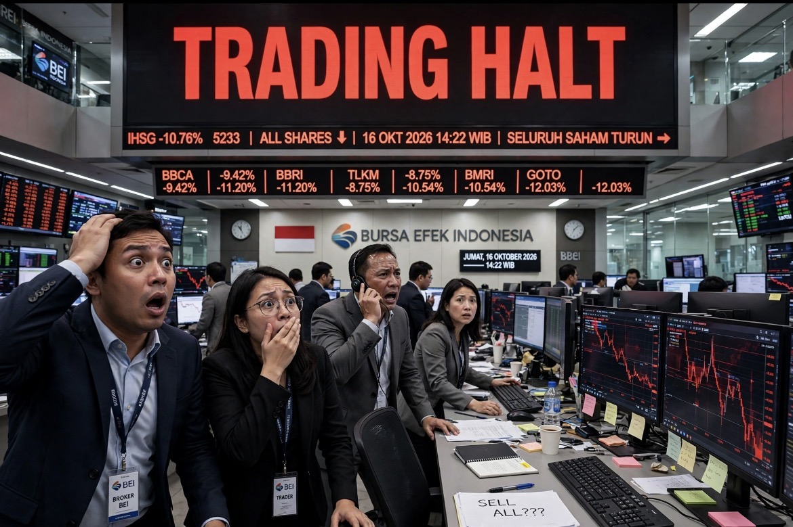

# IHSG Berdarah, Negara Tersentak: Krisis Kepercayaan, Tata Kelola Pasar Modal, Risiko Politik, & Kegagalan Respons Pemerintah

*Ilustrasi (pic: Grok AI).*

  
Republik pulih ketika investor tidak lagi harus menebak apakah aturan berlaku untuk semua orang, apakah informasi dapat dipercaya, dan apakah reformasi akan sungguh-sungguh dilaksanakan
  

Hari ini, Jumat, 16 Oktober 2026, IHSG dibuka di level 5.393,92, turun 8,01% dari penutupan sebelumnya. Perdagangan dihentikan sementara karena penurunan tajam tersebut.
Setelah perdagangan dilanjutkan, tekanan malah membesar. IHSG ditutup melemah 11,57%. 

ANTARA melaporkan bahwa tekanan utama berkaitan dengan pengumuman MSCI mengenai kemungkinan perubahan klasifikasi pasar modal Indonesia.

Indonesia belum resmi diturunkan ke status standalone. MSCI baru membuka konsultasi. Batas waktu konsultasi adalah 30 April 2027, dengan keputusan final paling lambat 30 Juni 2027. Namun, ancamannya sudah cukup untuk mengguncang pasar hari ini.

MSCI adalah penyedia indeks global yang menjadi acuan bagi banyak pengelola investasi internasional. Ketika klasifikasi sebuah negara berubah, sebagian dana yang mengikuti indeks tertentu mungkin harus mengurangi atau melepas kepemilikannya sesuai mandat investasinya.

Nah, di sinilah masalahnya mulai serius. Sebab pengumuman MSCI bukan sekadar komentar seseorang tentang Indonesia. Itu sinyal yang dapat memengaruhi keputusan investasi nyata.

## Mengapa Satu Pengumuman Bisa Membakar Seluruh Bursa?

Pasar saham tidak hanya memperdagangkan laba perusahaan. Pasar juga memperdagangkan kepercayaan terhadap aturan mainnya.

MSCI menyebut sejumlah persoalan yang sudah menjadi perhatian investor, terutama:
- Struktur kepemilikan saham yang dinilai kurang transparan.
- Kepemilikan saham yang terkonsentrasi.
- Dugaan perdagangan terkoordinasi.
- Keraguan apakah reformasi yang diumumkan pemerintah benar-benar menghasilkan perbaikan yang dapat dibuktikan.

MSCI juga menyatakan bahwa reformasi yang telah diumumkan belum memperlihatkan bukti perbaikan yang konsisten dan cukup material.

Bukan sekadar ekonomi Indonesia tumbuh terlalu lambat, bukan pula semata-mata investor sedang panik. Yang dipersoalkan adalah apakah pasar Indonesia cukup transparan, dapat diakses, dan dapat dipercaya untuk menjadi tempat menanamkan modal.

Bayangkan dua perusahaan sama-sama menghasilkan laba Rp1 triliun:
- Perusahaan A memiliki laporan keuangan yang jelas, kepemilikan yang transparan, dan aturan transaksi yang ditegakkan secara konsisten.
- Perusahaan B menghasilkan laba yang sama, tetapi investor sulit mengetahui siapa yang mengendalikan saham, seberapa besar saham yang benar-benar beredar di publik, dan apakah pergerakan harganya dipengaruhi perdagangan terkoordinasi.

Apakah keduanya pantas dihargai dengan valuasi yang sama? Belum tentu.

Investor akan meminta risk premium, yaitu imbal hasil tambahan sebagai kompensasi atas risiko. Sebagian investor bahkan bisa memilih pergi sama sekali.

Itulah sebabnya tata kelola pasar modal bukan kosmetik administratif. Ia ikut menentukan biaya modal perusahaan, kemampuan perusahaan mencari dana, dan daya tarik negara bagi investasi jangka panjang.

## Apakah IHSG Berdarah karena Republik ini Ribut Terus?

Politik dalam negeri sangat mungkin menjadi salah satu faktor yang memperburuk tekanan pasar. Namun, penyebab langsung kehancuran IHSG hari ini sudah lebih jelas: pengumuman MSCI.

Kita harus membedakan tiga lapisan penyebab:

- Lapisan pertama: pemicu langsung

Pengumuman MSCI pada 15 Oktober tentang usulan reklasifikasi Indonesia. Ini mengubah risiko yang sebelumnya dikhawatirkan menjadi ancaman yang jauh lebih konkret. Pada hari berikutnya, IHSG ambruk.

- Lapisan kedua: kerentanan struktural

Transparansi kepemilikan, konsentrasi saham, dugaan perdagangan terkoordinasi, dan keraguan atas efektivitas reformasi. Inilah persoalan yang secara eksplisit disorot MSCI.

- Lapisan ketiga: kepercayaan terhadap negara

Ketidakpastian kebijakan, kredibilitas pemerintah, kualitas penegakan hukum, dan kekhawatiran tentang arah ekonomi dapat memperbesar risk premium. 

Reuters juga melaporkan bahwa IHSG telah merosot hampir 40% sepanjang tahun ini ketika peringatan MSCI muncul.

Sekarang kita masuk ke perkara politik:

A. Polemik ijazah Jokowi dan Gibran

Pasar saham bukan ruang steril yang kebal terhadap politik. Investor memperhatikan apakah sengketa politik diselesaikan melalui proses hukum yang kredibel, apakah institusi bekerja independen, dan apakah kebijakan berubah-ubah mengikuti konflik elite.

Namun, tidak tepat menyimpulkan bahwa polemik ijazah tertentu menyebabkan IHSG jatuh 11,57% hari ini tanpa bukti yang menghubungkan keduanya. Kita memerlukan data tentang aliran modal, survei investor, perubahan premi risiko, dan kronologi kebijakan untuk menilai seberapa besar pengaruhnya.

Polemik politik dapat menjadi bagian dari latar ketidakpastian. Tetapi untuk menjelaskan kejatuhan hari ini, kita sudah memiliki pemicu yang terdokumentasi yaitu keputusan MSCI membuka konsultasi reklasifikasi.

B. Pernyataan Prabowo tentang saham dan bandar

Ini justru menarik secara ekonomi politik. Pada Desember 2024, Prabowo memang pernah mengatakan bahwa bagi masyarakat kecil, bermain saham bisa seperti berjudi dan bahwa pihak yang menang adalah bandar, pemain besar, serta pihak yang lebih kuat. Pernyataan itu dilaporkan Tirto pada 6 Desember 2024.

Kita harus adil dalam membaca konteksnya. Ia sedang menyoroti ketimpangan kekuatan antara investor kecil dan pemain besar, bukan mengeluarkan pengumuman kebijakan untuk menghancurkan bursa.

Tetapi secara komunikasi publik, ada persoalan serius. Jika seorang presiden menggambarkan pasar saham terutama sebagai arena tempat orang kecil kalah dan bandar menang, sementara pemerintahnya sendiri membutuhkan pasar modal untuk membiayai ekspansi perusahaan dan memperluas kepemilikan aset masyarakat, pesan yang muncul bisa kontradiktif.

Negara seharusnya mengatakan:
- Investasi saham mengandung risiko, tetapi bukan otomatis perjudian.
- Manipulasi pasar harus ditindak.
- Investor kecil perlu perlindungan dan pendidikan.
- Pasar yang sehat memberi perusahaan akses pendanaan dan warga kesempatan membangun kekayaan jangka panjang.

Jangan mendidik masyarakat untuk takut kepada pasar modal, lalu berharap investor global percaya kepada pasar modal yang sama.

Namun, satu pernyataan pada 2024 juga tidak dapat dijadikan bukti bahwa kejatuhan Oktober 2026 disebabkan oleh sikap pribadi presiden. Yang bisa kita kritik adalah konsistensi komunikasi dan kebijakan, bukan mengarang hubungan sebab-akibat.

C. Apakah dukungan Indonesia kepada Palestina bisa memicu tekanan ekonomi terselubung?

Kita perlu mengujinya dengan standar bukti yang tepat.bAda tiga hal berbeda:
- Tekanan ekonomi sebagai alat politik memang mungkin terjadi. Negara dapat menggunakan sanksi, hambatan perdagangan, pembatasan akses modal, atau tekanan diplomatik untuk memengaruhi negara lain.
- Operasi pengaruh terselubung dan disinformasi juga merupakan fenomena nyata. Informasi palsu dapat dimanfaatkan untuk memperuncing konflik sosial, menurunkan kepercayaan terhadap institusi, atau mengganggu proses politik.

Tetapi untuk kasus IHSG hari ini, belum ada bukti bahwa tekanan terkait sikap Indonesia terhadap Palestina menyebabkan pengumuman MSCI atau kejatuhan bursa.
Perbedaan ketiga poin itu penting. Kita tidak boleh mengubah fakta bahwa operasi terselubung bisa terjadi menjadi kesimpulan bahwa operasi tersebut pasti sedang terjadi.

Bagaimana dengan Spanyol?

Kasus Ceuta memang relevan untuk mempelajari disinformasi. Pada akhir Juli 2026, puluhan ribu orang berusaha memasuki Ceuta dari Maroko setelah informasi menyesatkan tentang akses perbatasan beredar di media sosial.

Perdana Menteri Spanyol Pedro Sánchez menuduh Rusia dan Israel terlibat dalam disinformasi yang berkaitan dengan krisis itu. Kedua pihak tersebut membantah tuduhan yang relevan, dan laporan pemerintah 

Spanyol sendiri menyatakan bahwa hingga saat itu belum dapat dipastikan apakah akun-akun yang menyebarkan ajakan tersebut terhubung dengan pemerintah Maroko, Rusia, atau Israel.

Jadi, ada dua kesimpulan yang bisa kita pegang sekaligus:
Disinformasi digital memang dapat menjadi pemicu yang memperbesar krisis nyata.
Atribusi kepada negara tertentu memerlukan bukti tambahan. Dugaan seorang pejabat, bukti penyebaran informasi palsu, dan bukti bahwa pemerintah asing mengorkestrasi operasi adalah tiga tingkat pembuktian yang berbeda.
Prinsip yang sama berlaku bagi Indonesia. Kita perlu waspada terhadap kemungkinan operasi pengaruh, tetapi kita juga harus memeriksa penyebab yang dapat dibuktikan terlebih dahulu.

Dan ada satu alasan tambahan: jika masalah tata kelola pasar memang nyata, mengalihkan semua perhatian kepada musuh eksternal justru bisa melindungi pihak-pihak domestik yang seharusnya memperbaiki keadaan.

## Apa Arti Status Standalone? Mengapa Investor Begitu Takut?

Jika developed dikategorikan sebagai pasar maju, sementara emerging adalah spesifikasi pasar berkembang, sedangkan frontier merupakan pasar perbatasan, maka standalone berarti di luar kelompok utama.

Hal di atas menggambarkan kategori klasifikasi pasar MSCI, bukan urutan yang pasti akan dilalui Indonesia. Indonesia saat ini masih berstatus emerging market, sementara MSCI mengusulkan standalone.

Perbedaan utamanya bukan semata-mata soal gengsi. Banyak pengelola dana menggunakan indeks MSCI sebagai acuan portofolio. 

Jika Indonesia dikeluarkan dari indeks emerging markets yang mereka ikuti, sebagian pengelola dana pasif dapat diwajibkan menjual saham Indonesia, sedangkan pengelola dana aktif dapat mengurangi eksposur karena mandat investasi atau penilaian risiko mereka.

Reuters melaporkan bahwa potensi arus keluar modal dapat mencapai sekitar US$19 miliar, berdasarkan estimasi analis, jika perubahan klasifikasi itu benar-benar terjadi. Angka ini adalah estimasi potensi, bukan uang yang sudah pasti keluar.

Apa efek lanjutannya?
- Permintaan terhadap saham Indonesia dapat menyusut.
- Likuiditas dan pembentukan harga dapat memburuk.
- Perusahaan berpotensi menghadapi biaya modal yang lebih tinggi.
- Investor asing dapat meminta diskon valuasi lebih besar.
- Kepercayaan investor domestik pun bisa ikut tertekan.

Namun, jangan pula menganggap status indeks sebagai penentu tunggal nasib suatu negara. Pasar masih dipengaruhi laba perusahaan, suku bunga, nilai tukar, kebijakan fiskal, pertumbuhan ekonomi, dan kondisi global.

Masalahnya adalah ketika persoalan tata kelola bertemu dengan ancaman arus keluar modal, dampaknya bisa saling memperbesar.

## Apa yang Harus Dilakukan Pemerintah agar IHSG Tidak Kembali Berdarah?

Jawabannya adalah bukan menggelar konferensi pers yang mengatakan fundamental Indonesia baik-baik saja. Bukan pula sekadar meminta investor tenang.

Pemerintah harus memperbaiki hal-hal yang membuat investor punya alasan untuk percaya.

**Prioritas 1: Bersihkan tata kelola pasar, bukan sekadar memoles indeks**

MSCI sudah menyebut masalahnya. Maka OJK, BEI, KSEI, dan lembaga penegak hukum harus menjawabnya dengan langkah terukur.

Buka struktur kepemilikan yang sesungguhnya

Pengungkapan pemilik manfaat (beneficial owner), hubungan antarpemegang saham, kepemilikan terafiliasi, dan konsentrasi saham harus bisa diawasi serta diverifikasi. Bukan hanya formalitas pengisian formulir.

Tindak perdagangan terkoordinasi dan manipulasi

Dugaan harus diselidiki melalui bukti transaksi, pola order, hubungan antarrekening, dan informasi yang relevan. Jika terbukti melanggar, sanksi harus konsisten, transparan, dan tidak bergantung pada kedekatan pelaku dengan elite.

Benahi free float dengan sungguh-sungguh

MSCI mencatat peta jalan menuju minimum free float 15%. Namun, meningkatkan persentase saham yang diklaim beredar tidak cukup apabila saham tersebut tidak benar-benar tersedia untuk diperdagangkan secara wajar.

Mengapa ini penting? Karena indeks yang sehat membutuhkan saham yang benar-benar dapat dibeli dan dijual oleh investor publik, bukan hanya kapitalisasi pasar besar di atas kertas.

**Prioritas 2: Ubah reformasi dari janji menjadi bukti yang dapat diaudit**

Pemerintah dan regulator telah mengumumkan reformasi. Tetapi pengumuman MSCI pada 15 Oktober menunjukkan bahwa pelaku pasar belum melihat bukti perbaikan yang konsisten.

Maka Indonesia perlu menerbitkan laporan kemajuan dengan indikator yang jelas, misalnya:

| Indikator | Yang perlu dipublikasikan |
|------|-------|
|Transparansi pemilik saham|Persentase emiten yang telah mengungkap kepemilikan sesuai standar|
|Penegakan hukum|Jumlah perkara yang diperiksa, diselesaikan, dan diberi sanksi|
|Konsentrasi kepemilikan|Data konsentrasi yang dapat dibandingkan antaremiten|
|Free float|Saham publik yang benar-benar tersedia untuk diperdagangkan|
|Perlindungan investor|Kecepatan penanganan pengaduan dan hasil pemeriksaan|
|Akses investor asing|Hambatan administratif, kepastian penyelesaian transaksi, dan kualitas informasi|

Angka-angka itu harus disertai metodologi dan verifikasi independen. Jangan sampai kita membuat rapor sendiri, memberi nilai 100 kepada diri sendiri, lalu heran mengapa investor tidak percaya. 

**Prioritas 3: Pastikan regulator tidak hanya kuat kepada investor kecil**

Pasar yang kredibel harus memiliki aturan yang berlaku bagi semua orang. Jika investor ritel melakukan pelanggaran, ia harus diproses. Jika pelaku besar melanggar, ia juga harus diproses. Jika ada konflik kepentingan, hubungan pemilik manfaat harus diungkap. Jika emiten memberikan informasi material yang menyesatkan, konsekuensinya harus nyata. 

Independensi regulator bukan aksesori. Itu fondasi kepercayaan.

Pemerintah juga harus berhati-hati agar kepentingan politik, target pertumbuhan, dan kepentingan perusahaan tertentu tidak mengintervensi pengawasan secara tidak semestinya.

**Prioritas 4: Stabilkan pasar tanpa berpura-pura bahwa semua masalah sudah selesai**

Dalam keadaan seperti hari ini, komunikasi krisis penting. Pemerintah dan regulator perlu menjelaskan:
- Apa yang menyebabkan penurunan.
- Apa yang sedang dilakukan untuk memperbaiki persoalan.
- Apa yang sudah dapat dipastikan dan apa yang masih belum diketahui.
- Kapan kemajuan berikutnya akan diumumkan.
- Bagaimana investor dilindungi dari manipulasi dan informasi menyesatkan.

Tetapi ada batas yang harus dijaga. Pemerintah tidak boleh menjanjikan IHSG pasti naik, memaksa harga saham naik, atau menggunakan dana publik secara sembarangan hanya untuk membuat indeks tampak hijau.

Tujuan kebijakan bukan menghapus setiap hari merah. Tujuannya adalah membuat harga mencerminkan informasi dan risiko secara wajar, serta memastikan pasar tetap adil, transparan, dan berfungsi ketika terjadi guncangan.

## Mengapa Pemerintah Terlihat Baru Bergerak Setelah IHSG Ambruk?

Dalam ilmu politik ekonomi, ada perbedaan antara kebijakan yang bersifat preventif dan kebijakan yang bersifat reaktif.

Kebijakan preventif memperbaiki kerentanan ketika belum menjadi krisis. Kebijakan reaktif baru muncul ketika biaya politik dan ekonomi dari membiarkan masalah menjadi lebih besar daripada biaya memperbaikinya.

Kalau reformasi baru bergerak cepat setelah indeks jatuh, muncul pertanyaan: apakah risiko sebelumnya tidak diketahui, atau sudah diketahui tetapi tidak dianggap cukup mendesak?

Untuk kasus MSCI, persoalannya bukan sepenuhnya datang tiba-tiba. Pada Juni 2026, MSCI telah menyoroti masalah aksesibilitas pasar dan membekukan sejumlah perubahan terkait indeks. 

Pemerintah kemudian mengumumkan langkah reformasi, tetapi pada Oktober MSCI tetap menyatakan bahwa bukti perbaikan yang konsisten belum cukup.

Dengan kata lain, ini bukan cerita sederhana tentang pemerintah yang tidak pernah diperingatkan. Ini cerita tentang kesenjangan antara mengetahui masalah, mengumumkan solusi, dan menghasilkan perubahan yang dipercaya pihak luar.

Dan di sinilah kritik politik yang sah harus diarahkan. Bukan dengan langsung menyimpulkan bahwa semua pejabat sengaja membiarkan pasar jatuh, melainkan dengan meminta pertanggungjawaban atas tenggat, pelaksanaan, dan hasil reformasi.

## Bagaimana dengan Program HP dan Tabungan Gratis Bagi Warga Berusia 17+?

Kita akan memisahkan dua hal: manfaat sosial program dan dugaan tujuan politiknya.

Kalau pemerintah memberikan perangkat digital atau membantu warga membuka rekening, program semacam itu secara teori dapat memperluas akses pendidikan, layanan keuangan, dan ekonomi digital. Namun, kita harus melihat rancangan, sumber anggaran, kriteria penerima, dan bukti manfaatnya.

Begitu pula dengan dugaan bahwa program itu dirancang untuk merangkul pemilih pemula atau mempersiapkan pencalonan kembali. Dugaan itu perlu dibuktikan melalui dokumen kebijakan, pernyataan resmi, desain program, pola penyaluran, dan bukti penggunaan sumber daya negara untuk kepentingan elektoral.

Tetapi kritik kebijakannya tetap bisa kita ajukan tanpa harus menunggu tuduhan politik terbukti sebab ketika anggaran negara terbatas, apakah program tersebut memberikan manfaat sosial yang lebih besar daripada alternatifnya?

Jangan sampai negara sibuk membagikan simbol kemajuan, sementara fondasi ekonomi dan institusinya membutuhkan perbaikan yang lebih mendasar.

## WIKA Sekarat, IHSG Ambruk: Apakah Pemerintah Memahami Fungsi Pasar Modal?

Saham BUMN yang terus tertekan bisa terasa seperti gambaran mini tentang masalah yang lebih besar: perusahaan strategis, utang, proyek, arus kas, dan kepercayaan investor saling berkaitan. Tetapi kita harus membedakan masalah suatu emiten dengan masalah seluruh pasar.

WIKA tidak akan pulih hanya karena IHSG naik sehari. Untuk menilai pemulihannya, kita harus memeriksa laporan keuangan terbaru, arus kas operasi, beban bunga, jatuh tempo utang, restrukturisasi, kualitas proyek, piutang, dan dukungan pemegang saham pengendali.

Sebaliknya, memperbaiki pasar modal secara keseluruhan juga tidak otomatis menyelesaikan persoalan keuangan WIKA.

Ada dua pekerjaan berbeda:
- Reformasi pasar: memastikan harga terbentuk secara wajar, informasi transparan, dan investor terlindungi.
- Restrukturisasi perusahaan: memastikan emiten punya rencana yang masuk akal untuk membayar kewajiban, mengelola proyek, dan menghasilkan arus kas.

Negara tidak boleh mencampuradukkan keduanya. Menjaga pasar agar sehat berbeda dengan menyelamatkan setiap perusahaan dari konsekuensi keputusan bisnisnya.

Dan bagi BUMN, ada satu prinsip tambahan: apabila negara memberikan dukungan, publik berhak mengetahui dasar ekonominya, risiko fiskalnya, dan siapa yang bertanggung jawab atas keputusan yang membawa perusahaan ke kondisi tersebut.

## Pemerintah Jangan Hanya Datang ke BEI Setelah Kebakaran

Kalau masyarakat ingin mendorong perubahan, kemarahan perlu diubah menjadi tuntutan yang dapat diukur.

Langkah 1: Tuntut peta jalan reformasi yang terbuka

Publik perlu meminta OJK, BEI, dan pemerintah menerbitkan target, tenggat, penanggung jawab, dan laporan kemajuan atas persoalan yang disorot MSCI. Bukan sekadar pernyataan bahwa regulator akan terus berkoordinasi.

Langkah 2: Bangun tekanan publik yang berbasis data

Investor ritel, asosiasi investor, analis independen, akademisi, dan organisasi masyarakat sipil dapat menyampaikan tuntutan bersama. Kritik yang spesifik, terdokumentasi, dan konsisten lebih sulit dijawab dengan slogan.

Langkah 3: Minta DPR melakukan pengawasan substantif

DPR perlu meminta penjelasan mengenai reformasi pasar, perlindungan investor, pengawasan transaksi, dan koordinasi antarlembaga. Rapat kerja seharusnya menghasilkan rekomendasi, tenggat, dan evaluasi tindak lanjut, bukan hanya pernyataan keprihatinan.

Langkah 4: Dorong pengawasan independen dan penegakan hukum

Pengaduan yang disertai bukti harus ditangani melalui saluran resmi. Dugaan manipulasi, konflik kepentingan, atau pelanggaran keterbukaan informasi harus diuji secara profesional, bukan dijadikan tuduhan tanpa dasar.

Langkah 5: Nilai pemerintah berdasarkan hasil, bukan frekuensi konferensi pers

Ukur perbaikan dari kualitas keterbukaan, penegakan aturan, aksesibilitas pasar, kepercayaan investor, dan kemampuan menyelesaikan perkara. Jangan menjadikan warna IHSG sebagai satu-satunya rapor pemerintah.

Pemerintah dan regulator harus memperlakukan integritas pasar modal sebagai kepentingan ekonomi nasional, bukan sekadar urusan teknis bursa. 

Publik berhak memperoleh peta jalan reformasi yang terukur, keterbukaan hasil penegakan hukum, perlindungan investor yang setara, dan pertanggungjawaban atas kegagalan pelaksanaan kebijakan. 

Respons terhadap krisis tidak boleh berhenti pada kunjungan pejabat setelah indeks ambruk. Yang dibutuhkan adalah pencegahan, transparansi, dan bukti bahwa aturan berlaku bagi semua pelaku pasar.

## Masalahnya Bukan Hanya IHSG Merah, tetapi  Kepercayaan yang Kehilangan Fondasi

Penyebab langsung kehancuran IHSG hari ini cukup jelas: MSCI membuka konsultasi untuk kemungkinan mereklasifikasi Indonesia menjadi standalone, dan pengumuman itu memicu aksi jual yang sangat besar.

Akar masalah yang diangkat MSCI bukan sekadar sentimen politik. Ada persoalan struktural mengenai transparansi kepemilikan, konsentrasi saham, dugaan perdagangan terkoordinasi, dan bukti efektivitas reformasi. Itu yang harus dibenahi secara nyata.

Politik domestik tetap penting. Kredibilitas pemerintah, kepastian hukum, konsistensi kebijakan, dan kualitas komunikasi dapat memperbesar atau mengurangi premi risiko. Namun, kita tidak boleh mengklaim bahwa polemik ijazah atau posisi Indonesia terhadap Palestina menyebabkan kejatuhan hari ini tanpa bukti yang menghubungkannya.

Pemerintah tidak bisa mengukur keberhasilan ekonomi hanya dari pertumbuhan, pembangunan fisik, atau program bantuan. Kualitas institusi dan kemampuan negara menegakkan aturan juga menentukan apakah modal bersedia tinggal, berkembang, dan membiayai kegiatan ekonomi produktif.

Ada ironi besar di sini. Kita ingin Indonesia menjadi negara maju, tetapi negara maju bukan hanya negara yang mempunyai gedung tinggi, proyek besar, dan program bantuan yang mudah dipamerkan. Negara maju juga memiliki lembaga yang dapat dipercaya, aturan yang ditegakkan, informasi yang transparan, dan mekanisme koreksi ketika kebijakan gagal.

Pasar saham bukan seluruh perekonomian. Turunnya IHSG tidak berarti seluruh rakyat langsung menjadi lebih miskin dengan persentase yang sama. Tetapi pasar modal yang tidak dipercaya dapat menghambat pembiayaan perusahaan, mengurangi nilai investasi, dan memperbesar biaya modal. Dampak akhirnya dapat menjalar ke dunia usaha dan lapangan kerja.

Dan jangan sampai kemarahan terhadap pemerintah membuat kita mengambil keputusan investasi yang merugikan diri sendiri. 

Trading halt bukan sinyal otomatis untuk menjual atau membeli. Dalam keadaan seperti ini, kita perlu memisahkan penilaian terhadap negara, kondisi perusahaan yang kita miliki, dan keputusan portofolio pribadi.

Untuk saham seperti WIKA, misalnya, kita harus menilai kemampuan perusahaan bertahan dan memperbaiki arus kas, bukan sekadar berharap indeks kembali hijau. 

Sedangkan untuk IHSG, kita harus melihat apakah reformasi benar-benar dilaksanakan, bukan hanya apakah indeks memantul setelah jatuh.

Kalau pemerintah ingin mengembalikan kepercayaan, ia tidak perlu meminta rakyat berhenti mengkritik. Justru ia harus membuat kritik menjadi tidak terlalu diperlukan dengan memperbaiki masalah yang melahirkannya.

Republik tidak akan pulih hanya karena pejabat datang ke gedung bursa. Republik pulih ketika investor tidak lagi harus menebak apakah aturan berlaku untuk semua orang, apakah informasi dapat dipercaya, dan apakah reformasi akan sungguh-sungguh dilaksanakan.

Itulah pekerjaan yang harus dimulai sekarang, bukan setelah alarm berikutnya berbunyi. 

  
**Referensi**

1. MSCI. (2026, October 15). MSCI Launches a Consultation on a Proposal to Reclassify Indonesia from Emerging Market to Standalone Market Status.

2. Reuters. (2026, October 16). Indonesian stocks sink most since 1998 on MSCI downgrade warning.

3. Reuters. (2026, October 16). MSCI, its classifications and what they mean.

4. MSCI. (2026, June 23). MSCI Announces the Results of the MSCI 2026 Market Classification Review.

5. Azzahra, Q. (2024, December 6). Di Balik Pernyataan Prabowo Samakan Investasi Saham dengan Judi. Tirto.

6. The Jakarta Post. (2026, October 16). MSCI weighs downgrading Indonesia to standalone-market status.
