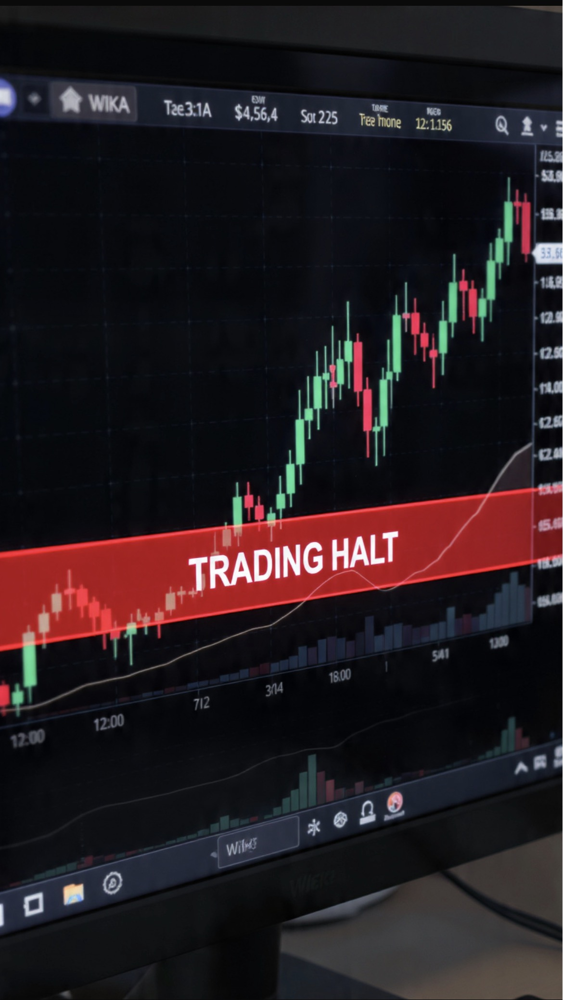

# IHSG: Antara Investor, Intervensi Asing, Kegagalan Pengawasan, dan Kredibilitas Negara

*Ilustrasi (Pic: Rita Mf Jannah & Meta AI)*

  
***Kredibilitas dibangun dengan memastikan bahwa setiap investor, baik asing maupun domestik, bermain di pasar yang transparan, adil, dan memiliki kepastian hukum***
  

Wajar bila kita mumet, yang menyebalkan bukan sekadar melihat portofolio merah. Kita sudah menyaksikan IHSG jatuh, kemudian perlahan pulih, mulai terlihat stabil, lalu kembali dihantam sentimen negatif. Rasanya pasar modal Indonesia sedang berlari sambil mengikat tali sepatunya sendiri.

Tetapi kali ini kita ingin membedahnya lebih serius. Ada tiga pertanyaan besar:
Mengapa IHSG begitu mudah kehilangan kepercayaan investor?
Apakah ada kekuatan asing yang sengaja menekan atau menghancurkan pasar saham Indonesia?
Apa yang harus dilakukan pemerintah, OJK, BEI, dan Danantara agar pasar kembali sehat?
Pertama, kita harus membedakan dua hal: pasar yang sedang terkoreksi karena fundamental ekonomi dan pasar yang mengalami krisis kepercayaan akibat persoalan kelembagaan. Keduanya bisa terjadi bersamaan, tetapi obatnya berbeda.

Dan kalau pemerintah hanya mengobati gejala tanpa memperbaiki penyebabnya, IHSG bisa menghijau hari ini lalu kembali berdarah besok.

## Siapa yang Sebenarnya Mengguncang IHSG?

Pada 24 November 2026, Reuters melaporkan bahwa MSCI belum mengubah proposal untuk mengklasifikasikan Indonesia dari Emerging Market menjadi Standalone Market. MSCI menegaskan konsultasi masih berlangsung, dengan keputusan final diperkirakan paling lambat 30 Juni 2027. Ini bukan persoalan kecil. 

Mari kita pahami dahulu siapa MSCI (Morgan Stanley Capital International). Ia adalah penyedia indeks global yang produknya menjadi acuan pengelola dana investasi internasional. Bukan lembaga pemerintah, bukan regulator, dan bukan bursa saham.

Mengapa pengumumannya bisa membuat IHSG terguncang? Karena banyak dana investasi global menggunakan indeks MSCI sebagai patokan alokasi portofolio.

Bayangkan sebuah reksa dana global mengelola uang triliunan rupiah dan mandat investasinya mengikuti indeks Emerging Markets.

Kalau Indonesia kehilangan status tersebut, manajer investasi dapat menghadapi kewajiban atau dorongan untuk mengurangi eksposur terhadap saham Indonesia.

Akibatnya:
- Dana pasif dapat melakukan penyesuaian portofolio.
- Dana aktif bisa mengurangi bobot Indonesia.
- Likuiditas saham tertentu dapat menurun.
- Tekanan jual dapat menekan harga saham dan rupiah.

Reuters pada 19 Oktober melaporkan IHSG anjlok 11,6% pada Jumat sebelumnya dan kembali tertekan lebih dari 5% pada Senin, setelah pengumuman MSCI.

Jadi, ancamannya bukan imajinasi. Tetapi ada satu hal yang perlu kita luruskan: MSCI tidak sedang memerintahkan investor menghancurkan Indonesia. MSCI sedang menilai apakah pasar Indonesia memenuhi standar investabilitas dan aksesibilitasnya.

## Apakah Ada Campur Tangan Asing untuk Menghancurkan Pasar Indonesia?

Ini pertanyaan yang harus kita bedah tanpa naif, tetapi juga tanpa membangun teori konspirasi yang belum terbukti.

Ada tiga fenomena berbeda:

A. Tekanan modal asing yang nyata

Investor asing memang bisa menarik modal dalam jumlah besar. Mereka tidak perlu bersekongkol untuk menghasilkan tekanan jual yang hebat, cukup terjadi perubahan persepsi risiko. Misalnya:
prospek rupiah memburuk;
imbal hasil obligasi Amerika meningkat;
ketidakpastian kebijakan meningkat;
risiko penurunan klasifikasi pasar bertambah.
Investor global kemudian mengurangi aset berisiko di Indonesia. Ini adalah mekanisme pasar yang nyata.

B. Potensi manipulasi perdagangan

Ini justru lebih serius. MSCI menyoroti persoalan transparansi kepemilikan saham, free float yang sebenarnya dapat diperdagangkan, serta indikasi perdagangan terkoordinasi.

Reuters pada Oktober juga melaporkan langkah Indonesia memperketat pengawasan terhadap dugaan manipulasi perdagangan dan pembekuan akun mencurigakan.

Artinya, masalahnya tidak semata-mata investor asing menjual saham. Ada persoalan integritas pasar domestik yang harus dibereskan.

C. Operasi asing untuk menghancurkan Indonesia

Nah, untuk tuduhan ini belum menemukan bukti kredibel yang menunjukkan adanya operasi terkoordinasi oleh negara asing dengan tujuan menghancurkan IHSG.

Jangan mencampuradukkan tiga hal:

| Fenomena | Penilaian |
|:-----|:------:|
|Investor asing melakukan capital outflow|Terjadi|
|Penyedia indeks global mengubah penilaian Indonesia|Terjadi|
|Negara asing berkomplot menghancurkan IHSG|Belum terbukti|

Tetapi jangan pula menganggap Indonesia tidak punya musuh dalam bentuk praktik perdagangan yang merusak.

Spekulan, pemilik saham terkonsentrasi, transaksi terkoordinasi, dan pelaku manipulasi bisa merusak pembentukan harga tanpa harus membawa bendera negara mana pun.

Musuh pasar modal yang paling berbahaya kadang bukan investor asing, melainkan ketidakjujuran di dalam pasar sendiri.

Mengapa Pasar Indonesia Begitu Rentan?

Masalah struktural yang menimbulkan empat penyakit perlu diperhatikan:

1. Free float dan transparansi kepemilikan

Free float adalah jumlah saham yang benar-benar tersedia untuk diperdagangkan publik. Kalau kepemilikan saham terkonsentrasi pada segelintir pihak, jumlah saham yang benar-benar beredar bisa jauh lebih kecil daripada yang terlihat. Akibatnya, harga saham bisa bergerak tidak proporsional.

Investor institusi global membutuhkan kepastian bahwa harga saham mencerminkan transaksi yang wajar, bukan sekadar pergerakan sekelompok pemegang saham.

2. Ketergantungan pada modal asing

Pasar modal Indonesia masih relatif dangkal dibandingkan sejumlah pasar berkembang lainnya.

OECD dalam survei ekonomi Indonesia November 2026 juga menyoroti kelemahan transparansi, tata kelola, dan terbatasnya basis investor institusional domestik.

Artinya, kita perlu memperkuat investor domestik institusional agar pasar tidak terlalu rentan terhadap perubahan arus modal internasional.

3. Pengawasan dan penegakan hukum

Kalau manipulasi terjadi, tetapi pelakunya tidak segera diidentifikasi dan ditindak, investor akan kehilangan kepercayaan.

Peringatan UMA saja tidak cukup. Pasar membutuhkan penegakan hukum yang menghasilkan konsekuensi nyata.

4. Ketidakpastian kebijakan

Investor tidak menuntut pemerintah selalu membuat kebijakan yang menyenangkan pasar. Mereka menuntut kebijakan yang dapat diprediksi.

Perubahan aturan mendadak, komunikasi yang saling bertentangan, dan respons yang terlambat membuat investor menaikkan premi risiko.

Dan ketika premi risiko naik, valuasi saham bisa turun meskipun perusahaan masih menghasilkan laba.

Pemerintah Sebenarnya Sudah Melakukan Sesuatu. Tetapi Apakah Cukup?

Ada perkembangan yang patut diapresiasi, tetapi belum pantas dirayakan sebagai kemenangan.

Dalam siaran pers 3 November 2026, OJK melaporkan sejumlah langkah reformasi:
- Memperkuat keterbukaan data kepemilikan saham.
- Memperketat pengawasan transaksi tidak wajar dan perdagangan terkoordinasi.
- Menyesuaikan batas ARB dari 15% menjadi 7%.
- Memperpanjang fasilitas buyback tanpa persetujuan RUPS sampai 30 Juni 2027.
- Memperbaiki mekanisme pengawasan konsentrasi kepemilikan saham.
- Melanjutkan reformasi kelembagaan bursa melalui demutualisasi.

Ini langkah yang relevan, tetapi perlu menekankan satu hal: Mengubah peraturan tidak sama dengan mengubah perilaku pasar. Investor internasional tidak akan kembali hanya karena pemerintah menerbitkan sepuluh peraturan baru.

Mereka ingin melihat bukti:
- pelaku manipulasi benar-benar dihukum;
- pemilik manfaat akhir saham dapat diketahui;
- free float benar-benar tersedia;
- transaksi mencurigakan ditindak;
- laporan emiten dapat dipercaya.

Pasar tidak membutuhkan konferensi pers yang lebih indah. Pasar membutuhkan bukti bahwa reformasi bekerja.

## Bagaimana Cara Membangkitkan IHSG?

Indonesia membutuhkan strategi pemulihan dalam lima lapisan:

1. Bersihkan pasar terlebih dahulu

OJK dan BEI harus menindak manipulasi, transaksi semu, insider trading, serta praktik penguasaan harga. Jangan pilih kasih berdasarkan siapa pemilik perusahaannya.

2. Bangun kepercayaan investor institusional

Perbaiki transparansi, free float, kualitas emiten, dan akses investor asing. Jangan sekadar mengejar arus modal masuk, tetapi pastikan mereka merasa aman berinvestasi.

3. Perkuat investor domestik

Dana pensiun, asuransi, reksa dana, dan investor institusional domestik perlu berkembang dengan tata kelola investasi yang sehat. Jangan menjadikan mereka alat untuk menahan indeks secara artifisial.

4. Perbaiki fundamental ekonomi

Perusahaan harus menghasilkan laba, investasi produktif harus tumbuh, rupiah harus stabil, dan kebijakan fiskal harus kredibel.

5. Pemerintah harus konsisten

Jangan hari ini mengatakan mendukung pasar, besok mengeluarkan kebijakan yang membuat investor bingung. Koordinasi Kementerian Keuangan, BI, OJK, BEI, dan Danantara harus menghasilkan arah kebijakan yang jelas.

## Danantara dan BUMN: Jangan Hanya Menjadi Pemadam Kebakaran IHSG

Danantara harus mengambil peran strategis dalam memperbaiki kualitas aset BUMN. Bukan sekadar membeli saham BUMN agar indeks terlihat bagus.

Ada perbedaan besar antara:
menopang harga saham;
menyelamatkan perusahaan;
meningkatkan produktivitas aset negara.

Misalnya WIKA. BEI mencatat penghentian sementara perdagangan saham WIKA pada 18 November 2026. Pemerintah semestinya memberikan penjelasan yang tegas mengenai:
- Kondisi keuangan dan kewajiban perusahaan.
- Status restrukturisasi utang.
- Nasib proyek-proyek yang belum selesai.
- Strategi pemulihan operasional.
- Target waktu dan persyaratan pembukaan kembali perdagangan.

Tidak perlu menjanjikan harga saham akan naik, tetapi jangan biarkan investor hidup dalam kabut informasi. 

Pemerintah harus memahami bahwa reputasi BUMN juga merupakan bagian dari reputasi negara. Kalau negara ingin masyarakat percaya pada saham BUMN, negara harus menunjukkan bahwa BUMN dikelola secara bertanggung jawab.

## Apakah IHSG bisa pulih pada 2027?

Bisa, meskipun tidak menjanjikan bahwa indeks akan segera terbang kembali. Namun ada tiga skenario yang perlu dipertimbangkan:

**Skenario optimistis**

Reformasi berhasil ketika MSCI melihat perbaikan nyata, arus modal asing mulai kembali, rupiah stabil, dan investor domestik semakin aktif. Maka IHSG berpeluang mengalami pemulihan valuasi secara bertahap.

**Skenario moderat**

Pasar pulih tetapi selektif. Sebagian saham berfundamental kuat pulih lebih dahulu, sedangkan saham bermasalah tetap tertinggal. Ini adalah skenario yang perlu paling diperhitungkan dalam menyusun strategi portofolio.

**Skenario pesimistis**

Reformasi gagal meyakinkan pasar, akibatnya MSCI mempertahankan penilaian negatif, modal asing terus keluar, rupiah tertekan, dan premi risiko Indonesia meningkat. IHSG bisa kembali mengalami tekanan berkepanjangan.

Perlu diingat, keputusan MSCI paling lambat Juni 2027 menjadi salah satu katalis penting yang patut kita pantau.

## Bagaimana dengan Nasib Semua Saham?

Ini bagian yang paling penting secara praktis.
Jangan melakukan kesalahan investasi hanya karena melihat portofolio merah.

Kita harus membedakan tiga kategori:
| Jenis saham | Strategi evaluasi |
|:-----|:------:|
|Fundamental kuat|Evaluasi valuasi dan prospek bisnis|
|Fundamental membaik tetapi spekulatif|Perhatikan arus kas, likuiditas, dan volume|
|Fundamental memburuk|Evaluasi ulang alasan kepemilikan|

Jangan menyamakan koreksi harga dengan kerusakan fundamental. Sebaliknya, jangan pula menganggap setiap penurunan sebagai kesempatan membeli.

Saham bagus bisa turun karena kepanikan pasar. Saham buruk bisa naik karena spekulasi. Itulah sebabnya kita harus memeriksa satu per satu.

## Indonesia Tidak Boleh Kalah oleh Krisis Kepercayaannya Sendiri

Negara tidak bisa terus-menerus meminta masyarakat menjadi investor, tetapi membiarkan kualitas perlindungan investor dan integritas pasar tertinggal.

Negara tidak bisa mengajak rakyat membangun kekayaan melalui pasar modal, sementara persoalan transparansi, manipulasi, dan tata kelola dibiarkan berlarut-larut.

Negara juga tidak boleh menganggap arus modal asing sebagai sesuatu yang selalu bisa dikendalikan dengan pidato nasionalisme. Investor asing tidak wajib mencintai Indonesia. Investor domestik pun tidak wajib terus-menerus menanggung risiko akibat buruknya tata kelola. Yang harus dilakukan pemerintah adalah membuat Indonesia layak dipercaya.

Kredibilitas pasar modal tidak dibangun dengan memaksa indeks naik. Kredibilitas dibangun dengan memastikan bahwa setiap investor, baik asing maupun domestik, bermain di pasar yang transparan, adil, dan memiliki kepastian hukum.

Jangan terlalu sibuk menyelamatkan angka IHSG sampai lupa menyelamatkan institusi yang membuat angka itu layak dipercaya. Itu pekerjaan rumah yang sesungguhnya. 

  
**Referensi**

Organisation for Economic Co-operation and Development. (2026). OECD Economic Surveys: Indonesia 2026. OECD Publishing.

Otoritas Jasa Keuangan. (2026, November 3). Financial System Stability Committee (KSSK) strengthens policy coordination and synergy to safeguard national economic fundamentals and financial system resilience.

Reuters. (2026, October 19). Panic selling hits Indonesian markets on MSCI expulsion threat.

Reuters. (2026, October 26). Indonesia strengthens measures against stock manipulation after market rout triggered by MSCI.

Reuters. (2026, November 24). MSCI denies softer stance on Indonesia’s market status, review ongoing.

Minsky, H. P. (1986). Stabilizing an unstable economy. Yale University Press.

Stiglitz, J. E. (2010). Freefall: America, free markets, and the sinking of the world economy. W. W. Norton.
