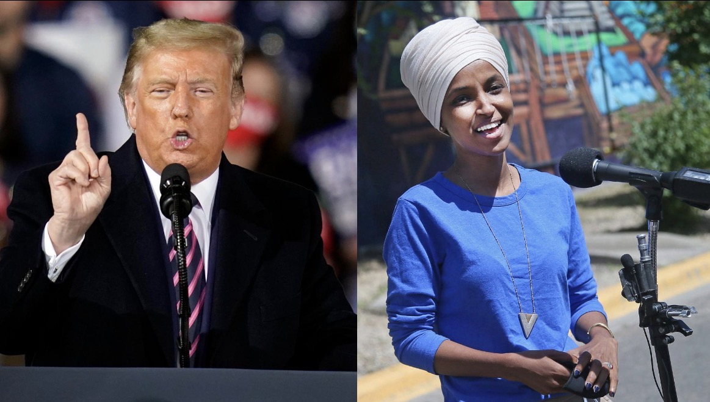

## Ilhan Omar, Trump, Israel, dan Batas antara Penegakan Hukum dengan Pembalasan Politik

*Trump dan Ilham Omar (pic: itv.com)

  
***Prinsip demokrasi yang harus dijaga adalah sederhana: lawan politik tidak boleh kebal hukum, tetapi hukum juga tidak boleh menjadi senjata untuk membungkam lawan politik***
  

Ketika aparat federal menggeledah rumah seorang anggota Kongres yang selama bertahun-tahun menjadi sasaran serangan politik Donald Trump, pertanyaannya bukan cuma apa yang sedang diselidiki? 

Ada pertanyaan konstitusional yang lebih besar: bagaimana membedakan penegakan hukum yang sah dari penggunaan kekuasaan negara untuk menekan lawan politik?

Peristiwa itu memang terjadi. Pada Senin, 12 Oktober 2026, agen Homeland Security Investigations (HSI), unit investigasi di bawah Immigration and Customs Enforcement (ICE), menggeledah rumah anggota Kongres Ilhan Omar di Washington, D.C. 

Departemen Kehakiman AS mengonfirmasi bahwa surat perintah penggeledahan telah diperoleh secara sah melalui proses yudisial. Namun, pemerintah belum membuka seluruh rincian penyelidikannya.

Omar memang dikenal sebagai salah satu pengkritik paling vokal terhadap kebijakan Israel di Kongres AS. Tetapi kita harus memisahkan dua pertanyaan: apa dasar hukum penggeledahan itu, dan apakah konteks politik menimbulkan alasan untuk mencurigai adanya perlakuan selektif? Keduanya berkaitan, tetapi tidak otomatis memiliki jawaban yang sama.

## Siapa Ilhan Omar?

Ilhan Omar adalah anggota DPR AS dari Partai Demokrat, Minnesota, Distrik ke-5.

Lahir di Somalia pada 1982. Mengungsi bersama keluarganya akibat perang saudara Somalia, datang ke Amerika Serikat pada 1990-an dan menetap di Minneapolis.

Dilantik menjadi anggota DPR pada Januari 2019. Serta menjadi perempuan Muslim Amerika pertama di antara dua perempuan Muslim yang terpilih ke Kongres pada pemilu 2018, sekaligus anggota Kongres pertama yang lahir sebagai pengungsi Afrika.

Omar bukan pejabat Palestina, bukan warga Israel, dan bukan anggota pemerintahan asing. Ia adalah legislator Amerika yang dipilih oleh konstituennya sendiri. Itu penting, sebab kritiknya terhadap kebijakan luar negeri AS merupakan bagian dari politik domestik Amerika.

Ia juga termasuk kelompok progresif di DPR yang kerap disebut The Squad, bersama sejumlah anggota Demokrat lain yang mendorong perubahan kebijakan terkait ketimpangan ekonomi, hak-hak sipil, imigrasi, dan kebijakan luar negeri.

Sikapnya terhadap Israel cukup tegas. Ia mendukung solusi dua negara bagi Israel dan Palestina, menyerukan gencatan senjata, menentang dukungan persenjataan AS kepada pemerintah yang dianggap melakukan pelanggaran hak asasi manusia, serta mengkritik dukungan Washington kepada operasi militer Israel di Gaza. 

Omar juga mengecam serangan Hamas pada 7 Oktober 2023 dan menyerukan pembebasan seluruh sandera.

Jadi, jangan menyederhanakan posisinya sebagai sekadar “anti-Israel”. Ia mengkritik kebijakan negara Israel dan dukungan militer AS, sembari menyatakan dukungan terhadap solusi dua negara serta menolak antisemitisme. 

Kritik terhadap pemerintah Israel, identitas Yahudi, dan kebencian terhadap orang Yahudi adalah tiga hal berbeda yang tidak boleh dicampuradukkan.

## Mengapa Rumahnya Digeledah?

Menurut laporan CBS News dan Reuters, penyelidikan yang melatarbelakangi penggeledahan itu berkaitan dengan dugaan penipuan dokumen imigrasi. 

Dokumen yang dipersoalkan dilaporkan berasal dari masa kecil Omar dan melibatkan dokumen yang diurus oleh almarhum ayahnya ketika keluarga mereka datang ke Amerika sebagai pengungsi. (CBS News⁠, Reuters⁠)

Ada tiga fakta penting yang jangan dicampuradukkan:
- Penggeledahan benar-benar terjadi. Departemen Kehakiman mengonfirmasi pelaksanaan surat perintah penggeledahan oleh HSI.
- Penyelidikannya masih berlangsung. Rincian lengkap mengenai dugaan pelanggaran, bukti yang dimiliki penyidik, dan alasan spesifik menggeledah rumah Omar belum diumumkan secara terbuka.
- Penggeledahan bukan putusan bersalah. Sampai informasi yang tersedia saat ini, belum ada dasar untuk menyimpulkan bahwa Omar terbukti melakukan penipuan imigrasi. (AP News⁠)

Kantor Omar menyatakan bahwa ia tidak melakukan kesalahan dan menuduh pemerintahan Trump menggunakan aparat federal untuk menargetkan lawan politik. Itu merupakan posisi resmi pihak Omar, bukan kesimpulan hukum yang sudah ditetapkan pengadilan. (Pernyataan kantor Omar, 12 Oktober 2026⁠)

## Mengapa Penggeledahan ini Kontroversial?

Waktunya sangat sensitif. Penggeledahan terjadi hanya sekitar 22 hari sebelum pemilihan paruh waktu Kongres AS pada November 2026, ketika Omar sedang menghadapi pemilihan kembali. 

Sejumlah anggota Demokrat mempertanyakan apakah tindakan aparat tersebut melanggar kebijakan Departemen Kehakiman yang membatasi langkah investigasi yang berpotensi memengaruhi pemilu dalam periode 60 hari menjelang pemungutan suara. (Pernyataan anggota Demokrat Komite Kehakiman DPR⁠)

Namun, kritik tersebut perlu ditempatkan secara tepat. Pernyataan anggota Kongres Demokrat bukan putusan bahwa penggeledahan itu ilegal. 

Kita perlu mengetahui dasar surat perintah, urgensi tindakan, bukti yang hendak diamankan, serta apakah kebijakan internal Departemen Kehakiman memang dilanggar dalam kasus ini.

Pertanyaan hukumnya bukan sekadar apakah aparat memiliki surat perintah, tetapi juga apakah tindakan tersebut proporsional, didukung alasan yang memadai, dan dilaksanakan tanpa standar ganda.

## Apakah Omar Menjadi Incaran Trump Karena Kritiknya terhadap Israel?

Kecurigaan itu mempunyai konteks politik yang nyata, tetapi hubungan sebab-akibatnya belum terbukti.

Trump dan para pendukungnya telah berulang kali menyerang Omar secara terbuka. Kritik mereka mencakup identitasnya sebagai imigran Somalia, pandangan politik progresifnya, dan kontroversi terkait pernyataan-pernyataannya. 

Pada September 2026, pejabat pemerintahan Trump juga telah mengisyaratkan adanya penyelidikan terhadap Omar sebelum penggeledahan Oktober dilakukan. (AP News⁠)

Omar sendiri merupakan pengkritik vokal dukungan militer AS kepada Israel. Ia menyerukan gencatan senjata, mengkritik tindakan Israel di Gaza, dan mendukung pertanggungjawaban atas dugaan pelanggaran hak asasi manusia. 

Ia juga mengakui pernah menggunakan ungkapan yang menyakiti kolega dan konstituen Yahudi, lalu menyampaikan permintaan maaf atas komentar tersebut. (Catatan resmi Omar⁠)

Jadi, ada dua lapisan yang perlu dianalisis.

Lapisan pertama: konflik politik yang terdokumentasi. Trump memang sering menyerang Omar dan pemerintahannya telah mengumumkan adanya penyelidikan sebelum penggeledahan berlangsung.

Lapisan kedua: motif khusus di balik penggeledahan. Belum ada bukti publik yang cukup untuk menyimpulkan bahwa penggeledahan itu diperintahkan sebagai pembalasan khusus atas kritik Omar terhadap Israel.

Mengapa pembedaan ini penting? Karena seorang pejabat dapat menjadi sasaran serangan politik sekaligus menghadapi penyelidikan yang sah. Sebaliknya, keberadaan penyelidikan yang secara formal sah tidak otomatis membuktikan bahwa prosesnya bebas dari tekanan politik.

Kedua kemungkinan itu harus diuji dengan bukti.

## Ketika Aparat Penegak Hukum Berhadapan dengan Lawan Politik Presiden

Dalam negara demokratis, aparat penegak hukum harus mempunyai kebebasan untuk menyelidiki dugaan kejahatan, termasuk jika orang yang diselidiki adalah pejabat terpilih. Kekebalan mutlak bagi anggota Kongres akan menciptakan masalah serius karena jabatan politik bisa digunakan untuk menghindari hukum.

Tetapi prinsip yang sama berlaku ke arah sebaliknya: presiden tidak boleh menggunakan kekuasaan penegakan hukum untuk menghukum orang karena mengkritik pemerintah.

Dua prinsip itu harus berjalan bersama.

Empat pertanyaan untuk menguji apakah penegakan hukum dilakukan secara adil

1. Apakah ada dasar bukti yang spesifik?

Apakah penyidik dapat menjelaskan dugaan pelanggaran dan kaitan barang atau dokumen yang dicari dengan penyelidikan, bukan hanya mengandalkan rumor lama?

2. Apakah prosedurnya konsisten?

Apakah kasus serupa terhadap orang yang tidak memiliki konflik politik dengan presiden diperlakukan dengan standar yang sama?

3. Mengapa tindakan itu dilakukan sekarang?

Waktu penggeledahan menjelang pemilu patut diperiksa. Namun, waktu yang mencurigakan merupakan alasan untuk meminta penjelasan, bukan bukti tunggal bahwa tindakan tersebut bermotif politik.

4. Apakah ada pengawasan independen?

Dasar surat perintah, pengawasan pengadilan, pemeriksaan terhadap potensi konflik kepentingan, dan transparansi proses dapat membantu membedakan penyelidikan yang sah dari penyalahgunaan kekuasaan.

Secara konstitusional, Amandemen Pertama melindungi kebebasan berbicara dan hak mengkritik pemerintah. Speech or Debate Clause dalam Pasal I Konstitusi AS juga memberikan perlindungan tertentu terhadap tindakan legislatif anggota Kongres. 

Namun, perlindungan itu bukan kekebalan menyeluruh terhadap semua penyelidikan kriminal. Apakah suatu tindakan melanggar perlindungan konstitusional bergantung pada fakta dan dasar hukumnya.

Karena itu, pengujian paling kuat bukan dengan langsung menyatakan “ini pasti persekusi”, melainkan meminta pemerintah menunjukkan alasan konkret di balik tindakannya, memastikan prosesnya dapat diperiksa secara independen, dan menuntut perlakuan yang sama bagi orang dengan posisi politik yang berbeda.

## Mengapa Kritik terhadap Israel Membuat Kasus ini Semakn Sensitif?

Dukungan AS kepada Israel bukan sekadar persoalan hubungan luar negeri. Isu tersebut telah menjadi medan pertarungan politik domestik Amerika, terutama setelah perang Gaza.

Reuters melaporkan pada Juli 2026 bahwa konsensus bipartisan lama mengenai dukungan kepada Israel semakin terpecah. Sejumlah anggota Demokrat mendorong pembatasan bantuan militer, sedangkan pihak lain mempertahankan bantuan dengan syarat tertentu. (Reuters⁠)

Dalam konteks seperti itu, legislator yang mengkritik kebijakan Israel dapat menghadapi tekanan politik dari berbagai arah. Tetapi kritik terhadap Israel sendiri tidak membuktikan bahwa seseorang sedang diselidiki karena pandangan tersebut.

Ada perbedaan antara:
- Kritik politik: Omar menentang sebagian kebijakan Israel dan dukungan militer AS.
- Serangan politik: Trump dan sekutunya berulang kali menyerang Omar secara terbuka.
- Penyelidikan hukum: HSI menggeledah rumahnya dalam penyelidikan dugaan pelanggaran dokumen imigrasi.
- Pembalasan politik: klaim bahwa penyelidikan digunakan untuk menghukumnya karena pandangan politik, yang membutuhkan bukti mengenai motif, proses, dan perlakuan yang tidak setara.

Empat hal itu saling berkaitan dalam konteks politik, tetapi tidak boleh dianggap sebagai satu fakta yang sudah terbukti seluruhnya.

Ilhan Omar adalah anggota DPR AS keturunan Somalia, seorang Muslim, dan pengkritik vokal kebijakan Israel serta dukungan militer Washington. 

Rumahnya di Washington, D.C., memang digeledah oleh HSI pada 12 Oktober 2026 dalam penyelidikan yang dilaporkan berkaitan dengan dokumen imigrasi masa kecilnya. 

Pemerintah belum mengungkap seluruh bukti yang mendasari penyelidikan tersebut, dan penggeledahan itu bukan bukti bahwa Omar bersalah. (AP News⁠)

Konteks politiknya membuat pertanyaan mengenai kemungkinan pembalasan politik patut diajukan. Namun, kesimpulan bahwa ia menjadi sasaran khusus karena kritik terhadap Israel belum dapat dipastikan berdasarkan bukti publik yang tersedia.

Prinsip demokrasi yang harus dijaga adalah sederhana: lawan politik tidak boleh kebal hukum, tetapi hukum juga tidak boleh menjadi senjata untuk membungkam lawan politik.

Itulah ukuran yang semestinya diterapkan kepada siapa pun, entah ia anggota Partai Demokrat atau Republik, pendukung atau pengkritik Israel, imigran atau warga yang lahir di Amerika. 

  
**Referensi:**

1. Associated Press. (2026, October 12). Federal agents search Rep. Ilhan Omar’s home as part of an investigation. AP News.

2. Reuters. (2026, October 12). U.S. federal agents search Ilhan Omar’s home in alleged immigration fraud probe. Reuters.

3. CBS News. (2026, October 12). Federal agents search Rep. Ilhan Omar’s home, sources say. CBS News.

4. U.S. House of Representatives. (n.d.). About Ilhan Omar.

5. Office of Representative Ilhan Omar. (n.d.). My record.

6. Office of Representative Jamie Raskin. (2026, October 12). Statement on the search of Representative Ilhan Omar’s home.

7. The Guardian. (2026, October 13). Democrats condemn FBI search of Ilhan Omar’s home as Trump ramps up attacks.
