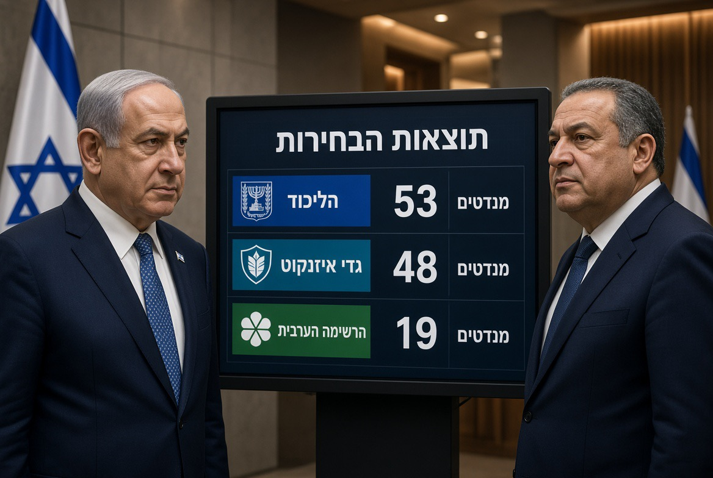

# Israel & Paradoks 19 Kursi Arab: Ketika Suara Minoritas Menjadi Penentu, tetapi Keberadaannya Masih Dipersoalkan

*Ilustrasi (pic: Grok AI).*

  
***Demokrasi punya ujian yang sangat sederhana tetapi berat: apakah sebuah kelompok masih dianggap sah ketika suara mereka tidak menghasilkan sesuatu yang diinginkan penguasa?***
  

Deadlock Israel bukan sekadar soal siapa yang memperoleh kursi terbanyak. Ada paradoks politik yang jauh lebih dalam: warga Arab Israel bisa menjadi penentu pembentukan pemerintahan, tetapi partai-partai yang membutuhkan suara mereka belum tentu bersedia mengakui mereka sebagai mitra politik yang setara.

Asal-usul warga Arab Israel sebagian besar memang memiliki akar keluarga dan sejarah di Palestina sebelum berdirinya Israel pada 1948, tetapi status dan pengalaman mereka tidak seragam. Kita perlu membedakan warga Arab Israel, warga Palestina di wilayah pendudukan, dan pengungsi Palestina beserta keturunannya.

Mari kita bedah sejarah, demografi, dan matematika koalisinya. Pisau analisisnya kita asah, bukan untuk memotong fakta seenaknya. 

## Matematika Politiknya Memang Menarik

Hasil final yang diumumkan Komisi Pemilihan Umum Israel menghasilkan komposisi 120 kursi untuk total anggota Knesset, parlemen Israel dengan mayoritas minimum 61. Blok Netanyahu memperoleh 53, Blok oposisi Eisenkot 48, sementara Partai Arab
19 kursi. 

Jika oposisi dan seluruh partai Arab bekerja sama: 48 + 19 = 67 kursi, akan nelewati mayoritas 6 kursi. Namun ada satu masalah besar: angka 67 itu hanya matematika. Ia belum menjadi koalisi politik.

Bahkan beberapa pemimpin oposisi, termasuk Avigdor Lieberman dan Naftali Bennett, telah menyatakan penolakan terhadap kerja sama dengan partai-partai Arab. 

Jadi, kelompok yang secara aritmetika dapat membantu membentuk pemerintahan justru menghadapi hambatan untuk diterima sebagai mitra. Inilah yang membuat 19 kursi tersebut begitu penting.

## Apakah Warga Arab Israel Sebenarnya Orang Palestina yang Wilayahnya Dianeksasi?

Jawaban pendeknya: sebagian besar merupakan keturunan penduduk Palestina yang tetap tinggal di wilayah yang menjadi Israel setelah perang 1948. Tetapi istilah aneksasi perlu digunakan secara hati-hati.

Mari kita mundur ke 1948. Sebelum Israel berdiri, wilayah tersebut berada di bawah Mandat Britania atas Palestina. Masyarakatnya terdiri atas komunitas Arab Palestina, Yahudi, dan kelompok lainnya.

Setelah perang 1948:
- Sekitar 700.000 sampai 750.000 warga Palestina terusir atau melarikan diri dari rumah mereka.
- Sekitar 150.000 orang Palestina tetap tinggal di wilayah yang kemudian menjadi Israel.
- Mereka dan keturunannya menjadi inti komunitas warga Palestina pemegang kewarganegaraan Israel saat ini.

Sumber Council on Foreign Relations menjelaskan bahwa mayoritas warga Arab Israel merupakan keturunan penduduk Arab Palestina yang tetap berada dalam batas negara Israel setelah perang 1948.

Tetapi ada lapisan sejarah yang lebih menyakitkan. Pada 1948-1966, warga Arab yang tinggal di Israel berada di bawah pemerintahan militer. Mereka secara formal memiliki kewarganegaraan, tetapi kebebasan bergerak, akses terhadap tanah, dan kehidupan politik mereka dibatasi oleh sistem kontrol militer.

Penelitian Ofra Bloch dalam Law and History Review (2021) bahkan menggambarkan integrasi mereka ke dalam perekonomian Israel sebagai hierarchical inclusion: dimasukkan ke dalam sistem, tetapi dengan posisi yang tidak setara.

Jadi, ada perbedaan penting:

| Kelompok | Status |
|------|-------|
|Warga Palestina di dalam Israel|Umumnya warga negara Israel|
|Warga Palestina di Tepi Barat|Hidup di wilayah pendudukan, dengan status hukum yang berbeda|
|Warga Palestina di Gaza|Bukan warga negara Israel|
|Warga Palestina di Yerusalem Timur|Mayoritas berstatus penduduk tetap Israel, bukan otomatis warga negara|

Yerusalem Timur memiliki sejarah tersendiri: wilayah itu diduduki Israel pada 1967 dan kemudian dianeksasi secara sepihak. Aneksasi tersebut tidak diakui sebagai sah oleh masyarakat internasional.

Maka, menyebut warga Arab Israel sebagai orang Palestina yang wilayahnya dianeksasi memiliki dasar sejarah untuk sebagian komunitas, tetapi tidak tepat jika diterapkan secara seragam kepada semua individu dan semua wilayah.

## Mengapa 19 kursi itu Membuat Sebagian Politisi Israel Gelisah?

Dua kekuatan utama yang memperoleh 19 kursi adalah:
- Joint List: 11 kursi. Aliansi politik Arab yang mencakup unsur nasionalis Arab dan kelompok kiri.
- Ra’am: 8 kursi. Partai Islam konservatif yang dipimpin Mansour Abbas, dengan pendekatan pragmatis terhadap politik parlementer Israel.
Keduanya tidak identik. Mereka memiliki orientasi ideologi, strategi politik, dan prioritas kebijakan yang berbeda. Tetapi keduanya membawa suara warga Arab ke dalam parlemen.

Di sinilah paradoksnya: mereka adalah bagian dari sistem pemilihan Israel, mengikuti aturan pemilu, memperoleh mandat pemilih, dan memiliki hak konstitusional sebagai anggota parlemen. Namun sebagian partai Zionis tetap enggan menjadikan mereka mitra pemerintahan.

Ada tiga persoalan yang perlu dibedakan:
Identitas negara. Sebagian politisi memandang kerja sama dengan partai Arab sebagai persoalan ideologis karena Israel didefinisikan sebagai negara Yahudi.
Politik keamanan. Hubungan warga Arab dengan identitas Palestina dan konflik Israel-Palestina sering dijadikan isu dalam perdebatan keamanan.
Kalkulasi elektoral. Politisi khawatir kehilangan dukungan pemilih Yahudi jika membentuk pemerintahan yang bergantung pada partai Arab.
Tetapi ada preseden penting: pada 2021, Ra’am pernah bergabung dalam koalisi pemerintahan Naftali Bennett dan Yair Lapid. Artinya, kerja sama politik Yahudi-Arab bukan sesuatu yang mustahil dalam sejarah Israel modern.

## Episode Qatar: Ketika Suara Pemilih Berubah Menjadi Persoalan Keamanan Nasional 

Setelah partai-partai Arab memperoleh 19 kursi, Netanyahu dan kubu Likud mengangkat tuduhan bahwa terdapat campur tangan asing, termasuk dugaan pendanaan Qatar untuk meningkatkan partisipasi pemilih Arab.

Namun kita harus memisahkan tiga hal:
Ada permintaan penyelidikan terhadap dugaan campur tangan asing.
Qatar secara resmi membantah keterlibatan.
Tuduhan bahwa Qatar mendanai kemenangan partai-partai Arab belum terbukti.
Reuters melaporkan bahwa Netanyahu menuduh partai Arab melakukan kecurangan tanpa menyertakan bukti yang mendukung tuduhannya.

Pejabat pemilu menyatakan tidak ada dasar untuk menyimpulkan bahwa integritas pemilu telah dirusak secara sistematis.

Ada satu detail yang sangat penting: investigasi terhadap dugaan pelanggaran oleh individu tidak sama dengan bukti bahwa satu komunitas pemilih melakukan kecurangan secara kolektif.

Dalam demokrasi, peningkatan partisipasi pemilih bukan bukti campur tangan asing.
Kalau ada bukti pendanaan ilegal, tentu harus diselidiki. Tetapi kalau sebuah komunitas menggunakan hak pilihnya dan memperoleh representasi lebih besar, hasil tersebut tidak bisa begitu saja dicurigai hanya karena tidak menguntungkan pemerintah.

Dan ada ironi politik yang diberitakan Reuters: tuduhan terhadap partai Arab dapat membuat Eisenkot semakin sulit bekerja sama dengan mereka, meskipun dukungan mereka secara matematis dapat membantu menggantikan pemerintahan Netanyahu.

## Berkaitan dengan Penolakan terhadap Solusi Dua Negara?

Ada hubungan ideologis, tetapi jangan menyederhanakan semua penolakan terhadap partai Arab sebagai penolakan terhadap solusi dua negara.

Solusi dua negara berarti pembentukan negara Palestina yang merdeka berdampingan dengan Israel, umumnya berdasarkan garis 1967 dengan pengaturan dan pertukaran wilayah yang disepakati.

Sebagian kelompok nasionalis-religius Israel menolak gagasan tersebut karena menganggap seluruh atau sebagian besar wilayah Tepi Barat sebagai bagian dari tanah historis Israel. Ada pula yang menolaknya dengan alasan keamanan.

Sementara itu, sebagian politisi oposisi yang menolak koalisi dengan partai Arab tidak selalu memiliki posisi identik mengenai negara Palestina.

Jadi, dua persoalan ini saling bersinggungan, tetapi bukan satu persoalan yang sama:

| Persoalan | Pertanyaan dasarnya |
|------|-------|
|Hak warga Arab Israel|Apakah mereka memiliki representasi politik yang setara?|
|Identitas negara|Seberapa jauh identitas Yahudi negara membatasi kesetaraan kewarganegaraan?|
|Solusi dua negara|Apakah Palestina akan memperoleh kedaulatan sendiri?|
|Pendudukan|Bagaimana masa depan wilayah Palestina yang diduduki sejak 1967?|

Penelitian politik mengenai kewarganegaraan Palestina di Israel juga menunjukkan ketegangan antara hak sipil-politik warga Arab dan struktur negara yang mempertahankan dominasi nasional Yahudi.

Mengapa Netanyahu Masih Menjadi Caretaker?

Karena sistem Israel adalah parlementer.
Perolehan suara terbanyak tidak otomatis menjadikan seseorang memiliki mandat untuk membentuk pemerintahan baru.

Prosesnya:
- Presiden Isaac Herzog berkonsultasi dengan perwakilan partai-partai.
- Presiden menunjuk anggota Knesset yang dianggap memiliki peluang membentuk pemerintahan.
- Kandidat memperoleh waktu untuk menyusun koalisi, dengan kemungkinan perpanjangan.
- Jika upaya pembentukan pemerintahan gagal, kandidat lain dapat diberi kesempatan.

Jika seluruh proses gagal, Israel dapat menghadapi pemilu ulang.
Netanyahu tetap menjalankan pemerintahan sebagai perdana menteri sementara sampai pemerintahan baru terbentuk.

Ada tiga jalur politik yang sedang terbuka:
Koalisi oposisi dengan dukungan partai Arab: secara aritmetika mencapai 67 kursi, tetapi menghadapi penolakan sebagian mitra oposisi.
Pemerintahan persatuan: partai-partai dari kubu yang berbeda mencoba membentuk pemerintahan bersama. Ini juga memiliki hambatan ideologis dan politik.
Kebuntuan berkepanjangan: tidak ada kesepakatan dan kemungkinan pemilu ulang tetap terbuka.

## Paradoks Demokrasi: Hak Memilih atau Hak Menentukan Masa Depan?

Ada konsep ilmu politik yang relevan di sini, yaitu ethnic democracy. Konsep ini digunakan untuk menjelaskan sistem yang memiliki pemilu kompetitif dan hak politik bagi warga, tetapi pada saat yang sama mempertahankan dominasi kelompok etnis atau nasional tertentu dalam struktur negara.

Yoav Peled membahas persoalan ini dalam artikel akademiknya, Ethnic Democracy and the Legal Construction of Citizenship: Arab Citizens of the Jewish State (2013). Ia menganalisis bagaimana warga Arab Israel memiliki hak sipil dan politik, tetapi menghadapi batas struktural dalam menentukan karakter kolektif negara.

Kasus pemilu 2026 memperlihatkan persoalan tersebut secara konkret. Warga Arab Israel menggunakan hak pilih mereka. Representasi politik mereka meningkat dari 10 menjadi 19 kursi. Mereka kini dapat memengaruhi pembentukan pemerintahan, tetapi sebagian partai yang membutuhkan dukungan mereka masih menolak kerja sama.

Ini membawa kita kepada pertanyaan yang lebih mendasar: Apakah demokrasi cukup hanya dengan memberikan hak kepada minoritas untuk memilih, atau demokrasi juga harus memberikan ruang kepada minoritas untuk ikut menentukan pemerintahan? Itulah persoalan yang sedang diuji oleh 19 kursi tersebut.

Ada dua hal yang sering dicampuradukkan dalam politik Israel:
- Pengakuan terhadap hak warga Palestina sebagai warga negara Israel.
- Pengakuan terhadap hak bangsa Palestina untuk memiliki negara sendiri.
Padahal keduanya tidak saling menggantikan. 

Warga Palestina yang menjadi warga negara Israel tetap dapat memperjuangkan kesetaraan di dalam Israel, sementara hak rakyat Palestina di Tepi Barat dan Gaza untuk menentukan nasib sendiri merupakan persoalan yang berbeda.

Jadi, kemenangan 19 kursi Arab ini bukan berarti konflik Israel-Palestina selesai. Tetapi hasil tersebut memperlihatkan bahwa masyarakat Arab di dalam Israel bukan sekadar objek kebijakan negara. Mereka adalah pemilih, warga negara, dan sekarang pemilik daya tawar parlementer yang signifikan.

Demokrasi punya ujian yang sangat sederhana tetapi berat: apakah sebuah kelompok masih dianggap sah ketika suara mereka tidak menghasilkan sesuatu yang diinginkan penguasa?

Nah, itu pertanyaan yang jauh lebih besar daripada siapa yang duduk di kursi perdana menteri. 

  
**Referensi**

Peled, Y. (2013). Ethnic Democracy and the Legal Construction of Citizenship: Arab Citizens of the Jewish State. American Political Science Review. Cambridge University Press⁠.

Bloch, O. (2021). Hierarchical Inclusion: The Untold History of Israel’s Affirmative Action for Arab Citizens (1948–68). Law and History Review, 39(1), 29–67. Cambridge University Press⁠.

Council on Foreign Relations. (2023). What to Know About the Arab Citizens of Israel. CFR⁠.

Reuters. (2026, October 29). Netanyahu, at risk of losing power, steps up attacks on Israel’s Arab parties. Reuters⁠.

The Times of Israel. (2026, October 30). With all votes counted, Netanyahu’s bloc has 53 seats, Eisenkot’s 48, Arab parties 19. Hasil pemilu final⁠.
