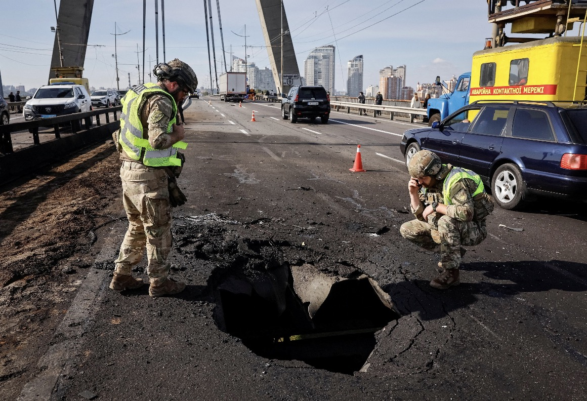

# Jembatan Kebanggaan Putin Ambruk: Ukraina Membidik Logistik dan Legitimasi Kekuasaan Rusia

*Ilustrasi (pic: independent.co.uk).*

  
***Jembatan Kerch adalah beton dan baja, tetapi nilai politiknya jauh melampaui material pembangunnya***
  

Ini serangan yang jauh lebih signifikan daripada sekadar satu jembatan terkena rudal. Pada 17 November 2026, serangan Ukraina untuk hari kedua berturut-turut menyebabkan bagian lengkung utama jalur jalan Jembatan Kerch runtuh ke Selat Kerch. 

Laporan visual menunjukkan bentang jalan yang ambruk, sementara bagian rel masih berdiri meskipun mengalami kerusakan. Dan ada ironi geopolitik yang tajam: jembatan yang dibangun Rusia untuk mengukuhkan kendali atas Krimea justru menjadi sasaran strategis Ukraina karena fungsi logistik dan simbol politiknya.

## Apa yang Terjadi Pada 16–17 November?

Kita susun kronologinya, karena ada dua gelombang serangan yang perlu dibedakan.
- 16 November: Ukraina menyerang Jembatan Kerch. Lalu lintas sempat dihentikan. Kerusakan awal dilaporkan relatif terbatas oleh pihak Rusia.
- Malam 16 menuju 17 November: serangan kedua berlangsung. Kali ini dampaknya jauh lebih berat.
- 17 November: bentang lengkung jalur jalan runtuh ke perairan Selat Kerch. Rusia menghentikan lalu lintas jalan dan kereta untuk pemeriksaan.
- Setelah pemeriksaan: laporan berikutnya menyebut layanan kereta kembali berjalan, sementara jalur jalan tetap terganggu.

Reuters pada laporan awal menyatakan belum dapat memverifikasi secara independen seluruh rekaman keruntuhan. Namun, laporan AP dan Guardian berikutnya juga menyebut Ukraina mengklaim bentang jalan dan lengkungnya runtuh, Rusia mengakui kerusakan, dan foto serta rekaman yang beredar memperlihatkan bagian jalan jatuh ke laut.

Jadi, bagian jalan utama runtuh. Tetapi bukan berarti seluruh jembatan roboh. Jalur rel masih berdiri, walaupun dilaporkan mengalami kerusakan.

## Mengapa Jembatan Kerch Begitu Penting bagi Putin?

Jembatan Kerch, sepanjang sekitar 19 kilometer, menghubungkan Semenanjung Krimea dengan wilayah Krasnodar di Rusia.

Pembangunannya dimulai setelah Rusia menganeksasi Krimea pada 2014:
- Jalur jalan dibuka pada Mei 2018.
- Jalur kereta dibuka pada Desember 2019.

Jembatan ini mempunyai tiga fungsi sekaligus:

1. Infrastruktur logistik

Jembatan mengangkut kendaraan, penumpang, barang, dan sebelumnya menjadi jalur penting untuk memasok pasukan Rusia di Krimea.

Tetapi ada nuansa penting: menurut Reuters, Rusia kini juga memiliki koridor darat melalui wilayah Ukraina selatan yang diduduki. Artinya, Jembatan Kerch bukan lagi satu-satunya jalur logistik Rusia menuju Krimea.

Namun, kehilangan atau rusaknya jembatan tetap mengurangi redundansi jalur transportasi dan menambah biaya serta kerumitan pengiriman.

2. Simbol politik Putin

Jembatan ini sangat erat dengan citra politik Putin. Pada 2018, Putin sendiri meresmikan jembatan tersebut dengan mengendarai truk melintasinya.

Secara simbolis, proyek tersebut menyampaikan pesan:
- Rusia menganggap Krimea sebagai bagian dari wilayahnya.
- Moskow mampu mengintegrasikan Krimea dengan daratan Rusia.
- Aneksasi 2014 bukan sekadar tindakan militer, tetapi diklaim sebagai perubahan teritorial permanen.
- Karena itu, serangan terhadap jembatan memiliki dimensi simbolis yang besar.

Ukraina tidak hanya menyerang infrastruktur transportasi. Mereka menyerang salah satu representasi paling terlihat dari klaim teritorial Kremlin.

3. Akses maritim

Jembatan melintasi Selat Kerch, jalur yang menghubungkan Laut Hitam dengan Laut Azov.

Jika bagian konstruksi yang runtuh menghalangi kanal pelayaran, dampaknya dapat meluas ke kapal-kapal komersial dan transportasi maritim.

Guardian melaporkan puing-puing bentang yang runtuh berpotensi menghalangi kanal navigasi utama. Namun, tingkat gangguan pelayaran dan lamanya penutupan masih perlu dipastikan.

## Bagaimana Ukraina Berhasil Merusak Jembatan yang Dijaga Ketat?

Menurut Presiden Volodymyr Zelenskyy, operasi ini merupakan kampanye panjang yang melibatkan penghancuran bertahap pertahanan udara, radar, dan sistem peperangan elektronik Rusia.

Ukraina menyebut penggunaan sejumlah sistem senjata buatan dalam negeri, termasuk:
- Drone Palianytsia.
- Rudal jelajah Neptune.
- Drone atau sistem jarak jauh Ruta.
- Rudal jelajah FP-5 Flamingo.

Menurut keterangan Ukraina yang dilaporkan Guardian, drone diarahkan ke bagian jalan, sedangkan rudal dan sistem lain digunakan terhadap bagian rel.

Ada klaim menarik dari pihak Ukraina: operasi ini dilakukan dengan kemampuan navigasi dan persenjataan domestik tanpa mengandalkan Starlink atau Starshield Amerika.

Namun, rincian teknis mengenai seluruh rangkaian serangan belum diverifikasi secara independen. Kita harus membedakan pengumuman militer Ukraina dari hasil investigasi pihak ketiga.

Makna strategisnya: Ukraina ingin memperlihatkan bahwa mereka dapat mengembangkan kemampuan serangan jarak jauh sendiri, sekalipun menghadapi keterbatasan dukungan teknologi eksternal.

## Mengapa Serangan Dilakukan Dua Hari Berturut-Turut?

Ini bagian yang paling menarik dari strategi militer. Serangan pertama tidak menghasilkan kerusakan sebesar serangan kedua. Kemudian, serangan lanjutan membuat bentang jalan utama runtuh.

Dalam teori operasi militer, pola seperti ini dapat dikaji melalui konsep sequential targeting atau penargetan bertahap. Tujuannya bukan sekadar menghantam target sekali, tetapi menghasilkan efek kumulatif terhadap kemampuan operasional lawan.

Kita dapat membedakan tiga tingkatan dampak:

| Tingkatan | Sasaran dampak |
|------|-------|
|Taktis|Merusak struktur jembatan|
|Operasional|Mengganggu transportasi dan logistik Krimea|
|Strategis|Mengurangi kemampuan Rusia mempertahankan kendali dan menunjukkan kerentanan simbol kekuasaannya|

Tetapi jangan menyimpulkan bahwa runtuhnya satu bentang otomatis membuat seluruh pasokan Rusia ke Krimea terputus. Rusia masih mempunyai koridor darat melalui wilayah yang dikuasainya di Ukraina selatan. 

Serangan ini meningkatkan tekanan terhadap sistem logistik, bukan serta-merta menghapus seluruh akses Rusia ke semenanjung tersebut.

## Ada Ironi Besar: Rusia juga Menyerang Jmbatan di Kyiv

Pada malam yang sama, Rusia menyerang dua jembatan utama di Kyiv yang melintasi Sungai Dnipro.

Wali Kota Kyiv Vitali Klitschko melaporkan serangan terhadap jembatan utara dan selatan, disertai gangguan pada infrastruktur kota, termasuk pasokan listrik dan air di beberapa wilayah. Rusia juga melancarkan serangan terhadap infrastruktur energi Ukraina.

Zelenskyy menyebut serangan Ukraina terhadap Jembatan Kerch sebagai respons atas serangan Rusia terhadap infrastruktur Ukraina.

Di sini terlihat pola yang semakin jelas: kedua pihak menjadikan infrastruktur transportasi sebagai bagian dari medan perang.

Tetapi ada persoalan hukum humaniter yang tidak boleh diabaikan. Jembatan sipil tidak otomatis menjadi sasaran militer yang sah hanya karena memiliki nilai strategis. 

Berdasarkan hukum humaniter internasional, suatu objek harus memenuhi kriteria tujuan militer, dan serangan tetap tunduk pada prinsip pembedaan, proporsionalitas, serta tindakan pencegahan.

Jadi, baik Ukraina maupun Rusia tidak memperoleh kekebalan hukum hanya karena menyebut serangan mereka sebagai pembalasan.

## Apakah ini Mempermalukan Putin Menjelang Pertemuan dengan Trump dan Xi?

Ini konteks geopolitik yang sangat menarik. Serangan besar terhadap jembatan terjadi menjelang rangkaian pertemuan Vladimir Putin di Tiongkok, termasuk pertemuan trilateral yang dijadwalkan dengan Donald Trump dan Xi Jinping.

Ukraina dilaporkan ingin memperlihatkan bahwa Rusia belum berhasil mengamankan infrastruktur strategisnya sendiri, bahkan ketika Kremlin terus mengklaim kemajuan militernya.

The Times, sebagaimana dikutip United24, menyebut seorang perwira Ukraina mengaitkan operasi tersebut dengan upaya menunjukkan kelemahan Putin menjelang pertemuan internasional. Itu merupakan interpretasi pihak Ukraina, bukan bukti bahwa operasi hanya dirancang untuk memengaruhi diplomasi.

Ada tiga lapisan pesan:
- Kepada Rusia: infrastruktur simbolis Kremlin tetap dapat dijangkau.
- Kepada Amerika: Ukraina masih memiliki kemampuan ofensif dan tidak hanya bergantung pada bantuan Barat.
- Kepada Tiongkok: konflik ini belum menghasilkan kendali Rusia yang sepenuhnya stabil atas wilayah pendudukan.

Namun, jangan terlalu cepat menyimpulkan bahwa serangan ini akan mengubah posisi diplomatik Trump atau Xi. Itu membutuhkan bukti dari keputusan dan pernyataan mereka.

## Apakah Rusia Bisa Memperbaikinya?

Secara teknis, bisa. Tetapi persoalannya bukan sekadar kemampuan membangun kembali.

Ada beberapa hambatan:
- Bentang lengkung baja yang runtuh harus diperiksa dan kemungkinan diganti.
- Puing-puing di perairan perlu ditangani.
- Infrastruktur penyangga dan sambungan harus diperiksa.
- Pekerjaan konstruksi berlangsung di wilayah yang masih berisiko diserang.
- Kapal dan alat berat yang diperlukan untuk perbaikan dapat menjadi sasaran.

Guardian mengutip komentar pengamat pro-perang Rusia yang memperingatkan bahwa penggantian bentang besar di tengah ancaman serangan akan sangat sulit. Juru bicara Kremlin Dmitry Peskov tetap menyatakan jembatan akan dibangun kembali.

Jadi, kemampuan rekonstruksi Rusia bukan persoalan utama. Persoalannya adalah apakah Rusia bisa mempertahankan keamanan proyek rekonstruksi selama perang berlangsung.

## Tiga Konsekuensi Strategis yang Perlu Kita Awasi

1. Logistik Rusia di Krimea

Kerusakan jembatan dapat meningkatkan ketergantungan pada koridor darat melalui Ukraina selatan. Ini menambah kebutuhan pengamanan dan biaya transportasi.

2. Eskalasi serangan infrastruktur

Serangan terhadap Jembatan Kerch dan jembatan Kyiv menunjukkan risiko siklus pembalasan yang semakin luas.

3. Posisi negosiasi

Serangan ini memperlihatkan bahwa kedua pihak masih berusaha memperkuat posisi militer ketika jalur diplomasi belum menghasilkan penyelesaian.

## Ukraina Meruntuhkan Bentang Jembatan, tetapi Sasaran Strategisnya Lebih Besar

Ada tiga hal yang harus kita ingat:
- Bagian lengkung utama jalur jalan Jembatan Kerch memang runtuh pada 17 November. Jalur rel tidak ikut runtuh seluruhnya, meskipun mengalami kerusakan.
- Jembatan Kerch memiliki nilai logistik, maritim, dan simbol politik yang besar bagi Rusia.
- Serangan ini tidak otomatis memutus seluruh jalur pasokan Rusia ke Krimea karena masih ada koridor darat melalui wilayah pendudukan.

Dan ini bagian paling menarik secara teori perang: Dalam perang modern, kemenangan tidak selalu ditentukan oleh siapa yang menguasai wilayah paling luas. Kemampuan mengganggu mobilitas, rantai pasokan, infrastruktur, dan legitimasi lawan juga menjadi instrumen strategis.

Jembatan Kerch adalah beton dan baja, tetapi nilai politiknya jauh melampaui material pembangunnya.

Putin membangunnya untuk menghubungkan Krimea dengan Rusia. Ukraina menyerangnya untuk menunjukkan bahwa hubungan itu tidak dapat dianggap permanen hanya karena Kremlin telah membangunnya.

Namun, menghancurkan simbol tidak sama dengan memenangkan perang. Pertanyaan sesungguhnya adalah apakah kerusakan ini akan menghasilkan perubahan nyata dalam kemampuan militer dan posisi negosiasi Rusia.

Apakah strategi Ukraina kini bergeser dari merebut kembali wilayah secara langsung menuju menghancurkan kemampuan Rusia mempertahankan wilayah pendudukannya? Sebab itu dua strategi perang yang berbeda, dan konsekuensi geopolitiknya juga berbeda. 

  
**Referensi**

Associated Press. (2026, November 17). Ukrainian drones and missiles strike Kerch Bridge that links Russia with Crimea.

Reuters. (2026, November 17). Russia says Ukraine struck its bridge to Crimea for second day in biggest drone attack of war.

The Guardian. (2026, November 17). Ukraine critically damages Kerch bridge linking occupied Crimea with Russia.

The Insider. (2026, November 17). Kerch Bridge linking mainland Russia with occupied Crimea partially collapses after second Ukrainian attack in two days.

Al Jazeera. (2026, November 17). Ukraine drone attack kills two in Crimea as Kyiv targets bridge to Russia.

United24 Media. (2026, November 17). Ukraine uses its own missile guidance system to strike the $4 billion Crimean Bridge without Starlink or Starshield.
