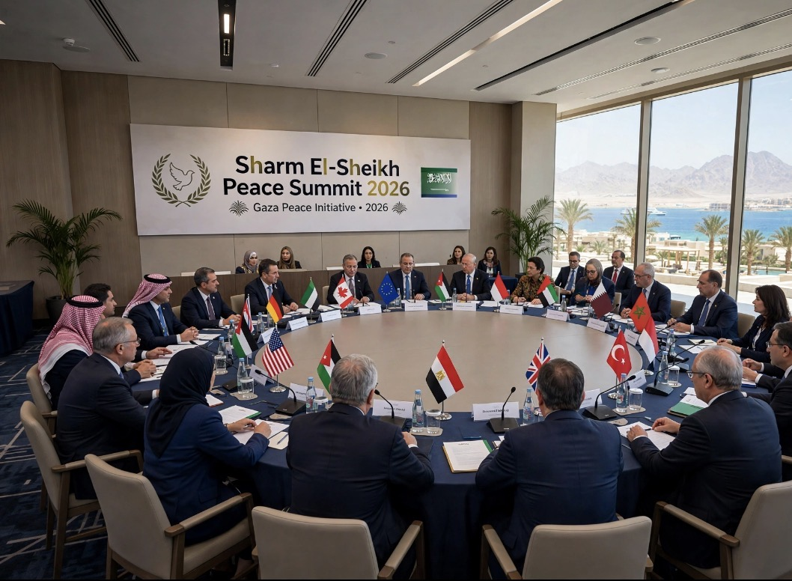

# KTT Perdamaian Gaza di Sharm el-Sheikh: Perdamaian di Atas Panggung, Kebuntuan di Lapangan
 
*Ilustrasi (pic: Grok AI).*

  
***Perdamaian yang hanya menghentikan sebagian tembakan, tetapi membiarkan ketidakpastian, kontrol, dan penderitaan berkepanjangan, adalah perdamaian yang belum selesai***
  

Ada satu paradoks besar, sebuah konferensi bisa berhasil menghentikan sebagian pertempuran, tetapi belum tentu berhasil membangun perdamaian.

Dan waktunya sangat relevan. KTT itu berlangsung pada 13 Oktober 2025, tepat satu tahun sebelum hari ini, 13 Oktober 2026. 

Setahun kemudian, penilaian yang muncul dari laporan terbaru justru memperlihatkan betapa jauh jarak antara janji diplomatik dan kehidupan nyata warga Gaza. 

Associated Press melaporkan pada 10 Oktober 2026 bahwa sejumlah ketentuan utama kesepakatan masih belum terlaksana dan pembangunan kembali Gaza nyaris tidak berjalan. 

Reuters juga melaporkan bahwa penarikan penuh pasukan Israel, pelucutan senjata Hamas, dan rekonstruksi masih menemui kebuntuan.

## Apa Sebenarnya yang Terjadi di Sharm el-Sheikh?

Pada 13 Oktober 2025, Mesir menjadi tuan rumah KTT yang dipimpin bersama oleh Presiden Mesir Abdel Fattah el-Sisi dan Presiden Amerika Serikat Donald Trump. 

Pertemuan itu dimaksudkan untuk mendukung penghentian perang di Gaza dan membuka jalan menuju penyelesaian politik persoalan Palestina. 

Sejumlah pemimpin negara, Sekretaris Jenderal PBB, dan perwakilan organisasi internasional hadir. Indonesia juga diwakili Presiden Prabowo Subianto.

KTT tersebut mengikuti kesepakatan yang diumumkan pada Oktober 2025 berdasarkan rencana 20 poin Trump. Fase awalnya mencakup gencatan senjata, pertukaran sandera dan tahanan, peningkatan bantuan kemanusiaan, serta penarikan sebagian pasukan Israel. Para pemimpin juga menandatangani dokumen visi mengenai masa depan Gaza.

Jangan remehkan arti pencapaian awal itu. Jika kesepakatan mengurangi pertempuran dan memungkinkan orang yang ditawan kembali kepada keluarga mereka, itu manfaat nyata bagi manusia, bukan sekadar seremoni.

Tetapi ada perbedaan mendasar antara kesepakatan untuk menghentikan perang dan kesepakatan tentang bagaimana konflik akan diselesaikan secara adil dan permanen.

Yang pertama dapat dimulai melalui negosiasi keamanan. Yang kedua membutuhkan jawaban jauh lebih sulit: siapa yang memerintah Gaza, siapa yang mengendalikan wilayahnya, siapa yang menjamin keamanan warga, bagaimana rekonstruksi dilaksanakan, dan bagaimana hak politik rakyat Palestina diwujudkan?

Di sinilah ujian KTT sebenarnya dimulai setelah para pemimpin meninggalkan panggung.

## Setahun Kemudian: Apakah Gaza Benar-benar Sudah Damai?

Jawaban jujurnya: belum. Gencatan senjata menghasilkan beberapa kemajuan nyata, tetapi belum menghasilkan perdamaian yang stabil dan menyeluruh.

Laporan AP dan Reuters pada Oktober 2026 menunjukkan gambaran yang keras.

Reuters melaporkan Israel menguasai sekitar dua pertiga wilayah Gaza pada Oktober 2026, lebih luas daripada garis kendali awal dalam rencana gencatan senjata. 

1.400 lebih warga Palestina tewas menurut Kementerian Kesehatan Gaza, jumlah tersebut tercatat sejak gencatan senjata berlaku pada Oktober 2025. Angka ini merupakan data yang dilaporkan otoritas kesehatan Gaza dan dikutip Reuters. 

1,2 juta orang menghadapi kelaparan akut, Reuters mengutip pemantau ketahanan pangan IPC mengenai kondisi kemanusiaan yang masih sangat berat. 

Perkiraan kebutuhan pemulihan $71,4 miliar. Estimasi kebutuhan rekonstruksi dan pemulihan selama satu dekade yang dikutip Reuters, jauh di atas rencana awal $2,45 miliar. 

Ada tiga hal yang perlu dibedakan:

Gencatan senjata: intensitas perang dapat turun tanpa semua serangan berhenti.

Penghentian pendudukan dan kontrol militer: membutuhkan perubahan nyata atas siapa yang menguasai wilayah dan bagaimana penarikan pasukan dijalankan.

Perdamaian politik: membutuhkan tata pemerintahan yang sah, keamanan bagi warga, hak menentukan masa depan, serta jaminan agar kekerasan tidak berulang.

Kalau sebuah kesepakatan berhasil mengembalikan sandera dan tahanan serta memperluas bantuan, itu bukan kegagalan total. 

Namun, jika setahun kemudian warga masih hidup di tenda, serangan masih terjadi, sebagian besar wilayah tetap berada di bawah kendali militer Israel, dan pembangunan kembali hampir tidak berjalan, kita juga tidak boleh menyebutnya perdamaian yang telah tuntas.

Gencatan senjata adalah pencapaian penting. Menjadikannya perdamaian yang bertahan lama adalah pekerjaan yang berbeda.

## Mengapa Kesepakatan itu Tersendat?

Inilah bagian yang paling penting secara politik. Masalahnya bukan sekadar para pemimpin kurang sering bertemu. Mereka belum mencapai kesepakatan yang dapat dijalankan mengenai beberapa pertanyaan mendasar diantaranya:

A. Siapa yang memegang kendali atas Gaza?

Rencana awal membayangkan pemerintahan Palestina baru yang bersifat teknokratis, dibantu mekanisme internasional. Namun, menurut AP, badan pemerintahan Palestina yang direncanakan belum dapat memasuki Gaza melalui Mesir, sementara Hamas masih menjadi kekuatan dominan di sebagian wilayah yang tidak dikendalikan militer Israel. 

Pasukan stabilisasi internasional yang direncanakan juga belum terbentuk, ini menghasilkan persoalan legitimasi.

Pemerintahan teknokratis mungkin memiliki keahlian administrasi, tetapi keahlian saja tidak cukup. Warga Palestina perlu mempunyai suara dalam menentukan siapa yang memerintah mereka, bagaimana pemimpin dipertanggungjawabkan, dan bagaimana hak-hak politik mereka dilindungi.

Kalau pemerintahan dibentuk melalui kesepakatan para aktor asing tanpa legitimasi yang memadai dari masyarakat yang akan diperintah, ia berisiko dianggap sebagai administrasi yang dipaksakan dari luar.

B. Urutan pelucutan senjata dan penarikan pasukan

Reuters melaporkan bahwa Israel mengaitkan penarikan pasukan lebih lanjut dengan pelucutan senjata Hamas secara penuh. Sebaliknya, Hamas dan pemerintahan AS menyatakan proses pelucutan dan penarikan perlu berlangsung bertahap serta saling terkait. 

Kesepakatan lanjutan yang diumumkan pada Juli 2026 juga tersendat karena perbedaan ini. Secara analitis, ini adalah masalah sequencing, yaitu urutan pelaksanaan kewajiban.

Jika satu pihak diwajibkan menyerahkan senjata lebih dahulu tanpa jaminan yang dapat dipercaya mengenai penarikan pasukan dan perlindungan warga, pihak itu dapat memandang proses tersebut sebagai risiko keamanan yang tidak seimbang. Sebaliknya, jika senjata tetap berada di tangan kelompok bersenjata, Israel akan menganggap ancaman serangan masih ada.

Kita tidak harus menerima klaim keamanan salah satu pihak begitu saja. Yang perlu ditanyakan ialah: mekanisme apa yang bisa diverifikasi, siapa yang mengawasi, dan apa konsekuensinya jika salah satu pihak melanggar?

Tanpa jawaban yang jelas, setiap pihak bisa menjadikan kegagalan pihak lain sebagai alasan untuk menunda kewajibannya sendiri.

C. Siapa yang menjamin pelaksanaan kesepakatan?

Di sinilah kredibilitas mediator diuji. Mediator bukan hanya orang yang berhasil mempertemukan pihak-pihak yang bermusuhan. Ia juga harus membantu membangun mekanisme yang membuat pelanggaran dapat dideteksi, diperiksa, dan ditindaklanjuti.

Jika satu pihak memiliki kekuatan militer dan kendali atas akses wilayah yang jauh lebih besar, sedangkan pihak lain bergantung pada janji penarikan pasukan dan bantuan, maka pengawasan harus dirancang dengan sangat hati-hati.

Kekuatan politik para mediator dapat membantu membuka pintu negosiasi. Namun, pengaruh diplomatik tidak sama dengan kemampuan memaksa semua pihak melaksanakan perjanjian. 

Bahkan Amerika Serikat sendiri tidak berhasil membuat semua bagian rencana yang didukungnya terlaksana sesuai tujuan awal.

## Apakah KTT itu Lebih Menguntungkan Trump daripada Rakyat Palestina?

Mari kita nilai berdasarkan hasil, bukan hanya citra. Trump memperoleh keuntungan diplomatik yang jelas: ia dapat mengklaim peran penting dalam negosiasi yang menghasilkan gencatan senjata dan pemulangan sandera. 

KTT tersebut juga memberinya panggung untuk mengumumkan visi pembangunan dan stabilitas kawasan. Laporan media pada saat itu menggambarkan acara tersebut sebagai upaya besar untuk menandai berakhirnya perang.

Tetapi keuntungan citra politik tidak otomatis membuktikan bahwa KTT sengaja diselenggarakan hanya demi reputasi Trump. Motif pribadi seperti itu tidak bisa dipastikan dari seremoni semata.

Cara yang lebih kuat adalah mengukur keberhasilan berdasarkan kepentingan warga Gaza:

| Ukuran keberhasilan | Pertanyaan yang harus dijawab |
|------|-------|
|Keselamatan|Apakah serangan berhenti secara konsisten dan warga terlindungi?|
|Bantuan kemanusiaan|Apakah makanan, obat, air, bahan bakar, dan tempat berlindung tersedia dalam jumlah memadai?|
|Kebebasan bergerak|Apakah warga bisa berpindah dengan aman dan memperoleh akses yang diperlukan?|
|Pemerintahan|Apakah rakyat Palestina memiliki suara dan legitimasi politik dalam pemerintahan Gaza?|
|Penarikan pasukan|Apakah penarikan militer dilaksanakan secara nyata, terverifikasi, dan sesuai kesepakatan?|
|Rekonstruksi|Apakah rumah, rumah sakit, sekolah, jaringan air, dan listrik benar-benar dibangun kembali?|
|Akuntabilitas|Apakah pelanggaran oleh semua pihak dapat diperiksa dan ditindaklanjuti?|

Jika para pemimpin mendapat pujian, foto bersama, dan keuntungan politik, tetapi warga tetap kehilangan rumah, akses kebutuhan dasar, dan kepastian mengenai masa depan, maka hasil diplomasi itu masih jauh dari ukuran keberhasilan yang seharusnya.

Panggung diplomatik bukanlah bukti perdamaian. Kondisi hidup manusia setelah konferensi itulah ukuran yang lebih kuat.

## Bagaimana Posisi Indonesia dan Prabowo?

Indonesia menghadapi dilema diplomatik yang tidak sederhana. Menghadiri KTT memberi kesempatan untuk menyuarakan dukungan terhadap Palestina, terlibat dalam pembahasan bantuan, serta memengaruhi rancangan mekanisme pascaperang. Namun, kehadiran di meja perundingan tidak dengan sendirinya berarti Indonesia berhasil menentukan hasil akhir.

Pada Oktober 2025, Prabowo hadir di Sharm el-Sheikh sebagai salah satu pemimpin yang mendukung proses perdamaian. Pemerintah Indonesia juga menyatakan kesiapan untuk mempertimbangkan pengiriman pasukan perdamaian, bergantung pada perkembangan kesepakatan dan mandat internasional.

Akan tetapi, pada Oktober 2026, AP melaporkan bahwa rencana pengerahan kontingen Indonesia yang dijanjikan sebagai bagian dari pasukan stabilisasi internasional ditangguhkan pada musim semi ketika perhatian dunia beralih ke perang Iran. Sementara itu, pasukan stabilisasi tersebut sendiri belum terbentuk.

Ada tiga prinsip yang semestinya menjadi pegangan Indonesia:

Jangan menyamakan kehadiran diplomatik dengan keberhasilan substantif. Kehadiran baru bernilai strategis jika diikuti langkah yang menghasilkan perlindungan warga dan kemajuan politik yang nyata.

Setiap pengerahan pasukan harus memiliki mandat yang jelas. Dasar hukum, persetujuan yang diperlukan, aturan keterlibatan, rantai komando, dan perlindungan terhadap personel Indonesia perlu dipastikan.

Perlindungan warga Palestina harus menjadi tujuan, bukan sekadar legitimasi bagi operasi keamanan. Pasukan internasional tidak boleh diposisikan sebagai pengganti hak politik rakyat Palestina atau menjadi mekanisme untuk mempertahankan kontrol yang tidak adil.

Indonesia bisa berperan melalui diplomasi, bantuan kemanusiaan, dukungan rekonstruksi, pemulihan layanan kesehatan, dan upaya memperkuat akuntabilitas. 

Jika mengirim pasukan, pertanyaan yang harus dijawab bukan hanya berapa banyak personel yang dikirim, melainkan apa mandat mereka, kepada siapa mereka bertanggung jawab, dan bagaimana mereka memastikan warga Gaza benar-benar lebih aman.

## Apa yang Seharusnya Menjadi Syarat Perdamaian yang Adil?

Ada enam unsur yang harus dinilai secara bersamaan:

Penghentian kekerasan yang dapat diverifikasi. Tidak cukup hanya mengumumkan gencatan senjata. Harus ada pemantauan, pelaporan pelanggaran, dan mekanisme untuk mencegah eskalasi.

Akses kemanusiaan yang memadai dan berkelanjutan. Bantuan harus sampai kepada warga yang membutuhkan, bukan sekadar tercatat telah memasuki wilayah.

Penarikan militer yang nyata dan memiliki jadwal yang jelas. Pengaturan keamanan harus mencegah serangan tanpa menjadikan kontrol militer yang tidak berkesudahan sebagai keadaan permanen.

Pemerintahan Palestina yang memiliki legitimasi. Rakyat Palestina harus berperan nyata dalam menentukan masa depan politik mereka sendiri.

Rekonstruksi dengan kendali dan manfaat bagi warga Gaza. Dana pembangunan harus transparan, tepat sasaran, dan tidak menjadi alasan untuk memindahkan penduduk atau merampas hak mereka.

Jalan menuju penyelesaian politik yang adil. Gencatan senjata harus menjadi jembatan menuju penyelesaian konflik, bukan mekanisme yang hanya membekukan ketimpangan kekuasaan.

Unsur-unsur ini bukan berarti seluruhnya mudah diwujudkan atau bahwa semua pihak memiliki tanggung jawab yang identik. Tanggung jawab hukum dan politik perlu dinilai berdasarkan tindakan, kewajiban, dan bukti masing-masing. Namun, tanpa kemajuan pada unsur-unsur tersebut, perdamaian akan tetap rapuh.

KTT yang berhasil menghentikan sebagian perang belum tentu berhasil menciptakan perdamaian

Penilaian paling adil terhadap KTT Sharm el-Sheikh adalah mengakui dua kenyataan sekaligus. Pertama, kesepakatan awal menghasilkan manfaat nyata. Gencatan senjata mengurangi skala operasi militer besar, memungkinkan pemulangan sandera, pembebasan tahanan dan narapidana Palestina, serta memperluas akses bantuan dibandingkan kondisi sebelumnya. 

Pencapaian ini tidak seharusnya dihapus hanya karena proses selanjutnya gagal mencapai seluruh tujuannya.

Kedua, hasil awal itu belum berubah menjadi perdamaian yang stabil dan adil. Setahun kemudian, serangan masih berlangsung, kendali militer Israel meluas menurut laporan Reuters, mekanisme pemerintahan Palestina dan pasukan stabilisasi internasional belum berfungsi sesuai rencana, dan rekonstruksi masih sangat terbatas.

Jadi, ukuran keberhasilan bukanlah seberapa megah deklarasi ditandatangani atau seberapa banyak pemimpin berjabat tangan. Ukurannya adalah apakah warga Palestina dapat hidup tanpa ketakutan akan serangan, memperoleh kebutuhan dasar, kembali ke rumah dengan aman, dan memiliki masa depan politik yang mereka ikut tentukan.

Perdamaian yang hanya menghentikan sebagian tembakan, tetapi membiarkan ketidakpastian, kontrol, dan penderitaan berkepanjangan, adalah perdamaian yang belum selesai.

Diplomasi telah membuka pintu, tetapi setahun kemudian, dunia masih belum berhasil memastikan bahwa rakyat Gaza dapat benar-benar melewatinya menuju kehidupan yang lebih aman dan bermartabat.

  
**Referensi**

Associated Press. (2026, October 10). A US-brokered ceasefire was supposed to end the war in Gaza. A year later, progress has stalled.

Reuters. (2026, October 6). One year on, Trump’s Gaza plan has not stopped Israeli fire or disarmed Hamas.

Presidency of the Arab Republic of Egypt. (2025, October 13). Statement by the Presidency of the Arab Republic of Egypt.

United Nations. (2025, October 23). UN Deputy Special Coordinator for the Middle East Peace Process briefs the Security Council on the situation in the Middle East.

Channel NewsAsia. (2025, October 13). Indonesia President Prabowo takes up ‘sudden invitation’ to attend Gaza peace summit in Egypt.
