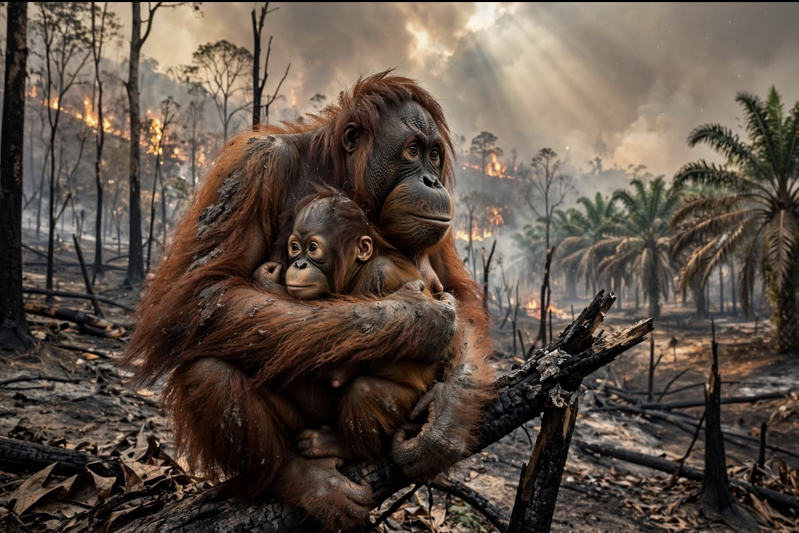

# Kalimantan Terbakar, Gambut Membara, dan Keserakahan yang Mengusir Penghuni Hutan

*Ilustrasi (pic: Grok AI).*

  
***Tanggung jawab sesungguhnya dimulai jauh sebelum api muncul, ketika kita memutuskan bagaimana lahan digunakan, siapa yang mengawasinya, dan apakah keuntungan ekonomi boleh mengalahkan keselamatan ekosistem***
  

Kebakaran hutan bukan cuma persoalan api yang terlihat dari kejauhan. Pada lahan gambut, bagian yang paling berbahaya justru dapat tersembunyi di bawah permukaan tanah.

Ada empat mekanisme yang saling memperkuat:

1. Gambut menyimpan bahan bakar dalam jumlah besar

Gambut terbentuk dari sisa tumbuhan yang menumpuk selama waktu yang sangat panjang dalam kondisi basah dan kekurangan oksigen. 

Ketika gambut mengering, bahan organik itu menjadi bahan bakar. Api bisa merambat di bawah permukaan, membakar lapisan organik tanpa selalu memperlihatkan nyala besar di atas tanah.

2. Gambut yang dikeringkan lebih mudah terbakar

Kanal drainase untuk penggunaan lahan tertentu dapat menurunkan muka air gambut. Saat musim kemarau, gambut kehilangan kelembapan dan menjadi lebih mudah terbakar. 

Karena itu, kerusakan tata air gambut bisa membuat satu kebakaran jauh lebih sulit dikendalikan daripada kebakaran di tanah mineral.

3. Memadamkan nyala belum tentu memadamkan bara

Api di permukaan bisa tampak padam, tetapi bara masih hidup di lapisan gambut. Jika bagian yang membara tidak didinginkan sampai cukup dalam dan area sekitarnya tidak diamankan, api dapat muncul kembali. 

Inilah salah satu alasan operasi pemadaman perlu diikuti pemeriksaan ulang atau mopping up.

4. Kemarau memperbesar masalah, bukan menjelaskan seluruh penyebabnya

Cuaca panas dan kering membuat vegetasi serta gambut lebih mudah terbakar, sementara kekurangan air menyulitkan pemadaman. 

Laporan AP pada Oktober 2026 mengaitkan kebakaran besar tahun ini dengan El Niño dan musim kering yang berkepanjangan. Namun, cuaca menjelaskan mengapa api mudah menyebar, bukan otomatis menjelaskan siapa yang menyalakan api atau mengapa pencegahan gagal.

Ada satu perbedaan penting: asap yang bertahan lama tidak selalu berarti satu titik api yang sama terus menyala selama berbulan-bulan. Bisa terjadi kebakaran berulang di berbagai lokasi, bara yang menyala kembali, dan asap dari wilayah berbeda yang menumpuk atau terbawa angin ke permukiman. 

Untuk memastikan pola di lokasi tertentu, kita perlu melihat peta titik panas, luas area terbakar, arah angin, serta pengukuran kualitas udara dari waktu ke waktu. Kalimantan tahun ini juga menghadapi masalah yang lebih besar daripada satu kawasan. 

Pada 9 Oktober, AP melaporkan gugatan warga Kalimantan Barat yang menuduh pemerintah lalai menangani kebakaran dan pengawasan selama lebih dari tiga bulan. Itu merupakan tuduhan yang sedang diproses, bukan putusan pengadilan, tetapi menunjukkan bahwa warga melihat masalah ini sebagai kegagalan pencegahan dan tata kelola, bukan semata-mata bencana alam.

## Korporasi Sengaja Membakar Hutan lalu Dibiarkan?

Kita perlu membedakan tiga hal yang sering dicampuradukkan: kebakaran yang disengaja, kebakaran yang merambat ke lahan perusahaan, dan kebakaran yang membesar karena pengawasan atau pencegahan gagal. Ketiganya bisa terjadi, tetapi bukti untuk masing-masing kasus tidak sama.

A. Pembakaran yang disengaja

Pembukaan lahan dengan api bisa menjadi cara murah untuk membersihkan vegetasi. Jika dilakukan secara melanggar hukum, atau api sengaja dinyalakan untuk membuka lahan dan kemudian dibiarkan merambat, itu harus diselidiki dan ditindak. 

Tetapi keberadaan titik panas di dekat konsesi perusahaan saja tidak cukup untuk membuktikan siapa yang menyalakan api.

B. Kebakaran yang tidak sengaja, tetapi diperparah oleh tata kelola lahan

Lahan yang dikeringkan, vegetasi yang mudah terbakar, kanal drainase, akses pemadaman yang buruk, atau tidak adanya sumber air dapat memperbesar risiko. 

Perusahaan tidak harus terbukti menyalakan api untuk dapat dimintai pertanggungjawaban apabila unsur pelanggaran atau kelalaian yang relevan terbukti.

C. Pengawasan dan penegakan hukum yang tidak efektif

Jika pembakaran berulang tidak diikuti investigasi yang memadai, sanksi yang konsisten, pemulihan lahan, dan pengawasan setelah kebakaran, pelaku dapat merasa risiko ekonominya kecil. 

Di sinilah negara harus diuji: apakah biaya mencegah kebakaran sungguh-sungguh lebih rendah daripada keuntungan membiarkan praktik berisiko terus berjalan? Lalu, apakah pemerintah takut investasi terganggu?

Itu hipotesis yang layak diuji, bukan kesimpulan yang boleh langsung kita tetapkan sebagai fakta.

Untuk membuktikannya, kita perlu melihat hal-hal konkret: apakah perusahaan yang melanggar tetap memperoleh izin; apakah sanksi ditunda atau dikurangi; apakah pemerintah mengabaikan peringatan teknis; apakah ada konflik kepentingan; serta apakah hasil investigasi menunjukkan pembakaran sengaja atau kelalaian.

Investasi bukan alasan untuk memberi kekebalan terhadap kerusakan lingkungan. Perusahaan yang beroperasi secara bertanggung jawab justru membutuhkan tata kelola yang baik agar tidak dirugikan oleh pesaing yang menekan biaya dengan cara merusak.

Ada pula persoalan insentif ekonomi. Ketika keuntungan pembukaan lahan dinikmati oleh pihak tertentu, tetapi biaya asap, penyakit, hilangnya habitat, dan pemulihan lingkungan ditanggung masyarakat luas, kita menghadapi masalah ekonomi yang disebut eksternalitas negatif.

Contoh sederhananya:
Keuntungan dari lahan yang dibuka: masuk ke pihak yang menguasai atau menggunakan lahan.
Biaya kesehatan akibat asap: ditanggung warga dan sistem kesehatan.
Biaya hilangnya habitat: ditanggung satwa, masyarakat sekitar, dan generasi berikutnya.
Biaya pemadaman: ditanggung petugas, anggaran publik, serta relawan.
Kalau keuntungan diprivatisasi, sedangkan kerugian disosialisasikan, sistem ekonominya memberi insentif yang keliru.

Itulah kritik yang lebih tajam daripada sekadar menyebut seseorang serakah. Keserakahan menjadi persoalan struktural ketika aturan dan insentif memungkinkan keuntungan diperoleh dengan memindahkan biaya kerusakan kepada orang lain.

Namun, jangan sampai kita jatuh ke kesimpulan sebaliknya bahwa semua kebakaran pasti direncanakan perusahaan. Itu juga tidak ilmiah. Penetapan tanggung jawab harus berbasis bukti lapangan, data konsesi, investigasi penyebab kebakaran, dan proses hukum.

## Tanjung Puting: Nasib Orangutan Ketika Api Mendekat dari Dua Arah

Ini bagian yang paling menyakitkan. Tanjung Puting bukan sekadar kawasan hijau pada peta. Hutan di sana adalah ruang hidup bagi satwa yang tidak bisa begitu saja pindah ke tempat baru tanpa konsekuensi.

Pada 11 Oktober 2026, BNPB membenarkan kebakaran di Taman Nasional Tanjung Puting setelah beredar video yang memperlihatkan asap dan kobaran api dari dua arah berbeda. 

Pemadaman melalui helikopter terkendala jarak pandang yang rendah akibat asap. Pemerintah kemudian kembali menyatakan pada 12 Oktober bahwa pengendalian kebakaran masih berlangsung.

Tetapi ada batas penting dalam informasi yang tersedia, yakni belum menemukan angka terverifikasi yang memastikan berapa orangutan di Tanjung Puting yang mati, terluka, atau berhasil dievakuasi akibat kebakaran ini. Kita harus jujur soal itu. 

Ancaman terhadap habitat telah dikonfirmasi, tetapi jumlah korban satwa di lokasi tersebut tidak boleh dikarang.

Apa yang terjadi pada orangutan ketika habitatnya terbakar?

1. Kehilangan tempat mencari makan

Orangutan bergantung pada hutan untuk memperoleh buah, daun, kulit kayu, dan sumber makanan lainnya. 

Ketika hutan terbakar, sumber pakan bisa hilang dalam waktu singkat. Mereka mungkin terpaksa berpindah, menghabiskan lebih banyak energi, atau memasuki kawasan yang sudah ditempati individu lain.

2. Anak dan induk menghadapi risiko khusus

Orangutan berkembang biak dengan lambat dan anaknya bergantung pada induk selama bertahun-tahun. Jika induk terluka atau mati, anaknya bisa kehilangan perlindungan dan kesempatan bertahan hidup. 

Evakuasi pun tidak selalu mudah karena satwa liar dapat ketakutan, terluka, atau terpisah dari kelompoknya.

3. Asap dan luka bakar dapat membahayakan satwa yang tidak tersentuh api

Orangutan bisa mengalami gangguan pernapasan akibat asap, dehidrasi, luka bakar pada tangan dan kaki, serta kekurangan makanan. 

Mereka mungkin bertahan dari kebakaran langsung, tetapi menghadapi kelaparan dan kerusakan habitat setelah api padam.

4. Hutan yang tersisa bisa menjadi lebih sempit dan terisolasi

Api dapat memutus koridor antarbagian hutan. Akibatnya, orangutan kehilangan akses menuju makanan, tempat berlindung, dan pasangan. Kerusakan ini bisa berlangsung bertahun-tahun setelah asap menghilang.

Berita yang lebih luas dari Kalimantan juga menunjukkan bahwa risiko ini nyata, bukan sekadar skenario hipotetis. AP melaporkan pada 10 Oktober bahwa orangutan bernama Novita ditemukan dengan luka bakar di telapak tangan dan kaki setelah melintasi area terbakar. 

Seekor orangutan jantan bernama Sampurna meninggal setelah diselamatkan dari kawasan perkebunan kelapa sawit yang terdampak kebakaran. Itu adalah laporan mengenai kasus di wilayah kebakaran Indonesia, bukan bukti bahwa kedua individu tersebut berasal dari Tanjung Puting.

Reuters juga melaporkan pada 11 Oktober bahwa delapan orangutan yang terancam kebakaran telah diselamatkan dan dipindahkan ke hutan lindung Batu Nyambu. 
Tiga di antaranya merupakan pasangan induk dan anak. 

Reuters menyebut total 46 orangutan telah diselamatkan oleh otoritas konservasi Kalimantan Barat dan Yayasan Inisiasi Alam Rehabilitasi Indonesia sejak Agustus. 

Angka tersebut menunjukkan besarnya kebutuhan penyelamatan satwa, tetapi jangan disalahartikan sebagai jumlah korban Tanjung Puting.

Jadi, apa yang paling mendesak dilakukan di Tanjung Puting?

Penanganannya perlu berjalan dalam empat jalur sekaligus:

Memetakan api dan melindungi area prioritas. Tim perlu mengetahui lokasi kebakaran aktif, arah rambat, kedalaman pembakaran gambut, jalur akses, serta area yang paling penting bagi habitat orangutan.

Mengendalikan api dari darat dan udara. Helikopter berguna, tetapi tidak bisa bekerja dengan aman ketika jarak pandang terlalu rendah. Tim darat, pompa, suplai air, sekat bakar yang sesuai kondisi ekologis, dan pemeriksaan bara bawah tanah tetap penting.

Menyelamatkan satwa yang benar-benar terancam. Petugas konservasi dan dokter hewan harus melakukan penilaian lapangan, evakuasi bila diperlukan, perawatan, serta pemantauan setelah penyelamatan. Evakuasi tidak boleh dilakukan secara sembarangan karena dapat menambah stres dan risiko cedera.

Membuka informasi perkembangan secara berkala. Publik perlu mengetahui lokasi api, luas area terdampak, kondisi akses pemadaman, tindakan penyelamatan satwa, serta kendala yang belum teratasi.

Dan ada satu hal yang tidak boleh terlewat: pemerintah menyebut kabut asap sebagai kendala operasi udara, sementara sejumlah relawan pemadam di Tanjung Puting menyatakan mundur karena merasa dukungan terhadap pekerjaan mereka tidak maksimal. 

Keterangan relawan itu bukan dengan sendirinya bukti seluruh penanganan gagal, tetapi cukup serius untuk ditindaklanjuti dengan evaluasi terbuka mengenai logistik, koordinasi, keselamatan, dan dukungan lapangan.

## Mengapa Kebakaran Hutan Seolah Menjadi Tradisi Tahunan?

Kita kerap memperlakukan kebakaran sebagai keadaan darurat musiman, bukan sebagai masalah tata kelola lahan yang harus dicegah sepanjang tahun.

Pola kegagalannya sering berbentuk lingkaran: Musim kering dan gambut mengering;Api muncul atau menyebar; Pemadaman darurat menyerap tenaga dan anggaran; Api padam, tetapi masalah tata air, penggunaan lahan, dan pengawasan belum tentu diperbaiki; Risiko kembali meningkat ketika musim kering berikutnya tiba.

Lingkaran ini bukan berarti tidak ada petugas yang bekerja keras. Banyak petugas, masyarakat, dan relawan memang menghadapi risiko besar di lapangan. Persoalannya adalah pemadaman yang heroik tidak bisa menggantikan pencegahan yang sistematis.

Kalau satu kawasan berulang kali terbakar, pertanyaan yang harus diajukan bukan hanya “siapa yang memadamkan api?”, melainkan juga:
Mengapa kawasan tersebut kembali mudah terbakar?
Apakah muka air gambut dijaga?
Siapa yang menguasai dan mengelola lahan di sekitar titik kebakaran?
Apakah sumber air dan akses pemadaman sudah disiapkan sebelum musim kering?
Apakah penyebab kebakaran diselidiki sampai tuntas?
Apakah pihak yang terbukti bertanggung jawab benar-benar menanggung biaya pemulihan?
Jika pertanyaan-pertanyaan ini tidak dijawab, kita berisiko mengulang pertunjukan yang sama: api menyala, asap menyelimuti kota, petugas berjuang, satwa mengungsi, lalu perhatian publik mereda ketika hujan datang.

## Apakah Ada Jalan Keluar Selain Menunggu Hujan?

Ada. Tidak mudah, tidak instan, tetapi secara teknis tersedia. Solusinya harus memadukan pemulihan ekologi, perubahan insentif ekonomi, dan penegakan hukum.

| Masalah | Intervensi yang dibutuhkan | Mengapa penting |
|--------|--------|--------|
|Gambut mengering|Pembasahan kembali gambut, termasuk sekat kanal dan pengelolaan muka air yang sesuai kondisi setempat|Mengurangi kerentanan gambut terhadap pembakaran|
|Api bawah tanah|Pemadaman sampai lapisan yang membara, dilanjutkan pemeriksaan dan mopping up|Mengurangi risiko api menyala kembali|
|Api berulang di lahan tertentu|Investigasi penyebab, audit pengelolaan lahan, dan penegakan hukum berbasis bukti|Mengidentifikasi sumber risiko dan pihak yang bertanggung jawab|
|Pencegahan terlambat|Patroli sebelum puncak kemarau, pemantauan satelit, deteksi dini, serta cadangan air|Memungkinkan respons sebelum api meluas|
|Habitat terfragmentasi|Perlindungan kawasan inti dan koridor satwa, pemulihan hutan serta vegetasi asli|Mempertahankan ruang hidup orangutan dalam jangka panjang|
|Biaya kerusakan ditanggung publik|Pertanggungjawaban hukum, pemulihan lingkungan, transparansi konsesi, dan pengawasan independen|Mencegah keuntungan diperoleh dengan memindahkan biaya kepada masyarakat|

Pembasahan gambut, misalnya, bukan sekadar membuang air ke lokasi yang terbakar. Pengelolaannya harus memperhatikan hidrologi kawasan, kondisi kanal, topografi, dan kebutuhan ekosistem. 

Demikian juga, pembukaan sekat bakar atau pembuatan jalur pemadaman harus dirancang oleh petugas yang memahami kondisi lapangan agar upaya darurat tidak justru memperbesar kerusakan.

Laporan Reuters pada 5 Oktober mengutip kelompok perlindungan gambut yang mengingatkan bahwa penurunan jumlah titik panas saja tidak cukup dijadikan ukuran keberhasilan, karena kebakaran gambut bisa terus membara meskipun indikator permukaan terlihat membaik. 

Ini poin penting: jumlah hotspot, luas terbakar, kedalaman pembakaran, kualitas udara, dan keberhasilan pemulihan harus dinilai bersama-sama.

Enam perubahan yang wajib dilakukan
- Jangan menunggu api membesar. Siapkan petugas, air, pompa, dan jalur komunikasi sebelum puncak kemarau, terutama di lahan gambut dan kawasan konservasi yang berulang kali terbakar.
- Periksa konsesi secara terbuka. Publikasikan peta konsesi, titik kebakaran, hasil investigasi, dan tindakan penegakan hukum, dengan perlindungan yang memadai bagi pelapor dan saksi.
- Terapkan tanggung jawab berdasarkan bukti. Pembakaran sengaja, kelalaian yang terbukti, dan kerusakan akibat faktor lain tidak boleh disamakan. Namun, setiap bentuk tanggung jawab yang terbukti harus membawa konsekuensi yang nyata.
- Pulihkan tata air gambut, bukan hanya permukaan tanah. Pemulihan perlu dilakukan dalam skala hidrologis yang memadai, bukan sebatas proyek kecil yang tidak menyentuh sumber pengeringan kawasan.
- Berikan perlindungan nyata bagi habitat orangutan. Kawasan inti, koridor hutan, jalur menuju sumber makanan, dan lokasi rehabilitasi perlu masuk dalam perencanaan risiko kebakaran.
- Ukur keberhasilan selama bertahun-tahun. Jangan hanya menghitung jumlah operasi pemadaman. Nilai juga apakah kebakaran berulang menurun, gambut tetap basah, kualitas udara membaik, dan habitat pulih.

## Mengapa Keserakahan Bisa Menggilas Nyawa Orangutan?

Dalam sistem yang hanya menghitung nilai ekonomi yang mudah dijual, hutan sering dipandang sebagai ruang yang belum menghasilkan apa-apa sampai dibuka, ditanami, atau dimanfaatkan secara komersial.

Padahal, hutan yang masih berdiri sudah menghasilkan nilai yang sangat besar: menyimpan karbon, mengatur tata air, menopang keanekaragaman hayati, mengurangi risiko bencana tertentu, dan menjadi rumah bagi satwa liar.

Orangutan tidak memiliki sertifikat kepemilikan seperti manusia. Mereka tidak bisa menyewa pengacara, mengajukan protes ke kantor pemerintah, atau menawar kompensasi ketika wilayah jelajahnya hilang. Ketidakmampuan mereka masuk ke meja perundingan ekonomi bukan berarti kepentingan hidup mereka tidak bernilai.

Di sinilah persoalan etika lingkungan muncul. Apakah kita menganggap alam hanya memiliki nilai ketika dapat dikonversi menjadi pendapatan? Ataukah kita mengakui bahwa makhluk hidup dan ekosistem mempunyai nilai yang tidak habis dijelaskan oleh harga pasar?

Ada pula persoalan keadilan antargenerasi. Keuntungan dari pemanfaatan lahan mungkin dinikmati sekarang, sementara kerusakan gambut, hilangnya habitat, dan perubahan ekologi diwariskan kepada generasi yang belum lahir. 

Bahkan jika seluruh pohon yang terbakar kelak tumbuh kembali, struktur hutan, hubungan antarspesies, dan fungsi ekologisnya tidak otomatis pulih dalam beberapa tahun.

Karena itu, membela orangutan bukan berarti menempatkan satwa di atas kebutuhan manusia. Justru manusia dan orangutan sama-sama membutuhkan ekosistem yang tidak terus-menerus dirusak oleh keputusan jangka pendek. 

Warga yang menghirup asap, anak-anak yang tidak dapat bersekolah, petugas yang bekerja di tengah bahaya, dan satwa yang kehilangan rumah berada dalam satu krisis ekologis yang sama.

Gambut menjelaskan mengapa kebakaran bisa sangat sulit dipadamkan, tetapi gambut bukan penyebab tunggal. Cuaca kering dan El Niño memperbesar risiko. 

Penggunaan lahan, tata air, sumber penyalaan, kesiapan pemadaman, dan penegakan hukum ikut menentukan seberapa luas serta lama bencana berlangsung.

Dugaan bahwa korporasi sengaja membakar lalu pemerintah membiarkannya demi investasi harus diuji lewat bukti, bukan diterima mentah-mentah. Namun, negara juga tidak boleh menggunakan ketiadaan bukti terhadap satu perusahaan sebagai alasan untuk menghindari audit menyeluruh. Ketika kebakaran berulang, pengawasan, tata kelola lahan, dan pertanggungjawaban publik harus diperiksa secara serius.

Kebakaran bukan takdir tahunan. Risiko dapat ditekan melalui pengelolaan gambut yang benar, pencegahan dini, perlindungan kawasan konservasi, transparansi konsesi, dan konsekuensi hukum yang konsisten. 

Yang tidak realistis adalah berharap semua masalah selesai hanya dengan helikopter, operasi darurat, dan hujan.

Dan tentang Tanjung Puting, ada satu hal yang tidak boleh kita lupakan: sampai ada data lapangan yang terverifikasi, kita belum bisa memastikan jumlah orangutan yang terdampak langsung. Tetapi ketidakpastian jumlah korban bukan alasan untuk menunggu. 

Justru ketika api mendekati habitat, tindakan penyelamatan, pemadaman, dan pemantauan harus segera diprioritaskan. 

Hutan tidak perlu menunggu sampai orangutan mati untuk membuktikan bahwa kerusakannya serius. Kalau kita hanya mulai peduli ketika ada foto satwa yang terbakar, kita terlambat membaca tanda-tanda kehancurannya. 

Tanggung jawab sesungguhnya dimulai jauh sebelum api muncul, ketika kita memutuskan bagaimana lahan digunakan, siapa yang mengawasinya, dan apakah keuntungan ekonomi boleh mengalahkan keselamatan ekosistem.

  
**Referensi:**

Associated Press. (2026, October 9). Residents on Indonesia’s Borneo take their grievances over 3-month fires and choking haze to court.

Associated Press. (2026, October 10). Wildfires threaten Indonesia’s orangutans as rescuers find injured animals.

Reuters. (2026, October 5). Indonesia must keep its guard up against wildfire despite drop in hotspots, environment groups warn.

Reuters. (2026, October 11). Indonesia moves 8 endangered orangutans to safety after Borneo fires.

ANTARA News. (2026, October 12). Kemenhut intensifkan pemadaman karhutla di Tanjung Puting.
