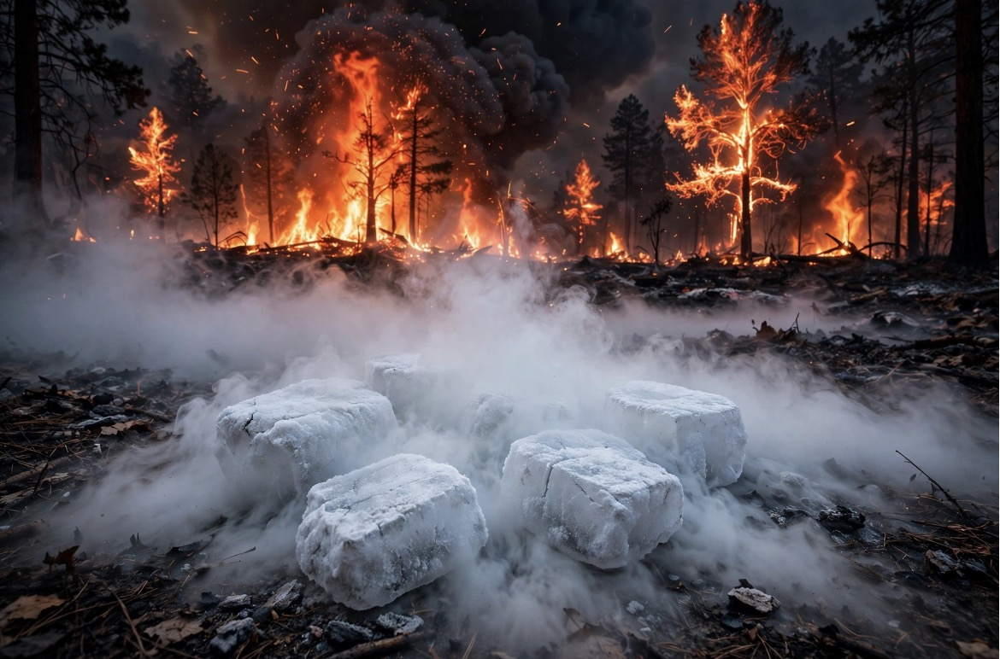

# Kenalan dengan Dua Bahan Pemodifikasi Hujan Buatan saat Kebakaran Hutan: Dry Ice dan NaCl

*(pic: Rita Mf Jannah & Meta AI).*

  
***Satu bermain dengan pendinginan dan proses es, satu lagi membantu proses pertumbuhan tetesan air. Semuanya tetap tunduk pada hukum fisika atmosfer***
  

Saat kabut asap melanda wilayah Kalimantan dan Sumatera beberapa waktu lalu hingga menyeberang ke negara tetangga, kemudian protes merajalela. Pemerintah melalui bantuan TNI AU melakukan modifikasi cuaca dengan dua bahan berkhasiat, yaitu dry ice dan NaCl.

Dua-duanya bisa dipakai dalam operasi modifikasi cuaca, dry ice adalah karbon dioksida padat, sedangkan NaCl itu garam dapur. Bahan, sifat fisika, dan mekanisme kerjanya berbeda. Kita masuk laboratorium mini, yuk! 

## Apa Perbedaan keduanya?

**Dry ice**

- Karbon dioksida padat, CO₂
- Suhu sekitar −78,5°C pada tekanan atmosfer normal.
- Menyublim, yaitu langsung berubah dari padat menjadi gas.
- Dalam teknik penyemaian awan dingin tertentu, dry ice dapat mendinginkan awan hingga membentuk kristal es.
- Dalam operasi yang ditujukan untuk mengurai asap, pendinginan lokal juga pernah digunakan untuk mencoba memengaruhi kestabilan atmosfer.

NaCl

- Natrium klorida, garam
- Berupa kristal padat pada suhu ruang.
- Bersifat higroskopis dalam bentuk dan kondisi tertentu, sehingga dapat membantu menarik air.
- Dalam penyemaian awan hangat, partikel garam dapat bertindak sebagai inti kondensasi awan.
- Tetesan air yang tumbuh dapat bertabrakan dan bergabung hingga cukup besar untuk jatuh sebagai hujan.

## Perbedaan Cara Kerjanya di Awan

Bayangkan awan sebagai kumpulan tetesan air superkecil. Ada dua pendekatan fisika yang berbeda.

Metode dry ice: jalur es
- Pendinginan kuat
- Kristal es terbentuk
- Presipitasi mungkin terjadi

Digunakan pada awan dingin yang sesuai. Hasilnya bergantung pada kondisi awan, bukan sekadar banyaknya dry ice.

Metode NaCl: jalur tetesan air
- Partikel garam
- Tetesan tumbuh
- Hujan mungkin terjadi

Digunakan pada awan hangat yang sesuai, dengan tujuan membantu pertumbuhan tetesan air melalui proses mikrofisika awan.

Catatan penting: Tidak setiap operasi dry ice ditujukan untuk menghasilkan hujan. Jika dry ice digunakan untuk mencoba mengurai inversi atmosfer dan membantu penyebaran asap, tujuan operasionalnya berbeda dari penyemaian awan untuk meningkatkan presipitasi.

## Mengapa Garam Bisa Membantu Hujan, Sedangkan Dry Ice Bisa Membantu Membentuk Es?

Karena sifat molekul dan interaksinya dengan air berbeda.
- NaCl: ketika partikel garam menyerap air dan larut dalam tetesan, zat terlarut menurunkan tekanan uap air di atas larutan. Ini membantu pertumbuhan tetesan pada kelembapan yang sesuai.
- Dry ice: suhunya sangat rendah. Dalam awan yang mengandung air superdingin, pendinginan dan proses pembentukan es dapat mengubah evolusi awan menuju presipitasi.
Dua-duanya tidak menciptakan air dari ketiadaan. Air hujan tetap berasal dari uap air di atmosfer.

## Apakah Dry Ice Bisa Digunakan untuk Membuat Hujan Juga?

Bisa dalam teknik penyemaian awan dingin tertentu, tetapi jangan menyamakan semua penggunaan dry ice. Bahan yang sama dapat digunakan dengan tujuan operasional yang berbeda, tergantung metode dan kondisi atmosfer.

Kalau kita berbicara tentang operasi di Kalimantan, kita perlu melihat laporan teknis operasi tersebut: kapan dry ice disebarkan, pada ketinggian berapa, kondisi inversinya bagaimana, dan apakah NaCl digunakan pada awan potensial hujan. Tanpa data itu, kita tidak boleh menyimpulkan bahwa dry ice-lah yang menyebabkan hujan turun.

Mulai Kapan Tekhnologi Hujan Buatan Dikenal di Indonesia?

Jauh banget sejarahnya:

 •  1977: Awal mula. Ide dari Pak Harto saat melihat pertanian Thailand maju karena hujan buatan. Terus menyuruh Habibie belajar ke Thailand. Proyek pertama di Jawa tahun 1977 itu.

 •  1985: Dibentuk UPT Hujan Buatan di BPPT.

 •  Sejak 2006: TNI AU ikut. Sebelumnya cuma BPPT punya 5 pesawat, cuma 1 yang siap. Akhirnya TNI AU bantu pakai Hercules yang dimodifikasi ada konsol khusus buat nabur garam. 

Jadi udah 48 tahun teknologi ini ada di Indonesia.

Nah, sekarang kelihatan kan? Dry ice bukan garam, garam bukan dry ice, dan keduanya bukan tombol ajaib untuk mengendalikan hujan. Satu bermain dengan pendinginan dan proses es, satu lagi membantu proses pertumbuhan tetesan air. Semuanya tetap tunduk pada hukum fisika atmosfer.

  
**Referensi**

World Meteorological Organization. WMO Statement on Weather Modification. WMO⁠

National Center for Atmospheric Research. Cloud Seeding. NCAR⁠

BPPT & BRIN. (2022). Teknologi Modifikasi Cuaca dalam gelaran KTT G20 - Forest Insights Indonesia. Forest Insights Indonesia. forestinsights.id

Technology Indonesia. (2023). Mengenal Teknologi Modifikasi Cuaca Untuk Kurangi Intensitas Hujan. Technology-Indonesia.com. technologyindonesia.id

IDM. (2026, 26 Oktober). Misi Pemadaman Karhutla di Kalsel dan Kalteng, Lima Pesawat TNI AU Berhasil Buat Hujan Buatan. Indonesia Defense Magazine. indonesiadefense.com

Portal Berita Merdeka. (2026, 26 Oktober). Dua Hercules TNI AU Angkut 4,6 Ton Dry Ice untuk Modifikasi Cuaca. portalberitamerdeka.live
