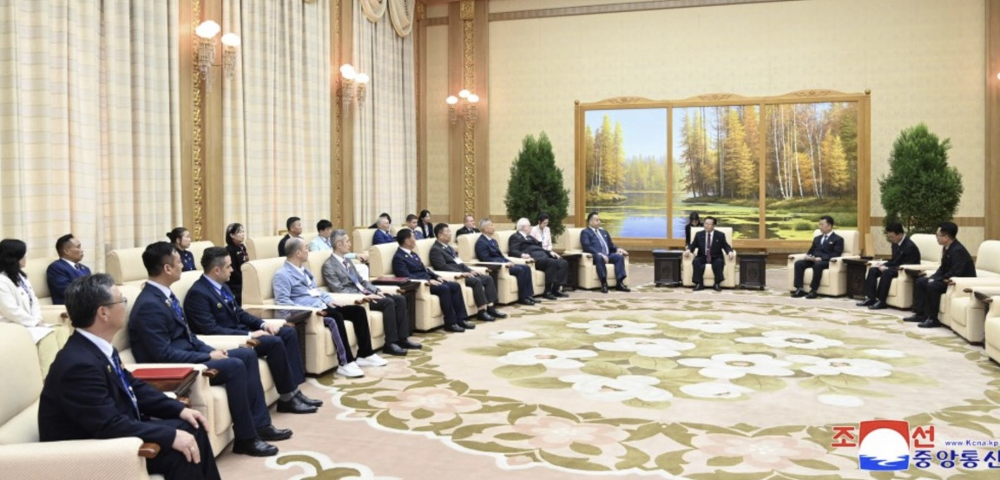

# Kim Jong-un Menerima Banyak Duta Besar Baru: Gestur Diplomatik Langka, Sinyal Korea Utara Membuka Jendela Diplomasi?

*(Pic: nknews.org.*

  
***Pyongyang sedang membuka beberapa jendela diplomatik yang dipilih sendiri, sambil tetap memegang kunci seluruh bangunan***
  

Ini menarik justru karena Korea Utara bukan negara yang menjadikan diplomasi seremonial dengan banyak negara sebagai tontonan rutin.

Dalam sistem diplomatik, penerimaan surat kredensial oleh kepala negara bukan sekadar foto berjabat tangan, menyerahkan map, lalu pulang membawa souvenir. Ia merupakan tindakan formal yang mengakui seorang diplomat sebagai representasi resmi negara asing. 

Namun, untuk membaca gestur Kim Jong-un secara geopolitik, kita harus memisahkan signifikansi protokol, perubahan kebijakan, dan kemungkinan pesan strategis.

Kita perlu memverifikasi laporan, terutama negara asal duta besar dan tanggal penerimaan kredensialnya, karena dua detail itu akan menentukan apakah ini sekadar normalisasi aktivitas diplomatik atau memiliki nilai strategis lebih besar.

## Apa yang Sebenarnya Terjadi?

Pada 22 November 2026, Kim Jong-un menerima surat kepercayaan dari 10 duta besar baru dalam satu seremoni di Pyongyang, di gedung Komite Sentral Partai Pekerja Korea.

1. Indonesia 

Gina Yoginda, Dubes RI untuk Korea Utara. Ia termasuk dalam sepuluh diplomat yang menyerahkan kredensial.

2. Rusia 

Andrei Podelyshev, duta besar Rusia yang juga menyerahkan kredensial secara langsung kepada Kim.

Delapan negara lainnya: Swedia, Vietnam, Brasil, Republik Ceko, India, Filipina, Thailand, dan Bangladesh.

Peristiwa ini dilaporkan oleh KCNA dan dikonfirmasi melalui pelaporan Yonhap, NK News, CNN Indonesia serta media lainnya. Yang membuatnya langka bukan karena Korea Utara menerima diplomat asing, melainkan karena Kim Jong-un sendiri melakukan penerimaan kredensial tersebut.

Menurut laporan yang dikutip Yonhap dan TASS, ini merupakan pertama kalinya dalam lebih dari 30 tahun pemimpin tertinggi Korea Utara secara langsung menerima kredensial dari duta besar asing.

## Mengapa ini Disebut Langkah Diplomatik Langka?

Untuk memahami kejanggalan ini, kita harus memahami sejarah protokol Korea Utara:

| Periode | Penerima kredensial diplomatik |
|:-----|:------:|
|Era Kim Il-sung|Pemimpin tertinggi secara langsung menerima kredensial diplomat|
|Era Kim Jong-il|Fungsi tersebut lebih banyak dijalankan Ketua Presidium Majelis Rakyat Tertinggi|
|Era Kim Jong-un sebelum perubahan konstitusi 2026|Protokol tersebut tidak rutin dijalankan langsung oleh Kim|
|Setelah revisi konstitusi Maret 2026|Kepala urusan negara memperoleh kewenangan menerima kredensial, yang kini dijalankan Kim|

Menurut laporan Yonhap, revisi konstitusi pada Maret 2026 memberikan kewenangan penerimaan kredensial kepada Ketua Komisi Urusan Negara, jabatan yang dipegang Kim Jong-un. Sebelumnya, tugas tersebut dijalankan Ketua Presidium Majelis Rakyat Tertinggi.

Dengan demikian, peristiwa 22 November bukan improvisasi protokol semata. Ia memiliki landasan perubahan konstitusional. Dan di sini kita mulai melihat lapisan politik yang lebih menarik.

## Lapisan Pertama: Kim Mempertegas Posisi sebagai Kepala Negara

Ini adalah demonstrasi institusional mengenai siapa yang mewakili negara Korea Utara dalam diplomasi tingkat tertinggi.

Secara formal, Korea Utara memiliki struktur pemerintahan dan institusi yang menjalankan fungsi berbeda. Selama bertahun-tahun, fungsi penerimaan kredensial diplomat asing berada pada pejabat yang berbeda dari pemimpin politik utama.

Dengan mengambil fungsi tersebut setelah perubahan konstitusi, Kim memperlihatkan tiga hal.

Pertama, konsolidasi representasi negara. 
Kim tidak hanya tampil sebagai pemimpin Partai Pekerja Korea atau figur komando militer. Ia tampil secara langsung dalam fungsi diplomatik yang melekat pada kepala negara.

Kedua, penguatan simbolisme personal. 
Dalam rezim yang sangat personalistik seperti Korea Utara, simbolisme politik bukan dekorasi. Penampilan pemimpin, siapa yang diterima, lokasi pertemuan, dan bagaimana media negara mendokumentasikan acara merupakan bagian dari komunikasi politik.

Ketiga, penguatan legitimasi institusional.
Perubahan konstitusi dan praktik protokol berjalan beriringan. Kim bukan hanya menjalankan fungsi yang secara konstitusional diberikan kepadanya, tetapi memperlihatkan pelaksanaan fungsi itu kepada audiens domestik dan internasional.

Kementerian Unifikasi Korea Selatan juga menafsirkan peristiwa ini sebagai upaya menunjukkan posisi Kim sebagai kepala negara, baik di dalam maupun di luar negeri.

Jadi, ini bukan hanya diplomasi luar negeri. Ini juga politik legitimasi domestik.

Lapisan Kedua: Korea Utara sedang Mengirim Pesan Tidak Ingin Hanya Memiliki Sedikit Saluran Diplomatik

Korea Utara mengalami isolasi diplomatik yang semakin berat selama pandemi COVID-19.

Penutupan perbatasan, pembatasan pergerakan, pengurangan staf diplomatik asing, penangguhan aktivitas kedutaan dan terbatasnya hubungan internasional menyebabkan Pyongyang mengalami periode isolasi yang jauh lebih intensif.

Sejumlah negara dan organisasi internasional mengalami hambatan dalam mempertahankan operasi diplomatik maupun bantuan kemanusiaan. Maka, penerimaan sepuluh diplomat sekaligus memiliki makna tambahan: diplomasi formal yang berfungsi kembali secara lebih terlihat.

Namun, jangan salah membaca ini sebagai pembukaan perbatasan secara penuh atau liberalisasi politik. Korea Utara dapat memperluas diplomasi tanpa membuka masyarakatnya. Bahkan, diplomasi aktif dan kontrol domestik yang ketat bisa berjalan bersamaan.

Modelnya bukan diplomasi terbuka berarti negara menjadi terbuka. Melainkan diplomasi selektif berarti negara memilih saluran eksternal yang dianggap menguntungkan bagi kepentingan strategisnya.

Lapisan Ketiga: Rusia, Tetapi Jangan Menyederhanakan Seluruh Acara Menjadi Poros Rusia-Korea Utara

Rusia jelas memiliki posisi strategis yang sangat penting dalam diplomasi Korea Utara saat ini.

Hubungan kedua negara telah meningkat secara signifikan dalam beberapa tahun terakhir, termasuk melalui perjanjian kemitraan strategis, kerja sama politik, militer dan berbagai bentuk dukungan bilateral.

Dalam konteks itu, kehadiran duta besar Rusia, Andrei Podelyshev, dalam seremoni yang dipimpin langsung Kim tentu memiliki bobot diplomatik.

Tetapi acara ini tidak boleh direduksi menjadi seremoni untuk Rusia saja. Sepuluh negara yang hadir menunjukkan spektrum hubungan yang lebih luas:

| Negara | Mengapa menarik secara geopolitik |
|:-----|:------:|
|Rusia|Mitra strategis yang hubungan bilateralnya semakin erat|
|Indonesia|Negara ASEAN dengan tradisi diplomasi bebas aktif dan hubungan historis dengan DPRK|
|India|Negara besar yang mempertahankan hubungan diplomatik meskipun hubungan dengan DPRK terbatas|
|Vietnam|Negara sosialis yang memiliki hubungan bilateral dengan Pyongyang dan pengalaman transformasi ekonomi|
|Swedia|Memiliki sejarah peran diplomatik dan komunikasi Barat di Korea Utara|
|Brasil|Representasi hubungan dengan negara Amerika Latin|
|Republik Ceko|Hubungan diplomatik yang mempertahankan kanal Eropa|
|Filipina|Negara ASEAN, sekaligus bagian dari lingkungan keamanan Asia Timur yang lebih luas|
|Thailand|Saluran hubungan bilateral Asia Tenggara|
|Bangladesh|Hubungan bilateral dengan negara Asia Selatan|

Tabel ini merupakan pembacaan konteks hubungan negara, bukan klaim bahwa semua negara tersebut memiliki agenda atau posisi politik yang sama.

Komposisi ini menarik karena Korea Utara tampak mempertahankan jaringan diplomatik yang tidak hanya bertumpu pada Rusia dan China. Tetapi ada perbedaan besar antara mempertahankan hubungan diplomatik dan memperoleh dukungan strategis. 

Penerimaan seorang duta besar tidak berarti negara tersebut mendukung program nuklir Korea Utara, kebijakan militernya, atau pelanggaran sanksi. Diplomasi justru sering dipertahankan ketika perbedaan politik masih besar.

## Isi Pidato Kim: “Kami Tidak Mengejar Supremasi atau Ekspansi”

Ini bagian yang paling menarik untuk dibaca secara kritis.

Dalam pidato setelah penerimaan kredensial, Kim menyampaikan bahwa Korea Utara tidak mengejar supremasi atau ekspansi, dan menyatakan keinginan memperluas hubungan dengan negara yang menghormati kedaulatan serta bersahabat dengan DPRK.

Ia juga mempertahankan argumentasi bahwa kekuatan militer diperlukan untuk menjaga keamanan dan hak berdaulat negara.

Secara retorika, ada tiga pesan:

1. Menawarkan narasi defensif.

Kim menampilkan kekuatan militer Korea Utara sebagai instrumen perlindungan kedaulatan, bukan ekspansionisme. Ini merupakan framing yang konsisten dengan narasi resmi Pyongyang mengenai program pertahanan dan nuklirnya.

2. Menawarkan diplomasi tanpa menyerahkan prinsip politik.

Korea Utara menyatakan bersedia memperluas hubungan, tetapi menggunakan syarat yang jelas: penghormatan terhadap kedaulatan, keamanan dan kepentingannya.
Dengan kata lain, tawaran hubungan bukan tawaran untuk mengubah sistem politik atau meninggalkan kebijakan militernya.

3. Mengirim pesan kepada lingkungan internasional.

Pidato tersebut menyampaikan bahwa Pyongyang ingin diperlakukan sebagai negara yang memiliki hak menentukan arah politik dan keamanan sendiri. Namun, kita harus membedakan retorika diplomatik dari perilaku strategis.

Klaim bahwa Korea Utara tidak mengejar ekspansi adalah pernyataan pemerintah Korea Utara, bukan kesimpulan independen mengenai seluruh perilaku militernya.

Negara-negara tetangga, terutama Korea Selatan dan Jepang, memiliki alasan keamanan yang berbeda dalam menilai kemampuan nuklir, rudal balistik, dan postur militer DPRK. Sebuah pidato tidak menghapus persoalan tersebut.

## Indonesia: Mengapa Kehadiran Gina Yoginda Justru Menarik?

Dari sepuluh diplomat yang diterima, Indonesia memiliki posisi yang cukup menarik secara diplomatik.

Gina Yoginda, Dubes RI untuk Korea Utara, ikut menyerahkan surat kepercayaan kepada Kim Jong-un pada 22 November 2026. CNN Indonesia melaporkan peristiwa ini melalui dokumentasi AFP dan KCNA.

Indonesia dan Korea Utara bukan dua negara yang baru menemukan satu sama lain melalui diplomasi kontemporer.

Hubungan bilateral keduanya memiliki sejarah sejak era Sukarno, ketika Indonesia dan Korea Utara berada dalam lingkungan politik internasional yang sama-sama menekankan antikolonialisme, kedaulatan, dan solidaritas negara-negara berkembang, meskipun konteks politik masing-masing negara kemudian berubah drastis.

Mengapa Indonesia mempertahankan hubungan?

Ini bukan berarti Indonesia menyetujui politik Korea Utara. Mempertahankan hubungan diplomatik dapat memiliki beberapa fungsi:
- Kanal komunikasi: hubungan diplomatik memungkinkan komunikasi langsung ketika situasi regional memburuk.
- Diplomasi multilateral: Indonesia dapat mempertahankan posisi dan komunikasi dalam kerangka internasional.
- Prinsip bebas aktif: hubungan diplomatik tidak harus identik dengan persetujuan atas kebijakan negara mitra.
- Kepentingan regional: Asia Timur memiliki dampak langsung terhadap keamanan, perdagangan, dan stabilitas kawasan Asia Tenggara.

Indonesia tidak perlu menjadi sekutu Korea Utara untuk mempertahankan kedutaan atau menerima hubungan diplomatik.

Justru, diplomasi memungkinkan negara berinteraksi dengan pihak yang berbeda secara ideologi, politik, maupun kepentingan.

## Sinyal Kim Jong-un Mempersiapkan Pembukaan Diplomatik Lebih Luas?

Kemungkinan ada dorongan memperluas diplomasi, tetapi bukti yang tersedia belum cukup untuk menyimpulkan bahwa Pyongyang sedang melakukan perubahan strategis besar.

Setidaknya terlihat tiga interpretasi:

Interpretasi 1: Normalisasi protokol dan representasi negara

Ini interpretasi dengan bukti paling kuat. Revisi konstitusi Maret 2026 memberikan kewenangan tersebut, lalu Kim menggunakannya secara langsung dalam seremoni yang melibatkan sepuluh diplomat. Ada hubungan yang jelas antara perubahan institusional dan praktik diplomatik.

Interpretasi 2: Reaktivasi diplomasi selektif

Pyongyang berusaha memperluas atau mengaktifkan kembali hubungan dengan sejumlah negara. Penerimaan sepuluh diplomat sekaligus memberi sinyal bahwa Korea Utara ingin mengelola jaringan hubungan bilateralnya secara lebih aktif. Ini masuk akal, tetapi belum membuktikan perubahan besar pada kebijakan luar negeri.

Interpretasi 3: Persiapan membuka negosiasi dengan Amerika Serikat atau mengubah kebijakan nuklir

Ini masih spekulatif. Tidak ada bukti dari seremoni kredensial itu sendiri bahwa Kim sedang bersiap mengubah kebijakan nuklir, menerima denuklirisasi, atau memulai negosiasi baru dengan Washington.

Korea Utara dapat memperluas hubungan diplomatik sambil mempertahankan kebijakan nuklirnya. Bahkan, diplomasi yang lebih aktif bisa berfungsi untuk mengurangi ketergantungan pada satu atau dua mitra strategis, memperkuat legitimasi internasional, dan memperluas ruang manuver.

Diplomasi bukan selalu tanda kelemahan atau kompromi. Terkadang diplomasi adalah cara sebuah negara memperkuat posisi tawarnya tanpa mengubah instrumen kekuatan yang dimilikinya.

## Gestur Kecil, Pesan Institusional Cukup Besar

Peristiwa ini benar-benar langka dalam protokol diplomatik Korea Utara, tetapi tidak boleh dibesar-besarkan menjadi bukti bahwa Kim Jong-un sedang membuka pintu reformasi atau mengubah kebijakan nuklir.

Yang dapat kita simpulkan dengan lebih kuat:
- Kim secara langsung menerima kredensial dari sepuluh duta besar.
- Ini merupakan perubahan protokol yang signifikan, pertama kali dilakukan pemimpin Korea Utara dalam lebih dari 30 tahun menurut laporan yang tersedia.
- Praktik tersebut mengikuti revisi konstitusi Maret 2026.
- Kim mempertegas representasi diplomatik dan simbolisme kedudukannya sebagai kepala negara.
- Korea Utara menyatakan keinginan memperluas hubungan dengan negara-negara yang menghormati kedaulatannya.
- Kehadiran sepuluh negara menunjukkan kanal diplomatik yang lebih beragam, tetapi tidak membuktikan terbentuknya blok baru.
- Belum ada bukti bahwa seremoni tersebut menandakan perubahan kebijakan nuklir atau rekonsiliasi dengan Amerika Serikat.

Tampaknya Kim Jong-un sedang memanfaatkan perubahan konstitusional untuk memperlihatkan dirinya sebagai representasi langsung negara dalam diplomasi, sambil mengirim sinyal bahwa Korea Utara bersedia memperluas hubungan internasional tanpa terlebih dahulu mengubah prinsip keamanan dan politiknya.

Bukan pintu yang dibuka lebar. Lebih seperti Pyongyang sedang membuka beberapa jendela diplomatik yang dipilih sendiri, sambil tetap memegang kunci seluruh bangunan. 

  
**Referensi**

1. Yonhap News Agency, 22 November 2026,
N. Korean leader receives credentials from Russian ambassador in protocol shift after 30 yrs Baca artikel Yonhap⁠

2. Yonhap News Agency, 23 November 2026
N. Korea’s Kim says Pyongyang seeks no regional dominance, defending arms buildup as self-defense Baca artikel Yonhap⁠

3. CNN Indonesia, 23 November 2026
Langka, Kim Jong Un Terima Langsung Surat Kepercayaan Dubes RI Baca CNN Indonesia⁠

4. SBS News, 23 November 2026
Kim Jong Un Receives Credentials from Foreign Envoys for First Time, Says DPRK ‘Does Not Pursue Hegemony or Expansion’
Baca SBS News⁠

5. Ministry of Unification, Republic of Korea, Regular Briefing by Spokesperson Yoon Min Ho, Baca briefing resmi⁠

6. The Herald Business, 22 November 2026
Kim Jong-un receives ambassadors’ credentials directly for first time in over 30 years, Baca Herald Business⁠
