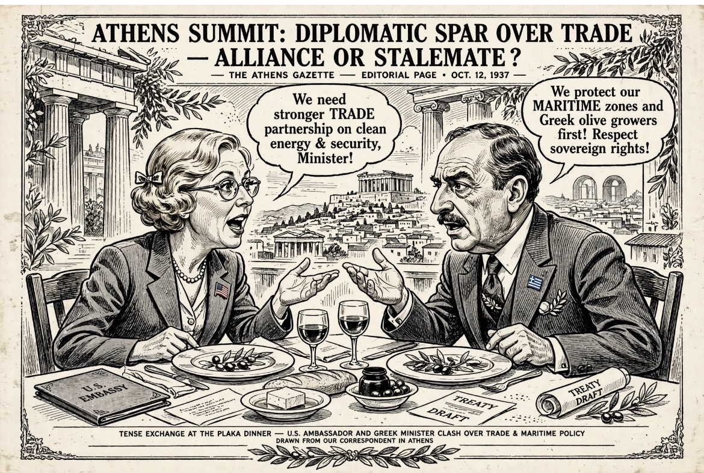

# Kimberly Guilfoyle, Kedaulatan Yunani, & Batas Tipis antara Diplomasi, Coercive Statecraft, dan Dugaan Intervensi Politik

*Ilustrasi (pic: Grok AI).*

  
***Kasus ini layak diperiksa secara institusional bukan karena kita sudah punya bukti “kudeta Amerika” tetapi karena pertanyaan penyalahgunaan kekuasaan atau tuduhan yang tidak berdasar?***
  

Ketika seorang duta besar berbicara seolah pergantian pemerintahan adalah instrumen kebijakan luar negeri, masalahnya bukan cuma kalimatnya, tetapi apa yang kalimat itu ungkapkan tentang distribusi kekuasaan.

Ini bukan kutipan yang muncul dari akun anonim media sosial. Wall Street Journal melaporkan bahwa dalam sebuah makan malam di Athena pada Maret 2026, Duta Besar AS untuk Yunani Kimberly Guilfoyle terlibat perdebatan dengan Menteri Energi Yunani Stavros Papastavrou.

Ketika pembicaraan mengarah kepada keruntuhan pemerintahan Romania yang saat itu dianggap akan segera terjadi, Guilfoyle dilaporkan mengatakan: “We can do that to any country we want. We can do that here.”

Menurut sumber WSJ yang hadir atau mendapat informasi mengenai percakapan tersebut, Papastavrou menjawab bahwa Amerika Serikat tidak dapat mengganti pemerintahan Yunani karena pemerintahan itu dipilih rakyat. Pengacara Guilfoyle membantah karakterisasi WSJ terhadap percakapan tersebut. 

Financial Times kemudian memberikan detail tambahan: makan malam itu disebut berlangsung 18 Maret di Kedutaan AS di Athena dan dihadiri lebih dari selusin pejabat Yunani dan Amerika. 

Jadi untuk eksistensi laporan dan konteks ucapannya, dasar pemberitaannya cukup kuat.

Tetapi kita belum punya rekaman audio publik. Jadi secara epistemik: “WSJ melaporkan Guilfoyle mengatakan X” bukan: “Kita telah membuktikan dari rekaman bahwa Guilfoyle mengatakan X.” 

Perbedaan kecil dalam kalimat, perbedaan besar dalam standar bukti.

## Mengapa Athena Langsung Panas? 

Karena kalimat itu menyentuh sesuatu yang jauh lebih sensitif daripada hubungan energi. Ia menyentuh sovereignty.

Dalam negara demokratis, pemerintah memperoleh kewenangan melalui mekanisme konstitusional dan elektoral negara tersebut.

Kalau seorang pejabat asing mengatakan: “Kami bisa melakukan itu di sini juga,” dan konteks “itu” adalah jatuhnya pemerintahan, maka pendengar secara rasional dapat membaca kalimat tersebut sebagai klaim bahwa Washington memiliki kapasitas untuk memengaruhi atau bahkan mengganti pemerintahan Yunani.

Itulah sebabnya Menteri Yunani dilaporkan langsung menekankan bahwa pemerintah Yunani dipilih oleh rakyat.

Dan pemerintah Yunani kemudian menyatakan secara resmi bahwa tidak pernah ada ancaman terhadap pemerintah Yunani dan bahwa hubungan Yunani-AS tetap strategis dan stabil. 

Jadi Athena sendiri melakukan pembedaan, bahwa hubungan dengan Washington dekat tetapi Washington tidak berhak mengganti pemerintahan Yunani.

Dua hal itu tidak kontradiktif.

## Bagian Paling Panas: Romania

Kalimat Guilfoyle menjadi jauh lebih sensitif setelah kita melihat kronologinya.

Pada bulan Maret, Guilfoyle dilaporkan berbicara mengenai kemungkinan jatuhnya pemerintahan Romania.Kemudian akhir Maret, ia kemudian pergi ke Bucharest dan bertemu tokoh-tokoh Social Democratic Party (PSD) Romania. 

WSJ dan FT melaporkan pertemuan tersebut, sementara terdapat rekaman/foto yang menunjukkan Guilfoyle bersama sejumlah tokoh PSD. 

Lalu 5 Mei, pemerintahan Perdana Menteri Ilie Bolojan jatuh setelah PSD keluar dari koalisi dan kemudian memberikan suara bersama AUR serta anggota lain dalam mosi tidak percaya. 

Ketika September barulah laporan WSJ mengenai ucapan Guilfoyle muncul dan menghubungkan kembali kedua peristiwa tersebut.

Dan sekarang publik bertanya: “Apakah Amerika mengetahui keruntuhan itu sebelumnya?” Itu pertanyaan yang sah. Tetapi jika “Apakah Amerika menyebabkan keruntuhan itu?” Itu belum terbukti.

## Kesalahan Logika yang Sangat Menggoda

Kita punya:
A. Guilfoyle berbicara tentang kemungkinan jatuhnya pemerintahan Romania.
B. Guilfoyle kemudian bertemu tokoh PSD.
C. Pemerintahan Romania kemudian jatuh.

Secara kronologis: A → B → C, tetapi kronologi tidak otomatis berarti kausalitas.

Kita masih membutuhkan bukti mengenai: apa yang dibicarakan dalam pertemuan Bucharest; apakah Guilfoyle memberikan instruksi; apakah ada tekanan ekonomi/politik; apakah ada pertukaran konsesi; apakah Washington berkoordinasi dengan PSD; apakah ada komunikasi resmi atau informal dari State Department; apakah ada bukti tindakan AS yang secara langsung berkontribusi terhadap mosi tidak percaya.

Sampai sekarang, bukti publik yang tersedia belum mencapai tingkat tersebut.

Bahkan PSD dan pihak-pihak Romania yang disebut dalam kontroversi menyangkal adanya kolusi dengan AS. FT melaporkan bahwa tidak jelas apakah Guilfoyle pernah menyarankan PSD untuk keluar dari koalisi. 

## AS Kudeta atau Tidak?

WSJ bukan hanya memberitakan komentar Guilfoyle. Investigasi mereka juga menggambarkan aktivitas Guilfoyle yang sangat aktif dalam mendorong LNG Amerika di Balkan.

Guilfoyle dilaporkan mendorong negara-negara di Eropa Tenggara agar membeli gas AS melalui struktur bisnis yang melibatkan perusahaan Yunani Aktor Group dan perusahaan energi milik negara Yunani.

Dalam salah satu kasus, kesepakatan LNG bernilai sekitar $6 miliar selama 20 tahun dilaporkan terkait dengan perusahaan tersebut. 

Dan di sinilah cerita berubah bentuk. Bukan lagi diplomat ke politik, tetapi diplomat ke energi, ke perusahaan, ke geopolitik, berujung ke politik domestik. Itulah energy statecraft.

## Mengapa LNG Menjadi Sangat Politis?

Gas bukan cuma komoditas. Di Eropa pasca-invasi Rusia ke Ukraina, energi merupakan bagian dari strategic security.

Negara yang bergantung pada gas Rusia mempunyai struktur ketergantungan tertentu. Sementara negara yang beralih ke LNG Amerika mempunyai struktur ketergantungan yang berbeda.

Maka energy security bukan sekadar harga gas. Ia menyangkut siapa pemasoknya; jalur pipa; terminal LNG; kontrak jangka panjang; infrastruktur; perusahaan yang mendapat kontrak; siapa yang mengendalikan jaringan distribusi; dan posisi geopolitik negara.

Greece sendiri berada pada posisi penting karena menjadi salah satu pintu masuk LNG menuju Balkan dan Eropa Tenggara.

Karena itu Washington punya kepentingan strategis untuk memperkuat Southern/Eastern European energy corridor dan mengurangi ketergantungan terhadap energi Rusia. FT dan WSJ sama-sama menempatkan aktivitas Guilfoyle dalam konteks tersebut. 

## Konflik Kepentingan

Menurut WSJ, Guilfoyle sering ditemani Christos Marafatsos, seorang lobbyist energi yang bekerja untuk kepentingan terkait Aktor.

WSJ melaporkan bahwa beberapa pejabat asing bahkan mengira Marafatsos adalah semacam kepala staf Guilfoyle karena sering hadir dalam pertemuan diplomatik. Ia bukan pejabat pemerintah Amerika. 

Kemudian muncul pertanyaan: Di mana batas antara diplomasi Amerika dan promosi kepentingan perusahaan tertentu? Ini bukan tuduhan bahwa transaksi tersebut ilegal.

Dan Guilfoyle, melalui pengacaranya, membantah karakterisasi bahwa ia menyalahgunakan jabatannya. Pejabat Kedutaan AS juga mengatakan ia mengikuti pedoman etika State Department. 

Tetapi kontroversinya cukup serius sampai anggota Kongres AS meminta investigasi State Departmentmengenai: keterlibatan lobbyist dalam pertemuan diplomatik; perjalanan menggunakan jet privat; hubungan dengan perusahaan energi; dan aktivitas Guilfoyle di Balkan. 

Nah, ini sudah bukan sekadar gosip diplomatik. Sudah ada tuntutan pemeriksaan institusional.

## Amerika Mau Menjatuhkan Yunani?

Ini titik yang harus kita tahan, walaupun godaannya luar biasa. Bukti publik saat ini menunjukkan:

Yang ada buktinya adalah Guilfoyle memang Duta Besar AS untuk Yunani, WSJ melaporkan ucapan tersebut, FT memperoleh konfirmasi tambahan mengenai tanggal dan konteks makan malam, Guilfoyle kemudian bertemu tokoh politik Romania, lalu Pemerintah Romania kemudian jatuh.

AS memang sedang mendorong ekspor LNG dan koridor energi melalui Yunani/Balkan, ada kontroversi mengenai peran lobbyist dan kepentingan perusahaan, Pemerintah Yunani menyangkal adanya ancaman terhadap pemerintahnya, dan Guilfoyle membantah karakterisasi percakapan tersebut. 

Sedangkan yang belum terbukti adalah AS memerintahkan PSD menjatuhkan Bolojan, Guilfoyle merancang jatuhnya pemerintah Romania, Washington memiliki operasi rahasia untuk mengganti pemerintah Yunani, Guilfoyle sedang mengancam pemerintahan Mitsotakis secara resmi, serta kontrak LNG merupakan imbalan atas pergantian pemerintahan. Itu semua membutuhkan bukti tambahan.

## Coercive Diplomacy

Diplomasi tidak selalu berbentuk: “Halo, kami ingin berdiskusi dengan Anda.” 

Negara juga mempunyai berbagai instrumen, yaitu persuasion, incentives, economic pressure, diplomatic pressure, sanctions, covert action,  serta military force. Tidak semuanya sama.

Dan kemampuan sebuah negara untuk menggunakan kekuatan tersebut dapat menciptakan apa yang disebut power asymmetry.

Amerika Serikat adalah kekuatan besar, Yunani adalah sekutu NATO, Romania adalah anggota NATO dan UE. Secara formal mereka adalah mitra, bukan negara musuh.

Justru karena itu, dugaan bahwa seorang diplomat Amerika mengucapkan kalimat seperti: “We can do that here” menjadi sensitif.

Karena hubungan sekutu idealnya tidak hanya dibangun atas kapasitas untuk menekan, tetapi juga atas predictability, sovereignty, reciprocity, dan trust.

## Ironi Geopolitik yang Luar Biasa

Amerika Serikat secara resmi menekankan democracy, sovereignty, dan rule of law. Tetapi apabila seorang diplomat Amerika terdengar mengatakan: “Kami bisa melakukan hal yang sama kepada negara lain.” maka muncul pertanyaan diplomatik yang sangat sederhana: “Kami” itu siapa?

Kalau yang dimaksud hanya: “Amerika memiliki pengaruh politik yang besar.” itu merupakan observasi tentang power.

Tetapi kalau yang dimaksud adalah “Pemerintah Amerika dapat menyebabkan pemerintahan negara demokratis jatuh ketika kami menginginkannya,” itu sudah merupakan klaim mengenai political intervention.

Dan dua makna itu secara normatif dan hukum sangat berbeda.

## Sejarah AS Jauh Lebih Sensitif

Kita tidak perlu menganggap semua tuduhan sekarang benar untuk mengakui satu fakta historis bahwa Amerika Serikat memang memiliki sejarah keterlibatan dalam pergantian pemerintahan asing, termasuk operasi rahasia dan dukungan terhadap kudeta pada era Perang Dingin.

Itulah sebabnya kalimat semacam ini memiliki historical resonance yang jauh lebih besar daripada kalau diucapkan oleh negara kecil.

Tetapi sejarah tersebut tidak membuktikan bahwa Washington menjatuhkan pemerintahan Romania pada 2026. Itu dua proposisi berbeda.

Dan justru di sinilah penelitian politik yang bagus harus disiplin, historical capability tidaklah sama dengan present culpability.
Kemampuan historis bukan bukti kesalahan kontemporer.

Namun, ada satu pertanyaan yang sangat legitimate untuk diajukan. Bukan: “Apakah Amerika melakukan kudeta?”
melainkan: “Apakah mekanisme pengaruh Amerika di Balkan sudah terlalu bercampur antara kepentingan geopolitik, kebijakan energi, kepentingan komersial, dan hubungan dengan aktor politik lokal sehingga membutuhkan transparansi yang lebih besar?”

Itu pertanyaan yang bisa diuji.

Dan sekarang bahkan anggota Kongres Amerika sendiri meminta dokumen dan pemeriksaan terhadap aktivitas Guilfoyle. 

## Drama Romania Belum Selesai

Per 30 September, calon perdana menteri Siegfried Mureşan gagal memperoleh vote of confidence di parlemen.

Reuters pada 1 Oktober melaporkan kebuntuan politik Romania sudah berlangsung sekitar lima bulan, melemahkan leu dan meningkatkan tekanan terhadap rating kredit negara. 

Jadi kita tidak sedang melihat sebuah cerita yang sudah selesai. Pemerintah jatuh , koalisi gagal terbentuk, calon PM gagal mendapat kepercayaan, akibatnya ketidakpastian fiskal meningkat. Kontroversi Guilfoyle masuk ke dalam krisis yang sudah memang nyata.

Karena itu sangat penting untuk tidak menjadikan satu ucapan diplomat sebagai master key yang menjelaskan seluruh kekacauan Romania.

Yang telah terbukti adalah adanya laporan kredibel mengenai ucapan Guilfoyle yang dapat dipahami sebagai klaim kemampuan AS memengaruhi pergantian pemerintahan.

Sedangkan yang belum terbukti adalah bahwa ucapan tersebut merupakan pengakuan operasi AS untuk menjatuhkan Romania atau ancaman konkret terhadap pemerintah Yunani.

Dan justru bagian paling seriusnya bukan satu kalimat itu sendirian. Melainkan kombinasi diplomasi, LNG, lobbyist, perusahaan, pertemuan dengan politisi Balkan, keruntuhan pemerintahan Romania, serta klaim tentang kemampuan mengganti pemerintahan.

Itulah yang membuat kasus ini layak diperiksa secara institusional. Bukan karena kita sudah punya bukti “kudeta Amerika”. Tetapi karena ketika kekuasaan geopolitik, kepentingan energi, dan politik domestik mulai berada di ruangan yang sama, transparansi menjadi mekanisme pengaman terhadap dua kemungkinan sekaligus, yaitu penyalahgunaan kekuasaan dan tuduhan yang tidak berdasar.

Papastavrou, menurut laporan itu, langsung menjawab dengan prinsip yang sangat sederhana bahwa pemerintah Yunani dipilih rakyat.

Dalam satu kalimat, dia memindahkan percakapan dari: “Siapa yang paling kuat?” menjadi: “Siapa yang berhak menentukan pemerintahan?” Itulah sebenarnya inti persoalannya. 

  
**Referensi**

Wall Street Journal, 2026: investigasi mengenai Guilfoyle, aktivitas LNG, lobbyist, dan ucapan di makan malam Athena. 

Financial Times, 29 Sep 2026: detail tanggal makan malam, kunjungan Guilfoyle ke Romania, dan jatuhnya pemerintahan Bolojan. 

Reuters, 30 Sep–1 Okt 2026: kebuntuan politik Romania dan kegagalan Mureşan memperoleh vote of confidence. 

eKathimerini, 28 Sep 2026: reaksi oposisi dan bantahan pemerintah Yunani. 

Le Monde, 4 Okt 2026: kontroversi Guilfoyle di Yunani dan Romania serta konteks energi Balkan.  
