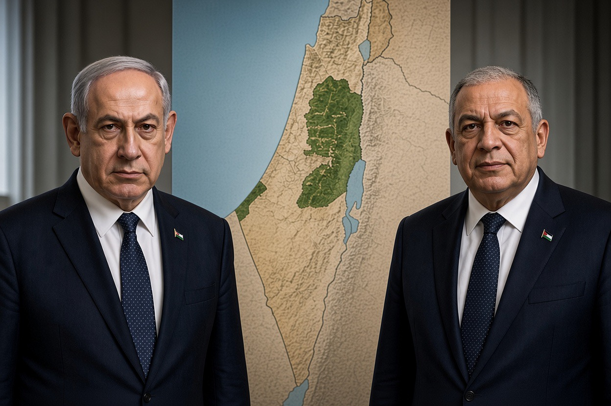

# Kontinuitas Hegemoni, Diskontinuitas Taktik: Netanyahu atau Eisenkot, Palestina Tetap Objek Bukan Subjek

*Ilustrasi (pic: Grok AI).*

  
***Bukan hanya siapa yang duduk di kursi perdana menteri, melainkan juga apakah warga Palestina memperoleh hak, perlindungan, kebebasan bergerak, dan kendali nyata atas masa depan mereka sendiri***
  

Ini pemilu yang menarik justru karena ada perbedaan besar antara mengganti pemimpin Israel dan mengubah kebijakan Israel terhadap Palestina. Dua hal itu sering dianggap sama, padahal belum tentu.

Dari laporan terbaru menjelang pemungutan suara Israel pada 27 Oktober 2026, tampaknya Netanyahu dan Gadi Eisenkot sama-sama menolak pembentukan negara Palestina yang merdeka. Namun, menyimpulkan bahwa keduanya pasti menjalankan kebijakan yang identik juga kurang tepat. 

Perbedaan mereka soal permukiman, kekerasan oleh pemukim, dan mitra koalisi bisa membawa konsekuensi nyata bagi warga Palestina. Mari kita bedah dengan pisau analisis, bukan sekadar slogan politik. 

## Pertama, ini Bukan Pemilihan Presiden Langsung

Israel memilih anggota parlemen, yaitu Knesset, yang memiliki 120 kursi. Untuk membentuk pemerintahan mayoritas, sebuah blok umumnya perlu mengamankan sedikitnya 61 kursi, melalui partai sendiri atau koalisi.

Survei terakhir yang dilaporkan The Times of Israel pada 23 Oktober memperkirakan blok pro-Netanyahu dan blok oposisi sama-sama memperoleh sekitar 51 kursi. Artinya, bahkan jika blok oposisi mendapat lebih banyak kursi, itu belum otomatis membuat Eisenkot menjadi perdana menteri. 

Partai-partai harus bernegosiasi untuk membentuk koalisi. Ini penting karena:
- Eisenkot tidak bisa menjalankan seluruh agenda pribadinya tanpa dukungan parlemen.
- Partai-partai kecil bisa menjadi penentu siapa yang membentuk pemerintahan.
- Jika negosiasi gagal, Israel dapat menghadapi kebuntuan politik atau pemilu ulang.

Jadi, jangan membayangkan pemilu ini seperti dua orang bertarung dalam pertandingan tinju, lalu pemenangnya bebas menentukan segalanya. Ini lebih mirip permainan catur koalisi, dan pion-pion kecil bisa menentukan arah papan.

## Netanyahu vs Eisenkot: Apa yang Sebenarnya Membedakan Mereka?

Benjamin Netanyahu (Likud, kanan nasionalis)

Netanyahu menegaskan penolakannya terhadap negara Palestina. Pemerintahannya memimpin perluasan permukiman di Tepi Barat, sementara mitra koalisinya, Bezalel Smotrich dan Itamar Ben-Gvir, mendukung agenda yang lebih jauh, termasuk aneksasi wilayah Palestina.

Gadi Eisenkot (Yashar, oposisi berorientasi keamanan)

Eisenkot juga menolak negara Palestina merdeka dan menginginkan Israel mempertahankan kendali keamanan atas wilayah antara Sungai Yordan dan Laut Tengah. Namun, ia menentang kekerasan pemukim, menolak pos permukiman ilegal menurut hukum Israel, dan menentang beberapa rencana perluasan permukiman yang dapat memutus keterhubungan wilayah Palestina.

Inilah paradoksnya: Eisenkot dapat menawarkan pemerintahan yang berbeda dari Netanyahu, tetapi perbedaan itu belum tentu mencakup hak Palestina untuk memiliki negara sendiri.

Menurut Reuters, keduanya juga menyatakan bahwa Israel tidak akan menarik pasukannya dari Gaza sebelum Hamas dilucuti senjatanya. Eisenkot ingin pemerintahan Hamas diganti, melalui rencana yang didukung AS atau melalui kekuatan militer. 

Jadi, pergantian pemimpin tidak otomatis berarti perubahan mendasar pada pendekatan keamanan Israel di Gaza.

## Mengapa Kedua Kubu Bisa Sama-sama Menolak Negara Palestina?

Ada beberapa mekanisme politik yang membantu menjelaskan hal ini. Kita perlu membedakan bukti tentang posisi mereka dari dugaan mengenai motif pribadi.

Pertama, pergeseran batas wacana politik.

Dalam politik, sesuatu yang awalnya merupakan posisi satu kubu bisa menjadi konsensus lebih luas ketika partai-partai berlomba menampilkan diri sebagai pihak yang paling mampu menjamin keamanan. 

Di Israel, trauma serangan 7 Oktober 2023 dan perang sesudahnya menjadikan keamanan nasional isu utama kampanye.

Associated Press melaporkan bahwa kondisi kemanusiaan di Gaza mendapat ruang terbatas dalam kampanye dibandingkan isu keamanan, kegagalan pemerintah pada 7 Oktober, dan kewajiban dinas militer. AP juga melaporkan bahwa mayoritas warga Yahudi Israel menentang negara Palestina.

Kedua, pemilu tidak menghapus ketergantungan pada koalisi.

Seorang pemimpin yang ingin membentuk pemerintahan harus mempertimbangkan partai-partai yang bersedia mendukungnya. Jika koalisinya didominasi partai yang menolak negara Palestina, ruang untuk mengubah kebijakan akan menyempit.

Ketiga, keamanan dan hak menentukan nasib sendiri tidak diperlakukan sebagai persoalan yang setara dalam kampanye.

Para pemimpin dapat berbeda pendapat tentang cara menjaga keamanan Israel, tetapi tetap menolak pengakuan atas kedaulatan Palestina. Itu membuat kompetisi politik berlangsung dalam kerangka yang tidak menyediakan pilihan kuat bagi pendukung solusi dua negara.

Ini bukan berarti semua pemilih Israel berpikir sama. Ada partai dan warga yang mendukung pembentukan negara Palestina, tetapi mereka tidak menjadi arus utama di antara kandidat utama dalam pemilu kali ini.

## Kalau Eisenkot Menang, Apakah Kehidupan Warga Palestina Bisa Berubah?

Bisa berubah dalam beberapa hal, walaupun bukan berarti menuju kemerdekaan. Ini perbedaan yang sangat penting.

| Bidang | Jika Netanyahu tetap berkuasa | Jika Eisenkot membentuk pemerintahan |
|--------|--------|--------|
|Negara Palestina|Tetap ditolak|Tetap ditolak menurut posisi yang dilaporkan|
|Permukiman Tepi Barat|Ekspansi telah berlangsung di bawah pemerintahannya|Lebih mungkin ada pembatasan terhadap pos yang melanggar hukum Israel, tetapi dukungan terhadap permukiman secara prinsip tetap ada|
|Kekerasan pemukim|Pemerintahannya dikritik karena dinilai membiarkan kekerasan|Eisenkot menyatakan akan mencegah kekerasan pemukim|
|Gaza|Mengaitkan penarikan pasukan dengan pelucutan senjata Hamas|Memiliki syarat keamanan yang serupa, tetapi mengusulkan pergantian pemerintahan Hamas|
|Koalisi|Bergantung pada mitra kanan jauh, termasuk Ben-Gvir dan Smotrich|Berpotensi bergantung pada partai oposisi lain dengan agenda berbeda|

Perbandingan berdasarkan posisi kandidat yang dilaporkan Reuters hingga 22 Oktober 2026. Baris tentang pemerintahan Eisenkot menggambarkan kemungkinan berdasarkan platform dan mitra potensial, bukan kebijakan pemerintah baru yang sudah terbukti.

Jadi, jika Eisenkot menang, mungkin ada perubahan dalam pengawasan kekerasan pemukim, pengaturan permukiman, dan pendekatan diplomatik. 

Tetapi kalau tujuan yang kita maksud adalah pengakuan kedaulatan Palestina, penghentian pendudukan, dan hak rakyat Palestina menentukan masa depan politiknya sendiri, perubahan yang ditawarkan Eisenkot masih sangat terbatas.

Ada perbedaan antara pemerintah yang memperlakukan penduduk Palestina dengan cara yang relatif berbeda dan pemerintah yang mengakui hak politik mereka secara penuh.

## Apakah ini Berarti Pemilu Israel Tidak Penting bagi Palestina?

Kita perlu menilai pemilu berdasarkan akibat konkret, bukan sekadar siapa yang menang.
Ada tiga tingkat perubahan yang perlu dibedakan:

Tingkat 1: Mengurangi kerugian langsung

Perlindungan lebih baik dari kekerasan pemukim, pembatasan penggusuran, akses bantuan kemanusiaan, dan penghormatan terhadap hak warga sipil. Perubahan seperti ini dapat berarti banyak bagi keluarga yang sedang menghadapi pengungsian atau kehilangan rumah.

Tingkat 2: Mengubah kebijakan struktural

Menghentikan ekspansi permukiman, membatasi pengambilalihan tanah, dan mengubah pengaturan militer serta administrasi di wilayah pendudukan.

Tingkat 3: Mengakui hak menentukan nasib sendiri

Membuka jalan nyata menuju penentuan status politik Palestina, kedaulatan, dan penyelesaian konflik yang sesuai dengan hukum internasional.

Seorang pemimpin dapat menghasilkan kemajuan pada tingkat pertama tanpa bergerak jauh pada tingkat ketiga. Itu sebabnya kita perlu memeriksa tindakan pemerintah, bukan hanya retorika yang lebih moderat.

Dalam hukum internasional, hak rakyat Palestina untuk menentukan nasib sendiri tidak bergantung pada apakah pemimpin Israel menyukainya. 

Mahkamah Internasional dalam pendapat penasihatnya pada 19 Juli 2024 menyatakan bahwa keberadaan Israel yang berkelanjutan di Wilayah Palestina yang Diduduki adalah melanggar hukum dan menegaskan kewajiban mengakhiri kehadiran tersebut secepat mungkin. 

Itu adalah pendapat hukum penting mengenai kewajiban internasional, bukan hasil yang otomatis berubah hanya karena pergantian pemerintahan Israel.

## Apa yang Perlu Dipantau Setelah Pemilu?

Jangan berhenti pada judul berita Netanyahu kalah atau Eisenkot menang. Pantau lima indikator ini:
Koalisi pemerintahan: partai mana yang masuk, dan konsesi apa yang mereka tuntut?
Permukiman: apakah persetujuan pembangunan baru dan pengambilalihan tanah benar-benar dihentikan atau hanya diatur ulang?
Perlindungan warga Palestina: apakah penggusuran, penghancuran rumah, dan kekerasan pemukim berkurang dalam praktik?
Gaza: apakah ada penarikan pasukan, akses bantuan, rekonstruksi, dan pengaturan pemerintahan sipil yang layak?
Negara Palestina: apakah pemerintah baru membuka proses politik yang nyata menuju kedaulatan, atau tetap menolaknya secara eksplisit?
Lima indikator ini jauh lebih informatif daripada sekadar mengukur seberapa keras seorang kandidat mengecam Netanyahu.

Pergantian Netanyahu ke Eisenkot belum tentu membawa kemerdekaan bagi Palestina memang didukung oleh bukti mengenai posisi kedua kandidat. Reuters melaporkan bahwa keduanya menolak negara Palestina merdeka, sedangkan AP mencatat bahwa solusi dua negara tidak menjadi tawaran utama sebagian besar kandidat terkemuka.

Namun, kemenangan siapa pun belum tentu membuat semua kebijakan tetap sama. Eisenkot menyatakan sikap yang berbeda mengenai kekerasan pemukim dan sebagian kebijakan permukiman. Perbedaan tersebut bisa berdampak pada kehidupan warga Palestina, meskipun tidak menyelesaikan persoalan kedaulatan.

Pelajaran politiknya adalah pergantian pemimpin bisa mengubah cara kekuasaan dijalankan tanpa mengubah siapa yang memiliki kekuasaan atas wilayah yang diperebutkan.

Dan itulah alasan kita harus menilai bukan hanya siapa yang duduk di kursi perdana menteri, melainkan juga apakah warga Palestina memperoleh hak, perlindungan, kebebasan bergerak, dan kendali nyata atas masa depan mereka sendiri.

  
**Referensi**

Associated Press. (2026, October 27). Israelis are voting to choose their next prime minister. Here’s what to know. AP News⁠

Obeid, L., & Uriel-Beeri, T. (2026, October 22). How would a Netanyahu election loss change Israel’s policies toward the Palestinians? Reuters. Investing.com, Reuters report⁠

Reuters. (2026, October 27). Netanyahu’s political survival on the line as Israel votes. Reuters⁠

International Court of Justice. (2024, July 19). Legal consequences arising from the policies and practices of Israel in the Occupied Palestinian Territory, including East Jerusalem: Advisory opinion. ICJ⁠
