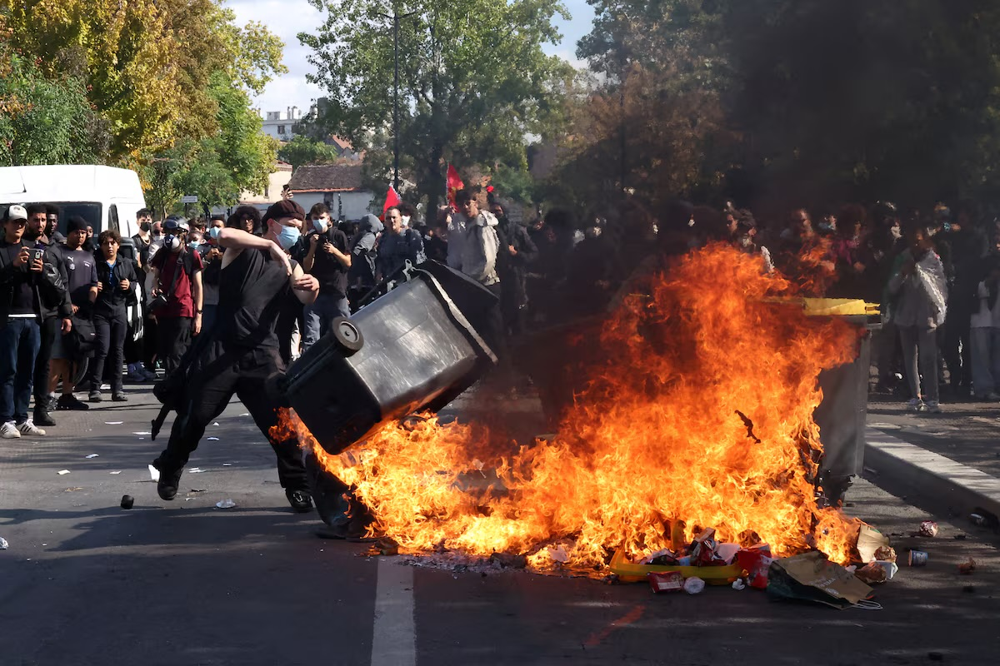

# Krisis Pendidikan Prancis: Siswa Membakar Sekolah yang Mereka Tuntut untuk Diperbaiki

*Ilustrasi (pic: Grok AI).*

  
***Prancis yang sedang terbakar bukan hanya karena api, tapi karena hubungan negara dengan generasi mudanya sedang diuji***
  

Pada 1 Oktober 2026, Reuters melaporkan terjadi kebakaran di setidaknya dua sekolah. Di Marseille, kebakaran terjadi di Lycée Saint-Exupéry. 

Polisi mengatakan ratusan pemuda menghalangi mobil pemadam, memaksa petugas meninggalkan kendaraan, lalu kendaraan pemadam itu dibakar.

Kebakaran lain terjadi di Lycée Nelson Mandela di Nantes. Gedung dievakuasi dan api kemudian dikendalikan. 

Jadi, ada sekolah yang dibakar dalam rangkaian protes. Karena gerakannya terdiri dari ribuan pelajar yang melakukan blokade/protes, sementara tindakan pembakaran dan kekerasan dilakukan oleh sebagian pelaku. 

Bahkan pejabat Prancis sendiri mengatakan ada troublemakers yang berpindah dari satu sekolah ke sekolah lain untuk memprovokasi kekerasan.  
 
 

## Guru Disiram Bensin?

Reuters melaporkan pada 1 Oktober bahwa seorang kepala sekolah di Lycée Victor Hugo, Marseille, disiram bensin oleh penyerang dan mengalami luka. 

Reuters menyebut serangan itu terjadi di tengah meningkatnya kekerasan dalam demonstrasi. 

Sebuah headline memberitakan seorang guru disiram bensin dalam percobaan pembakaran. Verifikasi Reuters adalah kepala sekolah disiram bensin dan terluka, sementara formulasi “percobaan pembakaran” harus dipakai hati-hati kecuali sumber investigasi resmi menetapkan bahwa tujuan pelaku memang membakar orang tersebut.

Artinya, disiram bensin terverifikasi, luka juga terverifikasi, namun niat membakar orang tersebut jangan kita naikkan menjadi fakta final tanpa hasil penyidikan.

Nah, ini bedanya berita serius dengan headline yang sudah diberi saus sambal.  
 
 

## Ribuan Orang Ditahan

Pada 29 September, Menteri Dalam Negeri Laurent Nuñez mengumumkan ada 440 interpellations di seluruh Prancis, mayoritas merupakan anak di bawah umur. 

Jadi angka 440 itu bukan angka total sampai sekarang, itu adalah angka pada hari tertentu.

Setelah itu angkanya meningkat:

| Tanggal | Interpellations |
|------|-------|
|28 Sept|164|
|29 Sept|440|
|30 Sept|625|
|1 Okt|1.948|

Angka tersebut juga dicatat Amnesty France berdasarkan data pemerintah, meskipun Amnesty memberikan interpretasi kritis terhadap respons polisi. 

Per 2 Oktober, pemerintah Prancis menyebut sekitar 2.000 orang telah ditahan. 

## Mengapa Anak Sekolah Turun ke Jalan?

Pemicu utamanya adalah keluhan mengenai kondisi pendidikan diantaranya kekurangan guru; kelas terlalu padat; gedung sekolah rusak; absennya tenaga pengajar; jam sekolah panjang; tekanan sistem pendidikan; ketidakpuasan terhadap sistem masuk universitas; dan kekhawatiran mengenai anggaran pendidikan. 

Reuters pada 3 Oktober melaporkan gerakan itu telah menyebar ke lebih dari 1.200 sekolah, dengan isu utama antara lain ruang kelas yang terlalu padat, bangunan yang rusak dan kekurangan guru. 

Jadi kita punya dua fakta yang sama-sama benar:

A. Ada keluhan pendidikan yang nyata.

dan

B. Sebagian aksi berubah menjadi kekerasan kriminal.

Keduanya tidak saling membatalkan, ini penting banget. Karena kalau kita menyebut:
“Ada kekerasan, berarti semua tuntutan mereka palsu.” Itu non sequitur.

Sebaliknya kalau menyebut: “Tuntutannya sah, berarti pembakaran sekolah dan serangan terhadap kepala sekolah dapat dibenarkan.” Itu juga tidak masuk akal.

 

## Skala Jauh Melewati Demo Siswa Biasa

Menurut Kementerian Pendidikan Prancis, pada 1 Oktober lebih dari 1.020 lycée terdampak oleh aksi mogok/protes, termasuk 222 yang diblokade. 

Dan pada 2 Oktober sekitar 400 lycée ditutup; sekitar 560 sekolah melaporkan protes/gangguan; sedikitnya 170 siswa terluka; 65 staf pendidikan terluka, termasuk 40 kepala sekolah; lebih dari 100 lycée mengalami kerusakan berat. 

Jadi ini sudah bukan sekadar “anak-anak bolos sekolah sambil demo.” Ini sudah menjadi krisis ketertiban sipil yang berpusat pada institusi pendidikan.

 

## Paradoks Menarik

Gerakan tersebut awalnya berkata: “Kami ingin sekolah yang lebih baik.” Tetapi ketika sebagian demonstran membakar sekolah, mereka secara literal merusak tempat yang sedang mereka tuntut agar diperbaiki.

Ini bukan cuma ironi, ini problem klasik dalam collective action, yakni grievance, mobilisasi, eskalasi, fragmentasi, berujung kekerasan.

Pada tahap awal, aktornya relatif jelas, yaitu pelajar, guru, orang tua, serta tuntutan pendidikan. Namun setelah eskalasi, pelajar ditambah aktivis, kelompok oportunistik, troublemakers alias biang kerok, polisi, dan kemudian berubah menjadi konflik jalanan. Akibatnya tujuan awal gerakan dapat menjadi kabur.

Reuters bahkan melaporkan pemerintah menuduh kelompok pengacau berpindah dari satu sekolah ke sekolah lain untuk mendorong kekerasan. Itu adalah klaim pemerintah, bukan fakta independen yang sudah terbukti mengenai seluruh gerakan. 

 

## Jangan Hanya Menyalahkan Anak-anak

Ini bagian yang paling penting. Ketika yang ditangkap banyak remaja, negara menghadapi dilema bagaimana mempertahankan ketertiban tanpa memperlakukan seluruh generasi muda sebagai musuh?

Amnesty France mencatat bahwa banyak dari mereka adalah minor dan mengkritik penggunaan kekerasan polisi, termasuk gas air mata dan pemukulan. 

Di sisi lain, pemerintah menghadapi fakta bahwa ada: pembakaran; serangan terhadap petugas; kerusakan sekolah; kepala sekolah disiram bensin; serta mobil pemadam dibakar.

Jadi respons negara memang harus melakukan dua pekerjaan sekaligus, yakni melindungi hak demonstrasi damai ditambah menghentikan kekerasan kriminal. Kalau salah satu hilang, sistemnya pincang.

 

## Bukan Hanya Soal Sekolah

Ada sesuatu yang lebih dalam di sini. Sekolah adalah tempat negara paling jelas bertemu dengan generasi muda.

Kalau anak-anak melihat: “kelas gue penuh, guru gue gak ada, gedung gue rusak, masa depan gue makin gak pasti” maka masalah pendidikan tidak lagi terasa seperti masalah administratif. Ia berubah menjadi pengalaman politik sehari-hari.

Anak usia 16 atau 17 tahun mungkin gak membaca laporan APBN. Tapi dia tahu: “Guru matematika gue gak datang lagi.” “Kelas gue 38 orang.” “Atap sekolah bocor.” “Gedung panas.” “Gue gak mendapatkan pendidikan yang menurut gue dijanjikan negara.”

Dan ketika pengalaman semacam itu terkumpul pada ribuan anak, infrastruktur sekolah berubah menjadi simbol hubungan mereka dengan negara. Itulah mengapa demonstrasi pendidikan bisa tiba-tiba menjadi gerakan nasional.

Reuters mencatat protes ini muncul terutama di wilayah dengan kondisi sosial-ekonomi lebih berat, termasuk kawasan pinggiran Paris seperti Seine-Saint-Denis. 

 

## Ironi Paling Pahit

Negara berkata: “Kalian harus belajar.” Pelajar menjawab: “Kami mau belajar, tapi beri kami sekolah yang layak.” Lalu sebagian dari mereka membakar sekolah. Dan negara mengirim polisi, polisi menggunakan kekuatan, pelajar makin marah, sebagian melakukan kekerasan lebih jauh, sekolah makin rusak, guru makin takut. Dan anak-anak akhirnya kehilangan sekolah yang sejak awal mereka tuntut agar diperbaiki.

Itulah yang dalam analisis konflik sosial bisa disebut feedback loop eskalasi. Keluhan awal bisa rasional, tapi respons terhadap keluhan bisa dianggap tidak memadai. Akibatnya mobilisasi meningkat, kekerasan muncul, negara meningkatkan coercive response, sebagian peserta merasa semakin teralienasi, lalu kekerasan meningkat. Dan lingkarannya muter seperti mesin cuci politik. 

Protes pelajar Prancis memang berkembang menjadi kekerasan serius; setidaknya dua sekolah dibakar pada 1 Oktober, seorang kepala sekolah di Marseille disiram bensin dan terluka, dan 440 orang memang ditangkap pada 29 September. Namun 440 bukan total keseluruhan. Pada 2 Oktober, jumlah penahanan sudah sekitar 2.000 menurut pemerintah, dan skalanya terus berkembang.

Mayoritas gerakan tidak boleh otomatis disamakan dengan para pelaku pembakaran, sebab ada masalah pendidikan yang nyata dan ada kekerasan nyata.

Tuntutan yang sah tidak otomatis membuat semua metode sah, dan kekerasan sebagian peserta tidak otomatis menghapus masalah struktural yang memicu mobilisasi.

Prancis yang sedang terbakar bukan hanya karena api, tapi karena hubungan negara dengan generasi mudanya sedang diuji. 

  
**Referensi:**

Reuters, 1 Okt 2026: pembakaran sekolah & kepala sekolah disiram bensin. 

AP, 2 Okt 2026: skala nasional, ~1.900 penangkapan, 560 sekolah terdampak. 

Reuters, 3 Okt 2026: lebih dari 1.200 sekolah terdampak dan akar masalah pendidikan. 

Amnesty France, 2 Okt 2026: data penangkapan dan kritik terhadap respons polisi. 

Le Monde, 2 Okt 2026: >1.020 lycée terdampak pada 1 Oktober. 
