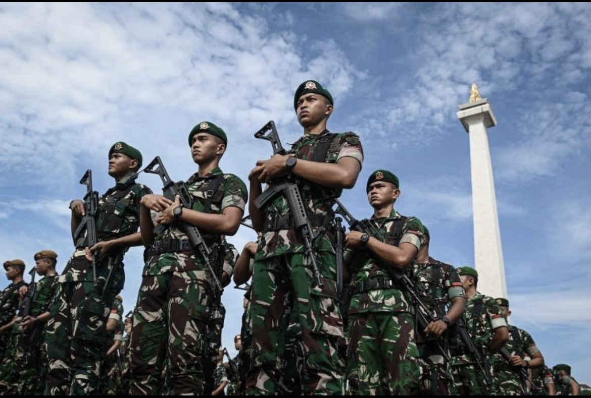

# Negara di Balik Sadapan: Ketika Polisi Mengintip Presiden, Tentara Bergerak, dan Republik Menguji Batas Kekuasaan

*Ilustrasi (pic: TheJakartapost.com).*

  
***Jangan sampai kita begitu sibuk memburu siapa yang menyadap Presiden, sampai lupa bertanya siapa saja warga yang mungkin telah disadap dan untuk kepentingan siapa***
  

Ada tiga klaim yang harus kita pisahkan: penahanan tiga jenderal polisi, pengerahan lebih dari 20.000 personel TNI ke Jakarta, dan hubungan sebab-akibat di antara keduanya. 

Kalau ketiganya benar, itu perkembangan serius. Tetapi angka pengerahan pasukan tidak otomatis membuktikan kudeta, keadaan darurat, atau bahwa TNI dikerahkan untuk menangani skandal penyadapan.

## Status Kasus: ini Bukan Lagi Sekadar Rumor WhatsApp

Per 5 November 2026, Bareskrim telah menetapkan dan menahan tiga tersangka:
Listyo Sigit Prabowo, mantan Kapolri dan saat itu menjabat Kepala Staf Kepresidenan.
Ahrie Sonta Nasution, pejabat di Divisi Hukum Polri.
Eko Hadi Santoso, perwira di lingkungan pendidikan dan pelatihan Polri.
DPR sendiri mengonfirmasi ketiga orang tersebut telah menjadi tersangka dan ditahan di Rutan Mabes Polri.

Menurut keterangan penyidik, dugaan operasi penyadapan berlangsung pada 2025–2026. Sejumlah nomor telepon diduga dimasukkan ke sistem Lawful Interception Management System tanpa verifikasi atau dasar penegakan hukum yang semestinya. Penyidik juga menduga terdapat penghapusan data elektronik dan akses ilegal.

Perhatikan istilah hukumnya: tersangka bukan terpidana. Penetapan tersangka menunjukkan penyidik menilai telah ada dasar untuk membawa perkara ke tahap pidana, bukan bahwa seluruh tuduhan sudah terbukti di pengadilan.

## Mengapa Penyadapan Presiden Merupakan Perkara yang Luar Biasa Serius?

Kita perlu membedakan dua hal:
Penyadapan yang dilakukan berdasarkan kewenangan hukum, prosedur, tujuan yang sah, dan pengawasan.
Penyadapan tanpa dasar hukum, tanpa otorisasi, atau dengan penyalahgunaan perangkat negara.
Yang kedua bukan sekadar pelanggaran privasi. Jika dugaan ini terbukti, ada persoalan serius mengenai penyalahgunaan kewenangan, keamanan informasi negara, dan integritas institusi penegak hukum.

Tetapi ada lapisan yang bahkan lebih besar. Jika perangkat intelijen atau sistem penyadapan negara digunakan untuk memantau komunikasi pejabat politik, jurnalis, aktivis, dan warga tanpa dasar hukum, maka negara berisiko mengubah instrumen keamanan menjadi instrumen pengendalian politik.

AP melaporkan bahwa dugaan target tidak terbatas pada Prabowo. Pejabat kabinet, politisi, jurnalis, organisasi masyarakat sipil, dan pelaku bisnis juga disebut sebagai kemungkinan sasaran. 

Amnesty International Indonesia mengingatkan bahwa operasi semacam itu berpotensi melanggar HAM dan mengintimidasi pihak yang kritis terhadap pemerintah.

Itulah sebabnya kasus ini harus diperiksa secara independen dan menyeluruh. Presiden bukan satu-satunya orang yang haknya perlu dilindungi. Warga biasa juga memiliki hak atas privasi dan perlindungan dari pengawasan sewenang-wenang.

## Dua Puluh Ribu Tentara di Jakarta: Angka Besar, tetapi Apa Sebenarnya yang Terjadi?

Di sini angka-angka perlu dibaca dengan teliti.
| Angka | Makna yang dilaporkan |
|------|-------|
|20.980 personel|Jumlah personel yang dilibatkan dalam pengerahan ke Jakarta|
|13.140 personel|Personel tambahan yang disiagakan untuk kemungkinan penugasan|
|6.770 personel|Personel polisi dan militer yang ditugaskan mengamankan sidang Jokowi pada 5 November|

CNA melaporkan pengerahan sekitar 20.980 personel, termasuk unsur Marinir dan Angkatan Laut, serta 13.140 personel tambahan dalam status siaga. AP kemudian memberikan konteks penting: pada Kamis, 5 November, sebanyak 6.770 personel polisi dan militer ditugaskan mengamankan sidang mantan Presiden Jokowi dalam perkara tuduhan ijazah palsu. 

Sidang itu tidak berkaitan dengan penyadapan. Sebagian besar personel dalam pengerahan lebih luas juga masih berada dalam posisi cadangan, bukan berpatroli memenuhi jalan-jalan Jakarta.

Pernyataan TNI menyebut pengerahan tersebut sebagai langkah rutin untuk keamanan nasional dan integritas wilayah. Namun, pejabat militer tidak memberikan penjelasan rinci yang menghubungkan jumlah pasukan dengan ancaman spesifik.

Maka ada tiga hal yang harus dibedakan:
- Ada pengerahan personel dalam jumlah besar. Ini terkonfirmasi.
- Ada ketegangan politik dan investigasi penyadapan yang berlangsung bersamaan. Ini juga terkonfirmasi.
- Pengerahan itu dilakukan untuk menghadapi kudeta, konflik antarlembaga, atau melindungi Presiden dari ancaman tertentu. Belum ada bukti publik yang cukup untuk menyimpulkan itu.
Korelasi waktu bukan bukti hubungan komando.

## Bagian Paling Panas: Apakah ini Konflik Prabowo Versus Jokowi?

Inilah lapisan politik yang membuat kasus ini jauh lebih kompleks daripada perkara pidana biasa.

Reuters pada 5 November menyebut skandal penyadapan tersebut memperlihatkan retakan yang semakin dalam antara Prabowo dan mantan pendukung politiknya, Jokowi.

Rangkaian peristiwanya:
- Listyo Sigit pernah menjadi Kapolri selama pemerintahan Jokowi.
- Setelah Prabowo menjadi presiden, Listyo kemudian diangkat menjadi Kepala Staf Kepresidenan.
- Listyo ditetapkan sebagai tersangka dalam perkara penyadapan.
- Prabowo memberhentikannya dari jabatan Kepala Staf Kepresidenan sehari setelah penahanan.
- Jokowi menyatakan menghormati proses hukum, tetapi belum ada bukti publik yang menetapkan dirinya sebagai pihak yang memerintahkan penyadapan.
Sekarang kita masuk ke pertanyaan analitis. Apakah penyadapan merupakan operasi loyalitas politik, operasi intelijen yang menyimpang, atau bagian dari perebutan pengaruh dalam lingkaran kekuasaan? Ketiganya merupakan kemungkinan hipotesis yang berbeda. 

Motifnya belum diumumkan oleh penyidik. Reuters mencatat bahwa pemerintah dan penyidik belum mengungkap alasan di balik operasi yang diduga berlangsung tersebut.

Ada satu hal yang justru harus kita hindari: menjadikan kedekatan Listyo dengan Jokowi sebagai bukti bahwa Jokowi memerintahkan penyadapan. Hubungan politik bukan bukti pidana.

Untuk menguji dugaan adanya operasi politik, penyidik perlu mengungkap:
Siapa yang memasukkan nomor target ke sistem?
Siapa yang menyetujui atau memerintahkan penyadapan?
Siapa yang menerima hasil intersepsi?
Apakah ada daftar target, laporan intelijen, atau komunikasi internal?
Siapa yang memerintahkan penghapusan data?
Apakah operasi tersebut memiliki tujuan penegakan hukum yang sah?

Tanpa jawaban itu, kita baru mengetahui dugaan perbuatan dan sejumlah tersangka, belum mengetahui keseluruhan arsitektur operasinya.

Supremasi Sipil: Mengapa Pengerahan Militer Perlu Diawasi?

## Indonesia adalah negara demokrasi konstitusional. Karena itu, pengerahan militer di ruang domestik harus memiliki dasar kewenangan, tujuan, rantai komando, dan mekanisme pertanggungjawaban yang jelas.

Landasan yang relevan antara lain:
- UUD 1945 Pasal 30: mengatur sistem pertahanan dan keamanan negara serta kedudukan TNI dan Polri.
- UU No. 34 Tahun 2004 tentang TNI, sebagaimana diubah dengan UU No. 3 Tahun 2025: mengatur tugas pokok TNI, termasuk operasi militer selain perang.
- UU No. 2 Tahun 2002 tentang Polri: menempatkan Polri sebagai alat negara yang bertugas memelihara keamanan dan ketertiban, menegakkan hukum, serta memberikan perlindungan kepada masyarakat.
Konsekuensi kelembagaannya penting: TNI bukan lembaga yang seharusnya mengambil alih penyidikan pidana terhadap anggota Polri. Sebaliknya, Polri juga tidak boleh menggunakan kewenangan penyidikan untuk melindungi atau mengawasi kepentingan politik tertentu.

Kita perlu mengajukan pertanyaan yang agak tidak nyaman: Jika penyadapan ilegal terjadi di dalam institusi kepolisian, siapa yang mengawasi pengawas?

Jawabannya tidak boleh sekadar: institusi itu sendiri. Dibutuhkan pengawasan eksternal, pemeriksaan forensik digital yang dapat diuji, transparansi proses hukum, dan pengawasan parlemen. Kalau tidak, penyelidikan berisiko menjadi persoalan kepercayaan: publik diminta mempercayai lembaga yang justru sedang diperiksa karena dugaan penyalahgunaan kewenangan.

## Bahaya Terbesar: Konflik Antarlembaga Keamanan

Dalam ilmu politik dan studi hubungan sipil-militer, ada konsep security sector governance: tata kelola lembaga keamanan agar kekuatan koersif negara tetap tunduk pada hukum dan otoritas sipil yang sah.

Skandal ini menyentuh tiga titik rawan:

A. Fragmentasi loyalitas

Ketika pejabat keamanan memiliki hubungan politik dengan pemimpin yang berbeda, muncul risiko bahwa loyalitas personal atau jaringan patronase mengalahkan loyalitas institusional.

Namun, kita belum boleh menyimpulkan adanya faksi TNI versus Polri. Untuk itu diperlukan bukti koordinasi, konflik komando, atau tindakan institusional yang nyata.

B. Ekspansi pengawasan

Jika penyadapan terhadap Presiden dan berbagai kelompok masyarakat terbukti dilakukan tanpa prosedur, masalahnya bukan hanya siapa yang disadap. Masalahnya adalah siapa yang mengendalikan teknologi pengawasan, siapa yang mengakses datanya, dan apakah data tersebut digunakan untuk kepentingan politik.

C. Militerisasi keamanan domestik

Pengerahan personel dalam jumlah besar dapat dibenarkan untuk menghadapi ancaman tertentu. Tetapi jika pengerahan seperti ini menjadi respons rutin terhadap ketegangan politik, masyarakat berhak meminta penjelasan mengenai proporsionalitas dan batas penggunaannya.

Ada perbedaan besar antara negara yang mempersiapkan keamanan dan negara yang menjadikan kehadiran aparat bersenjata sebagai jawaban atas setiap persoalan politik.

## Ada Perkembangan Politik Lain yang Perlu Diperhatikan

Reuters juga melaporkan bahwa sejumlah partai mulai membicarakan penggunaan hak angket DPR terkait kelayakan Wakil Presiden Gibran Rakabuming Raka. Pembicaraan ini berhubungan dengan putusan pengadilan mengenai persyaratan pendidikan Gibran dalam pencalonan 2024.

Beberapa partai, termasuk partai yang berada dalam koalisi Prabowo, disebut ikut mempertimbangkan langkah tersebut. Namun, koalisi pemerintahan masih menguasai sekitar 81% kursi parlemen menurut laporan Reuters.

Ini menarik karena dua proses politik berjalan bersamaan:
- Penyelidikan penyadapan yang melibatkan mantan Kapolri dan dua pejabat senior Polri.
- Munculnya pembicaraan mengenai penggunaan hak angket terhadap Wakil Presiden.
Keduanya belum terbukti merupakan satu operasi politik yang terkoordinasi. Tetapi keduanya memperlihatkan bahwa hubungan antara kekuasaan eksekutif, elite partai, dan institusi keamanan sedang menghadapi tekanan.

Enam Pertanyaan yang Harus Dijawab agar Republik Tidak Sekadar Menonton Drama Elite

Inilah indikator yang paling penting untuk dipantau dalam beberapa hari dan minggu ke depan.

| Pertanyaan | Mengapa penting? |
|------|-------|
|Siapa pemberi perintah penyadapan?|Menentukan rantai komando dan pertanggungjawaban|
|Siapa penerima hasil penyadapan?|Mengungkap kemungkinan penggunaan politik|
|Siapa yang menghapus data?|Menentukan upaya menghilangkan barang bukti|
|Apa dasar pengerahan 20.980 personel?|Menguji proporsionalitas dan tujuan operasi|
|Apakah ada pemeriksaan independen?|Mencegah penyidikan menjadi urusan internal semata|
|Apakah target selain Presiden akan diungkap?|Menentukan luasnya pelanggaran hak privasi|

Perhatikan pertanyaan keempat. TNI perlu menjelaskan bukan hanya jumlah personel, melainkan juga tujuan, durasi, wilayah penugasan, status kesiagaan, dan dasar perintahnya. Angka besar tanpa penjelasan operasional hanya menyisakan ruang spekulasi.

## Skandal Penyadapan atau Krisis Tata Kelola Keamanan?

Ada tiga tingkat persoalan:
- Tingkat pidana: dugaan penyadapan ilegal, akses ilegal, dan penghapusan bukti elektronik.
- Tingkat kelembagaan: potensi penyalahgunaan sistem pengawasan oleh pejabat yang memiliki kewenangan keamanan.
- Tingkat konstitusional: kebutuhan memastikan TNI dan Polri tetap berada dalam batas kewenangan hukum serta pengawasan sipil.

Yang paling penting bukan apakah skandal ini akan menguntungkan Prabowo, merugikan Jokowi, atau mengguncang jaringan politik tertentu.

Yang paling penting adalah apakah penyelidikan mampu mengungkap fakta tanpa menjadi alat untuk membersihkan satu kelompok sekaligus menyingkirkan kelompok lain.

Sebab negara hukum tidak boleh hanya melindungi presiden dari penyadapan ilegal. Negara hukum harus melindungi seluruh warga dari penyadapan ilegal, termasuk mereka yang tidak memiliki akses ke Istana.

Dan ada satu paradoks yang patut direnungkan, jika sistem pengawasan negara dapat digunakan tanpa prosedur untuk mengawasi Presiden, maka warga biasa jauh lebih rentan. Presiden setidaknya memiliki aparat, akses informasi, dan kekuasaan untuk memerintahkan penyelidikan. Warga biasa sering bahkan tidak tahu bahwa komunikasinya sedang dipantau.

Itulah inti persoalan demokrasi: kekuasaan pengawasan negara harus lebih kecil daripada kekuasaan hukum yang mengawasinya.

Satu hal yang harus kita garis bawahi, jangan sampai kita begitu sibuk memburu siapa yang menyadap Presiden, sampai lupa bertanya siapa saja warga yang mungkin telah disadap dan untuk kepentingan siapa. Itu pertanyaan yang menentukan apakah kasus ini hanya pergantian orang di lingkar kekuasaan atau benar-benar pembenahan institusi.

  
**Referensi**

1. Associated Press. (2026, November 5). Thousands of troops secure Indonesia trial as tensions run high over wiretap scandal. AP News. https://apnews.com/article/5133f0092549f865ff2fd72ba2bb4a6b⁠

2. Reuters. (2026, November 5). Indonesian police say wiretapping probe a matter for law enforcement, as parliament considers inquiry into VP. https://www.reuters.com/world/asia-pacific/indonesian-parties-weigh-parliamentary-inquiry-into-vice-presidents-education-2026-11-05/⁠

3. Channel News Asia. (2026, November 4). Indonesia deploys over 20,000 troops to Jakarta amid wiretapping probe. https://www.channelnewsasia.com/asia/indonesia-deploys-troops-jakarta-wiretapping-arrests-6523396⁠

4. Dewan Perwakilan Rakyat Republik Indonesia. (2026, November 4). Percayakan Polri usut tuntas kasus penyadapan ilegal kepada Presiden. https://www.dpr.go.id/kegiatan-dpr/berita/Percayakan-Polri-Usut-Tuntas-Kasus-Penyadapan-Ilegal-kepada-Presiden-70404⁠

5. Republik Indonesia. (2002). Undang-Undang Republik Indonesia Nomor 2 Tahun 2002 tentang Kepolisian Negara Republik Indonesia.

6. Republik Indonesia. (2004). Undang-Undang Republik Indonesia Nomor 34 Tahun 2004 tentang Tentara Nasional Indonesia.

7. Republik Indonesia. (2025). Undang-Undang Republik Indonesia Nomor 3 Tahun 2025 tentang Perubahan atas Undang-Undang Nomor 34 Tahun 2004 tentang Tentara Nasional Indonesia.
