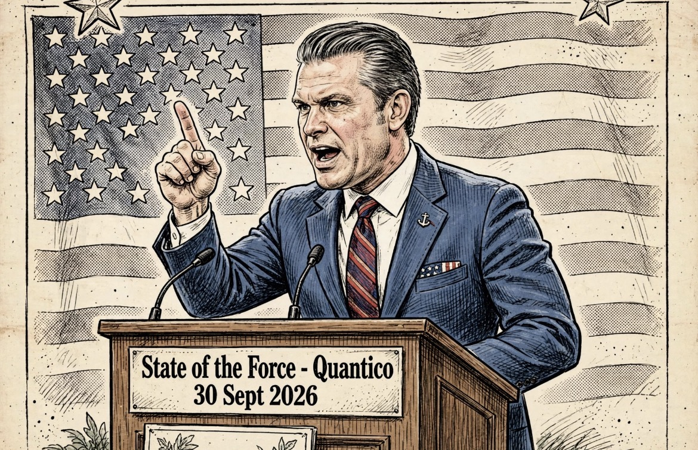

# No Fatties, No Trannies, No Beardos: Hegseth, 20% Jenderal, dan Transformasi Budaya Militer Amerika

*Ilustrasi (pic: Grok AI).*

  
***Apakah reorganisasi besar-besaran pimpinan militer selama konflik aktif meningkatkan atau mengurangi institutional resilience?***
  

Hegseth mengatakan sekitar 10% jenderal/admiral telah diberhentikan sejak ia menjadi menteri pertahanan. Kemudian 10% tambahan posisi/billet general officer akan dihapus atau diturunkan levelnya, sehingga total struktur posisi jenderal/admiral berkurang sekitar 20%. 

Jadi, 20% reduction in general/flag officer positions berbeda dengan 20% of individual generals already fired. Ini perbedaan administratif yang besar.

Reuters sebelum pidato bahkan melaporkan bahwa sebagian pengurangan akan dilakukan dengan mengubah pangkat jabatan masa depan atau membatalkan billet, bukan dengan memecat orang satu per satu. 

Namun Hegseth sendiri mengatakan ia telah mengarahkan sekitar 10% pemecatan dan kemudian menambah 10% pengurangan posisi.

Jadi kalau media menulis “cutting 20% of generals and admirals”, itu dapat dipahami sebagai ringkasan kebijakan. Tetapi kalau ditulis “Hegseth sudah memecat seperlima seluruh jenderal Amerika”, itu tidak presisi.

## Mengapa Hegseth Melakukan ini?

Versi resmi Hegseth adalah readiness, accountability, discipline, lethality, warrior ethos. Ia berargumen bahwa terlalu banyak lapisan birokrasi dan terlalu banyak posisi senior justru menghambat efektivitas militer. 

Gagasan pengurangan struktur jenderal sebenarnya sudah dia sampaikan dalam kesaksian Senat 2025. Saat itu ia mengatakan akan mengurangi minimal 20% posisi bintang empat, 20% general officers di National Guard, dan 10% general/flag officers secara keseluruhan. 

Jadi ini bukan keputusan yang muncul tiba-tiba pada 30 September 2026. Ada kesinambungan kebijakan. Pada 2025 mengurangi struktur pimpinan senior, kemudian 2026  implementasi/reorganisasi diperluas, lalu 30 September 2026 Hegseth mengumumkan hasil target lanjutan.

## Kalimat Kontroversial

Hegseth mengatakan: “No fatties, no trannies, no beardos, no weirdos, no wimps, no radicals. Just warriors.” 

Nah, ini bukan bahasa administratif, ini bahasa identitas dan kultur. Dan secara akademik kita harus memisahkan dua hal:

1. Kebijakan

Mengurangi jumlah posisi jenderal.

2. Retorika

Menggambarkan transformasi militer melalui kategori seperti “fat,” “trans,” “beard,” “wimp,” dan “radical.”

Yang kedua jauh lebih ideologis daripada sekadar restrukturisasi organisasi.

## Apa Sebenarnya “Warrior Ethos”?

Secara militer, konsepnya tidak aneh. Militer memang membutuhkan kesiapan fisik, disiplin, kemampuan bertempur, ketahanan, kompetensi teknis, kepemimpinan, serta kemampuan mengambil keputusan dalam tekanan.

Dan Departemen Pertahanan sendiri telah lama menggunakan istilah readiness, lethality, operational effectiveness, dan sejenisnya.

Masalahnya muncul ketika “warrior ethos” dijadikan oposisi terhadap identitas tertentu. Karena sekarang definisinya bukan hanya: “Apakah kamu mampu bertempur?” tetapi secara retoris menjadi: “Seperti apa bentuk manusia yang dianggap cocok menjadi warrior?”

Nah, itu sudah masuk politik budaya organisasi.

## “No Fatties” Lebih Menarik daripada Sekadar Body-Shaming

Kalau diterjemahkan kasar: “Gak ada orang gendut.” Tetapi masalah militer yang sebenarnya adalah physical readiness, itu dua hal berbeda.

Kalau militer menetapkan:“Personel harus memenuhi standar kebugaran X, kekuatan Y, daya tahan Z.” itu bisa diukur. Tetapi “no fatties” adalah kategori informal yang jauh lebih luas daripada ukuran kemampuan fisik.

Secara ilmiah, BMI sendiri juga bukan ukuran langsung performa fisik individual. Orang dengan massa otot tinggi bisa memiliki BMI tinggi tanpa memiliki kapasitas fisik rendah.

Jadi standar militer yang baik seharusnya mengukur fungsi yang relevan dengan tugas, bukan sekadar estetika tubuh.

## Konteks Rumit “No Beardos”

Jenggot dalam militer Amerika bukan isu kosmetik sederhana. Ada persoalan: keselamatan, kompatibilitas masker respirator, disiplin seragam, kebutuhan operasional, dan dalam beberapa kasus akomodasi agama.

Militer AS selama bertahun-tahun memiliki aturan mengenai pengecualian jenggot untuk alasan agama, termasuk bagi Sikh dan Muslim, dengan persyaratan tertentu.

Jadi ketika Hegseth memakai “no beardos” sebagai slogan budaya, itu terdengar jauh lebih luas daripada sekadar “masker gas harus kedap.”

Dan di sinilah kebijakan konkret harus dipisahkan dari retorika panggung.

## No Trannies?

Ini bagian paling kontroversial secara sosial. Kata “trannies” merupakan istilah merendahkan untuk transgender, bukan istilah administratif militer.

Hegseth menggunakannya dalam rangkaian “no fatties, no trannies, no beardos…” lalu menutup dengan:“Just warriors.” 

Ia tidak hanya mengatakan apa yang harus dilakukan tentara. Ia juga sedang mendefinisikan seperti apa tentara yang “benar” menurut visi kepemimpinannya.

## Hegseth sedang “Menghancurkan” Militer Amerika?

Kita tidak bisa menyimpulkan itu dari satu pidato. Ada dua interpretasi yang terdokumentasi.

1. Interpretasi pemerintah/Hegseth

Pengurangan struktur senior dan penghapusan program tertentu dimaksudkan untuk: mengurangi birokrasi, meningkatkan accountability, meningkatkan readiness, meningkatkan lethality, dan mengembalikan fokus pada fungsi perang. 

2. Kritik terhadap kebijakan

Kritikus khawatir pengurangan posisi senior dan pergantian besar-besaran pimpinan dapat mengurangi institutional continuity, menghilangkan pengalaman, mengganggu hubungan sipil-militer, dan menempatkan loyalitas terhadap agenda politik lebih dekat dengan promosi atau keberlangsungan karier.

CBS mencatat bahwa setidaknya 20 jenderal, admiral, dan pejabat sipil senior militer telah diberhentikan atau mengundurkan diri sejak Hegseth menjadi defense secretary, termasuk pimpinan tertinggi beberapa cabang militer. 

Itu adalah fakta yang berbeda dari klaim bahwa 20% semuanya sudah dipecat.

## Isu Lebih Serius daripada “No Fatties”

Civilian control of the military, ini justru jantung persoalannya.

Hegseth mengatakan: para jenderal yang “seem to think civilian control of the military is simply a suggestion” sudah tidak bekerja lagi di sana. 

Secara prinsip demokrasi konstitusional AS, militer memang berada di bawah otoritas sipil.

Jadi kalimat itu sendiri bukan masalah. Masalah akademiknya adalah: Bagaimana membedakan pemecatan karena ketidakpatuhan terhadap otoritas sipil yang sah dari pemecatan karena ketidakselarasan politik atau budaya?

Itulah pertanyaan yang jauh lebih penting daripada meme “no fatties.”

Karena kalau setiap pergantian pejabat militer dianggap bukti politisasi, itu salah. Tetapi kalau setiap pergantian pejabat otomatis dianggap murni reformasi profesional, itu juga terlalu naif.

## Konteks Waktunya Jauh Lebih Berat

Hegseth membuat restrukturisasi ini ketika Amerika Serikat sedang menghadapi perang dengan Iran, menurut laporan AP, yang menggambarkan AS memasuki bulan ketujuh perang tersebut pada saat pidato Quantico. AP juga melaporkan kekhawatiran mengenai stok rudal, beban deployment, dan kondisi personel. 

Jadi pertanyaannya bukan cuma: “Apakah lebih sedikit jenderal membuat militer lebih efisien?” Tetapi apakah reorganisasi besar-besaran pimpinan militer selama konflik aktif meningkatkan atau mengurangi institutional resilience?

Itu pertanyaan yang harus dijawab dengan data tempo operasi, kesiapan unit, retention, recruitment, munitions availability, command continuity, accident rates, deployment duration, morale, dan operational outcomes. Bukan dengan slogan.

Hegseth menegaskan pengurangan sekitar 20% struktur posisi jenderal dan laksamana. Sekitar 10% jenderal/admiral telah diberhentikan, sementara 10% tambahan berasal dari pengurangan billet/posisi, sehingga struktur general/flag officer ditargetkan berkurang sekitar 20%.

Hegseth menyebut “no fatties, no trannies, no beardos…” dalam pidatonya. Itu bukan kutipan palsu yang ditempelkan media kepadanya. CBS dan Guardian melaporkannya, dan AP mengonfirmasi isi pidato tersebut. 

Dan secara ilmiah, bagian paling menarik bukan sekadar Hegseth ngomong pedas. Yang menarik adalah bahwa reorganisasi struktural, penghapusan program keberagaman, perubahan standar personel, pergantian pimpinan senior, dan redefinisi “warrior ethos” semuanya sedang berjalan sebagai satu proyek perubahan budaya militer. Itu sudah jauh lebih besar daripada sekadar “pecat jenderal.”

Ini adalah pertanyaan tentang siapa yang mendefinisikan tentara Amerika masa depan: profesionalisme militer, kebutuhan operasional, atau identitas budaya-politik tertentu? 

Dan jawabannya baru bisa dinilai dari kebijakan konkret serta data hasilnya, bukan dari slogan Hegseth saja. 

<be> 
**Referensi**

Associated Press. (2026, September 30). Hegseth announces a new drone command and cuts to 20% of generals in “State of the Force” speech. 

CBS News. (2026, September 30). Hegseth cutting generals and admirals by 20%, including top officers who “clung to the woke department”. 

Reuters. (2026, September 29). Pentagon chief set to announce additional cuts in senior officer positions. 

U.S. Senate Committee on Armed Services. (2025, June 18). Hegseth testimony: FY2026 written posture statement. 

The Guardian. (2026, September 30). Pete Hegseth confirms cutting 20% of US military generals and admirals. 
