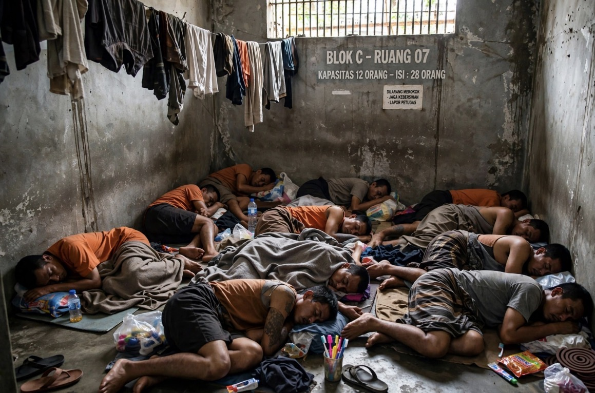

# Penjara Penuh: Inggris Memajukan Pintu Keluar, Indonesia Kehabisan Ruang

*Ilustrasi (pic: Grok AI).*

  
***Inggris sekitar 98% penuh sudah menganggap kapasitas sebagai keadaan darurat. Sementara Indonesia sekitar 181% bukan lagi sekadar “penjara penuh”***
  

Mulai 1 Oktober 2026, Inggris dan Wales memang menjalankan perubahan titik pelepasan otomatis bagi sebagian narapidana. 

Pemerintah memperkirakan sekitar 5.000 orang akan mendapat pelepasan lebih awal secara bertahap, setelah beberapa kategori, termasuk pemerkosa dan pelaku kejahatan seksual anak paling serius, dikecualikan. 

Gelombang pertama dimulai kemarin dan berikutnya berlangsung sampai 2027. Posisi terakhir 28 September, populasi penjara 87.499, kapasitas operasional 89.055. Jadi secara nasional sekitar 98,25% kapasitas operasional. 

Tapi ada koreksi kecil, bukan berarti pemerintah mengatakan, “kalau tidak dibebaskan maka November pasti 100% penuh.” Itu lebih tepat dipahami sebagai krisis kapasitas yang mendorong kebijakan pelepasan bertahap, bukan satu tanggal ajaib ketika seluruh penjara Inggris mendadak penuh total.

## Inggris: Narapidana Tidak Berbahaya?

Mekanisme sebenarnya adalah hukuman penjara tetap ada, tetapi sebagian masa hukuman dipindahkan dari balik jeruji ke pengawasan masyarakat.

Menurut House of Commons Library, untuk sebagian besar standard determinate sentences, titik pelepasan otomatis berubah menjadi sekitar sepertiga masa hukuman, dari sebelumnya 40% atau setengah, tergantung kategorinya. 

Setelah keluar, mereka tetap menjalani masa hukuman on licence, di bawah pengawasan probation.  Jadi istilah yang lebih tepat early release bukan bebas murni, tetapi kapasitas penjara dipindahkan menjadi beban pengawasan masyarakat.

Dan di sinilah bom keduanya meledak. 

## Probation: “Lho, yang Ngawasin Siapa?”

Ini bukan sekadar narapidana keluar. Kalau 5.000 orang tambahan keluar, mereka membutuhkan petugas probation, penilaian risiko, kunjungan, pemantauan, koordinasi polisi, rehabilitasi, pengawasan syarat lisensi, dan perlindungan korban.

Pada Agustus, sekitar 90% anggota Napo yang mengikuti pemungutan suara indikatif mendukung kemungkinan aksi mogok karena kekhawatiran beban kerja. Chief Inspector of Probation juga mengatakan sistem menghadapi masalah kapasitas.

Jadi pemerintah Inggris sedang melakukan sesuatu yang secara sistemik sangat menarik, mengurangi tekanan di penjara dengan memindahkan sebagian tekanan tersebut ke probation.

Kalau kapasitas probation tidak ikut naik, maka problemnya bukan hilang tetapi hanya pindah gedung. 

## Pengawas Penjara: Masalah Belum Selesai

HM Inspectorate of Prisons memperingatkan pada September bahwa sekalipun sekitar 4.500 tahanan tambahan dilepaskan antara Oktober 2026 dan Juni 2027, populasi penjara akan tetap sangat tinggi dan overcrowding tetap menjadi masalah. 

Ini penting karena kita sering berpikir bahwa jika penjara penuh, maka tinggal bebaskan orang, masalah selesai.

Padahal sistemnya, penjara penuh, early release, probation bertambah, risiko recall, sebagian kembali masuk, kapasitas kembali tertekan.

HMI Prisons bahkan memperingatkan bahwa overcrowding, kondisi buruk, narkoba, dan kekerasan dapat meningkatkan risiko seseorang kembali melakukan pelanggaran atau dipanggil kembali ke penjara.  Jadi ini bisa menjadi feedback loop.

## Kita Tengok Indonesia

Di sinilah kita bisa bilang: “Lho, Inggris baru 98% dan sudah panik. Indonesia bagaimana?”

Data World Prison Brief berdasarkan data administrasi nasional Indonesia per 31 Agustus 2026, penghuni penjara 278.189, padahal kapasitas resmi hanya 153.755, occupancy: 180,9%. 

Dengan kata lain, Indonesia bukan sekadar 98% penuh. Secara nasional kita berada di sekitar 181% dari kapasitas resmi.

Artinya kalau kapasitas resmi adalah 100 orang, penghuninya sekitar 181 orang. Maka delapan puluh satu orang tambahan harus dicari tempatnya di mana?

Dan data 28 September yang dilaporkan Katadata bahkan menunjukkan 279.330 penghuni untuk kapasitas 154.238, atau sekitar 181%. 

## Pemerintah Indonesia Sendiri Mengakui Masalahnya

Kemenimipas pada April 2026 menyebut tingkat overcrowding nasional sekitar 85% di atas kapasitas, dengan 271.468 penghuni vs kapasitas ideal 146.860. 

Jadi ada perbedaan kecil antar-snapshot dan definisi kapasitas, tetapi gambaran besarnya konsisten, Indonesia mengalami overcrowding yang sangat berat.

Dan beberapa wilayah jauh lebih parah. Pada 28 September, Kalimantan Timur dilaporkan memiliki 13.166 penghuni untuk kapasitas 4.801, sekitar 274% occupancy. Beberapa provinsi lain juga berada di atas 200%. 

Perbedaan Penting Inggris vs Indonesia

| Inggris & Wales | Indonesia |
|------|-------|
|~87.500 penghuni|~279.000|
|~89.000 kapasitas operasional|~154.000 kapasitas resmi|
|~98% occupancy|~181% occupancy|
|Krisis kapasitas|Krisis overcrowding struktural|
|Early release|Early release bukan satu-satunya solusi|
|Probation ikut tertekan|Lapas/rutan sendiri sudah sangat kelebihan penghuni|
|Fokus: jangan sampai kapasitas habis|Fokus: mengurangi kelebihan kapasitas yang sudah sangat besar|

Jadi dua-duanya punya problem penjara, tetapi skalanya tidak identik.

## Satu Masalah Indonesia yang Jauh Lebih “Pedas”

Siapa yang sebenarnya dipenjarakan? World Prison Brief mencatat sekitar 20,4% populasi penjara Indonesia merupakan tahanan pra-persidangan/remand per Agustus 2026. 

Ini penting sekali. Karena ketika kita melihat 278 ribu manusia berada dalam sistem penjara, kita tidak boleh otomatis menganggap semuanya orang yang sudah divonis dan sedang menjalani hukuman final.

Sebagian masih berada dalam proses hukum. Artinya solusi overcrowding tidak bisa hanya: “Bangun lebih banyak penjara.” Karena kalau arus masuk sistem hukum terus besar, kita cuma membangun kandang yang lebih besar untuk masalah yang sama.

## Problem Indonesia: Ketimpangan di Dalam Penjara

Ini bagian yang benar-benar pahit.

Pada September 2026, Ombudsman menemukan fasilitas mewah di dalam Lapas Cibinong, termasuk unit seperti apartemen dengan AC, televisi besar, kulkas, sofa, fasilitas olahraga, dan fasilitas lain yang diduga memberikan perlakuan istimewa kepada sebagian narapidana. Lima pejabat kemudian dinonaktifkan dalam penyelidikan tersebut. 

Jadi Indonesia punya dua realitas yang hidup berdampingan. Mayoritas overcrowding tetapi sebagian yang memiliki akses bisa mendapatkan fasilitas luar biasa.

Dan di situlah problem penjara berubah dari sekadar masalah kapasitas menjadi masalah keadilan institusional. Karena kalau negara berkata: “Penjara kita penuh.” Maka masyarakat berhak bertanya:“Penuh untuk siapa?”

Dan ketika fasilitas mewah justru ditemukan di dalam sistem yang kekurangan ruang, pertanyaannya berubah lagi: “Apakah problem kita benar-benar kekurangan kapasitas, atau juga kekurangan integritas?”

Nah. Itu pertanyaan yang jauh lebih mengganggu. 

## Apakah Indonesia Harus Meniru Inggris?

Early release bukan obat universal., kalau sistemnya hanya penjara penuh, lalu melepaskan lebih cepat tanpa memperkuat probation, rehabilitasi, pekerjaan setelah bebas, kesehatan mental dan adiksi, pengawasan risiko, perlindungan korban, alternatif hukuman, serta restorative justice, maka kita hanya memindahkan titik tekanan dari penjara ke masyarakat.

Inggris sendiri sedang menunjukkan problem tersebut secara langsung. HMI Prisons memperingatkan bahwa overcrowding dan rehabilitasi yang buruk dapat memperbesar risiko reoffending dan recall. 

Yang terjadi di Inggris adalah penjara hampir penuh, lalu negara mempercepat pelepasan, probation dipaksa menyerap beban baru, korban khawatir, akibatnya petugas mengancam mogok.

Sedangkan Indonesia, penjara sudah jauh melewati kapasitas resmi, overcrowding menjadi masalah struktural, sebagian solusi pemerintah diarahkan ke pemindahan narapidana berisiko tinggi, rehabilitasi, dan pengurangan overcrowding, tetapi problem kapasitas dan integritas masih besar. 

Perbandingan paling menusuknya, Inggris sekitar 98% penuh sudah menganggap kapasitas sebagai keadaan darurat. Sementara Indonesia sekitar 181% bukan lagi sekadar “penjara penuh”. Itu berarti sistem pemasyarakatan sudah lama hidup dalam kondisi di mana kapasitas normalnya tidak lagi menggambarkan realitas penghuni.

Jadi kalau Inggris sekarang bertanya: “Bagaimana kita mencegah penjara mencapai titik penuh?” Maka Indonesia punya pertanyaan yang lebih mendasar “Bagaimana sebuah sistem pemasyarakatan bisa bekerja ketika jumlah manusia di dalamnya hampir dua kali lipat dari kapasitas yang dirancang untuk mereka?”

Dan jawaban jangka panjangnya bukan cuma menambah sel. Karena kalau mesin yang memasukkan orang ke penjara terus bekerja dengan cara yang sama, kita hanya akan membangun penjara yang lebih besar untuk masalah yang lebih besar. 

  
**Referensi:**

UK Parliament / House of Commons Library, 2026: kebijakan early release dan krisis kapasitas penjara Inggris–Wales.

HM Inspectorate of Prisons, Sep 2026: overcrowding Inggris masih menjadi masalah meski ribuan tahanan dilepas lebih awal.

World Prison Brief, 2026: Indonesia sekitar 278 ribu penghuni vs 154 ribu kapasitas, sekitar 181% occupancy.

Kemenimipas, Apr 2026: pemerintah mengakui overcrowding nasional masih sangat tinggi.

AP, Sep 2026: kasus fasilitas mewah di Lapas Cibinong dan penonaktifan pejabat terkait.
