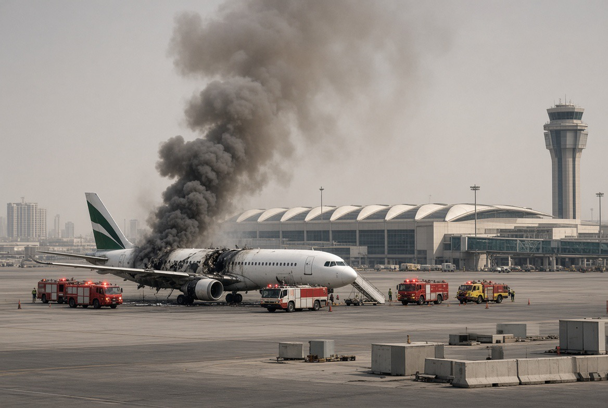

# Perang Saudara Saudi vs Houthi Menghabiskan Rudal, Negara Musuh Menghitung Keuntungan

*Ilustrasi (pic: Grok AI).*

  
***Dalam perang regional, pihak yang paling diuntungkan belum tentu pihak yang menembakkan rudal paling banyak***
  

Pada 6–7 Oktober terjadi serangan di Riyadh dan Abha. Menurut otoritas penerbangan Saudi, serangan terhadap King Khalid International Airport di Riyadh menewaskan satu warga Sudan dan melukai delapan orang. 

Di Abha, dua perempuan, masing-masing warga Maroko dan Aljazair, tewas, sementara 28 orang terluka. Total awalnya tiga korban tewas dan 36 terluka.

Kemudian 8 Oktober terjadi srangan lanjutan di Riyadh merusak pesawat Saudia yang sedang terparkir dan tidak membawa penumpang. 

Pada 9 Oktober, otoritas Saudi melaporkan tiga warga Saudi tewas dalam serangan Kamis tersebut, termasuk seorang pilot atau pegawai maskapai. 

Ini merupakan laporan korban pada rangkaian serangan yang berbeda dari laporan awal 6–7 Oktober, jadi angka korban tidak boleh dijumlahkan begitu saja.

7–9 Oktober, konflik meluas. Houthi mengklaim menyerang bandara dan instalasi militer menggunakan rudal balistik serta drone. 

Koalisi pimpinan Saudi mengatakan telah menyerang lebih dari 80 lokasi militer Houthi. Pertempuran juga berkaitan dengan perebutan wilayah di pesisir Laut Merah dan sekitar Selat Bab el-Mandeb.

Serangan dan korban memang terkonfirmasi oleh otoritas Saudi, tetapi tidak semua klaim penggunaan senjata, sasaran yang berhasil dihantam, dan kerusakan berasal dari verifikasi independen. Klaim Houthi mengenai operasi militer tetap perlu dibedakan dari informasi yang dikonfirmasi pihak lain.

Riyadh dan Abha adalah bandara sipil yang juga merupakan infrastruktur strategis. Serangan yang membahayakan penerbangan sipil membawa risiko jauh melampaui kerusakan pada satu terminal atau pesawat.

## Israel dan Sekutunya Tidak Perlu Mengotori Tangan?

Sebagai hipotesis tentang keuntungan strategis hal ini masuk akal untuk diuji, namun sebagai kesimpulan bahwa Israel sengaja merancang perang Saudi-Houthi, buktinya belum ada.

Dalam ilmu strategi, ada beberapa mekanisme yang mirip:

A. Strategic attrition, menguras lawan

Jika dua pihak saling menyerang, mereka harus mengeluarkan uang untuk rudal, drone, sistem pencegat, bahan bakar, perbaikan infrastruktur, dan operasi militer. 

Negara yang tidak terlibat langsung dalam pertukaran serangan bisa memperoleh keuntungan relatif apabila pesaingnya menghabiskan sumber daya.

Tetapi keuntungan itu bergantung pada hasil akhir. Jika perang ikut mengganggu pasokan energi, perdagangan, dan keamanan sekutu, pihak ketiga juga dapat menanggung kerugian.

B. Indirect strategy, memanfaatkan konflik pihak lain

Sebuah negara dapat memperoleh keuntungan ketika lawannya terpaksa memindahkan perhatian dan pasukan ke front lain. 

Dalam kasus ini, serangan Houthi memaksa Saudi memperhatikan pertahanan udara, bandara, instalasi energi, dan pesisir Laut Merah sekaligus.

Reuters melaporkan bahwa Saudi kembali mendukung operasi militer pemerintah Yaman untuk merebut wilayah yang dikuasai Houthi, sementara AS memberikan dukungan intelijen. (Reuters, 7 Oktober 2026⁠)

C. Strategic overextension, terlalu banyak front

Saudi harus menjaga wilayah udara, fasilitas minyak, jalur pelayaran, kota-kota besar, dan kepentingannya di Yaman. 

Jika ancaman meningkat bersamaan, biaya untuk mempertahankan semuanya ikut naik.
Namun, tekanan terhadap Saudi tidak otomatis berarti Israel menjadi pemenang. Iran dan Houthi juga menghadapi serangan balasan, kerusakan, dan biaya perang. (Reuters, 9 Oktober 2026⁠)

Inti ilmiahnya: konflik dapat menciptakan keuntungan strategis tidak langsung tanpa pihak yang memperoleh keuntungan itu harus menjadi dalang konflik. Kita harus memisahkan benefit from conflict dari engineering the conflict.

## Saudi dan Houthi Bisa Saling Menghancurkan Padahal Sama-sama di Dunia Arab?

Karena identitas Arab bukan satu kesatuan politik yang menghapus persaingan kekuasaan.

Pertama, kita perlu membedakan tiga lapisan konflik.

Perang saudara Yaman: Houthi berperang melawan pemerintah Yaman yang diakui secara internasional dan kelompok-kelompok bersenjata lain.

Persaingan regional: Saudi memandang pengaruh Houthi dan hubungan mereka dengan Iran sebagai ancaman terhadap perbatasan dan kepentingan strategisnya.

Konflik regional yang lebih luas: perang AS-Israel dengan Iran dan gangguan di Hormuz memperbesar nilai strategis Laut Merah serta Bab el-Mandeb.

Houthi menguasai Sanaa dan sebagian besar wilayah Yaman utara. Mereka memiliki kepentingan politik serta militer sendiri, meskipun mendapat dukungan Iran dan memiliki kepentingan yang beririsan dengan Tehran. Hubungan itu tidak berarti setiap keputusan Houthi pasti diperintahkan langsung oleh Iran. (Reuters, 10 September 2026⁠)

Jadi, menyebut ini sekadar “sesama saudara berantem” menangkap ironi kemanusiaannya, tetapi belum menjelaskan mekanisme konfliknya.

Yang bertabrakan adalah kepentingan kekuasaan, keamanan, wilayah, dan jalur perdagangan. Identitas bersama tidak otomatis mengalahkan semua kepentingan itu.

## Sasaran Strategis Lebih Besar: Bab el-Mandeb

Nah, ini bagian yang membuat konflik Yaman jauh lebih penting daripada sekadar pertukaran rudal.

Bab el-Mandeb adalah jalur sempit yang menghubungkan Laut Merah dengan Teluk Aden. Kapal yang melintasi jalur ini dapat meneruskan perjalanan menuju Terusan Suez dan pasar Eropa.

Jika akses di Hormuz terganggu, Bab el-Mandeb menjadi semakin penting sebagai jalur alternatif untuk sebagian arus perdagangan dan energi. Tetapi jalur alternatif itu bukan pengganti sempurna, karena rute, kapasitas, terminal, dan tujuan pengiriman berbeda.

Reuters melaporkan bahwa kemajuan Houthi di pesisir Laut Merah pada September memperbesar kemampuan mereka mengancam pelayaran, sementara Saudi berupaya merebut kembali wilayah strategis tersebut. (Reuters, 13 September 2026⁠)

Sehingga ada dua titik tekanan maritim yang harus diperhatikan:

Hormuz: jalur keluar utama bagi minyak dari kawasan Teluk Persia.

Bab el-Mandeb: pintu selatan Laut Merah yang penting bagi pelayaran antara Asia dan Eropa.

Jika kedua jalur menghadapi gangguan pada waktu yang sama, dampaknya dapat merembet ke ongkos pengiriman, asuransi kapal, harga energi, dan inflasi.

Dan di sinilah pihak ketiga dapat memperoleh keuntungan atau mengalami kerugian, tergantung posisi mereka sebagai produsen energi, importir, eksportir, atau kekuatan militer.

## Siapa yang Membayar dan Mungkin Memperoleh Keuntungan?

| Aktor | Biaya atau risiko | Potensi keuntungan strategis|
|------|------|------|
|Saudi Arabia|Pertahanan udara, operasi di Yaman, kerusakan infrastruktur, gangguan penerbangan dan investasi|Mempertahankan keamanan perbatasan dan jalur perdagangan jika berhasil menekan Houthi|
|Houthi|Serangan balasan, kehilangan peluncur dan wilayah, tekanan militer|Mempertahankan pengaruh politik serta memperoleh daya tawar melalui ancaman terhadap jalur pelayaran|
|Iran|Risiko eskalasi regional, tekanan militer dan ekonomi|Memiliki mitra regional yang dapat menambah tekanan terhadap Saudi dan kepentingan AS|
|Israel|Risiko keamanan regional dan dampak ekonomi dari konflik yang meluas|Bisa memperoleh keuntungan relatif apabila pesaing regional mengalihkan sumber daya ke front lain, tetapi itu belum membuktikan keterlibatan dalam perencanaan serangan|
|Amerika Serikat|Biaya dukungan militer, tekanan pasar energi dan risiko eskalasi|Dapat mempertahankan pengaruh keamanan melalui dukungan kepada mitra, tetapi konflik berkepanjangan juga membawa biaya bagi Washington|
|Warga sipil Yaman dan Saudi|Kematian, cedera, pengungsian, kehilangan pekerjaan dan kerusakan fasilitas publikTidak ada keuntungan langsung yang sebanding dengan risiko yang mereka tanggung|

Tabel ini bukan klasemen siapa yang menang. Ini peta distribusi biaya, risiko, dan kepentingan berdasarkan dinamika yang dilaporkan. Hasil akhirnya masih bergantung pada perkembangan militer dan diplomatik.

## Saudi Bisa Membeli Lebih Banyak Senjata tetapi Tetap Tidak Memperoleh Keamanan 

Serangan di Riyadh memperlihatkan bahwa pertahanan udara tidak menghilangkan seluruh risiko.

Sistem pencegat dapat menghancurkan rudal, tetapi serpihan, kesalahan identifikasi, atau proyektil lain tetap bisa membahayakan fasilitas dan penduduk. 

Bahkan jika mayoritas serangan berhasil digagalkan, biaya pertahanan tetap ada.
Ini menghasilkan asimetri biaya:
Penyerang dapat menggunakan senjata relatif murah untuk memaksa lawan mengaktifkan sistem pertahanan yang mahal.
Pihak yang bertahan harus menjaga banyak sasaran sekaligus.
Serangan yang tidak mencapai sasaran utama pun dapat mengganggu penerbangan, menaikkan biaya asuransi, dan menimbulkan kepanikan.
Namun, kita tidak boleh menyimpulkan bahwa setiap drone Houthi murah atau setiap pencegat Saudi mahal dengan angka tertentu tanpa data sistem senjata yang digunakan. Yang dapat kita simpulkan adalah adanya ketidakseimbangan biaya potensial dalam perang rudal dan drone.

Reuters melaporkan bahwa serangan terbaru mengakibatkan pembatalan penerbangan dan merusak pesawat Saudia, sementara koalisi Saudi menyatakan telah menghancurkan tiga platform peluncur Houthi. (Reuters, 9 Oktober 2026⁠)

Artinya, biaya perang bukan hanya nilai senjata yang ditembakkan. Biaya juga mencakup apa yang harus dilakukan lawan untuk mencegah serangan berikutnya.

## Apakah ini Strategi Licik Israel Menghancurkan Negara-negara Teluk dari Jauh?

Kita perlu menguji hipotesis itu dengan tiga pertanyaan:

Pertama, apakah Israel dapat memperoleh keuntungan dari konflik antarpihak regional?
Secara teoritis, ya. Jika negara-negara yang dianggap pesaing menghabiskan sumber daya dan perhatian untuk konflik lain, keseimbangan kekuatan regional dapat berubah.

Kedua, apakah ada bukti bahwa Israel sengaja mengatur Houthi untuk menyerang Saudi, atau sengaja merancang eskalasi ini agar negara-negara Teluk saling menghancurkan?
Dalam laporan yang tersedia hingga 9 Oktober, belum ada bukti publik yang menunjukkan adanya operasi semacam itu. Laporan yang ada menghubungkan eskalasi dengan perang regional, kemajuan teritorial Houthi, operasi Saudi di Yaman, dan perebutan pengaruh serta jalur pelayaran. Itu tidak cukup untuk membuktikan Israel merancang serangan Houthi.

Ketiga, apakah Israel atau AS otomatis diuntungkan jika Saudi dan Houthi terus berperang?

Tidak otomatis. Gangguan di Laut Merah dapat mengancam perdagangan global, mengganggu pasokan energi, dan memperbesar risiko eskalasi yang melibatkan Iran. 

AS juga memberikan dukungan intelijen kepada operasi Saudi, sehingga tidak tepat menyimpulkan bahwa Washington sekadar duduk santai sambil membiarkan Saudi menanggung semua biaya. (Reuters, 2 Oktober 2026⁠)

Dengan kata lain, strategi mengambil keuntungan dari konflik itu mungkin; tuduhan bahwa konflik ini sengaja dirancang oleh Israel adalah klaim berbeda yang membutuhkan bukti berbeda.

Ada satu pelajaran geopolitik yang sangat nyata dari serangan Riyadh dan Abha, bahwa negara tidak harus kehilangan seluruh wilayahnya untuk mengalami kerugian strategis besar. 

Gangguan penerbangan, biaya pertahanan udara, tekanan terhadap investasi, ancaman terhadap fasilitas energi, dan ketidakpastian pelayaran dapat menguras sumber daya tanpa pendudukan militer langsung.

Namun, kita juga harus melihat bahwa Houthi bukan sekadar alat pasif Iran, Saudi bukan sekadar korban tanpa pilihan, dan Israel bukan otomatis dalang di balik setiap konflik yang merugikan pesaingnya.

Yang terlihat saat ini adalah konflik berlapis: perang saudara Yaman, persaingan Saudi-Iran, dan perang regional yang mengancam dua jalur pelayaran strategis.

Dan ketika semua lapisan itu bertemu, negara-negara bisa menghabiskan anggaran untuk saling menyerang, mempertahankan diri, membalas serangan, dan memulihkan kerusakan, sementara warga sipil membayar dengan nyawa, pengungsian, dan kehidupan yang terputus.

Dalam perang regional, pihak yang paling diuntungkan belum tentu pihak yang menembakkan rudal paling banyak. Tetapi untuk menyebut siapa yang merancang permainan, kita tetap membutuhkan bukti, bukan hanya melihat siapa yang mungkin mendapat keuntungan.

  
**Referensi**

Reuters, 7 Oktober 2026. The war’s explosive new front. Analisis eskalasi Yaman dan Bab el-Mandeb.

Reuters, 9 Oktober 2026. Houthi strikes on Riyadh airport killed three Saudis as war escalates. Korban, pesawat Saudia, dan respons Saudi.

Al Jazeera, 7 Oktober 2026. Three killed, 36 injured in Houthi attacks on Saudi airports, Riyadh says. Data korban awal di Riyadh dan Abha.

Reuters, 13 September 2026. Analysis: Houthis’ Yemen advance leaves Gulf states with uncomfortable choice. Implikasi kontrol pesisir Laut Merah.
