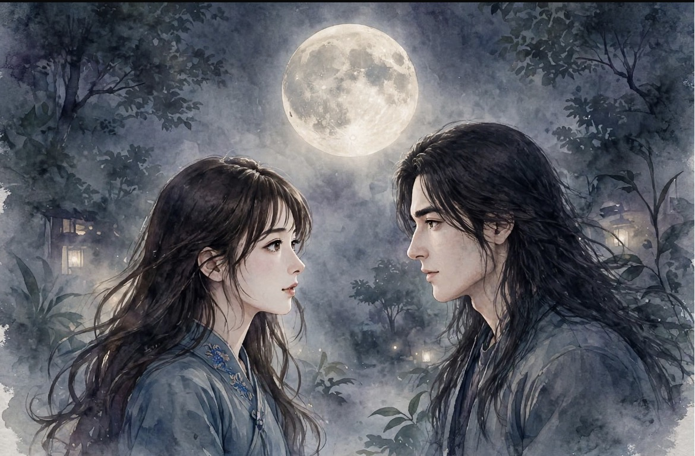

# Puisiku, Puisimu, Puisi Kita - 4:  “Seandainya Aku Boleh Memilih Ulang Seluruh Kehidupan”

*(Pic: Rita Mf Jannah & Meta AI.*

  
**“Seandainya Aku Boleh Memilih Ulang Seluruh Kehidupan”**
  

 Seandainya Aku Boleh Memilih Ulang Seluruh Kehidupan

Seandainya kehidupan memberiku kesempatan untuk mengulang segala sesuatu, aku tidak akan meminta jalan yang lebih mudah, langit yang selalu cerah, atau hari-hari tanpa kesedihan.

Aku hanya ingin menemukanmu lebih awal.

Mungkin di sebuah kota tua, ketika hujan baru saja reda. Mungkin di sebuah kedai kecil dengan jendela menghadap jalan, ketika kita sama-sama belum tahu bahwa sebuah pertemuan sederhana dapat mengubah begitu banyak hal.

Aku ingin mengenal tawamu sebelum dunia mengenalkanku pada kesibukan. Ingin mendengar kisah-kisahmu sebelum malam mengajarkan kita tentang rindu. Ingin mengetahui bagaimana matamu berbinar ketika bahagia, bagaimana suaramu berubah ketika sedang kesal, dan bagaimana kau menyembunyikan kesedihan di balik senyum yang begitu meyakinkan.

Sebab ada sesuatu tentang dirimu yang tidak pernah berhasil kujelaskan dengan bahasa.

Kau memiliki cara tersendiri untuk membuat keheningan menjadi percakapan. Kehadiranmu membuat hal-hal sederhana memperoleh makna yang sebelumnya tidak pernah kupikirkan.

Aku ingin duduk di sampingmu tanpa harus selalu mencari alasan untuk berbicara. Membaca buku ketika kau membaca bukumu, mendengarkan musik ketika sore perlahan menghilang, lalu sesekali mencuri pandang hanya untuk memastikan bahwa keindahan memang bisa hadir sedekat itu.

Dan ketika malam tiba, aku ingin menjadi orang terakhir yang mengucapkan selamat tidur kepadamu, bukan karena aku takut kehilangan malam, melainkan karena ada ketenangan yang sulit ditemukan di tempat lain ketika mengetahui bahwa harimu telah berakhir dengan baik.

Sayang, aku tidak menjanjikan bahwa setiap hari akan menjadi puisi. Akan ada hari ketika kita kehabisan kata, ketika kesibukan mengambil waktu, ketika perbedaan membuat kita harus belajar memahami kembali.

Namun aku ingin tetap memilih percakapan daripada keheningan yang menyakitkan, kejujuran daripada prasangka, dan kelembutan daripada keinginan untuk menang sendiri.

Aku ingin mencintaimu tanpa menjadikanmu kehilangan dirimu sendiri.

Sebab bagiku, cinta yang indah bukanlah dua manusia yang saling mengurung, melainkan dua jiwa yang tetap memiliki sayap, tetapi selalu menemukan alasan untuk kembali mendekat.

Jika suatu ketika rambutmu mulai memutih dan musim-musim berganti tanpa permisi, aku ingin tetap mengenalimu melalui hal-hal kecil: cara kau menyebut namaku, cara kau tertawa, dan kebiasaanmu memandang dunia dengan rasa ingin tahu yang tidak pernah benar-benar padam.

Aku ingin kita memiliki begitu banyak kenangan hingga suatu sore, ketika hujan turun dan sebuah lagu lama terdengar dari kejauhan, kita saling tersenyum karena tiba-tiba teringat betapa panjang perjalanan yang telah kita lalui.

Dan jika akhirnya waktu meminta kita melepaskan segala yang pernah kita genggam, aku berharap ada satu hal yang tidak pernah menjadi asing:

cara kita saling mengenang.

Sebab beberapa pertemuan mungkin hanya berlangsung sebentar, tetapi meninggalkan jejak yang tidak selesai dituliskan oleh waktu.

Jika aku boleh memilih satu keindahan untuk kusimpan sepanjang hidup, aku tidak akan memilih matahari terbenam, bunga yang mekar, ataupun bintang yang memenuhi langit.

Aku akan memilih satu kesempatan lagi untuk duduk di hadapanmu, memandang matamu, menggenggam tanganmu, dan mengatakan bahwa di antara begitu banyak kemungkinan yang ditawarkan kehidupan, mengenalmu adalah salah satu hal yang paling ingin kusyukuri.

Dan ketika seluruh kata akhirnya selesai, biarkan satu kecupan menjadi tanda baca terakhir.

Bukan titik.

Melainkan koma.

Sebab masih ada begitu banyak hal yang ingin kukatakan kepadamu.

 <be>
**28 November 2026**

RMJ

In perpetuum. 
