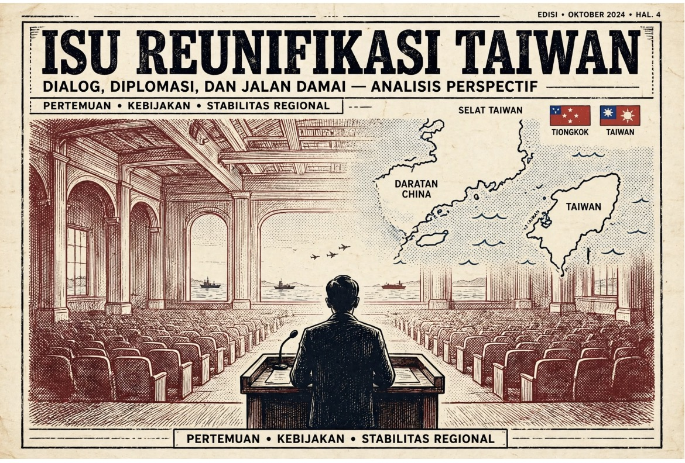

# Reunifikasi atau Aneksasi Kehendak? Xi Jinping, Taiwan, & Ambisi Mengakhiri Perang Saudara yang Belum Selesai

*Ilustrasi (pic: Meta AI).*

  
***Sejarah mungkin punya arus. Tetapi manusia yang hidup di dalamnya bukan benda hanyut yang tidak memiliki kehendak***
  

Kali ini Xi Jinping mengeluarkan kalimat yang pendek, tetapi bobot geopolitiknya seberat kapal induk: “Reunifikasi Taiwan harus dan pasti akan tercapai.”

Pernyataan itu disampaikan pada 12 November 2026, dalam peringatan 160 tahun kelahiran Sun Yat-sen di Beijing. Xi menyebut penyatuan Taiwan sebagai misi historis Partai Komunis Tiongkok dan menyatakan bahwa arus sejarah tidak bisa dihentikan. 

Ia kembali menawarkan reunifikasi damai melalui formula One Country, Two Systems. Taiwan menolak formula tersebut.

Mari kita bedah. Bukan cuma soal ambisi Beijing, tetapi juga sejarah, legitimasi, identitas nasional, strategi militer, dan posisi Amerika Serikat.

## Apa Sebenarnya yang Dikatakan Xi?

Ada tiga pesan utama dalam pidatonya.
- Reunifikasi Taiwan merupakan misi historis Partai Komunis Tiongkok.
- Beijing menyatakan tetap mengutamakan penyatuan damai dengan formula One Country, Two Systems.
- Seluruh warga Tiongkok, termasuk masyarakat Taiwan, diminta menentang gerakan yang oleh Beijing disebut separatisme.
Xi tidak secara eksplisit mengancam akan menyerang Taiwan dalam pidato tersebut. Tetapi ada satu konteks yang tidak boleh diabaikan: Beijing tidak pernah secara resmi mengesampingkan penggunaan kekuatan militer untuk mencapai tujuannya.

Perhatikan perbedaan antara dua kalimat ini:
“Kami menginginkan reunifikasi damai.”
“Reunifikasi harus dan pasti terjadi.”
Kalimat pertama menawarkan mekanisme. Kalimat kedua menyatakan hasil akhir yang dianggap tidak dapat ditawar.

Di sinilah persoalan politiknya: apakah kehendak satu negara dapat menentukan masa depan masyarakat yang tidak menghendaki penyatuan tersebut?

## Ironi Sejarah: Dua Pemerintahan, Satu Warisan Sun Yat-sen

Untuk memahami konflik ini, kita harus mundur ke 1911 dan 1949.

1911: Revolusi Xinhai menggulingkan Dinasti Qing.  Sun Yat-sen menjadi tokoh sentral pendirian Republik Tiongkok (Republic of China/ROC) pada 1912.
1921: Partai Komunis Tiongkok didirikan.
1927: Perang saudara antara kaum Nasionalis Kuomintang dan kaum Komunis semakin intensif.
1949: Mao Zedong memproklamasikan Republik Rakyat Tiongkok (People’s Republic of China/PRC). Pemerintahan Republik Tiongkok di bawah Kuomintang mundur ke Taiwan.

Sejak itu, terbentuk dua pemerintahan yang berbeda:

| Republik Rakyat Tiongkok | Republik Tiongkok |
|------|-------|
|Berpusat di Beijing|Berpusat di Taipei|
|Dipimpin Partai Komunis Tiongkok|Pemerintahan demokratis multipartai|
|Mengklaim Taiwan sebagai wilayahnya|Memiliki pemerintahan dan institusi sendiri|
|Tidak pernah memerintah Taiwan|Mengelola Taiwan secara de facto|

Ini fakta historis yang sangat penting: Taiwan tidak pernah diperintah oleh Republik Rakyat Tiongkok sejak PRC berdiri pada 1949.

Karena itu, istilah reunifikasi bukan istilah netral. Ia mengasumsikan bahwa Taiwan merupakan bagian dari satu negara yang semestinya kembali bersatu. Beijing menggunakan istilah itu karena menganggap perang saudara belum selesai secara nasional.

Namun dari perspektif Taiwan, mereka bukan wilayah yang sedang menunggu untuk dikembalikan kepada pemerintahan Beijing. Mereka memiliki sistem politik, pemerintahan, militer, dan kehidupan demokratis sendiri.

Jadi, dua pihak menggunakan sejarah yang sama untuk membangun legitimasi politik yang berbeda.

## Mengapa Xi Menggunakan Warisan Sun Yat-sen?

Ini bagian yang menarik secara historiografis.
Sun Yat-sen bukan tokoh yang secara eksklusif dimiliki Beijing.

Ia dihormati oleh kedua sisi Selat Taiwan:
Beijing menganggap Sun sebagai pelopor revolusi nasional dan tokoh yang memperjuangkan persatuan Tiongkok.
Taipei menghormatinya sebagai bapak pendiri Republik Tiongkok.
Dalam pidato 12 November, Xi menghubungkan cita-cita persatuan nasional Sun dengan agenda reunifikasi Partai Komunis.

Secara politik, strategi ini disebut historical legitimation, yaitu penggunaan sejarah untuk memberikan legitimasi kepada proyek politik kontemporer.

Logikanya:
- Sun memperjuangkan persatuan nasional.
- Partai Komunis mengklaim sebagai penerus perjuangan revolusi nasional.
Karena itu, reunifikasi Taiwan diposisikan sebagai kelanjutan perjuangan sejarah tersebut.
Masalahnya, hubungan historis tidak otomatis menghasilkan hak politik untuk menentukan masa depan masyarakat Taiwan.

Sun Yat-sen hidup sebelum berdirinya PRC. Menggunakan warisan intelektual dan politiknya untuk membenarkan klaim kedaulatan kontemporer tetap merupakan interpretasi politik, bukan bukti bahwa masyarakat Taiwan telah menyetujui pemerintahan Beijing.

Sejarah dapat menjadi sumber legitimasi, tetapi sejarah tidak bisa menggantikan persetujuan politik masyarakat yang hidup sekarang.

## Mengapa Taiwan Sulit Ditundukkan Secara Politik?

Ada tiga faktor besar:

1. Identitas politik masyarakat Taiwan

Taiwan berkembang menjadi demokrasi multipartai setelah berakhirnya pemerintahan otoriter Kuomintang.

Pemilu kompetitif, pergantian kekuasaan, kebebasan pers, dan kebebasan sipil menjadi bagian dari institusi politiknya.

Presiden Lai Ching-te dan pemerintahan Partai Progresif Demokratik (DPP) menolak klaim Beijing atas Taiwan.

Tetapi penting dicatat: masyarakat Taiwan tidak memiliki satu pandangan politik yang sepenuhnya seragam. Ada variasi antara identitas Taiwan, identitas Tiongkok, status quo, kemerdekaan formal, dan hubungan ekonomi dengan daratan.

Namun, penolakan terhadap model One Country, Two Systems jauh lebih luas daripada dukungan terhadap satu partai tertentu. Pemerintah Taiwan menyatakan formula itu tidak dapat diterima karena berarti tunduk pada pemerintahan Partai Komunis.

2. Faktor ekonomi: industri semikonduktor

Taiwan merupakan simpul utama industri semikonduktor dunia.

Taiwan Semiconductor Manufacturing Company (TSMC) memproduksi chip canggih yang menjadi komponen penting bagi:
pusat data dan kecerdasan buatan;
ponsel dan komputer;
industri otomotif;
sistem pertahanan;
infrastruktur telekomunikasi.
Jika terjadi konflik militer di Selat Taiwan, dampaknya tidak akan berhenti pada Taiwan dan Tiongkok. Rantai pasok global dapat terganggu, biaya asuransi pengiriman melonjak, perdagangan Asia Timur terguncang, dan produksi teknologi dunia menghadapi risiko besar.

Taiwan bukan hanya pulau dengan nilai geografis. Ia juga merupakan simpul infrastruktur ekonomi global.

3. Faktor geografi militer

Taiwan terletak pada posisi strategis dalam apa yang dikenal sebagai First Island Chain, rangkaian kepulauan yang membatasi akses militer Tiongkok menuju Pasifik Barat. Penguasaan Taiwan akan mengubah keseimbangan kekuatan maritim di kawasan.

Dari perspektif Beijing, Taiwan berkaitan dengan:
integritas teritorial;
keamanan pesisir timur Tiongkok;
akses militer menuju Pasifik;
kredibilitas Partai Komunis sebagai penjaga persatuan nasional.
Dari perspektif Washington dan sekutunya, perubahan paksa status Taiwan dapat mengubah keseimbangan keamanan Asia Timur.

Dengan demikian, Taiwan memiliki nilai strategis yang jauh melampaui luas wilayahnya.

## Apakah Pernyataan Xi Berarti Invasi Sudah Dekat?

Tidak otomatis. Kita perlu memisahkan retorika politik, persiapan militer, dan keputusan perang.

Pada 12 November, Kementerian Pertahanan Taiwan melaporkan 29 pesawat militer Tiongkok, termasuk jet J-16 dan drone, melakukan patroli kesiapan tempur bersama kapal perang di sekitar Taiwan.

Aktivitas tersebut penting karena dapat berfungsi sebagai:
- Military signaling: menunjukkan kemampuan dan kesediaan militer.
- Operational rehearsal: melatih koordinasi udara dan laut.
- Psychological pressure: meningkatkan tekanan terhadap masyarakat dan pemerintah Taiwan.
- Strategic normalization: membuat kehadiran militer Tiongkok di sekitar Taiwan terasa semakin rutin.
Tetapi 29 pesawat dalam patroli bukan bukti bahwa invasi akan dimulai.

Untuk mengidentifikasi persiapan invasi skala besar, kita perlu mengamati indikator lain, seperti mobilisasi logistik, konsentrasi kapal pendarat, persiapan rumah sakit militer, pengumpulan cadangan, pengaturan bahan bakar, serta perubahan pola komunikasi dan komando.

Invasi amfibi terhadap Taiwan merupakan operasi militer yang sangat kompleks. Menguasai pulau bukan sekadar mengirim kapal dan pesawat.

## Amerika Serikat: Pelindung Taiwan atau Pemain yang Menjaga Keseimbangan?

Posisi Amerika Serikat sangat menarik. Washington mengakui pemerintah Republik Rakyat Tiongkok sebagai pemerintah Tiongkok, tetapi tetap mempertahankan hubungan tidak resmi dengan Taiwan dan menyediakan dukungan pertahanan berdasarkan Taiwan Relations Act.

Amerika tidak memberikan jaminan pertahanan otomatis yang identik dengan perjanjian pertahanan formal. Kebijakan ini dikenal sebagai strategic ambiguity.

Tujuannya adalah menjaga dua hal sekaligus:
- Mencegah Beijing menggunakan kekuatan untuk mengubah status Taiwan.
- Mencegah Taipei mengambil langkah sepihak menuju kemerdekaan formal yang dapat memicu perang.
Namun, ada perkembangan yang patut diperhatikan: laporan Al Jazeera menyebut pemerintahan Trump sempat menangguhkan pembelian senjata Taiwan senilai US$14 miliar pada Mei 2026, dengan Trump menyebutnya sebagai negotiating chip dalam hubungan dengan Tiongkok.

Jika benar digunakan sebagai instrumen negosiasi, ini memperlihatkan dilema strategis Taiwan: kepentingan keamanan pulau itu juga dapat bersinggungan dengan agenda perdagangan dan diplomasi Washington-Beijing. Taiwan tidak bisa menganggap dukungan Amerika sebagai cek kosong.

## Mengapa Xi Mengeluarkan Pernyataan ini Sekarang?

Ada tiga konteks yang layak diperiksa. Pertama, menjelang pertemuan Xi dan Trump di APEC. Pernyataan Xi muncul sekitar satu minggu sebelum KTT APEC di Shenzhen, tempat kedua pemimpin diperkirakan bertemu.

Ini memberi sinyal bahwa Taiwan tetap menjadi kepentingan inti Beijing dan bukan isu yang dapat dengan mudah dikesampingkan dalam negosiasi bilateral.

Kedua, menjelang pemilihan lokal Taiwan. Pidato itu disampaikan sedikit lebih dari dua minggu sebelum pemilihan lokal Taiwan. Dengan mengangkat kembali isu reunifikasi, Beijing menegaskan posisi ideologisnya di tengah dinamika politik domestik Taiwan.

Namun, kita belum memiliki bukti bahwa pidato tersebut dirancang khusus untuk memengaruhi hasil pemilu.

Ketiga, konsolidasi narasi nasionalisme. Bagi Partai Komunis Tiongkok, reunifikasi bukan sekadar kebijakan luar negeri. Ia merupakan bagian dari narasi kebangkitan nasional Tiongkok.

Jika Taiwan tetap berada di luar kendali Beijing, proyek penyatuan nasional yang dikampanyekan Partai Komunis dianggap belum selesai.

Dengan kata lain, isu Taiwan juga berkaitan dengan legitimasi politik domestik Xi dan partainya.

Tiga Kemungkinan Masa Depan Selat Taiwan

| Skenario | Mekanisme | Konsekuensi |
|--------|--------|--------|
|Status quo|Taiwan tetap memerintah sendiri, Beijing mempertahankan klaim|Ketegangan berlanjut|
|Reunifikasi melalui negosiasi|Taiwan menyetujui kesepakatan politik dengan Beijing|Perubahan sistem pemerintahan dan kedaulatan|
|Pemaksaan militer|Beijing menggunakan blokade atau invasi|Risiko perang regional dan krisis ekonomi global|

Skenario pertama masih menjadi kondisi faktual saat ini. Skenario kedua menghadapi hambatan politik besar karena penolakan terhadap One Country, Two Systems. Skenario ketiga memiliki risiko eskalasi yang sangat tinggi.

Kita tidak bisa menetapkan bahwa perang pasti terjadi hanya berdasarkan pidato Xi. Tetapi kita juga tidak boleh menganggap pernyataan tersebut sebagai retorika tanpa konsekuensi.

## Siapa yang Berhak Menentukan Masa Depan Taiwan?

Di sinilah persoalan geopolitik berubah menjadi persoalan filsafat politik.

Beijing mendasarkan klaimnya pada:
sejarah nasional;
prinsip integritas teritorial;
narasi perang saudara yang belum selesai;
prinsip Satu Tiongkok menurut interpretasinya.
Taiwan mendasarkan posisi politiknya pada:
pemerintahan yang berjalan sendiri;
institusi demokratis;
kehendak masyarakat;
penolakan terhadap pemerintahan Partai Komunis Tiongkok.
Keduanya tidak sedang berbicara dari kerangka legitimasi yang sama. 

Beijing melihat persoalan ini sebagai penyatuan kembali wilayah nasional. Taiwan melihatnya sebagai persoalan apakah masyarakat yang telah mengelola pemerintahan sendiri harus menerima kekuasaan politik dari negara lain.

Ada satu prinsip yang harus kita bedakan: klaim kedaulatan tidak identik dengan persetujuan rakyat yang menjadi objek klaim tersebut.

Sebuah negara dapat mengklaim wilayah berdasarkan sejarah dan hukum nasionalnya. Namun klaim itu tidak dengan sendirinya membuktikan bahwa penduduk wilayah tersebut menerima pemerintahan yang hendak diberlakukan.

Inilah inti konflik Taiwan: benturan antara konsepsi kedaulatan teritorial dan hak menentukan masa depan politik.

Xi tidak mengumumkan invasi. Ia juga tidak menawarkan perubahan kebijakan yang benar-benar baru. Beijing telah lama menyatakan bahwa reunifikasi merupakan tujuan nasional dan tidak pernah mengesampingkan penggunaan kekuatan.

Namun, pengulangan pernyataan bahwa reunifikasi pasti terjadi, disampaikan menjelang pertemuan penting dengan Trump dan pemilihan lokal Taiwan, memiliki bobot strategis.

Ada tiga hal yang perlu kita pegang:
- Reunifikasi merupakan tujuan resmi Beijing, bukan kesepakatan bersama kedua pemerintahan.
- Taiwan merupakan pemerintahan demokratis yang mengelola wilayahnya sendiri dan menolak formula politik Beijing.
- Pernyataan Xi memperkuat tekanan politik dan strategis, tetapi belum membuktikan keputusan untuk melakukan invasi.
Dan satu pertanyaan filosofis adalah: Jika sebuah negara menganggap penyatuan wilayah sebagai misi sejarah, apakah misi sejarah itu dapat mengesampingkan kehendak masyarakat yang hidup di wilayah tersebut?

Sejarah mungkin punya arus. Tetapi manusia yang hidup di dalamnya bukan benda hanyut yang tidak memiliki kehendak. 

  
**Referensi**

Reuters. (2026, November 12). China’s Xi says Taiwan ‘reunification’ must happen as history cannot be stopped.

Al Jazeera. (2026, November 12). Xi Jinping says Taiwan’s ‘complete reunification’ with China will happen.

Deutsche Welle. (2026, November 12). China’s Xi Jinping renews calls for ‘reunification’ with Taiwan.

Focus Taiwan. (2026, November 12). MAC urges Beijing to recognize ROC’s existence after Xi’s remarks.

Congress of the United States. (1979). Taiwan Relations Act, Public Law 96-8.

Bush, R. C. (2013). Uncharted Strait: The Future of China-Taiwan Relations. Brookings Institution Press.
