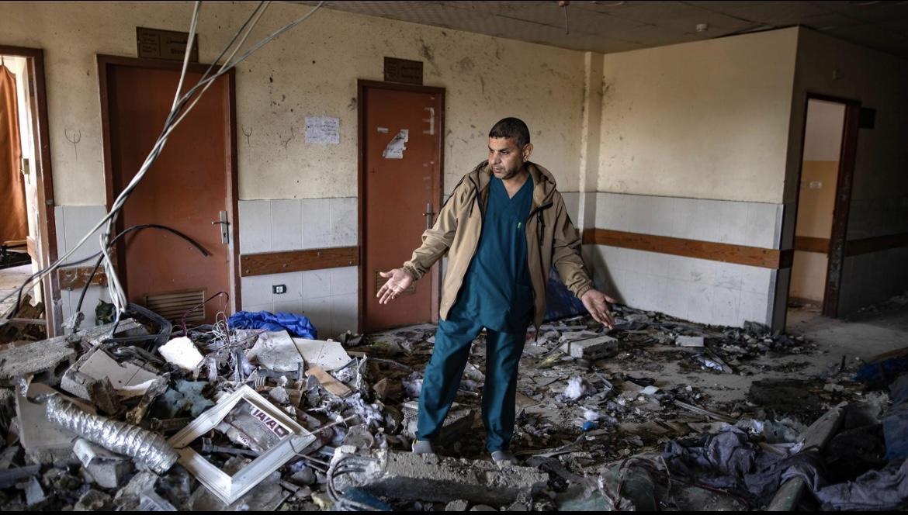

# Ruang Operasi Menjadi Medan Perang: Nasser Hospital dan Erosi Hukum Humaniter di Gaza

*Ilustrasi (pic: lastanpa.it).*

  
***Pasien bukan alat perang. Dokter bukan sasaran perang. Rumah sakit bukan ruang yang boleh kehilangan perlindungan hanya karena sebuah pihak mengucapkan kata “teroris”***
  

Serangan terhadap Rumah Sakit Nasser bukan hanya perkara enam orang tewas. Jika tenaga medis termasuk ahli bedah menjadi korban ketika rumah sakit masih menjalankan fungsi pelayanan, kita sedang berhadapan dengan persoalan hukum humaniter internasional, perlindungan fasilitas medis, dan runtuhnya kapasitas sistem kesehatan Gaza.

Rumah sakit bukan zona bebas hukum ketika perang berlangsung. Justru dalam perang, perlindungan terhadap rumah sakit dan tenaga medis menjadi semakin penting.

Saya akan memisahkan kronologi yang dilaporkan, klaim pihak-pihak yang terlibat, dan penilaian hukumnya. Kita tidak akan mengubah angka korban menjadi sekadar statistik, tetapi juga tidak akan menganggap semua tuduhan telah terbukti sebelum bukti diperiksa.

## Rekonstruksi Kejadian: Apa yang Sebenarnya Terjadi?

Enam korban jiwa, seorang ahli bedah gugur, dan pertanyaan besar: sampai di mana sebuah negara boleh menyerang ketika sasaran militernya berada di dalam rumah sakit?

Pada Kamis dini hari, 12 November 2026, serangan udara Israel menghantam bagian dari kompleks Rumah Sakit Nasser di Khan Younis, Gaza selatan.

Informasi yang dilaporkan media internasional:
- Enam orang meninggal dunia, menurut otoritas kesehatan dan pertahanan sipil Gaza.
- Sekitar 20 hingga 28 orang terluka. Angka berbeda menurut waktu pelaporan dan sumber.
- Salah satu korban meninggal adalah ahli bedah umum Dr. Rezik Abushira, yang juga ditulis Rizk Abu Shaira dalam laporan Associated Press.
- Serangan mengenai bagian bedah pada gedung Al-Yasin, termasuk area yang berhubungan dengan pelayanan operasi.
- Kerusakan dilaporkan terjadi pada bangsal bedah, ruang operasi, serta fasilitas pelayanan intensif.
- Menurut direktur rumah sakit, tidak ada peringatan sebelum serangan.
Ada detail yang sangat menyakitkan secara kemanusiaan: seorang dokter yang bekerja menyelamatkan nyawa justru kehilangan nyawanya dalam serangan terhadap fasilitas kesehatan tempat ia menjalankan tugas.

Dr. Abushira dilaporkan masih bekerja bersama seorang dokter bedah relawan Inggris beberapa jam sebelum serangan.

Namun kita perlu mencatat satu perkembangan penting: Israel kemudian mengonfirmasi bahwa serangan itu memang disengaja dan menyatakan sasaran utamanya adalah seorang komandan senior Hamas serta anggota sayap bersenjatanya.

Jadi, ini bukan sekadar laporan tentang ledakan yang asal-usulnya belum diketahui. Israel mengakui melakukan serangan, tetapi memberikan justifikasi militer yang berbeda dari penilaian otoritas Gaza.

## Apa Alasan Israel Menyerang Rumah Sakit?

Menurut pernyataan bersama militer Israel (IDF) dan Shin Bet, serangan tersebut ditujukan kepada Muhammad Abu Ismail, yang mereka identifikasi sebagai komandan Brigade Khan Younis Hamas.

Israel menyatakan Hamas menggunakan kompleks Nasser sebagai:
- Pusat komando dan pengendalian operasi.
- Tempat penyimpanan senjata.
- Pos pengamatan militer.
- Tempat berlindung bagi anggota kelompok bersenjata.
- Lokasi untuk mengoordinasikan kegiatan militer.
Israel juga menyatakan telah menggunakan amunisi presisi dan pengawasan udara untuk mengurangi risiko terhadap warga sipil. Tetapi ada persoalan pembuktian.

Pernyataan bahwa rumah sakit digunakan sebagai pusat operasi militer adalah klaim pihak yang melakukan serangan. Reuters menyatakan tidak dapat memverifikasi secara independen tuduhan tersebut. 

Associated Press juga melaporkan bahwa Israel belum menyertakan bukti publik yang dapat diperiksa secara independen untuk mendukung klaimnya.

Kita perlu mengajukan beberapa pertanyaan:
Apakah benar ada pusat komando militer di dalam kompleks?
Di gedung atau ruangan mana aktivitas tersebut berlangsung?
Apakah sasaran militer berada dekat pasien, ruang operasi, dan fasilitas perawatan?
Apakah serangan dapat diarahkan secara lebih terbatas?
Apakah ada alternatif operasi yang mengurangi risiko bagi pasien dan tenaga kesehatan?
Apakah rumah sakit diberi peringatan dan kesempatan melakukan evakuasi?
Tanpa jawaban dan bukti yang memadai, kita belum dapat menguji secara independen proporsionalitas tindakan Israel.

## Hukum Humaniter Internasional: Rumah Sakit Bukan Target Biasa

Sekarang kita masuk ke bagian hukum. Ini inti persoalannya. Dalam hukum humaniter internasional (International Humanitarian Law/IHL), rumah sakit memiliki perlindungan khusus. Dasar utamanya adalah Konvensi Jenewa IV 1949, khususnya Pasal 18 dan 19, serta aturan hukum kebiasaan internasional.

ICRC menjelaskan bahwa rumah sakit harus dihormati dan dilindungi selama menjalankan fungsi medisnya. Perlindungan itu tidak hilang hanya karena perang sedang berlangsung atau karena terdapat anggota militer yang sedang dirawat.

## Kapan Rumah Sakit dapat Kehilangan Perlindungan Khusus?

Menurut Pasal 19 Konvensi Jenewa IV, rumah sakit dapat kehilangan perlindungan khusus apabila digunakan, di luar fungsi kemanusiaannya, untuk melakukan tindakan yang merugikan pihak lawan secara militer.

Contohnya:
- Menjadi pangkalan untuk melancarkan serangan.
- Menjadi tempat penyimpanan senjata.
- Menjadi pos pengamatan yang mengirim informasi militer.
- Menjadi pusat koordinasi operasi tempur.
- Menjadi tempat berlindung bagi kombatan yang masih aktif bertempur.
Namun ada syarat yang sangat penting: peringatan harus diberikan terlebih dahulu dan, jika sesuai dengan keadaan, harus disertai batas waktu yang wajar serta tidak diindahkan.

Artinya, tuduhan penggunaan rumah sakit untuk kepentingan militer tidak otomatis menjadi izin untuk langsung menyerang.
Ada prosedur dan kewajiban perlindungan yang harus dipenuhi.

Empat lapisan hukum yang harus diuji
- Distinction (pembedaan)
Serangan harus diarahkan kepada sasaran militer, bukan warga sipil atau objek sipil yang dilindungi.
- Proportionality (proporsionalitas)
Kerugian sipil yang diperkirakan tidak boleh berlebihan dibandingkan keuntungan militer konkret dan langsung yang diharapkan.
- Precautions (kehati-hatian)
Penyerang wajib mengambil semua tindakan pencegahan yang layak untuk menghindari atau meminimalkan korban sipil.
- Special protection of medical units (perlindungan khusus fasilitas medis)
Rumah sakit tidak boleh dijadikan sasaran kecuali syarat hukum yang ketat untuk hilangnya perlindungan khusus terpenuhi.
Landasan: Konvensi Jenewa IV 1949, Additional Protocol I 1977, dan hukum humaniter kebiasaan ICRC.

Ada satu kekeliruan yang sering muncul dalam debat publik: seolah-olah keberadaan satu anggota Hamas di rumah sakit otomatis mengubah seluruh rumah sakit menjadi sasaran militer. Itu tidak benar.

Keberadaan orang bersenjata, penjagaan fasilitas, atau pasien yang merupakan anggota kelompok bersenjata tidak dengan sendirinya menghilangkan perlindungan rumah sakit. 

Bahkan, ICRC secara eksplisit menjelaskan bahwa keberadaan kombatan yang sedang dirawat bukan tindakan yang merugikan pihak lawan.

## Jika Ada Komandan Hamas di sana, Apakah Israel Boleh Menyerang?

Ini pertanyaan paling penting dan paling rumit. Jawabannya tidak bisa diberikan hanya dengan mengatakan, “Ada komandan Hamas, berarti sah diserang.”

Kita perlu membedakan dua persoalan hukum:

A. Status sasaran

Apakah orang yang menjadi sasaran merupakan anggota kelompok bersenjata dengan fungsi tempur berkelanjutan atau individu yang secara langsung berpartisipasi dalam permusuhan?
Apakah gedung yang diserang memenuhi definisi sasaran militer?

B. Cara serangan dilakukan

Sekalipun sasaran militer sah, penyerang tetap harus:
- Memastikan sasaran secara memadai.
- Memilih metode dan senjata yang mengurangi risiko bagi warga sipil.
- Memperhitungkan pasien dan tenaga medis yang berada di lokasi.
- Membatalkan atau menangguhkan serangan jika kerugian sipil diperkirakan berlebihan.
- Memenuhi kewajiban peringatan terkait fasilitas medis yang perlindungan khususnya hendak dihentikan.
Sebuah sasaran militer yang sah tidak memberikan kekebalan hukum kepada semua cara untuk menyerangnya. Inilah prinsip yang sering hilang dalam retorika perang.

Legalitas sasaran dan legalitas metode serangan adalah dua pemeriksaan yang berbeda. Jika Hamas memang menggunakan fasilitas kesehatan untuk kegiatan militer di luar fungsi medisnya, tindakan tersebut juga dapat melanggar hukum humaniter dan membahayakan pasien. Tetapi pelanggaran satu pihak tidak menghapus kewajiban hukum pihak lainnya.

## Ironi Paling Mengerikan: Seorang Ahli Bedah Menjadi Korban

Mari kita lihat akibatnya dari perspektif sistem kesehatan. Rumah sakit bukan sekadar bangunan dengan tempat tidur dan peralatan. Rumah sakit adalah jaringan kemampuan manusia.

Seorang ahli bedah membawa:
- Pengetahuan klinis yang diperoleh bertahun-tahun.
- Kemampuan melakukan operasi darurat.
- Pengalaman menangani trauma berat.
- Kemampuan membimbing dokter muda dan tenaga kesehatan lain.
- Kapasitas mengambil keputusan ketika waktu penyelamatan sangat terbatas.
Ketika seorang ahli bedah meninggal, kerugiannya tidak berhenti pada satu orang.
Pasien yang seharusnya ditangani juga kehilangan kesempatan memperoleh pelayanan dari tenaga spesialis tersebut.

Ini disebut health-system capacity loss, yaitu kehilangan kapasitas sistem kesehatan. Dan dampaknya bisa berlipat. Misalnya, seorang pasien dengan luka tembak memerlukan operasi segera. Jika ruang operasi rusak, listrik terganggu, radiologi berhenti, dan ahli bedah meninggal, maka pasien berikutnya menghadapi risiko yang jauh lebih besar meskipun tidak terkena serangan secara langsung.

AP melaporkan serangan ini menyebabkan operasi serta pelayanan radiologi dan laboratorium terganggu.

Jadi, ada dua jenis korban:
Korban langsung, yakni mereka yang tewas dan terluka akibat serangan.
Korban tidak langsung, yakni pasien yang kehilangan akses terhadap layanan medis karena fasilitas dan tenaga kesehatan tidak lagi tersedia.
Dalam studi kesehatan masyarakat, dampak kedua ini disebut indirect mortality atau kematian tidak langsung.

## Mengapa Satu Serangan Terhadap Rumah Sakit Dapat Berdampak Pada Seluruh Gaza?

Menurut laporan OCHA bertanggal 28 Oktober 2026, dari 670 fasilitas kesehatan yang tercatat di Gaza, hanya 316 yang masih berfungsi, dan sebagian besar hanya berfungsi secara parsial.

Dari 43 rumah sakit yang tercatat, 26 masih beroperasi dan 17 tidak berfungsi. Bahkan 26 rumah sakit yang masih beroperasi itu tidak seluruhnya berfungsi penuh.

Ini angka yang penting. Bayangkan sebuah sistem kesehatan dengan kapasitas yang telah menyusut. Kemudian salah satu rumah sakit penting kembali mengalami kerusakan.
Dampaknya bukan hanya pada pasien yang berada di dalam bangunan saat serangan terjadi. Pasien dari wilayah lain juga dapat kehilangan tempat rujukan.

Akibatnya, muncul efek domino:
- Serangan terhadap fasilitas kesehatan
- Ruang operasi dan peralatan rusak
- Kapasitas tenaga medis menurun
- Pasien dialihkan ke fasilitas lain yang sudah terbebani
- Risiko kematian dan komplikasi meningkat

Inilah mengapa kehancuran rumah sakit tidak dapat diukur hanya dari luas bangunan yang rusak atau jumlah korban pada hari serangan. Kerusakan sistem kesehatan menciptakan penderitaan yang terus berlangsung setelah pesawat dan rudal meninggalkan wilayah tersebut.

## Konteks Gencatan Senjata: Mengapa Serangan ini Penting?

Serangan Nasser terjadi ketika gencatan senjata yang dimediasi Amerika Serikat telah berlaku sejak 10 Oktober 2025. Namun, gencatan senjata tidak berarti kekerasan berhenti sepenuhnya.

Menurut otoritas kesehatan Gaza, sedikitnya 1.600 warga Palestina telah tewas akibat serangan dan tembakan Israel sejak kesepakatan itu berlaku. Israel, dalam laporan yang sama, menyatakan empat tentaranya tewas selama periode tersebut. Angka korban Palestina tersebut merupakan data otoritas Gaza yang dilaporkan Reuters, bukan hasil verifikasi independen Reuters terhadap setiap kejadian.

Ada dua persoalan yang harus dibedakan:
- Apakah suatu serangan melanggar ketentuan gencatan senjata?
- Apakah cara serangan itu dilakukan melanggar hukum humaniter internasional?
Keduanya berkaitan, tetapi bukan pertanyaan hukum yang identik.

Sebuah tindakan dapat melanggar kesepakatan gencatan senjata sekaligus melanggar hukum perang. Sebaliknya, penilaian legalitas serangan berdasarkan hukum humaniter memerlukan pemeriksaan tersendiri.

Kita tidak boleh menganggap keberadaan gencatan senjata otomatis menjadikan setiap serangan ilegal, tetapi juga tidak boleh memperlakukan gencatan senjata sebagai kertas dekorasi diplomatik.

## Apakah Serangan ini Merupakan Kejahatan Perang?

Ini bagian yang perlu ketelitian hukum. 

Statuta Roma Mahkamah Pidana Internasional (ICC) Pasal 8 memasukkan sejumlah tindakan sebagai kejahatan perang, termasuk:
- Dengan sengaja menyerang rumah sakit dan tempat pengumpulan orang sakit dan terluka, selama bukan sasaran militer.
- Dengan sengaja menyerang tenaga medis yang menggunakan lambang perlindungan sesuai hukum internasional.
- Melakukan serangan yang diketahui akan menyebabkan kerugian sipil berlebihan dibandingkan keuntungan militer konkret dan langsung yang diharapkan.
Namun, kita tidak boleh menyatakan enam kematian otomatis membuktikan kejahatan perang.

Penyelidikan harus memeriksa:
- Apakah fasilitas yang diserang masih menjalankan fungsi medis?
- Apakah benar ada penggunaan militer di lokasi dan apakah hal itu dapat dibuktikan?
- Apakah prosedur peringatan dipenuhi?
- Apakah sasaran yang dituju merupakan sasaran militer yang sah?
- Apa keuntungan militer konkret yang diperkirakan?
- Apakah kerugian terhadap pasien dan tenaga kesehatan dapat diperkirakan dan apakah tindakan pencegahan yang layak dilakukan?
Satu hal lagi: serangan yang menewaskan tenaga medis tidak otomatis membuktikan bahwa tenaga medis itu sengaja dijadikan sasaran. Niat, pengetahuan, dan keadaan serangan harus diperiksa.

Sebaliknya, klaim bahwa serangan menggunakan senjata presisi juga tidak otomatis membuktikan kepatuhan terhadap hukum perang. Presisi senjata bukan pengganti presisi penilaian hukum.

## Rumah Sakit Menjadi Medan Perebutan Narasi

Ada fenomena komunikasi perang yang menarik dalam kasus ini.

Setelah serangan, muncul dua narasi utama:

| Narasi Israel | Narasi otoritas Palestina |
|------|-------|
|Rumah sakit digunakan Hamas untuk kegiatan militer|Rumah sakit merupakan fasilitas kesehatan yang diserang|
|Serangan ditujukan kepada komandan Hamas|Serangan membunuh warga sipil dan tenaga medis|
|Penggunaan amunisi presisi dimaksudkan mengurangi korban|Kerusakan menunjukkan dampak berat terhadap pelayanan medis|
|Hamas dituduh mengeksploitasi fasilitas sipil|Israel dituduh melanggar perlindungan rumah sakit|

Kita tidak boleh menerima seluruh narasi salah satu pihak tanpa pemeriksaan. Tetapi kita juga tidak harus menganggap semua klaim memiliki tingkat pembuktian yang sama.

Ada perbedaan antara:
- Pernyataan militer tentang sasaran.
- Kesaksian dokter dan pasien.
- Rekaman kerusakan fisik.
- Data korban dari otoritas kesehatan.
- Investigasi independen.
- Temuan hukum oleh lembaga berwenang.
Semua itu harus diperiksa dan diberi bobot sesuai kualitas buktinya.

Satu persoalan yang sangat serius adalah ketika pembenaran militer terus-menerus menjadi jawaban utama terhadap kehancuran fasilitas kesehatan.

Hukum humaniter dibuat justru untuk membatasi kekerasan ketika pihak-pihak yang bertikai memiliki alasan militer untuk menyerang.

Jika alasan militer saja cukup untuk membenarkan segala tindakan, maka perlindungan warga sipil kehilangan maknanya.

Dari informasi yang tersedia hingga hari ini, kita dapat menyimpulkan beberapa hal:
- Israel mengakui melakukan serangan terhadap kompleks Nasser dan menyatakan sasarannya adalah komandan serta anggota Hamas.
- Enam orang dilaporkan tewas, termasuk ahli bedah Rezik Abushira, dan sekitar 20 hingga 28 orang terluka menurut laporan berbeda.
- Kerusakan pada fasilitas bedah mengganggu pelayanan rumah sakit.
- Klaim Israel mengenai penggunaan kompleks rumah sakit untuk kegiatan militer belum dapat diverifikasi secara independen oleh Reuters.
- Legalitas serangan harus diperiksa berdasarkan perlindungan khusus rumah sakit, aturan peringatan, pembedaan, proporsionalitas, dan kewajiban kehati-hatian.
- Kerusakan rumah sakit menambah beban pada sistem kesehatan Gaza yang telah mengalami kerusakan luas.
Pertanyaan terpenting bukan hanya apakah Israel berhasil menyerang orang yang disebutnya komandan Hamas. Pertanyaan yang harus dijawab adalah: Apakah tujuan militer yang diklaim itu dapat dicapai tanpa menghancurkan kemampuan sebuah rumah sakit untuk menyelamatkan pasien yang tidak terlibat dalam pertempuran? Itulah inti pengujian hukum humaniter.

Seorang ahli bedah memasuki ruang operasi untuk menunda kematian. Dalam perang yang kehilangan batas kemanusiaan, bahkan ruang tempat manusia berjuang mempertahankan hidup dapat berubah menjadi tempat kematian.

Kita tidak boleh membiarkan kematian Dr. Abushira menjadi sekadar angka keenam dalam laporan berita. Ia adalah tenaga medis dengan pengetahuan, tanggung jawab, dan pasien yang pernah menaruh harapan kepadanya.

Hukum humaniter bukan hadiah yang diberikan kepada pihak yang kita sukai. Ia adalah batas yang harus dipatuhi justru ketika kita sedang berhadapan dengan pihak yang kita anggap musuh.

Pasien bukan alat perang. Dokter bukan sasaran perang. Rumah sakit bukan ruang yang boleh kehilangan perlindungan hanya karena sebuah pihak mengucapkan kata “teroris”. 

  
**Referensi**

Associated Press. (2026, November 12). Israeli strike on Gaza hospital kills 6 people, including a doctor and a child, Health Ministry says. Laporan Associated Press⁠.

Reuters. (2026, November 12). Israeli strike on southern Gaza hospital kills six, Gaza civil defence says. Laporan Reuters⁠.

Anadolu Agency. (2026, November 12). Israeli airstrike kills 6 Palestinians at Nasser Hospital in southern Gaza. Laporan Anadolu Agency⁠.

The Times of Israel. (2026, November 12). IDF says overnight strike on Gaza hospital targeted top Hamas commander, other operatives. Pernyataan militer Israel yang dilaporkan media⁠.

International Committee of the Red Cross. (1949). Geneva Convention (IV) relative to the Protection of Civilian Persons in Time of War, Article 19. Pasal 19 Konvensi Jenewa IV⁠.

International Committee of the Red Cross. (1977). Protocol Additional to the Geneva Conventions of 12 August 1949, and relating to the Protection of Victims of International Armed Conflicts (Protocol I), Articles 12–13. Pasal 12 dan 13 Protokol Tambahan I⁠.

International Committee of the Red Cross. (2005). Customary International Humanitarian Law, Volume I: Rules. Cambridge University Press. Rule 28: Medical Units⁠.

International Committee of the Red Cross. (2023). The protection of hospitals during armed conflicts: What the law says. Penjelasan hukum perlindungan rumah sakit⁠.

United Nations Office for the Coordination of Humanitarian Affairs. (2026, October 28). Gaza: Reported impact snapshot. Laporan OCHA, 28 Oktober 2026⁠.

International Committee of the Red Cross. (2009). Customary International Humanitarian Law, Rule 25: Medical Personnel. Perlindungan tenaga medis⁠.
