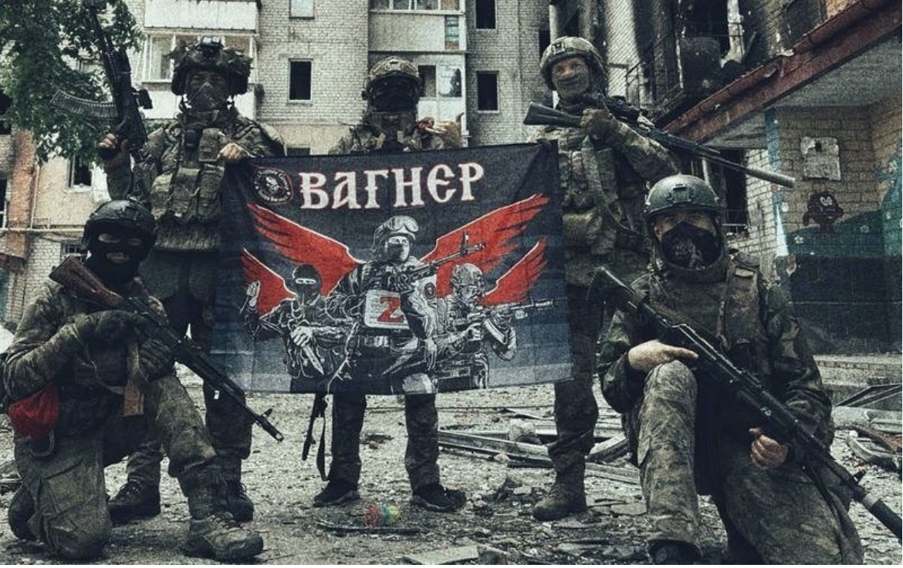

# Rusia Merekrut Tentara Asing Termasuk Indonesia: Kebutuhan Militer, Uang, atau Perdagangan Manusia? 

*(pic: narodedin.com.*

  
***Perang tidak hanya mengonsumsi amunisi. Ia juga dapat mengonsumsi harapan ekonomi orang-orang yang tidak pernah berniat menjadi tentara***
  

Tiga persoalan yang harus dipisahkan: mengapa Rusia membutuhkan personel asing, mengapa warga negara Indonesia bisa masuk ke dalam jaringan perekrutan itu, dan apakah mereka benar-benar direkrut secara sukarela atau justru ditipu.

Ada satu hal yang harus kita luruskan sejak awal: menyebut semua orang Indonesia yang bergabung sebagai tentara bayaran belum tentu tepat secara hukum. Ada yang mungkin direkrut melalui kontrak militer formal, ada yang menjadi kombatan asing, dan ada pula dugaan korban penipuan perekrutan. Status mereka tidak otomatis sama.

Kita bedah dari struktur militernya, ekonomi perang, sampai kerentanan perekrutan tenaga kerja Indonesia. Karena persoalannya bukan sekadar siapa yang mau berperang, tetapi juga siapa yang memperoleh keuntungan dari orang yang bersedia mengambil risiko tersebut.

## Polisi Indonesia Sudah Membongkar Jaringan TPPO

Kasus terkonfirmasi dalam penyidikan Polri. Ada perkembangan yang sangat penting pada November 2026.

Pada 2 November, Bareskrim Polri mengumumkan penanganan lima laporan polisi terkait dugaan perdagangan orang dengan modus perekrutan WNI untuk menjadi tentara bayaran di Rusia.

Angka yang disampaikan Polri saat itu:
- 58 orang tercatat sebagai korban dalam lima laporan polisi.
- 13 tersangka telah diamankan dalam pengungkapan yang diberitakan The Jakarta Post.
- Termasuk warga negara Rusia dan Ukraina.
- Satu korban dilaporkan meninggal dunia.
- Modus perekrutan menggunakan media sosial, grup lowongan kerja, dan aplikasi percakapan.

Kemudian, pada 11 November, Polri mengungkap jaringan lain yang melibatkan enam tersangka, termasuk seorang warga Rusia dan seorang warga Ukraina. 

Dalam jaringan tersebut, polisi mencatat 23 WNI telah dikirim ke zona konflik; satu dilaporkan meninggal dan beberapa mengalami luka serius akibat ranjau. Delapan calon korban berhasil dicegah keberangkatannya.

Ada pula laporan penangkapan perekrut di Yogyakarta pada 16 November, yang diduga merekrut sedikitnya 17 orang.

Penting: angka 58, 23, dan 17 tidak boleh dijumlahkan begitu saja. Itu berasal dari pengungkapan dan jaringan perkara yang berbeda, dan mungkin ada tumpang tindih korban. Angka tersebut juga merupakan data penyidikan atau laporan, bukan putusan pengadilan yang membuktikan kesalahan seluruh tersangka.

Jadi, persoalannya bukan hanya orang Indonesia secara sukarela melamar menjadi tentara asing. Ada indikasi kuat bahwa sebagian perekrutan berlangsung melalui penipuan dan eksploitasi.

## Mengapa Rusia Membutuhkan Tentara Asing?

Kita mulai dari pertanyaan paling mendasar: kalau Rusia memiliki penduduk lebih dari 140 juta, mengapa harus merekrut orang dari Indonesia, Nepal, India, Bangladesh, Kuba, dan berbagai negara lainnya?

Jawabannya berkaitan dengan kebutuhan tenaga manusia dalam perang berkepanjangan.

Perang Rusia-Ukraina telah menjadi perang atrisi (war of attrition), yaitu perang ketika kemampuan mempertahankan personel, persenjataan, amunisi, logistik, dan kapasitas industri menjadi faktor penentu.

Dalam perang semacam ini, jumlah personel bukan sekadar angka statistik. Ia menentukan kemampuan mempertahankan garis depan, melakukan rotasi pasukan, mengisi posisi yang kosong, dan mempertahankan operasi militer.

Rusia menghadapi beberapa persoalan.

A. Kebutuhan mengganti korban dan mempertahankan kekuatan tempur

Personel militer mengalami kematian, luka, kehilangan kemampuan tempur, dan kelelahan operasional.

Tidak semua orang yang terluka dapat kembali bertugas. Tidak semua unit dapat mempertahankan kekuatan awalnya.

Karena itu, kebutuhan rekrutmen bukan hanya untuk memperbesar tentara, melainkan juga mempertahankan jumlah personel yang dapat digunakan secara operasional.

Analisis CNN pada Juni 2026 membahas bagaimana keunggulan jumlah personel Rusia mulai menghadapi tekanan. Atlantic Council pada November 2026 juga mengulas perekrutan ribuan warga asing untuk perang tersebut.

B. Mobilisasi domestik memiliki biaya politik

Ini bagian yang sering luput.

Rusia sebenarnya memiliki beberapa pilihan:
- Melakukan mobilisasi lebih luas terhadap warga negaranya.
- Meningkatkan insentif bagi warga Rusia yang bersedia menandatangani kontrak militer.
- Menggunakan personel dari struktur militer dan paramiliter yang tersedia.
- Merekrut warga asing.
- Mobilisasi besar-besaran dapat menimbulkan ketidakpuasan sosial, mengganggu pasar tenaga kerja, dan meningkatkan tekanan terhadap pemerintah.

Pengalaman mobilisasi parsial Rusia pada September 2022 memperlihatkan bahwa mobilisasi memiliki konsekuensi domestik yang nyata, termasuk protes dan perpindahan warga ke luar negeri.

Karena itu, perekrutan melalui kontrak dan insentif finansial menjadi salah satu cara untuk memperoleh personel tanpa harus mengumumkan mobilisasi umum baru.

Tetapi jangan menyimpulkan bahwa orang Rusia tidak mau perang. Ada warga Rusia yang secara sukarela mendaftar, ada yang menjalani dinas karena kewajiban, dan ada yang masuk melalui berbagai mekanisme kontrak.

Masalahnya bukan seluruh masyarakat Rusia menolak perang. Masalahnya adalah pemerintah harus terus menyediakan personel untuk perang yang berkepanjangan, sementara mobilisasi memiliki biaya politik dan ekonomi.

C. Tentara asing dapat menjadi sumber tenaga tambahan

Orang asing menawarkan beberapa keuntungan bagi sistem perekrutan:
- Memperluas kumpulan calon personel.
- Mengurangi tekanan untuk merekrut warga domestik.
- Menarik orang yang membutuhkan uang dalam jumlah besar.
- Menggunakan jaringan perekrut lintas negara untuk menjangkau calon personel.

Namun, ada paradoksnya: semakin panjang perang, semakin besar pula insentif untuk mencari tenaga dari luar, termasuk melalui jaringan yang tidak transparan.

## Apakah Rusia Membayar Mereka Murah?

Justru ada ironi: yang ditawarkan kepada calon tentara asing bukan selalu upah murah. Dalam sejumlah kasus, iming-imingnya sangat besar.

Dalam pengungkapan Bareskrim pada 2 November, Polri menyebut calon korban dijanjikan bonus penandatanganan kontrak yang dijanjikan US$35.000, sekitar Rp620 juta menurut konversi yang diberitakan Polri.

Sementara gaji bulanan yang dijanjikan US$3.000 atau sekitar Rp50 juta per bulan menurut laporan yang sama.

Angka ini adalah janji yang dilaporkan penyidik, bukan bukti bahwa setiap korban benar-benar menerima pembayaran tersebut.

Mengapa nominalnya besar?

Karena perekrut sedang menjual sesuatu yang memiliki risiko ekstrem. Bonus dan gaji tinggi berfungsi sebagai insentif untuk membuat seseorang bersedia meninggalkan pekerjaan, keluarga, dan negaranya.

Namun, kita harus membedakan tiga angka:
- Nilai yang dijanjikan perekrut.
- Nilai yang benar-benar dibayarkan kepada calon personel.
- Biaya riil yang dikeluarkan negara atau institusi militer untuk mendapatkan dan mempertahankan personel tersebut.

Ketiganya belum tentu sama.

Dalam kasus perdagangan orang, janji pembayaran bahkan bisa menjadi alat penipuan. Seseorang dapat diberangkatkan dengan harapan memperoleh pekerjaan berupah tinggi, lalu mendapati bahwa kontrak yang harus ditandatangani adalah kontrak militer.

Jadi, jangan langsung menyebut Rusia membayar tentara Indonesia dengan murah. Bukti yang ada justru menunjukkan adanya janji imbalan besar yang digunakan untuk menarik calon korban.

## Bagaimana Orang Indonesia Bisa Masuk ke dalam Perang itu?

Modus yang ditemukan aparat Indonesia memperlihatkan bahwa perekrutan tidak selalu dimulai dengan kalimat: “Mau ikut perang?”

Justru, tawarannya bisa jauh lebih biasa.

Tahap pertama: iklan pekerjaan.

Calon korban menemukan tawaran pekerjaan melalui media sosial, grup lowongan kerja, atau aplikasi percakapan.

Pekerjaan yang ditawarkan antara lain:
- Logistik.
- Pengamanan perbatasan.
- Pembangunan fasilitas pertahanan.
- Pekerjaan konstruksi.
- Pekerjaan pertanian.

Tahap kedua: iming-iming finansial.

Calon korban dijanjikan gaji tinggi, bonus kontrak, tiket pesawat, dan fasilitas lainnya.

Tahap ketiga: keberangkatan ke Rusia.

Menurut keterangan penyidik yang diberitakan The Jakarta Post dan Kompas, sejumlah calon korban diberangkatkan menggunakan visa wisata, kemudian diarahkan menjalani pemeriksaan kesehatan dan proses penandatanganan kontrak militer.

Tahap keempat: perubahan status pekerjaan.

Orang yang mengira akan bekerja di sektor sipil dapat berhadapan dengan kontrak militer, pelatihan, dan kemungkinan penempatan ke zona konflik.

Ini bukan sekadar persoalan iklan pekerjaan palsu. Dalam perspektif hukum perdagangan orang, persoalan utamanya adalah penggunaan penipuan, perekrutan, pengangkutan, dan eksploitasi seseorang. Persetujuan korban yang diperoleh melalui penipuan tidak otomatis membuat eksploitasi itu sah.

## Kasus Muhammad Taufiq: Contoh Betapa Mahalnya Risiko yang Tersembunyi

Ada satu kasus yang sangat memilukan.

Muhammad Taufiq, warga Indonesia yang menurut laporan memiliki pengalaman bekerja sebagai pengemudi taksi dan manajer perusahaan pertanian, dilaporkan tewas setelah bergabung dengan militer Rusia.

Menurut informasi yang disampaikan intelijen militer Ukraina dan diberitakan Kompas:
- Ia mengirim CV ketika mencari pekerjaan.
- Ia menerima tawaran penghasilan tinggi.
- Ia menandatangani kontrak militer satu tahun pada 19 April 2026.
- Ia kemudian ditempatkan sebagai penembak senapan mesin.
- Ia dilaporkan hanya menjalani pelatihan sekitar satu setengah minggu sebelum dikirim ke wilayah konflik.
- Ia dilaporkan tewas dalam pertempuran pertamanya pada Mei 2026.

Ada batas penting pada sumber ini: kronologi tersebut berasal dari keterangan intelijen Ukraina, bukan hasil investigasi independen yang seluruh detailnya telah diverifikasi secara terbuka.

Namun, kasus ini memperlihatkan persoalan mendasar: seseorang yang berangkat untuk mencari penghasilan dapat berakhir di medan perang dengan persiapan militer yang sangat terbatas.

## Apakah Mereka Tentara Bayaran atau Korban Perdagangan Orang?

Ini penting sekali, secara hukum internasional, istilah mercenary memiliki definisi yang jauh lebih sempit daripada penggunaan sehari-hari.

Pasal 47 Protokol Tambahan I Konvensi Jenewa 1977 menetapkan beberapa unsur yang harus terpenuhi agar seseorang dapat dikategorikan sebagai tentara bayaran, antara lain:
- Direkrut secara khusus untuk bertempur dalam konflik bersenjata.
- Benar-benar mengambil bagian langsung dalam permusuhan.
- Termotivasi terutama oleh keuntungan pribadi.
- Dijanjikan kompensasi material yang secara substansial lebih besar daripada yang diterima kombatan dengan pangkat dan fungsi serupa.
- Bukan warga negara pihak yang berkonflik dan bukan penduduk wilayah yang dikendalikan pihak tersebut.
- Bukan anggota angkatan bersenjata suatu pihak dalam konflik.
- Tidak dikirim oleh negara ketiga sebagai anggota resmi angkatan bersenjatanya.

Semua unsur itu harus dipenuhi.

Karena itu, seorang warga Indonesia yang menandatangani kontrak resmi dengan angkatan bersenjata Rusia belum otomatis memenuhi definisi tentara bayaran menurut Pasal 47.

Sebaliknya, seseorang yang ditipu untuk masuk ke dalam militer bisa sekaligus menjadi kombatan dalam praktik perang dan korban perdagangan orang dalam konteks perekrutannya. Status kombatan dan status korban perdagangan orang bukan dua kategori yang selalu saling meniadakan.

Tiga kategori yang harus dibedakan:

1. Kombatan asing

Warga negara asing yang bergabung dengan angkatan bersenjata suatu negara.

2. Tentara bayaran

Orang yang memenuhi seluruh unsur definisi hukum khusus tentang mercenary.

3. Korban perdagangan orang

Orang yang direkrut atau dieksploitasi melalui cara-cara yang memenuhi unsur TPPO, termasuk penipuan dan pemaksaan.

Inilah mengapa judul berita yang menyebut semua WNI sebagai tentara bayaran perlu dibaca kritis. Istilah jurnalistik tidak selalu sama dengan klasifikasi hukum.

## Apakah Orang Indonesia Gampang Ditipu?

Bukan berarti orang Indonesia secara inheren lebih mudah ditipu. Yang lebih tepat: ada kerentanan sosial-ekonomi dan kelemahan perlindungan migrasi yang dapat dieksploitasi oleh jaringan perekrutan internasional.

Mari kita lihat mekanismenya.

A. Ketimpangan nilai uang

Bayangkan seseorang yang penghasilannya Rp4–6 juta sebulan menerima tawaran gaji Rp50 juta sebulan, ditambah bonus ratusan juta rupiah.

Secara psikologis, tawaran tersebut bukan sekadar kenaikan gaji. Ia tampak seperti kesempatan mengubah kondisi ekonomi keluarga dalam waktu singkat.

Dalam ekonomi perilaku, ada beberapa mekanisme yang relevan:
- Present bias: keuntungan besar yang segera terlihat lebih menarik daripada risiko jangka panjang yang belum dialami.
- Optimism bias: seseorang merasa kemungkinan buruk akan menimpa orang lain, bukan dirinya.
- Authority bias: perekrut yang memiliki dokumen, seragam, jaringan internasional, atau penampilan profesional dianggap lebih dapat dipercaya.
- Information asymmetry: perekrut mengetahui pekerjaan sebenarnya, sedangkan calon pekerja hanya mengetahui informasi yang diberikan kepadanya.
- Perekrut yang manipulatif dapat memanfaatkan keempatnya.

B. Perekrutan menggunakan jaringan sosial

Penipuan tidak selalu datang dari orang asing yang tiba-tiba mengirim pesan.

Jaringan perekrutan dapat menggunakan perantara lokal, grup pekerjaan, kenalan, bahkan orang yang tampak memiliki hubungan dengan perusahaan atau lembaga tertentu.

Kepercayaan sosial kemudian menjadi alat distribusi informasi palsu.

Seseorang mungkin berpikir: “Kalau teman saya juga ikut, berarti pekerjaan ini benar.” Padahal, teman tersebut mungkin sama-sama menjadi korban.

C. Literasi migrasi dan verifikasi pekerjaan

Banyak calon pekerja tidak memiliki akses yang memadai untuk memeriksa:
- Legalitas perekrut.
- Identitas perusahaan pemberi kerja.
- Jenis visa yang digunakan.
- Kontrak kerja dalam bahasa yang dipahami.
- Izin bekerja di negara tujuan.
- Ketentuan tentang risiko militer dan penempatan.

Inilah celah yang dapat dimanfaatkan oleh jaringan lintas negara.

D. Kerentanan bukan hanya masalah kemiskinan

Orang yang berpendidikan tinggi, memiliki pengalaman kerja internasional, dan mampu berbahasa asing pun bisa menjadi korban jika menghadapi penipuan yang dirancang dengan baik.

Kasus Muhammad Taufiq yang memiliki pengalaman kerja di luar negeri menunjukkan bahwa pendidikan dan pengalaman internasional bukan jaminan seseorang kebal dari manipulasi.

Jadi, menyebut korban bodoh atau gampang ditipu justru mengalihkan perhatian dari struktur perekrutan dan pihak yang memperoleh keuntungan.

Pertanyaan yang lebih penting bukan mengapa orang Indonesia begitu mudah ditipu, tetapi bagaimana jaringan perekrutan dapat beroperasi lintas negara, menggunakan perantara lokal, dan menjanjikan pekerjaan yang berbeda dari pekerjaan sebenarnya.

## Apakah Pemerintah Indonesia Sudah Bereaksi?

Ada tindakan diplomatik dan penegakan hukum. Pemerintah Indonesia telah mengambil beberapa langkah:

Pertama, penyidikan TPPO.

Bareskrim dan sejumlah Polda menangani laporan perekrutan WNI untuk militer Rusia. Pengungkapan jaringan juga memperlihatkan keterlibatan warga negara asing sebagai tersangka.

Kedua, komunikasi diplomatik dengan Moskow.

Pada awal November 2026, Indonesia meminta Rusia menghentikan perekrutan WNI melalui mekanisme resmi militernya dan meminta agar Indonesia dimasukkan ke dalam daftar negara yang dikecualikan dari perekrutan tersebut.

Pemerintah Indonesia menyampaikan kekhawatiran bahwa sebagian praktik perekrutan dapat masuk kategori perdagangan orang.

Ketiga, verifikasi nasib WNI.

Kementerian Luar Negeri dan perwakilan Indonesia melakukan koordinasi untuk memeriksa identitas, status, kondisi, dan keterlibatan WNI yang dilaporkan bergabung dengan militer Rusia. 

Namun, ada pertanyaan besar yang masih harus dijawab:
- Berapa jumlah keseluruhan WNI yang telah direkrut?
- Berapa yang benar-benar memahami bahwa mereka menandatangani kontrak militer?
- Berapa yang masih hidup dan berada di wilayah konflik?
- Apakah mereka dapat membatalkan kontrak?
- Apakah perekrut lokal memperoleh komisi dari setiap orang yang diberangkatkan?
- Apakah ada koordinasi antara jaringan perekrut dan institusi militer Rusia?

Jawaban atas pertanyaan-pertanyaan ini menentukan apakah kasusnya merupakan perekrutan ilegal yang terisolasi atau jaringan eksploitasi lintas negara yang lebih luas.

## Apakah ini Sudah Menjadi Persoalan Perdagangan Manusia Internasional?

Ada perkembangan yang patut diperhatikan.

Pada 11 November 2026, International Federation for Human Rights (FIDH) melaporkan bahwa jaksa Ukraina telah membuka penyelidikan pidana mengenai dugaan perdagangan manusia dalam perekrutan warga asing untuk kepentingan perang Rusia.

Penyelidikan tersebut menggunakan ketentuan perdagangan manusia untuk eksploitasi dalam konflik bersenjata. FIDH, Truth Hounds dan Fortify Rights juga telah mendokumentasikan dugaan praktik perekrutan melalui penipuan dan pemaksaan terhadap warga asing.

Salah satu laporan mereka berjudul: “I Was Tricked into the War: The Risk of Human Trafficking and Coerced Recruitment of Bangladeshi Men into Russia’s War in Ukraine.”

Ini relevan karena memperlihatkan bahwa persoalan tersebut tidak hanya muncul di Indonesia.

Ada pola yang perlu diselidiki lebih jauh: warga negara dari negara berkembang direkrut dengan tawaran pekerjaan atau pendidikan, kemudian masuk ke lingkungan militer dan berisiko ditempatkan di medan perang.

Tetapi kita harus tetap membedakan laporan organisasi HAM, dugaan penyidik, dan fakta yang sudah dibuktikan melalui pengadilan. Penyelidikan Ukraina bukan putusan bahwa setiap perekrutan warga asing oleh Rusia merupakan perdagangan manusia.

## Perang Menciptakan Pasar Tenaga Kerja yang Sangat Tidak Biasa

Kita akan merangkum persoalannya dalam satu kerangka ekonomi-politik.

Siklus perekrutan tenaga manusia dalam perang biasanya karena perang berkepanjangan (kebutuhan personel untuk mengganti korban dan mempertahankan operasi), kebutuhan rekrutmen meningkat (kontrak domestik dan perekrutan warga asing), pasar perekrutan lintas negara (agen, perantara, iklan pekerjaan, dan jaringan sosial).

Hal-hal tersebut menyebabkan risiko eksploitasi (penipuan kontrak, pemaksaan, perdagangan orang, dan penempatan di medan perang).

Ada tiga kesimpulan yang penting:

Pertama: Rusia memiliki insentif untuk mencari tambahan personel karena perang berkepanjangan membutuhkan penggantian dan pemeliharaan kekuatan tempur. Perekrutan asing merupakan salah satu instrumennya. Ini tidak membuktikan bahwa seluruh warga Rusia menolak berperang.

Kedua: kasus Indonesia memperlihatkan bahwa sebagian jaringan perekrutan diduga menggunakan penipuan pekerjaan dan eksploitasi ekonomi. Iming-iming gaji besar tidak sama dengan bukti bahwa korban menerima uang tersebut.

Ketiga: kita tidak boleh mengubah korban menjadi pihak yang disalahkan. Orang yang berangkat karena berharap mendapatkan pekerjaan sipil dan kemudian diarahkan ke medan perang menghadapi persoalan yang berbeda dari orang yang sejak awal secara sadar memilih menjadi kombatan.

Dan ada satu ironi geopolitik yang sangat pahit, negara besar berperang menggunakan sumber daya industri, anggaran pertahanan, teknologi, dan tenaga manusia. Ketika kebutuhan tenaga manusia meningkat, jangkauan perekrutan dapat meluas ke negara-negara yang masyarakatnya bahkan tidak memiliki hubungan langsung dengan konflik tersebut.

Orang Indonesia yang mencari pekerjaan di luar negeri akhirnya dapat terseret ke perang yang bukan perang negaranya.

Bukan karena Indonesia sedang berperang dengan Ukraina. Bukan pula karena masyarakat Indonesia secara kolektif mendukung Rusia. Melainkan karena pasar tenaga kerja, ketimpangan ekonomi, dan jaringan perekrutan dapat bertemu di tengah perang.

Perang tidak hanya mengonsumsi amunisi. Ia juga dapat mengonsumsi harapan ekonomi orang-orang yang tidak pernah berniat menjadi tentara.

Satu hal yang patut menjadi pelajaran bagi kita semua, ketika menemukan tawaran pekerjaan luar negeri yang menjanjikan bonus ratusan juta, jangan hanya memeriksa perusahaan dan gajinya. 

Periksa juga siapa yang membayar, jenis visa, isi kontrak, izin kerja, serta apakah ada kewajiban militer atau penempatan di wilayah konflik. Sebab dalam kasus seperti ini, satu tanda tangan bisa mengubah seluruh hidup seseorang. 

  
**Referensi**

1. Kepolisian Negara Republik Indonesia. (2026, 3 November). Polri Ungkap TPPO Modus Perekrutan WNI Jadi Tentara Bayaran di Rusia, Lima Laporan Polisi Ditangani. MediaHub Polri⁠.

2. The Jakarta Post. (2026, 3 November). Police probe alleged trafficking in Russian military recruitment. Baca laporan⁠.

3. ANTARA News. (2026, 11 November). Police uncover Russian-Ukrainian syndicate recruiting mercenaries. Baca laporan⁠.

4. ANTARA News. (2026, 3 November). Indonesia yet to determine why citizens join foreign militaries. Baca laporan⁠.

5. Kompas.com. (2026, 1 November). Ministry of Foreign Affairs Investigates Reports of Indonesian Citizen’s Death Allegedly Serving as Russian Soldier. Baca laporan⁠.

6. International Federation for Human Rights. (2026, 11 November). Ukraine launches criminal investigation into Russia’s predatory military recruitment of foreign nationals. Baca laporan⁠.

7. Atlantic Council. (2026, 6 November). Not quite mercenaries: How Russia lures thousands of foreigners to fight in its war on Ukraine. Baca analisis⁠.

8. International Committee of the Red Cross. (1977). Protocol Additional to the Geneva Conventions of 12 August 1949 (Protocol I), Article 47: Mercenaries. Baca teks hukum⁠.

9. George W. Bush Institute. (2025, 11 Juli). Jessica Ludwig. Russia uses forced labor, human trafficking to recruit foreign fighters for Ukraine war. Baca analisis⁠.
