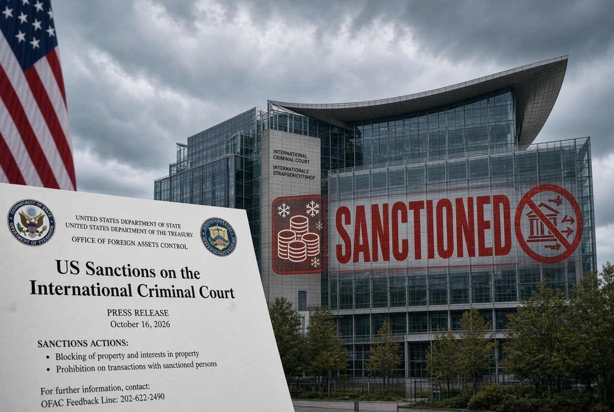

# Sanksi AS terhadap ICC: Hukum untuk Semua, Kecuali yang Terlalu Kuat?

*Ilustrasi (pic: Grok AI).*

  
***Peristiwa yang mengubah level konflik dari menghukum pejabat menjadi menekan pengadilannya***
  

Pada 9 Oktober 2026, pemerintahan Donald Trump memperluas tekanan terhadap Mahkamah Pidana Internasional atau International Criminal Court (ICC). 

Menteri Luar Negeri Marco Rubio mengumumkan sanksi terhadap ICC sebagai institusi, bukan hanya terhadap pejabat tertentu. Rubio menyebut ICC sebagai “rogue court” dan mengancam: “Either the ICC will end its threats, or we will end the ICC.” 

ICC mengonfirmasi bahwa tindakan AS ini merupakan eskalasi baru setelah sanksi sebelumnya terhadap hakim dan jaksa pengadilan.

Perbedaan ini sangat penting:

| Tahap tekanan | Sasaran | Dampak yang mungkin timbul |
|--------|--------|--------|
|Sanksi individual|Hakim, jaksa, atau pejabat tertentu|Aset, transaksi, dan kegiatan pribadi yang berada dalam cakupan sanksi dapat dibatasi|
|Sanksi institusional|ICC sebagai lembaga|Layanan keuangan, teknologi, pemasok, dan mitra operasional ikut menghadapi risiko|
|Tekanan diplomatik|Negara anggota dan mitra ICC|Negara dapat menghadapi dilema antara mempertahankan kerja sama dengan ICC dan menghindari konflik dengan AS|

Sanksi terhadap institusi mengubah persoalan dari “siapa yang boleh dihukum?” menjadi pertanyaan yang lebih luas: siapa yang boleh terus menjalankan lembaga yang mengadili dugaan kejahatan internasional ketika negara adidaya ingin lembaga itu berhenti?

ICC menyatakan sanksi tersebut mengancam independensi peradilan dan berpotensi mengganggu pelaksanaan mandatnya. Sebaliknya, pemerintah AS mengatakan tindakan itu diperlukan untuk mempertahankan kedaulatan serta melindungi warga negaranya dari yurisdiksi yang tidak diakuinya. 

Itu adalah dua posisi resmi yang bertentangan, dan keduanya perlu dinilai melalui dasar hukum serta dampak konkretnya.

## Dari Satu Perkara Menuju Perubahan Sistem

AS memberikan waktu hingga April 2027 dengan tiga tuntutan utama. Ketiganya perlu dibahas secara terpisah, karena konsekuensi hukumnya berbeda.

1. Surat perintah penangkapan Netanyahu dan Gallant

Pada 21 November 2024, ICC mengeluarkan surat perintah penangkapan bagi Perdana Menteri Israel Benjamin Netanyahu dan mantan Menteri Pertahanan Yoav Gallant dalam perkara dugaan kejahatan perang dan kejahatan terhadap kemanusiaan yang berkaitan dengan Gaza. Surat perintah tersebut bukan putusan bersalah final.

Jika pembatalan surat perintah dijadikan syarat politik untuk menghindari sanksi, persoalan yang muncul bukan sekadar apakah AS boleh menolak yurisdiksi ICC. Persoalannya juga apakah tekanan ekonomi digunakan untuk memengaruhi keputusan dalam perkara yang semestinya ditangani berdasarkan hukum dan bukti.

2. Investigasi terkait personel AS di Afghanistan

AS telah lama menolak kewenangan ICC untuk memeriksa dugaan kejahatan yang melibatkan warga negara, personel militer, atau pejabatnya. 

Salah satu titik konflik adalah investigasi atas dugaan kejahatan di Afghanistan, termasuk dugaan perlakuan buruk terhadap tahanan. Pemerintah AS memandang investigasi itu sebagai pelanggaran kedaulatan. 

Dari sudut akuntabilitas internasional, pertanyaan yang berbeda harus diajukan: apabila terdapat dugaan kejahatan serius dan proses hukum nasional tidak memadai, mekanisme apa yang tersedia untuk memeriksanya?

Perlu dicatat, rincian tuntutan mengenai penutupan seluruh investigasi, termasuk lokasi penjara rahasia CIA, tidak boleh dianggap sebagai satu paket syarat formal yang sudah terverifikasi hanya berdasarkan ringkasan berita. 

Laporan tentang dasar umum sanksi AS memang mengonfirmasi konflik terkait investigasi Afghanistan, tetapi status setiap perkara dan rumusan persis tuntutannya harus diperiksa secara terpisah.

3. Mengubah Statuta Roma agar warga negara nonanggota tidak dapat dituntut

Ini adalah tuntutan yang paling jauh jangkauannya jika benar menjadi bagian dari paket formal tersebut.

ICC tidak memiliki yurisdiksi tanpa batas, tetapi kewenangannya juga tidak ditentukan semata-mata oleh kewarganegaraan tersangka. 

Dalam keadaan tertentu, pengadilan dapat memiliki yurisdiksi atas kejahatan yang dilakukan di wilayah negara pihak, meskipun tersangkanya berasal dari negara yang bukan anggota Statuta Roma.

Perubahan akan menggeser aturan dasar itu. Dampaknya bukan hanya terhadap AS atau Israel, melainkan terhadap kemampuan ICC menangani perkara yang memenuhi dasar yurisdiksi teritorial ketika tersangka berasal dari negara nonanggota.

Mengapa tuntutan ketiga penting? Karena dua tuntutan pertama menyangkut perkara tertentu, sedangkan tuntutan ketiga berpotensi mengubah aturan untuk perkara-perkara selanjutnya.

Secara hukum, negara-negara anggota dapat mengusulkan perubahan Statuta Roma melalui prosedur traktat yang berlaku. Tetapi ada perbedaan mendasar antara mengusulkan reformasi secara sah dan mencoba memperoleh hasil hukum tertentu melalui ancaman ekonomi.

Jika sebuah lembaga diminta mengubah keputusan atau membatasi yurisdiksinya karena tekanan dari negara yang menjadi objek kepentingan dalam perkara, maka independensi peradilan menjadi persoalan utama.

## AS Meminta Keadilan atau Meminta Perlindungan dari Proses Hukum?

AS bukan negara pihak Statuta Roma. Washington menolak kewenangan ICC terhadap warga negaranya dan menganggap sejumlah tindakan pengadilan melampaui batas yurisdiksi. 

Posisi tersebut bukan hal baru, dan kritik terhadap yurisdiksi ICC tidak otomatis salah hanya karena berasal dari negara kuat.

Namun, kritik hukum idealnya diuji melalui argumentasi hukum, proses yang berlaku, dan bukti. Ia berbeda dari tindakan yang mengancam kelangsungan operasional pengadilan jika tuntutan politik tidak dipenuhi.

Perbedaan itu bisa diringkas sebagai berikut:

Keberatan hukum: “Pengadilan tidak memiliki yurisdiksi dalam perkara ini, berdasarkan alasan A, B, dan C.”

Reformasi institusional: “Aturan yurisdiksi perlu diubah melalui prosedur traktat yang sah.”

Tekanan koersif: “Jika pengadilan tidak mengubah perilakunya, aksesnya terhadap layanan penting akan dibatasi.”

Ketiganya tidak identik. Negara dapat menolak yurisdiksi dan mengusulkan reformasi tanpa harus melumpuhkan lembaga yang sedang menjalankan mandat hukum.

Sanksi yang diumumkan AS menimbulkan pertanyaan karena sasaran tindakannya meluas dari pejabat menjadi institusi itu sendiri, sementara alasan yang dikemukakan mencakup investigasi AS dan perkara pemimpin Israel. 

Reuters dan Associated Press melaporkan bahwa langkah ini merupakan eskalasi besar dari kebijakan sebelumnya.

Dengan demikian, kesimpulan yang dapat ditarik dari bukti publik bukanlah bahwa semua keberatan AS tidak sah. Kesimpulan yang lebih presisi adalah bahwa penggunaan sanksi institusional untuk menekan ruang gerak pengadilan menimbulkan persoalan serius tentang independensi peradilan dan konsistensi komitmen terhadap hukum internasional.

## Ekonomi Politik Sanksi: Bagaimana Sebuah Pengadilan Bisa Ditekan Tanpa Didatangi Tentara?

Inilah bagian yang paling menjelaskan mengapa negara kaya mempunyai pengaruh besar.

AS memiliki posisi penting dalam sistem pembayaran internasional, pasar finansial, layanan teknologi, perangkat lunak, dan komputasi awan. 

Ketika pemerintah AS menetapkan suatu entitas sebagai sasaran sanksi, perusahaan yang terhubung dengan yurisdiksi AS dapat menghadapi larangan atau pembatasan transaksi tertentu.

Kementerian Keuangan AS melalui OFAC mengumumkan sejumlah lisensi umum pada 9 Oktober yang mengizinkan jenis transaksi tertentu berkaitan dengan ICC, termasuk beberapa transaksi untuk menjaga operasi, telekomunikasi dan perangkat lunak perusahaan, pembayaran pensiun, serta urusan tertentu terkait tahanan. 

Artinya, dampaknya tidak identik dengan penghentian otomatis setiap layanan pada saat pengumuman.

Namun, mekanisme tekanannya tetap serius, AS memasukkan ICC ke dalam rezim sanksi Bank, penyedia teknologi, dan perusahaan mengevaluasi risiko kepatuhan. Sebagian layanan harus dihentikan, dialihkan, atau mendapat izin khusus

ICC menanggung biaya adaptasi, ketidakpastian, dan risiko operasional. Reuters melaporkan bahwa ICC telah bersiap mengganti sejumlah perangkat lunak dan menata ulang hubungan dengan penyedia layanan. 

Langkah mitigasi seperti ini dapat mengurangi dampak sanksi, tetapi tidak menghapus biaya, keterlambatan, atau ketergantungan yang masih tersisa.

Di sini ada konsep ekonomi politik yang relevan: ketergantungan dapat menjadi sumber kekuasaan. Pihak yang menguasai simpul penting dalam jaringan finansial dan teknologi dapat memengaruhi perilaku pihak lain tanpa harus menguasai wilayahnya.

Tetapi ketergantungan bukan berarti kendali mutlak. ICC dapat mencari penyedia alternatif; negara-negara anggota dapat mengatur bantuan dan perlindungan; perusahaan non-AS dapat mempertimbangkan untuk menggantikan layanan yang hilang. Semua pilihan itu memiliki biaya dan batasnya.

Karena itu, klaim bahwa ICC pasti langsung lumpuh terlalu jauh. Yang didukung bukti adalah bahwa sanksi ini dirancang untuk mengganggu operasi ICC dan meningkatkan risiko bagi pihak yang bekerja sama dengannya.

## Paradoks Donor: Apakah yang Membayar Paling Banyak Berhak Menentukan Hukum?

Kontribusi finansial kepada sebuah institusi tidak otomatis memberikan hak untuk mengendalikan putusan pengadilannya.

ICC dibentuk berdasarkan Statuta Roma dan diberi mandat oleh negara-negara pihak untuk menyelidiki serta mengadili individu atas kejahatan internasional tertentu. ICC menyebut bahwa 125 negara pihak mempercayakan mandat tersebut kepada pengadilan.

Di sini kita perlu membedakan tiga hal:

Pendanaan membiayai operasional institusi.

Kewenangan hukum menentukan ruang lingkup mandat dan prosedur institusi.

Independensi peradilan menuntut agar keputusan perkara dibuat berdasarkan hukum dan bukti, bukan instruksi politik dari pihak yang berkepentingan.

Negara donor dapat menuntut transparansi, audit, efisiensi, dan reformasi yang sah. Tetapi apabila dukungan finansial dipakai untuk memaksa hasil perkara tertentu, maka pendanaan berpotensi berubah dari sarana mendukung institusi menjadi instrumen tekanan terhadapnya.

Itulah sebabnya “dunia milik AS dan Israel” perlu diubah menjadi pertanyaan yang lebih tajam: Apakah negara yang mempunyai pengaruh ekonomi besar dapat menggunakan ketergantungan finansial sistem internasional untuk memperoleh ruang gerak hukum yang lebih luas bagi dirinya atau sekutunya?

Sanksi ini memberikan contoh konkret tentang bagaimana mekanisme tekanan semacam itu dapat bekerja. Tetapi untuk menyimpulkan bahwa seluruh sistem internasional dikendalikan AS dan Israel, kita memerlukan bukti yang jauh lebih luas daripada satu keputusan sanksi.

## Nobel Perdamaian Navi Pillay Membuat Timing-nya Mencolok

Pada 9 Oktober 2026, Komite Nobel Norwegia mengumumkan bahwa Hadiah Nobel Perdamaian diberikan kepada Navanethem “Navi” Pillay atas upayanya mempromosikan perdamaian dan hukum internasional. 

Pillay merupakan ahli hukum Afrika Selatan yang pernah melawan diskriminasi apartheid, menjabat sebagai hakim di pengadilan internasional, dan pernah menjadi Komisaris Tinggi PBB untuk Hak Asasi Manusia. 

Komite Nobel menyatakan bahwa pekerjaannya turut memperkuat tatanan hukum internasional dan upaya penuntutan kejahatan berat.

Beberapa jam kemudian, AS mengumumkan sanksi terhadap ICC. Reuters, Associated Press, dan Al Jazeera melaporkan kedekatan waktu tersebut sebagai bagian penting dari konteks politik peristiwa itu.

Timing tersebut sangat simbolis karena dua peristiwa itu membawa pesan yang berlawanan:

Penghargaan Nobel menekankan nilai hukum internasional dan akuntabilitas.

Sanksi AS menekan institusi yang menjalankan sebagian dari agenda akuntabilitas itu.

Tetapi kita tidak boleh menyimpulkan bahwa keputusan Nobel menyebabkan sanksi AS. 

Pemerintah AS telah lama menentang yurisdiksi ICC, termasuk sebelum 9 Oktober. Bukti yang ada menunjukkan bahwa kedua peristiwa terjadi pada hari yang sama di tengah konflik yang telah berlangsung, bukan bahwa satu peristiwa pasti menyebabkan yang lain.

Pillay juga tidak identik dengan ICC secara keseluruhan. Penghargaan kepadanya merupakan pengakuan atas karier dan kontribusinya terhadap hukum internasional, bukan keputusan yudisial yang mengesahkan setiap tindakan ICC.

Makna politiknya tetap besar, ketika institusi hukum internasional sedang menghadapi tekanan, Nobel untuk seorang ahli hukum yang mengabdikan kariernya pada akuntabilitas memperkuat pesan simbolis tentang pentingnya hukum.

## Belanda dan 125 Negara: Apakah ICC Dapat Bertahan?

ICC tidak mempunyai polisi global yang dapat menangkap tersangka di mana pun tanpa bantuan negara. 

Pelaksanaan surat perintah penangkapan, perlindungan saksi, pengumpulan bukti, serta operasi pengadilan bergantung pada kerja sama negara dan kemampuan operasionalnya.

Belanda, sebagai negara tuan rumah, memiliki peran penting dalam mendukung keberlangsungan pengadilan. 

Pada 9 Oktober, Presiden ICC Tomoko Akane bertemu Raja Willem-Alexander. ICC mengumumkan pertemuan itu pada hari yang sama dengan pengumuman sanksi.

Namun, pertemuan kerajaan adalah sinyal diplomatik, bukan mekanisme yang otomatis membatalkan sanksi. Ketahanan ICC akan bergantung pada dukungan konkret dari pemerintah, negara anggota, penyedia layanan, dan pihak-pihak yang bekerja sama dengan pengadilan.

Pada 10 Oktober, Biro Majelis Negara-Negara Pihak ICC menyatakan penyesalan mendalam atas sanksi terhadap institusi tersebut dan menyerukan agar sanksi dicabut. Biro itu juga menekankan perlunya kerja sama negara pihak untuk mempertahankan mandat pengadilan.

Itulah mengapa angka 125 negara penting. Angka itu menunjukkan luasnya basis perjanjian ICC, tetapi tidak berarti 125 negara otomatis akan mengambil posisi politik yang sama atau mampu menanggung biaya yang sama.

Respons kolektif mereka akan menentukan apakah ICC dapat mengurangi ketergantungan pada layanan yang rentan terhadap sanksi AS. 

Namun, kemampuan mereka tidak sama, sebagian negara memiliki lebih banyak sumber daya keuangan dan teknologi, sedangkan yang lain mungkin lebih rentan terhadap tekanan ekonomi.

## Hukum Internasional Hanya Alat Negara Kuat?

Tidak sesederhana itu, tetapi ada masalah struktural yang nyata.

Hukum internasional tidak bekerja dalam ruang hampa. Institusi internasional membutuhkan negara untuk menyediakan dana, menyerahkan tersangka, berbagi bukti, dan melaksanakan keputusan tertentu. 

Ketika negara kuat menolak kerja sama, lembaga hukum bisa kesulitan menjalankan mandatnya. Namun, itu bukan berarti hukum internasional sama sekali tidak mempunyai kekuatan. Traktat membentuk kewajiban; pengadilan dapat menghasilkan temuan dan putusan; negara dapat memilih untuk bekerja sama; dan tekanan diplomatik dapat menimbulkan biaya reputasi maupun politik.

Persoalan yang diperlihatkan oleh sanksi ini adalah ketidakseimbangan antara kewenangan hukum dan kapasitas untuk mempertahankan operasionalnya.

Negara kuat mempunyai lebih banyak instrumen untuk mengubah biaya yang ditanggung pihak lain. 

ICC mempunyai legitimasi yang berasal dari traktat dan negara-negara pihaknya, tetapi tidak memiliki seluruh alat pemaksaan yang dimiliki negara berdaulat.

Di sinilah paradoks tatanan hukum internasional: aturan menyatakan bahwa pertanggungjawaban pidana harus berlaku berdasarkan hukum, tetapi pelaksanaan aturan itu tetap bergantung pada dukungan politik dan material dari negara.

Sanksi AS terhadap ICC memperlihatkan bagaimana kekuatan finansial dan teknologi dapat digunakan untuk menekan lembaga hukum internasional ketika kewenangannya berbenturan dengan kepentingan negara kuat dan sekutunya.

Tiga hal perlu tetap dipisahkan:

AS memiliki keberatan hukum dan politik terhadap yurisdiksi ICC, terutama terkait warga negaranya dan perkara Israel.

Sanksi institusional yang diumumkan AS menimbulkan risiko nyata terhadap layanan dan operasi ICC.

Klaim bahwa tiga tuntutan merupakan syarat formal yang persis tercantum dalam instrumen sanksi perlu diverifikasi dari dokumen kebijakan yang berlaku. Tidak semua detail dalam ringkasan berita dapat otomatis dianggap sebagai ketentuan hukum resmi.

Jadi, kekuatan ekonomi tidak sama dengan hak hukum, dan dukungan finansial tidak otomatis memberi hak untuk menentukan hasil perkara. 

Sebaliknya, legitimasi hukum pun tidak otomatis menjamin bahwa sebuah institusi mampu bertahan ketika menghadapi tekanan ekonomi.

Pertanyaan yang lebih penting adalah: apakah kritik dan keberatan negara kuat ditempuh melalui prosedur hukum, atau disertai tekanan yang berpotensi membuat lembaga peradilan tidak mampu bekerja?

Itulah ujian yang sesungguhnya bagi prinsip bahwa tidak seorang pun berada di atas hukum. Bukan karena ICC pasti benar dalam setiap perkara, melainkan karena independensi pengadilan hanya bermakna jika keputusan hukum tidak ditentukan oleh pihak yang paling mampu membuat biaya penolakan menjadi mahal. 

  
**Referensi:**

Associated Press. (2026, October 9). US hits International Criminal Court with sweeping sanctions as part of drive to dismantle tribunal.

International Criminal Court. (2026, October 9). The ICC strongly rejects US sanctions against the institution.

International Criminal Court. (2026, October 10). The Bureau of the Assembly of States Parties regrets sanctions against the ICC as an institution.

Nobel Peace Prize. (2026, October 9). Nobel Peace Prize for 2026.

Office of Foreign Assets Control. (2026, October 9). International Criminal Court-related sanctions. U.S. Department of the Treasury.

Reuters. (2026, October 9). US imposes sanctions on ICC hours after former judge wins Nobel Peace Prize.

U.S. Department of State. (2026, October 9). Fact sheet: Imposing sanctions on the International Criminal Court.
