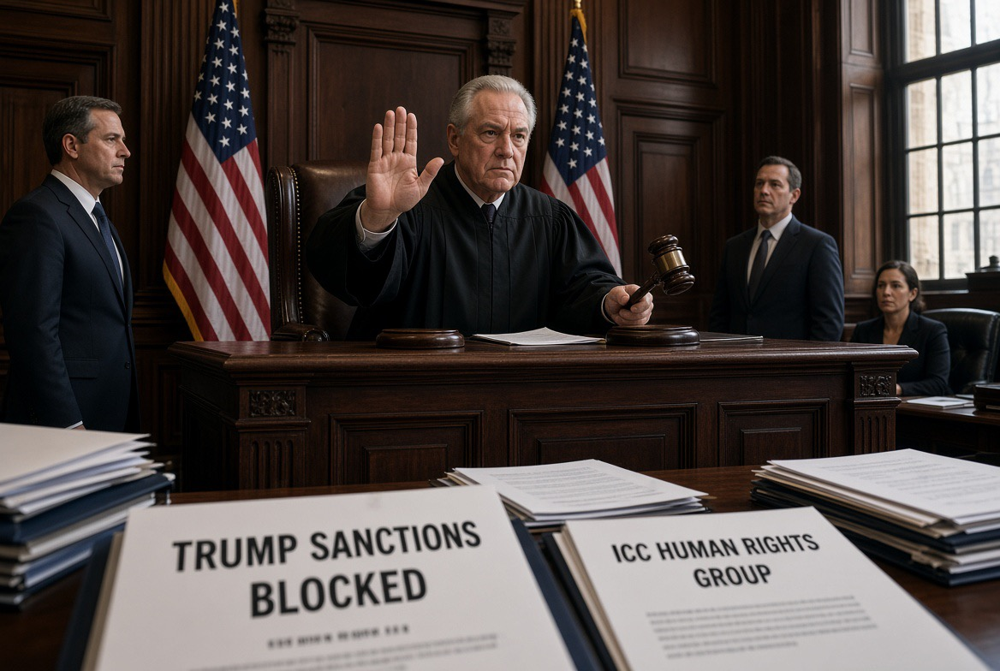

# Sanksi vs Konstitusi: Analisis Hukum Konstitusi AS, Akuntabilitas Internasional, & Politik Rekonstruksi Gaza

*Ilustrasi (pic: Grok AI).*

  
***Di antara keputusan formal dan hasil nyata, selalu ada pertarungan mengenai kewenangan, akses, dan kepatuhan***
  

Putusan Hakim Jesse Furman di Pengadilan U.S. District Court for the Southern District of New York pada 13 Oktober 2026 dalam perkara Democracy for the Arab World Now, Inc. et al. v. Trump et al. menimbulkan pertanyaan: apa sebenarnya yang diblokir?

Dari sumber utama opini dan perintah pengadilan, Dokumen 40, dua organisasi yang menggugat adalah DAWN (Democracy for the Arab World Now) organisasi advokasi hak asasi manusia, dan TAAG (Taxpayer Alliance Against Genocide) organisasi yang menentang penggunaan uang publik untuk mendukung tindakan yang mereka anggap berkaitan dengan genosida.

Mereka menantang pembatasan yang timbul dari perintah eksekutif Trump tahun 2025 tentang sanksi terhadap International Criminal Court (ICC), atau Mahkamah Pidana Internasional. 

Gugatan mereka berpusat pada dampak pembatasan tersebut terhadap kegiatan berbicara, advokasi, dan layanan berbasis komunikasi yang mendukung pekerjaan ICC.

Jadi apa yang diputus hakim? Furman mengabulkan permohonan preliminary injunction dalam bagian substansialnya. 

Pemerintah federal, dengan pengecualian Presiden Trump sebagaimana dirumuskan dalam perintah itu, untuk sementara dilarang menerapkan ketentuan hukuman perdata atau pidana tertentu kepada para penggugat atas kegiatan yang secara khusus dibahas dalam gugatan mereka, sejauh kegiatan tersebut dianggap melanggar larangan pemberian layanan dalam perintah eksekutif.

Ini bukan larangan menyeluruh terhadap semua sanksi ICC. Pemerintah masih memiliki kewenangan tertentu untuk menetapkan sanksi terhadap orang yang ditunjuk dan untuk menindak pemberian dana atau barang dalam kondisi yang dicakup perintah tersebut. 

Pengadilan juga membatasi perlindungan pada kegiatan para penggugat, bukan memberikan kekebalan universal kepada seluruh organisasi atau individu yang membantu ICC.

Itulah detail yang sangat penting: pengadilan membatasi penggunaan kekuasaan eksekutif terhadap kegiatan tertentu, bukan menghapus seluruh kebijakan sanksi Trump.

## Mengapa Furman Menganggap Sanksi itu Bermasalah secara Konstitusional?

Amandemen Pertama Konstitusi Amerika Serikat, First Amendment, melindungi kebebasan berbicara, pers, berkumpul, dan mengajukan petisi kepada pemerintah untuk memperbaiki keluhan. 

Perlindungan ini juga membatasi pemerintah ketika hendak menghukum ekspresi atau advokasi karena isi atau sudut pandang yang disampaikan.

Dalam putusannya, Furman menyimpulkan bahwa perintah eksekutif 2025 tersebut kemungkinan melanggar hak kebebasan berbicara para penggugat, karena mengatur kegiatan berbicara berdasarkan isi pesannya dan gagal memenuhi standar strict scrutiny. (Dokumen pengadilan, 13 Oktober 2026⁠)

Apa itu strict scrutiny?

Dalam hukum konstitusi AS, strict scrutiny merupakan standar pemeriksaan yang sangat ketat untuk kategori pembatasan tertentu terhadap hak konstitusional.

Secara umum, pemerintah harus menunjukkan bahwa:
- Kebijakan tersebut melayani kepentingan negara yang sangat penting (compelling governmental interest).
- Pembatasannya dirancang secara sangat sempit untuk mencapai kepentingan tersebut.
- Tidak ada pembatasan yang lebih luas daripada yang diperlukan untuk mencapai tujuan yang sah itu.
- Pemerintah dapat mengemukakan keamanan nasional sebagai kepentingan yang penting. Namun, menyebut kata keamanan nasional tidak otomatis membuat semua tindakan pemerintah konstitusional.

Masalah yang dipersoalkan pengadilan bukan apakah AS boleh melindungi kepentingan nasionalnya, melainkan apakah pemerintah boleh menghukum organisasi karena kegiatan advokasi dan komunikasi tertentu yang berkaitan dengan ICC. 

Hakim menilai pembatasan berbasis isi komunikasi itu tidak lolos pemeriksaan konstitusional yang ketat.

Ada perbedaan mendasar antara dua hal berikut:

| Pertanyaan | Prinsip hukumnya |
|------|-------|
|Bolehkah pemerintah menjatuhkan sanksi atas transaksi keuangan yang dilarang secara sah?|Bisa, jika memiliki dasar hukum dan memenuhi persyaratan yang berlaku.|
|Bolehkah pemerintah menghukum advokasi atau komunikasi karena isinya mendukung investigasi ICC?|Pembatasan seperti ini menghadapi persoalan serius di bawah First Amendment dan harus memenuhi standar konstitusional yang berlaku.|

Putusan Furman tidak berarti setiap kegiatan yang mengatasnamakan kebebasan berbicara kebal dari hukum. Namun, pemerintah juga tidak dapat begitu saja mengubah kegiatan advokasi menjadi pelanggaran yang dapat dihukum hanya karena tidak menyukai pesan yang disampaikan.

Mengapa keputusan ini belum merupakan putusan final?

Ini penting. Hakim memberikan preliminary injunction, bukan langsung membatalkan seluruh perintah eksekutif.

Putusan tersebut secara eksplisit menolak tiga permintaan yang lebih luas dari penggugat: menyatakan perintah itu inkonstitusional pada seluruh penerapannya, mengeluarkan larangan terhadap Presiden sendiri, dan memberikan perlindungan universal kepada semua orang. 

Pengadilan memerintahkan para pihak membahas langkah selanjutnya, termasuk apakah masih ada persoalan yang perlu diadili.

Jadi, kalimat yang tepat bukan “hakim membatalkan seluruh sanksi Trump terhadap ICC”, melainkan Hakim federal untuk sementara melarang penegakan hukuman tertentu terhadap para penggugat atas kegiatan yang dicakup gugatan, karena pembatasan tersebut kemungkinan melanggar perlindungan kebebasan berbicara dalam First Amendment.

## Hubungannya dengan Surat Perintah Penangkapan Netanyahu dan Gallant

International Criminal Court (ICC) Mahkamah pidana internasional yang berbasis di Den Haag, Belanda mengeluarkan surat perintah penangkapan terhadap Perdana Menteri Israel Benjamin Netanyahu dan mantan Menteri Pertahanan Yoav Gallant pada November 2024. 

Tuduhan yang menjadi dasar surat perintah tersebut berkaitan dengan dugaan kejahatan perang dan kejahatan terhadap kemanusiaan di Gaza. Keduanya menolak tuduhan tersebut. Surat perintah penangkapan bukan putusan bersalah.

Pada Februari 2025, Trump menerbitkan Executive Order 14203 yang memberlakukan sanksi terkait ICC. Kebijakan tersebut menyebut bahwa tindakan ICC terhadap AS dan sekutunya, termasuk Israel, merupakan ancaman terhadap kepentingan dan keamanan nasional AS. Perintah itu juga memungkinkan konsekuensi terhadap pihak-pihak tertentu yang membantu kegiatan ICC.

Ada persoalan yurisdiksi yang sering disalahpahami dalam perdebatan ini. Amerika Serikat dan Israel bukan negara pihak pada Statuta Roma, tetapi hal itu tidak otomatis berarti ICC tidak memiliki yurisdiksi atas setiap dugaan kejahatan yang berkaitan dengan warga negara mereka. 

Palestina merupakan negara pihak pada Statuta Roma, dan yurisdiksi ICC dapat mencakup dugaan kejahatan yang dilakukan di wilayah negara pihak, dengan tetap bergantung pada ketentuan hukum dan fakta perkara. 

Pengadilan AS sendiri mencatat bahwa AS dan Israel bukan negara pihak, sambil menjelaskan kerangka yurisdiksi ICC.

Karena itu, ada dua pertanyaan hukum yang harus dipisahkan:
- Yurisdiksi ICC: apakah pengadilan internasional tersebut memiliki kewenangan hukum untuk menyelidiki dan menuntut dugaan kejahatan tertentu?
- Konstitusionalitas sanksi AS: sejauh mana pemerintah Amerika boleh menghukum warga atau organisasi AS yang berkomunikasi dengan atau membantu ICC?

Putusan Furman terutama membahas pertanyaan kedua. Ia tidak memutuskan bahwa Netanyahu atau Gallant bersalah, dan juga tidak mengadili keseluruhan dasar yurisdiksi ICC.

Paradoks institusionalnya

Di satu sisi, pemerintah AS menyatakan bahwa sanksi diperlukan untuk melindungi kedaulatan dan keamanan nasional. Di sisi lain, pengadilan federal AS menyatakan bahwa pelaksanaan kebijakan itu terhadap kegiatan berbicara para penggugat kemungkinan melanggar hak konstitusional mereka.

Ini bukan berarti pengadilan AS otomatis mendukung semua keputusan ICC. Ini memperlihatkan bahwa bahkan kebijakan luar negeri yang didasarkan pada klaim keamanan nasional tetap dapat diuji berdasarkan konstitusi domestik.

## Israel Menghambat Pembangunan Pangkalan Pasukan Internasional di Gaza

Laporan eksklusif The Guardian pada 14 Oktober 2026 menyatakan bahwa Israel belum mengizinkan pembangunan pos militer yang direncanakan oleh Board of Peace pimpinan Trump di Gaza. 

Kontraktor AS, Arkel International, memperoleh kontrak pada awal Agustus untuk membangun pos yang dirancang menampung sekitar 150 personel internasional. Kontraktor dan truk pengangkut material dilaporkan belum diizinkan memasuki Gaza untuk memulai pekerjaan.

Menurut sumber yang memiliki pengetahuan langsung tentang proyek itu dan dikutip oleh The Guardian, pembangunan pangkalan tersebut merupakan prasyarat penting bagi penempatan International Stabilization Force (ISF), yaitu pasukan stabilisasi internasional yang direncanakan untuk mendukung keamanan dan memungkinkan kegiatan rekonstruksi.

Laporan tersebut juga menyebut bahwa personel dari Maroko dan Kosovo merupakan bagian dari komponen pasukan yang lebih besar. Namun, pihak pemerintah Israel dan militer Israel tidak memberikan komentar kepada The Guardian mengenai laporan tersebut, sementara juru bicara Board of Peace juga menolak berkomentar. 

Karena itu, kita harus menyebutnya sebagai laporan media berdasarkan sumber yang mengetahui proyek, bukan sebagai penjelasan resmi yang telah dikonfirmasi semua pihak.

Apa sebenarnya Board of Peace?

Board of Peace adalah inisiatif internasional yang dibentuk dalam kerangka rencana Trump untuk Gaza setelah gencatan senjata Oktober 2025. 

Dewan ini dirancang untuk mengoordinasikan administrasi transisi, pembiayaan rekonstruksi, dan rencana penempatan pasukan stabilisasi internasional.

Resolusi Dewan Keamanan PBB pada November 2025 menyambut peran dewan tersebut dalam administrasi transisi dan rekonstruksi Gaza serta mengotorisasi ISF untuk misi sementara di Gaza sampai 2027. 

Namun, keberadaan mandat internasional tidak otomatis memberi pasukan akses fisik ke wilayah yang dikendalikan pihak lain. Di sinilah hambatan pembangunan pangkalan menjadi penting.

| Rencana | Hambatan yang dilaporkan | Konsekuensi potensial |
|:-----|:------:|------:|
|Membangun pos bagi pasukan internasional|Akses kontraktor dan material ke Gaza belum diizinkan|Pembangunan fasilitas tertunda|
|Menempatkan ISF|Infrastruktur pendukung dan akses belum tersedia|Penempatan pasukan berisiko tertunda|
|Memulai rekonstruksi|Keamanan, logistik, dan akses konstruksi belum memadai|Proyek pemulihan fisik dapat terus terhambat|

Sumber: The Guardian, 14 Oktober 2026.

Apakah ini berarti Israel menolak perdamaian?

Kesimpulan seperti itu terlalu jauh jika hanya didasarkan pada laporan mengenai satu proyek. Kita perlu membedakan penolakan terhadap pembangunan pangkalan tertentu, keberatan terhadap struktur atau mandat ISF, dan penolakan terhadap seluruh rencana perdamaian.

Namun, implikasi praktisnya cukup jelas: rencana perdamaian yang memerlukan akses ke wilayah, izin perbatasan, dan kerja sama keamanan tidak dapat berjalan hanya karena telah diumumkan atau disetujui secara diplomatik.

Dalam hubungan internasional, ini berkaitan dengan veto power in practice, atau kemampuan aktor yang mengendalikan akses fisik untuk menghambat pelaksanaan suatu kesepakatan tanpa harus secara resmi membatalkannya.

Jika akses pembangunan tetap ditahan, rencana pasukan internasional dan rekonstruksi berisiko tertunda meskipun terdapat dukungan diplomatik dan rencana pembiayaan. 

Laporan The Guardian menyatakan bahwa Board of Peace berharap proyek itu dapat bergerak setelah pemilu Israel yang dijadwalkan pada 27 Oktober 2026, tetapi harapan tersebut belum menjadi jaminan bahwa izin akan diberikan.

## Apa Hubungan Kedua Berita ini?

Sekilas, satu berita membahas pengadilan AS dan satu lagi membahas pangkalan di Gaza. Tetapi keduanya memperlihatkan persoalan yang lebih luas: jarak antara kewenangan formal dan kemampuan nyata untuk melaksanakan suatu keputusan.

1. Di Amerika Serikat: batas konstitusional terhadap kekuasaan eksekutif

Trump memiliki kewenangan eksekutif dan alat kebijakan luar negeri, tetapi penerapannya dapat dibatasi oleh pengadilan ketika bertentangan dengan hak konstitusional. Dalam perkara ini, hakim membatasi penegakan sanksi terhadap kegiatan tertentu para penggugat.

2. Di Gaza: batas praktis terhadap implementasi diplomatik

Board of Peace memiliki rencana, kontrak pembangunan, dan kerangka internasional untuk ISF. Namun, tanpa akses yang diperlukan, proyek fisik tidak dapat bergerak sesuai rencana.

3. Pada tingkat internasional: legitimasi tidak selalu sama dengan kepatuhan

Institusi hukum internasional dapat mengeluarkan surat perintah, negara dapat menjatuhkan sanksi, dan badan internasional dapat mengusulkan pasukan. Akan tetapi, hasil akhirnya bergantung pada kewenangan hukum, kerja sama negara, kemampuan pelaksanaan, dan konsekuensi ketika suatu pihak tidak mematuhi kesepakatan.

Analogi ini bukan berarti pengadilan AS dan Board of Peace mempunyai kedudukan hukum yang sama. Pengadilan federal merupakan lembaga peradilan konstitusional dengan yurisdiksi domestik, sedangkan Board of Peace adalah mekanisme internasional dengan mandat dan kemampuan pelaksanaan yang berbeda.

Namun, keduanya menunjukkan bahwa deklarasi kekuasaan tidak selalu sama dengan kekuasaan yang dapat dijalankan tanpa batas.

Perlindungan konstitusional tetap relevan dalam kebijakan luar negeri. Pemerintah dapat memiliki tujuan keamanan nasional yang sah, tetapi pembatasan terhadap kebebasan berbicara tetap harus memenuhi standar konstitusional. Putusan Furman menyoroti batas tersebut dalam penerapan sanksi terhadap dua organisasi advokasi.

Akuntabilitas internasional tidak hanya bergantung pada pengadilan. ICC membutuhkan kerja sama negara, akses terhadap bukti, dukungan administratif, dan kemampuan untuk melaksanakan proses hukum. 

Sanksi yang menargetkan pihak-pihak yang membantu pengadilan dapat mengganggu fungsi itu, sementara pemerintah yang menjatuhkan sanksi akan mengemukakan kepentingan kedaulatan dan keamanan nasional.

Rekonstruksi Gaza bukan hanya persoalan uang dan bangunan. Ia memerlukan akses, keamanan, izin, tata kelola, dan kesepakatan mengenai kewenangan pasukan internasional serta masa depan politik Palestina. Hambatan pada satu komponen penting dapat menunda seluruh rangkaian proyek.

Dengan demikian, kedua berita ini mengingatkan kita untuk selalu menguji tiga hal secara terpisah: apa yang secara hukum diperbolehkan, apa yang secara politik diinginkan, dan apa yang secara nyata dapat dilaksanakan.

Hukum, diplomasi, dan kekuasaan fisik bekerja melalui mekanisme yang berbeda. Putusan pengadilan dapat membatasi sanksi, tetapi tidak otomatis mengakhiri konflik internasional. Mandat perdamaian dapat disepakati, tetapi tidak otomatis membuka perbatasan atau membangun fasilitas. 

Di antara keputusan formal dan hasil nyata, selalu ada pertarungan mengenai kewenangan, akses, dan kepatuhan. 

 br>
**Referensi**

1. Furman, J. M. (2026, October 13). Democracy for the Arab World Now, Inc. et al. v. Trump et al., Opinion and Order, Document 40, No. 1:26-cv-05957. U.S. District Court for the Southern District of New York.

2. Betts, A. (2026, October 14). Judge blocks US sanctions against 2 human rights groups helping ICC Gaza war crimes inquiry. The Guardian.

3. Roston, A. (2026, October 14). Israel blocks construction of key Gaza base created by Trump peace board. The Guardian.

4. Reuters. (2026, July 30). Explainer: What is US President Donald Trump’s “Board of Peace”? Reuters. 

5. International Criminal Court. (2024, November 21). Situation in the State of Palestine: ICC Pre-Trial Chamber I rejects the State of Israel’s challenges to jurisdiction and issues warrants of arrest for Benjamin Netanyahu and Yoav Gallant. International Criminal Court. 
